# Cryptography Cheat Sheet

Cryptography answers four needs, and each one has its own tool.
This sheet explains the tools first, then shows them working together in TLS, key rotation, and package downloads.

| You want to | Tool | Seen in |
| --- | --- | --- |
| Detect that data changed | [A checksum, hash, MAC, or signature](#detecting-changes-checksums-hashes-macs-and-signatures) | TLS certificates, apt, npm |
| Keep data secret | [Encryption](#encryption-keeping-data-secret) | TLS traffic, files encrypted with a KMS |
| Share a key with a stranger | [Key agreement](#key-agreement-how-two-parties-derive-the-same-secret) | The TLS handshake |
| Know who sent it | [A signature, plus a way to trust the key](#certificate-authorities-and-the-chain-of-trust) | TLS certificates, apt's package index |

All four tools need keys, so the sheet starts there.

## Symmetric and asymmetric cryptography

**A symmetric key is one secret that both sides share. An asymmetric key is a pair: a public key that anyone may have, and a private key that only its owner has.**
The two keys of a pair are mathematically linked, but nobody can work out the private key from the public one.

| | Symmetric | Asymmetric |
| --- | --- | --- |
| Keys | One shared secret | A public key and a private key |
| Who can do what | Whoever has the key can do everything: encrypt and decrypt, create a MAC and check it | The private key signs and decrypts. The public key only verifies and encrypts |
| Speed | Fast enough for any amount of data | Far slower, so it handles only small values, such as a hash or a key |
| Used for | The data itself | Small, important steps: proving identity and setting up a symmetric key |
| Examples | AES-GCM, ChaCha20-Poly1305, HMAC-SHA256 | RSA, ECDSA, Ed25519, ECDHE |

Because asymmetric operations are slow, real systems combine the two: an asymmetric step sets up a symmetric key, and the symmetric key protects the data.

A key pair can do three different jobs:

| Job | How the keys are used | What you get | Example |
| --- | --- | --- | --- |
| [Digital signature](#how-a-digital-signature-works-with-a-tls-certificate) | Sign with the private key. Anyone verifies with the public key | Proof that the key holder signed the data and that nothing changed | A TLS certificate, apt's package index |
| [Key agreement](#key-agreement-how-two-parties-derive-the-same-secret) | Each side combines its own private key with the other side's public key | A shared secret that was never sent | ECDHE in the TLS handshake |
| [Public-key encryption](#getting-the-key-to-the-other-side) | Encrypt with the recipient's public key. Only the recipient's private key decrypts | A message that only the key holder can read | A file encrypted with GPG for one recipient |

Not every key type does every job.
An Ed25519 key, for example, can only sign.

## Detecting changes: checksums, hashes, MACs, and signatures

**A checksum, a hash, a MAC, and a signature all do the same job: a short value travels with the bytes, and the receiver checks it to see whether the bytes changed.**
They differ in the key they need, and therefore in who they can stop.

| Check | Key | Who it stops | Examples |
| --- | --- | --- | --- |
| Checksum, such as CRC-32 | None | Nobody: it only catches accidents | Ethernet frames, TCP segments, Kafka record batches, ZIP files |
| Cryptographic hash, such as SHA-256 | None | An attacker, but only when the expected hash comes from a place they can't change | Download pages, Docker image digests, npm lockfiles |
| MAC, such as HMAC-SHA256 | One shared secret, used to create and to check | Anyone without the secret | Signed cookies, webhook signatures, TLS `Finished` messages |
| Digital signature, such as RSA or ECDSA | A private key to sign, a public key to verify | Anyone without the private key, including those who verify | TLS certificates and `CertificateVerify`, [apt's signed package index](#apt-one-signature-then-a-chain-of-hashes) |

A key is what stops an attacker.
Whoever edits the data can compute a new checksum or hash for it, but not a new MAC or signature.

The first three checks work the same way: the receiver recomputes the value and compares.
That makes a MAC a checksum with a secret key.
A signature is verified with the public key instead, so those who check it cannot create one.

### What checksums are for

A checksum catches corruption from noisy networks, failing disks, and broken downloads.
It is small and fast: a CRC-32 is 4 bytes, and modern CPUs have instructions that speed it up.

- **Networks:** every Ethernet frame carries a CRC-32, and every TCP segment carries a 16-bit checksum.
  A damaged packet is dropped and sent again.
- **Storage:** Kafka stores a CRC-32C with every record batch, and consumers check it.
  ZFS and Btrfs checksum every disk block to catch bit rot, where a disk silently flips bits.
- **Downloads:** a site lists a SHA-256 next to a file, and you compare it with `shasum -a 256 <file>`.
  That only proves the download isn't broken, unless the expected value comes from a trusted place.
  Ubuntu, for example, signs its `SHA256SUMS` file with GPG.
  [Checksums in package downloads](#checksums-in-package-downloads) shows how apt and npm do this.

Each layer's checksum covers only that layer.
TCP checks each packet, but if a bug damages the data before it is sent, TCP delivers the bad data with a valid checksum.
Applications therefore add end-to-end checks, such as the checksum header that S3 compares against the bytes it received.
The DDIA notes make the same points in [chapter 8](../ddia/08-the-trouble-with-distributed-systems.md) and [chapter 12](../ddia/12-the-future-of-data-systems.md).

### How a digital signature works, with a TLS certificate

A TLS certificate is a signed statement: this public key belongs to `example.com`.
A certificate authority (CA) signs it once, and every client that connects checks the signature:

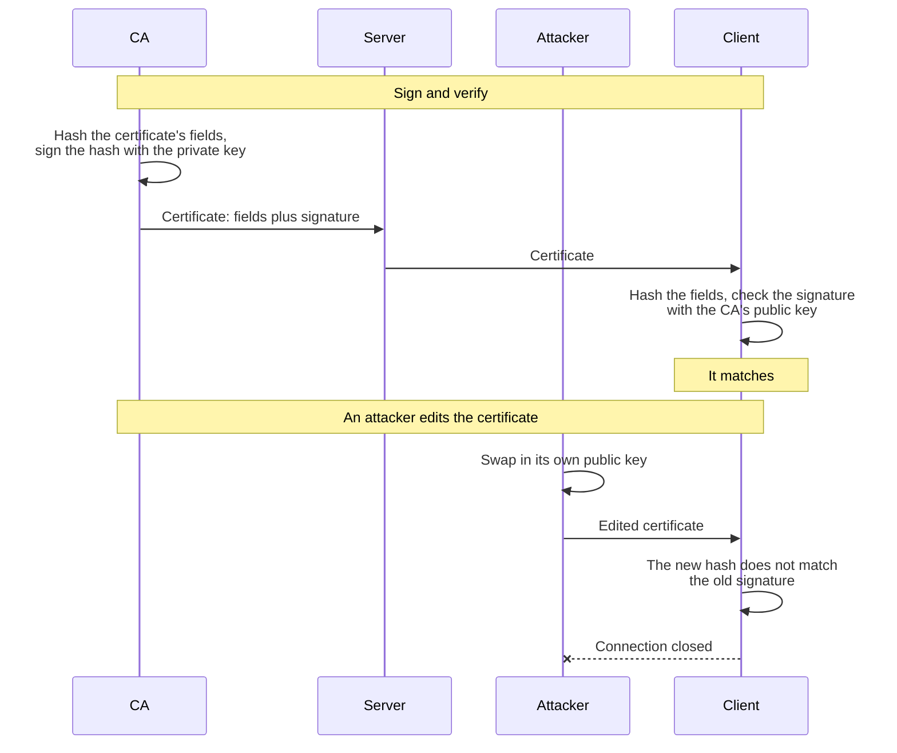

1. **Sign:** the CA hashes the certificate's fields with SHA-256 and signs the hash with its private key.
   The signature becomes the last part of the certificate.
2. **Verify:** the client hashes the fields it received and uses the CA's public key to check that the signature belongs to that hash.
   A match means the fields are unchanged and the CA's key signed them.
3. **Tamper:** an attacker can copy the certificate and swap in their own public key.
   The edit changes the hash, so the old signature no longer matches, and the attacker can't make a new one without the CA's private key.

A signature therefore detects tampering rather than preventing it.
Nothing stops the edit, but the client rejects the edited certificate.

A valid signature proves that the bytes are unchanged and that the holder of the private key signed them.
It leaves three things open:

- **Who owns the key.** The client needs a reason to trust the CA's public key, and [the chain of trust](#certificate-authorities-and-the-chain-of-trust) gives one.
- **Whether the data is still valid.** The verifier also checks an expiry, such as a certificate's validity dates.
- **Secrecy.** A signature does not hide the signed data, and anyone can read a certificate.

TLS checks a second signature in every handshake, as [what the browser verifies](#what-the-browser-verifies) shows.
A signed JWT is checked with the same steps, as [what JWS gives you](distributed-sessions.md#what-jws-gives-you) describes.

### Choosing a check

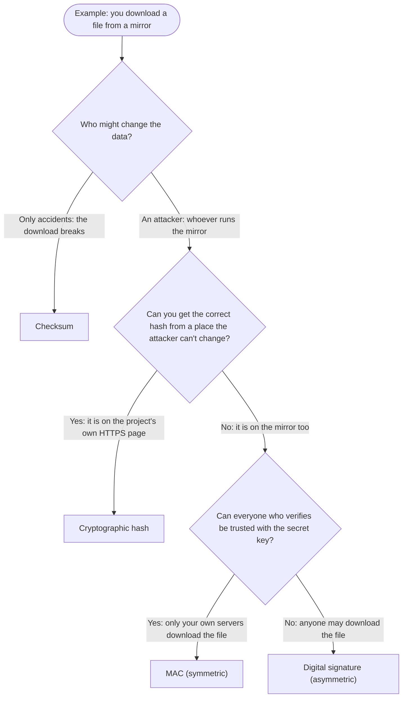

#### Cryptographic hash

A hash has no key, so it only works when the expected hash reaches you by a safe path.
Here the project shows it on its own HTTPS page:

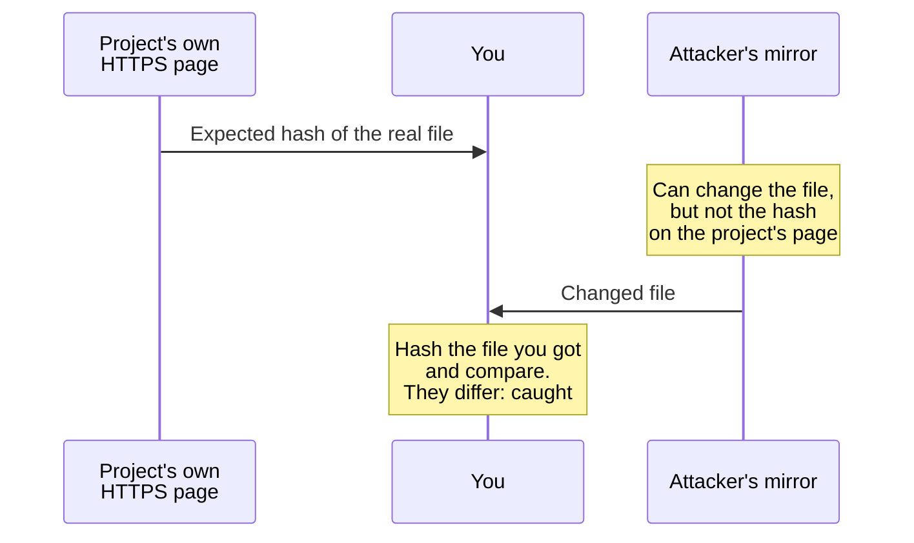

1. **Publish:** the project hashes the file with SHA-256 and shows the hash on its own HTTPS page.
2. **Check:** you hash the file you downloaded and compare the two hashes.
   A match means you have the file that the project hashed.
3. **Tamper:** the attacker changes the file on the mirror.
   They can compute the hash of the changed file, because a hash needs no key, but they can't put it on the project's page.
   The two hashes differ, and you reject the file.

A hash that sits on the mirror protects nothing: the attacker replaces the file and its hash together.

#### MAC

A MAC is symmetric: one secret key creates it and checks it.
Here your build server publishes the file, and only your own app servers download it:

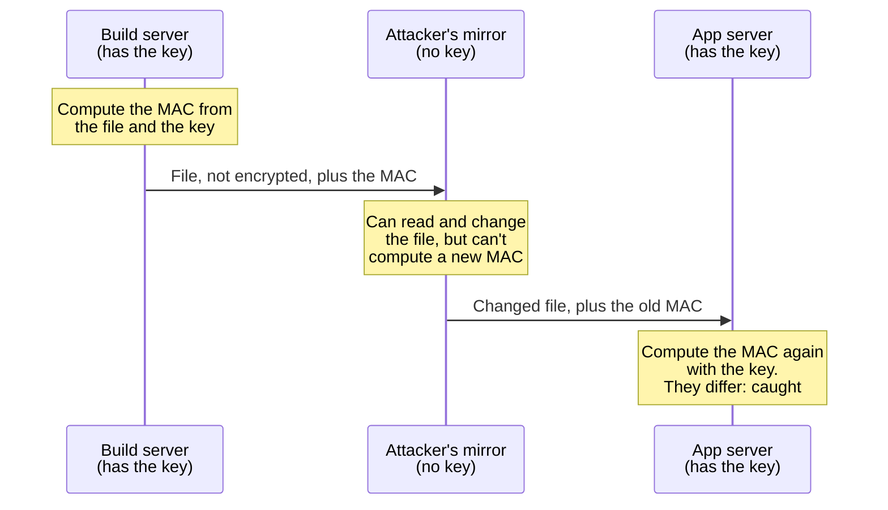

1. **Share the key:** the build server and the app servers get the same secret key in private, such as from a secret store.
2. **Create:** the build server computes the MAC from the file and the key, with HMAC-SHA256, and sends it with the file.
3. **Check:** an app server computes the MAC again, from the file it received and the same key, and compares the two.
   A match means the file is unchanged and came from a key holder.
4. **Tamper:** the attacker can read and change the file, but can't compute the matching MAC without the key.

Whoever can check a MAC can also create one, so the key goes only to machines you trust.

#### Digital signature

A signature is asymmetric: the private key signs, and the public key only verifies.
Here the project signs the file, and anyone may download it:

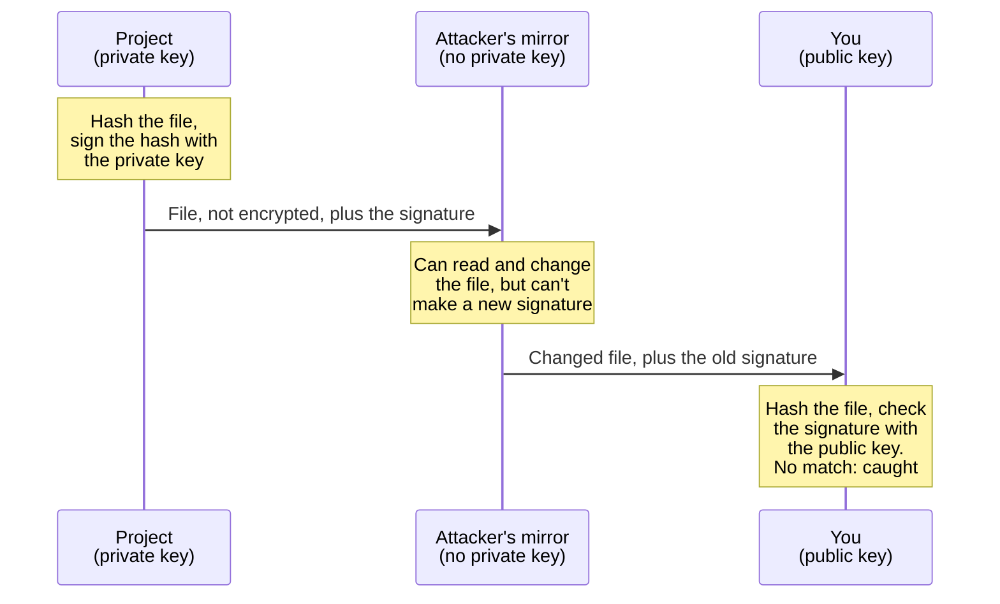

1. **Get the public key:** it is not secret, but it must really be the project's key, so you take it from a source you trust.
   apt, for example, uses [the archive keys that ship with the system](#apt-one-signature-then-a-chain-of-hashes).
2. **Sign:** the project hashes the file and signs the hash with its private key.
   The signature travels with the file.
3. **Verify:** you hash the file you received and use the public key to check that the signature belongs to that hash.
4. **Tamper:** the attacker can change the file and has the public key too, but a new signature needs the private key.

[How a digital signature works](#how-a-digital-signature-works-with-a-tls-certificate) shows the same steps with a TLS certificate.

## Encryption: keeping data secret

**Encryption turns data into ciphertext that only a key holder can read. Modern encryption is authenticated: it also refuses ciphertext that anyone changed.**

AES-256-GCM is the usual choice, and ChaCha20-Poly1305 works the same way.

Where the data is encrypted decides who can still read it:

| Where | Stops | Who can still read the data | Example |
| --- | --- | --- | --- |
| In transit | Anyone watching the network | Both ends of the connection | [TLS](#https-and-tls) |
| At rest | Anyone who gets the disk or a backup without the key | Every service that may use the key | [Envelope encryption](#envelope-encryption-with-a-kms), S3 with SSE-KMS |
| End to end | Everyone in between, including the service that carries the data | Only the sender's and the receiver's devices | Signal and WhatsApp messages |

### Getting the key to the other side

Symmetric encryption is fast, but both sides need the same key first.
There are three ways to get it there.
In each one, a fresh symmetric key encrypts the data, and something else protects that key:

| Way | How | Used by |
| --- | --- | --- |
| Agree on it | Both sides derive the key when they connect, with [key agreement](#key-agreement-how-two-parties-derive-the-same-secret) | TLS |
| Wrap it with a key service | A key management service (KMS) encrypts the data key, and the encrypted copy is stored next to the data | Stored files and database fields, as [envelope encryption](#envelope-encryption-with-a-kms) shows |
| Wrap it with a public key | The sender encrypts the data key with the recipient's public key | Files and email encrypted with GPG |

### Envelope encryption with a KMS

A KMS, such as AWS KMS or Google Cloud KMS, holds a key that never leaves the service.
The application encrypts the data itself, and asks the KMS only to protect the small data key:

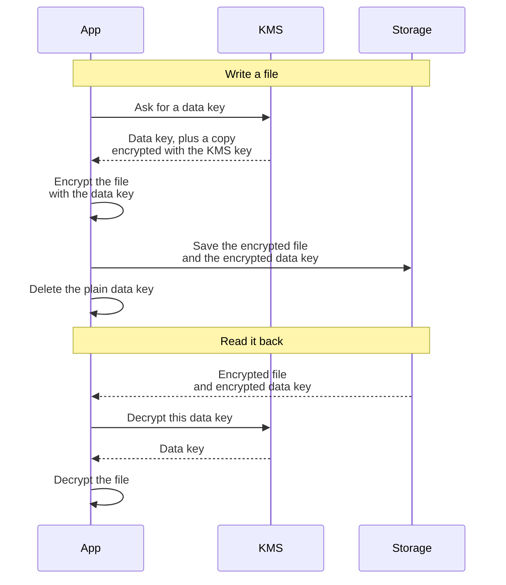

AWS KMS calls the first request `GenerateDataKey`, and Amazon S3 runs these same steps for you when a bucket uses SSE-KMS.

The app doesn't send the file itself to the KMS, for three reasons:

- **Size:** AWS KMS encrypts at most 4,096 bytes per request.
  A data key is 32 bytes, however large the file is.
- **Access control in one place:** someone who can read the storage but may not call the KMS sees only ciphertext, and the KMS logs every use of its key.
- **Cheap rotation:** when the KMS key rotates, the KMS keeps the old versions to decrypt old data keys, so no file is encrypted again.
  The old versions form a [key ring](#key-rings-and-key-rotation).

## Key agreement: how two parties derive the same secret

**Key agreement lets two parties end up with the same secret over a network that anyone can read, without ever sending the secret.**

- **What it is for:** setting up encryption between two sides that have never met, such as a browser and a server.
  The symmetric keys that encrypt the rest of the connection are made from the shared secret.
- **What it protects:** the secret, from anyone who can read the network.
  Each side sends only a public key, then combines the other side's public key with its own private key to get the secret.
  Someone who records every message sees only the two public keys, and can't work out the secret from them.
- **Diffie-Hellman** is the original key agreement method.
  TLS uses a modern form of it, called ECDHE.

Key agreement alone doesn't tell you who is on the other side.
An attacker in the middle could run one key agreement with the client and another with the server, and then read everything.
Certificates and a signature close that gap, as the next section shows.

## HTTPS and TLS

**HTTPS is ordinary HTTP sent through TLS. TLS proves who the server is, keeps the traffic secret, and makes any change to it detectable.**
It puts the building blocks above to work: a hash, a MAC, a signature, encryption, and key agreement, as [the handshake](#a-tls-13-handshake) shows.
TLS has no use for a plain checksum, because its authenticated encryption already detects every change.

- **HTTP versions:** HTTP/1.1 and HTTP/2 run over TLS on TCP.
  HTTP/3 runs over QUIC on UDP, and QUIC uses the TLS 1.3 handshake.
  The [gRPC and HTTP note](grpc.md#http11-http2-and-http3) covers the versions.
- **SSL is the old name.**
  SSL came before TLS and is no longer used, but "SSL certificate" still means a certificate used with TLS.
- **What is protected:** the HTTP path, query, headers, and body, between the two ends of the TLS connection.
  [Where TLS protection ends](#where-tls-protection-ends) lists what is not.

### What a certificate contains

**A certificate is a signed statement: this public key belongs to these names.**
A certificate authority (CA) signs it.
This is the certificate that `example.com` served in November 2026:

| Field | Value | What it tells the client |
| --- | --- | --- |
| Names (Subject Alternative Name) | `example.com`, `*.example.com` | The hostnames, or sometimes IP addresses, that it covers |
| Public key | An ECDSA key on the P-256 curve | The key the server must prove it holds |
| Validity | 26 Sep 2026 to 25 Dec 2026 | It is rejected outside these 90 days |
| Issuer | `Cloudflare TLS Issuing ECC CA 3` | Which CA signed it |
| Signature | ECDSA with SHA-256 | The CA's signature over all the other fields |
| Allowed use | Digital signature, TLS server authentication | What the key may be used for |

- **A certificate is public.**
  It contains no private key, and the server sends it to every client.
- **It covers only its own names.**
  A valid certificate for `shop.example.com` proves nothing about `api.example.com`.

### Certificate authorities and the chain of trust

A **CA** checks that you control a domain and then signs a certificate for it.
That is all an ordinary, domain-validated certificate proves.
It says nothing about whether the site or the business behind it is honest.

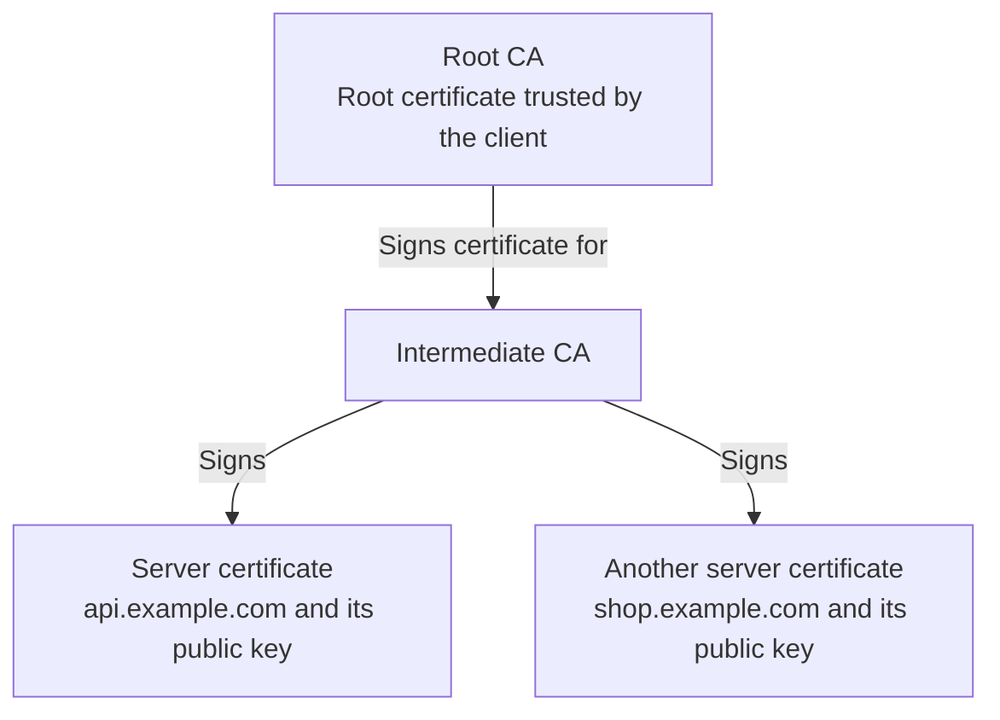

- **The trust store:** every browser and operating system ships with a list of root certificates it trusts.
  macOS ships with about 160.
- **Intermediates:** a root rarely signs server certificates itself.
  It signs an intermediate CA, and the intermediate signs server certificates, so the root's private key can stay offline.
- **What the server sends:** its own certificate and the intermediates, but normally not the root.
  The client follows the signatures upward until it reaches a root it already has.
- **A root signs itself,** which proves nothing.
  It is trusted only because it is in the trust store.
- **Private CAs:** a company can run its own CA for internal services, as long as its machines have that CA's root in their trust store.

#### How a server gets a certificate

1. **Create a key pair** and keep the private key on the server.
2. **Send the CA a certificate signing request (CSR)** with the public key and the hostnames.
   The server signs the request, which proves it holds the private key.
3. **Prove control of the domain** by publishing a token the CA picks, on the website or in a DNS record.
4. **Install the certificate.**
   The CA signs and returns it, and the server is configured with the certificate, the intermediates, and the private key.

- The CA never sees the server's private key.
- Certificates expire after a few months, so servers renew them automatically, usually with the ACME protocol.
- A certificate whose private key leaked is revoked and replaced with one for a new key.

### What the browser verifies

Each of these checks has a public test site at `badssl.com` that fails it on purpose:

| Check | Test site | Chrome shows | curl says |
| --- | --- | --- | --- |
| The chain ends at a root in the trust store | `untrusted-root.badssl.com` | `NET::ERR_CERT_AUTHORITY_INVALID` | `self signed certificate in certificate chain` |
| The hostname is one of the certificate's names | `wrong.host.badssl.com` | `NET::ERR_CERT_COMMON_NAME_INVALID` | `no alternative certificate subject name matches target host name` |
| Today is inside the validity dates | `expired.badssl.com` | `NET::ERR_CERT_DATE_INVALID` | `certificate has expired` |

The client makes two more checks on the certificate:

- **Allowed use and algorithms:** the certificate must be meant for servers, and it must not rely on weak algorithms.
- **Revocation and public logs:** the CA must not have withdrawn the certificate, and browsers also require it to appear in public Certificate Transparency logs.
  Revocation is the weakest check: curl skips it by default, and still accepts the revoked certificate at `revoked.badssl.com`.

Last, the server must prove that it holds the certificate's private key.
So two signatures are checked, with two different keys:

- **The CA signed the certificate.**
  The client checks that signature with the CA's public key, as [how a digital signature works](#how-a-digital-signature-works-with-a-tls-certificate) shows.
- **The server signs the handshake** with its own private key.
  The client checks that signature with the public key in the certificate.

Copying a certificate is therefore not enough to pretend to be its server: the copier can't produce the second signature.
The CA takes no part in the connection.
The client contacts it only for side checks, such as downloading a revocation list.

### A TLS 1.3 handshake

The handshake starts once the TCP connection is open.
This is a full handshake: a resumed connection skips the certificate.

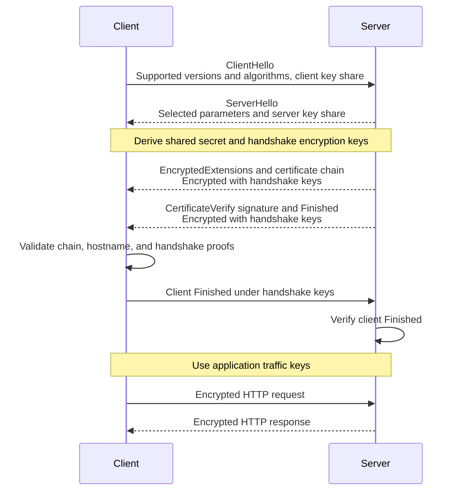

Each part of the handshake is one of the building blocks above:

| TLS needs to | Building block | Where you see it |
| --- | --- | --- |
| Share a secret with a server it has never met | Key agreement | The key shares in the two hello messages |
| Sum up the whole handshake in one short value | A hash | The value that `CertificateVerify` signs and that `Finished` covers |
| Know that the server really is `example.com` | A signature, plus a certificate that says whose key signed | `Certificate`, then `CertificateVerify`, which signs the handshake so far with the certificate's private key |
| Know that nobody changed the handshake | A MAC | `Finished`, which each side sends over the whole handshake |
| Keep the traffic secret and unchanged | Authenticated encryption | Everything after the hello messages, with a separate key for each direction |

- **The certificate's key never encrypts traffic.**
  It only signs the handshake.
- **Forward secrecy:** each connection uses fresh temporary keys and deletes them afterward.
  If the server's private key leaks later, traffic that was recorded earlier still can't be read.

### Where TLS protection ends

- **Metadata:** an observer still sees information such as the destination IP address, the amount of traffic, and its timing.
  It usually sees the hostname too, because the client sends it unencrypted in its first message.
- **TLS termination:** a load balancer that ends the TLS connection can read the HTTP traffic.
  The next hop, from the load balancer to the application, needs its own secure connection.
- **Mutual TLS (mTLS):** normally only the server shows a certificate.
  With mTLS, the client shows one too and proves it holds the private key, which is common between services.
  That tells the server who is calling, not what the caller may do.
- **Application login:** HTTPS does not sign a user in to the application.
  Cookies, sessions, and identity protocols do that, as described in the [OAuth note](oauth.md).

## Key rings and key rotation

**A key ring is a set of keys kept under one name, so a system can switch to a new key without breaking data made with the old one.**
Like a real key ring, it holds many keys, and you pick the one that fits.

- **One key is active.** It signs or encrypts everything new.
- **Older keys stay on the ring** only to verify or decrypt older data.
- **Each signed item names its key** with a key ID, so the verifier picks the right key instead of trying them all.

Rotating a signing key shows all three:

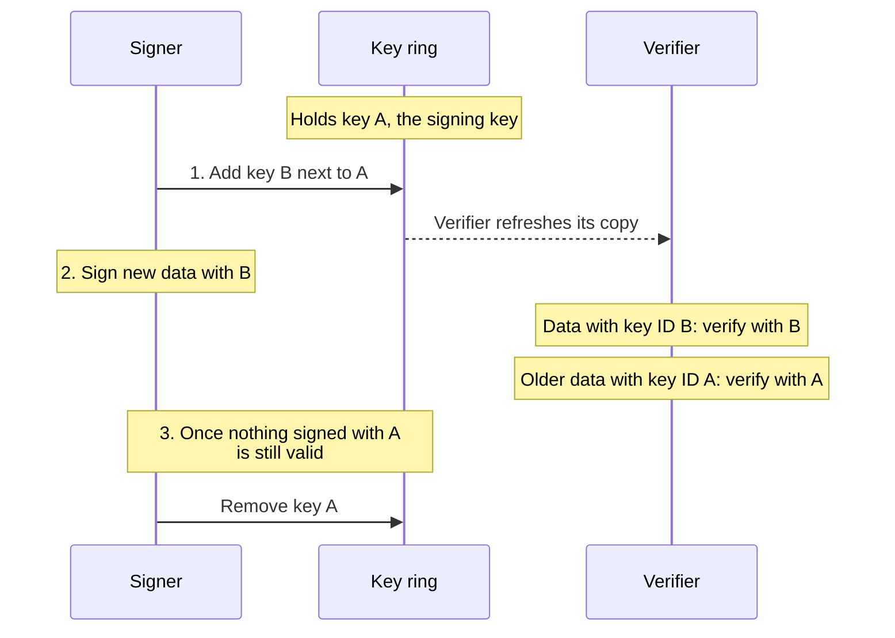

Without a ring, switching keys would at once invalidate everything signed with the old key.
For the key that signs login cookies, that would sign every user out.

Systems that rotate keys this way:

- **Cookie signing:** Django signs with `SECRET_KEY` and still accepts values signed with the older keys listed in `SECRET_KEY_FALLBACKS`.
- **Encryption keys:** a KMS encrypts new data keys with the newest version of its key, and keeps the older versions to decrypt older data keys, as [envelope encryption](#envelope-encryption-with-a-kms) shows.
- **JWT signing keys:** the issuer publishes its ring as a key set, and each token names its key, as [where the verification key comes from](distributed-sessions.md#where-the-verification-key-comes-from) shows.

TLS clients keep no ring of server keys.
Each server sends its certificate, and the client only needs its trusted root certificates.

The term also appears in other places:

| Where | What it means |
| --- | --- |
| GPG and PGP | Your store of keys: your own private keys plus other people's public keys, used to sign and verify commits, email, and packages |
| Operating system keyring | The system's secure store for passwords and tokens, such as macOS Keychain or GNOME Keyring |
| Google Cloud KMS | A named group of keys in one location, used to organize them and control access to them |
| apt | The archive keys a Linux system trusts for package indexes, such as `/usr/share/keyrings/ubuntu-archive-keyring.gpg` |

## Checksums in package downloads

**Package managers check every download against a hash, and they take that hash from a place an attacker can't change.**

| | Ubuntu (apt) | Node.js (npm) |
| --- | --- | --- |
| Hash | SHA-256 for each file | SHA-512 for each package, written `sha512-<base64>` |
| Trusted source of the hash | An index file that Ubuntu signs | The project's committed `package-lock.json` |
| On a mismatch | Stops with `Hash Sum mismatch` | Stops with `EINTEGRITY` |

### apt: one signature, then a chain of hashes

This is how apt checks the curl package from the real Ubuntu 24.04 (noble) archive, starting from the public key in its [key ring](#key-rings-and-key-rotation):

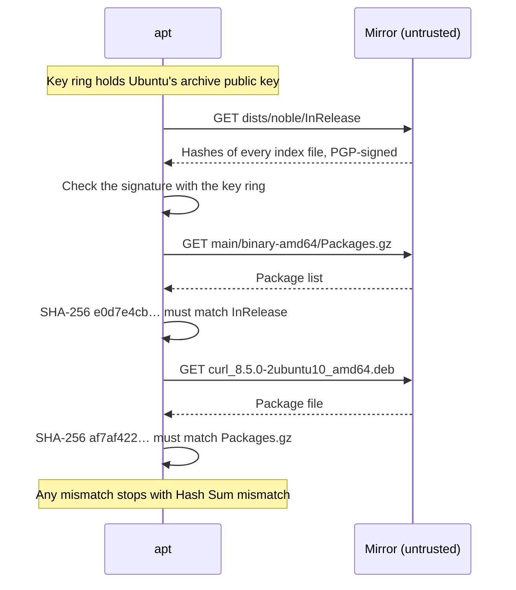

One signature therefore protects tens of thousands of packages, and the `.deb` files themselves are not signed.
Mirrors don't need to be trusted for integrity: a mirror that changes one byte breaks the chain, and apt stops.

### npm: the lockfile pins each hash

A `package-lock.json` entry records where a package came from and its hash:

```json
"node_modules/@types/node": {
  "version": "24.19.2",
  "resolved": "https://registry.npmjs.org/@types/node/-/node-24.19.2.tgz",
  "integrity": "sha512-93d49wCWJkCyN87MxLpNN6KXPCwFw7bVUg79mGUV1OS40JGWwVCr8n61DXCSqz7CV6/VfPkb7xec7uP2M+QHWQ=="
}
```

`integrity` is the SHA-512 of the package tarball, encoded in base64.

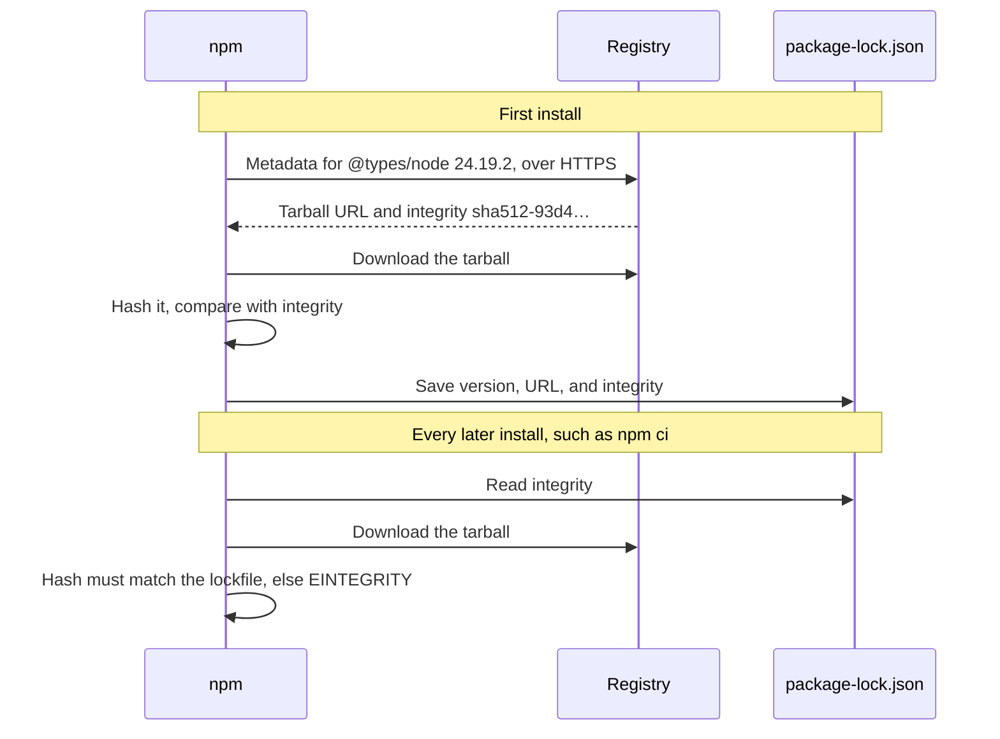

- On the first install, npm takes the hash from the registry over HTTPS and writes it to the lockfile.
- Every later install, such as `npm ci` in a CI job, must receive bytes with exactly that hash.
  Once the lockfile is committed, nobody can quietly swap the tarball, not even a compromised mirror or proxy.
- The registry also signs each version's integrity value with its own key.
  `npm audit signatures` checks those signatures, along with provenance attestations that link a package to its source commit and CI build.

### What checksums can't catch

Checksums and signatures prove that you received the bytes the publisher published, not that those bytes are safe.
In September 2025, attackers phished an npm maintainer and published malicious versions of popular packages such as `chalk` and `debug`.
Every hash matched, because the registry really served those bytes.
A lockfile keeps you on the versions you already have only until you update, so review dependency updates like any other code change.

## Common pitfalls

| Pitfall | Consequence | Fix |
| --- | --- | --- |
| Treating Base64 as encryption | Anyone can decode it: `dXNlcjpwYXNz` is `user:pass` | Encrypt data that must stay secret. |
| Protecting data with a plain hash | Whoever changes the data can also recompute the hash | Use a MAC or a signature, as [choosing a check](#choosing-a-check) shows. |
| Comparing a MAC with `==` | The comparison stops at the first wrong byte, and its timing tells an attacker how many bytes were right | Use a constant-time comparison, such as Python's `hmac.compare_digest`. |
| Storing passwords as SHA-256 hashes | SHA-256 is fast, so a stolen table can be guessed billions of times per second | Use a slow, salted password hash, such as Argon2id or bcrypt. |
| Turning off certificate checks, as `curl -k` and `verify=False` do | Every check in [what the browser verifies](#what-the-browser-verifies) is skipped, so any server is accepted | Add your own CA's root to the trust store. |
| One key forever, written into the code | A leak exposes everything, and replacing the key breaks everything signed or encrypted with it | Keep keys in a KMS or a secret store, and rotate them with a [key ring](#key-rings-and-key-rotation). |
| Inventing your own algorithm or protocol | Subtle flaws stay hidden until someone attacks them | Use TLS and a well-known library, such as libsodium. |
