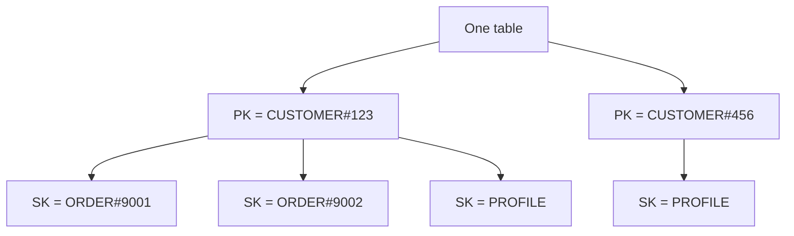
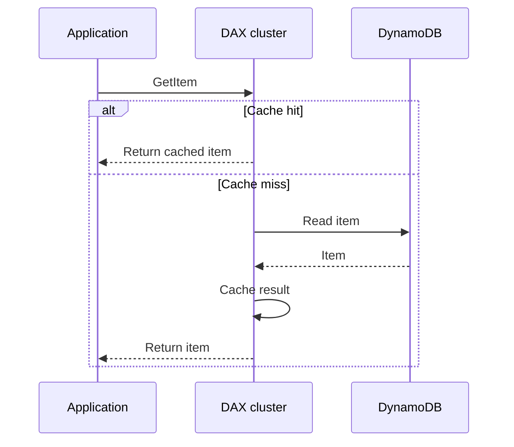
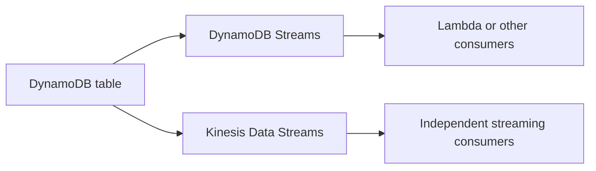
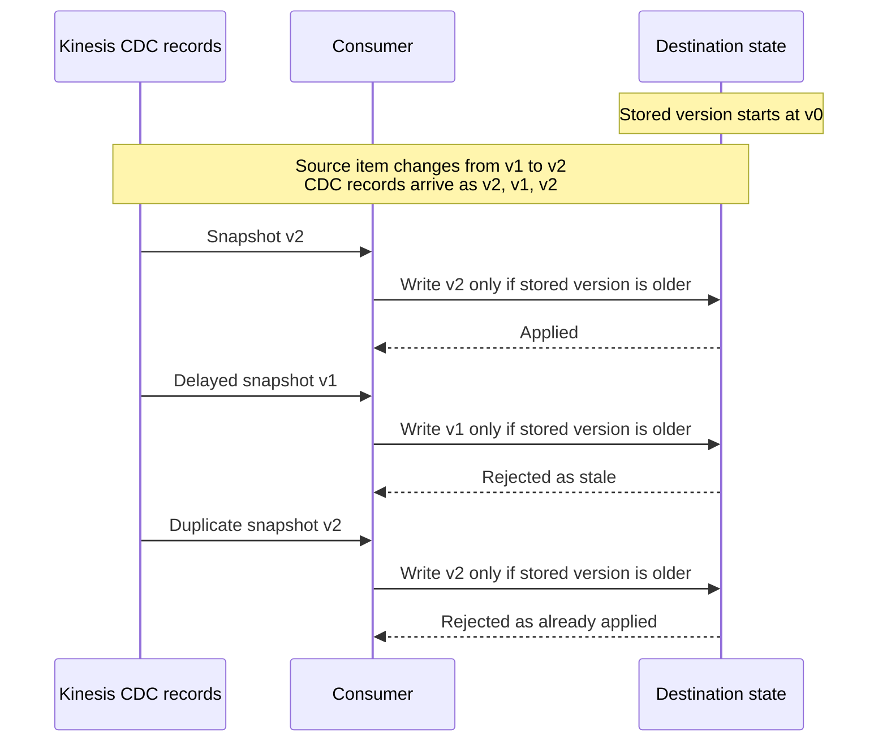

# DynamoDB Cheat Sheet

## DynamoDB fundamentals

### Keys and partitions

- A table contains items, and each item contains attributes.
- Each item is limited to **400 KB**, or **409,600 bytes**, including attribute names and values.
  Strings count by their UTF-8 byte length.
- A primary key is either a partition key alone or a partition key plus a sort key.
  In a composite key, the combination uniquely identifies an item.
  Each key attribute must hold a single string, number, or binary value.
- Items sharing a partition-key value form an **item collection**, ordered by sort key.
  Choose keys around the reads and writes the application needs.

The diagram shows logical item collections, not physical storage partitions.
A physical partition is SSD-backed storage that DynamoDB replicates across several Availability Zones in the Region.
DynamoDB hashes partition keys to place data and manages physical partitions itself.
It adds partitions in the background when a partition fills up or provisioned throughput outgrows the current ones, and the table stays available.
Items with the same partition key are stored in ascending sort-key order, and `Query` returns them in that order by default or in descending order on request.
Without an LSI, an item collection can span physical partitions, as many as its size and traffic need.

A hot key or uneven workload can still cause throttling.
A single partition throttles above 3,000 read capacity units or 1,000 write capacity units per second.
Adaptive capacity helps redistribute throughput, but table and partition limits still apply.
It is on for every table at no extra cost, raises throughput for hot partitions right away, and can move a very hot item onto its own partition.
It does not split item collections on a table that has an LSI.
Separately, burst capacity keeps up to 5 minutes (300 seconds) of unused read and write capacity to absorb short spikes.

### Reads and transactions

- **Eventually consistent reads** are the default and may return older data after a successful write.
  They cost half as much as strongly consistent reads, and repeating the read after a short time should return the newer value.
- For a single-Region table, **strongly consistent reads** reflect writes that completed successfully before the read.
  Request them by setting `ConsistentRead` to true on `GetItem`, `Query`, or `Scan`.
  Tables and LSIs support them; GSIs and streams do not.
- `TransactWriteItems` groups writes atomically within one account and Region.
  `TransactGetItems` reads a group of items atomically.
  Each call holds up to 100 actions on distinct items, at most 4 MB in total, and cannot target the same item twice.
  DynamoDB touches every item twice, once to prepare and once to commit, so each item costs two units, even when the transaction is cancelled.
  A failed condition or a conflict with another in-flight transaction cancels the whole call with `TransactionCanceledException`.
  Ordinary batch operations do not provide the same transaction guarantee: part of a `BatchWriteItem` can succeed while the rest fails.

Read consistency concerns freshness; transactions coordinate a group of operations.
A strong read alone does not protect a later read-modify-write sequence from concurrent changes.

### Local and global secondary indexes

| Property | LSI | GSI |
| --- | --- | --- |
| Keys | Same partition key, different sort key. | Can use a different partition key and sort key. |
| Read consistency | Eventual or strong. | Eventual only. |
| Creation | Defined when creating the table. Cannot be added or deleted later. | Can also be added to or deleted from an existing table. |
| Provisioned capacity | Shares the base table's capacity. | Has separate read and write capacity settings. |
| Item-collection limit | 10 GB for a partition-key value, including base items and all LSI entries. Writes that would grow it further can fail with `ItemCollectionSizeLimitExceededException`. | No equivalent 10 GB item-collection limit. |
| Attributes not projected | Fetched from the base table, with extra latency and read cost. | Not returned. Queries see only projected attributes. |
| Quota per table | 5. | 20 by default. |

Indexes support additional query patterns, but storing and maintaining index entries adds cost.
You choose which attributes to copy, or project, into an index: keys only (`KEYS_ONLY`), selected attributes (`INCLUDE`), or everything (`ALL`).
Each index entry adds 100 bytes of overhead, and a write that changes an index key costs two index writes: one to remove the old entry and one to add the new one.

### Single-table design

Store multiple entity types in one table when the access patterns benefit from querying them together.
For example:

| PK | SK | Entity and example attributes |
| --- | --- | --- |
| `CUSTOMER#123` | `PROFILE` | Customer: `name = Amy` |
| `CUSTOMER#123` | `ORDER#9001` | Order: `total = 40` |
| `CUSTOMER#123` | `ORDER#9002` | Order: `total = 75` |
| `CUSTOMER#456` | `PROFILE` | Customer: `name = Ben` |

- Read one profile with `GetItem` using its complete key.
- Query `PK = CUSTOMER#123` to retrieve that customer's profile and orders, paginating when needed.
- Add a sort-key condition such as `begins_with(SK, 'ORDER#')` to retrieve only orders.

Grouping related entities can reduce requests and enable index reuse, but savings depend on the access patterns.
For example, one eventually consistent query that returns two items totalling under 4 KB costs 0.5 RCU, while two separate queries cost 0.5 RCU each.
The trade-off is more deliberate key design and shared table-level settings.
Shared settings include all-or-nothing backups, a single encryption key and table class, and one change stream that carries every entity type.
Separate tables can be simpler for unrelated access patterns or different backup and operational requirements.

### Capacity and cost

| Mode | How it works | When to consider it |
| --- | --- | --- |
| On-demand | Pay for read and write requests, with throughput managed by DynamoDB. | Variable traffic or limited capacity-planning needs. |
| Provisioned | Configure read and write capacity units, or RCUs and WCUs, and pay for provisioned throughput. | Predictable demand where capacity can be used efficiently. |

On-demand is the default mode and AWS recommends it for most workloads.
Provisioned mode bills hourly for the configured capacity, even when it goes unused.
Compare actual usage and pricing rather than assuming one mode is always cheaper.
Item size, read consistency, transactions, index maintenance, and regional replication affect consumption.
Reads are counted in 4 KB steps: a strongly consistent read costs one read unit, an eventually consistent read half a unit, and a transactional read two units.
Writes are counted in 1 KB steps: a standard write costs one write unit and a transactional write two units.
Attribute names contribute to item size too.

### Global Tables

Global Tables replicate data across Regions so applications can access regional replicas.
**Multi-Region eventual consistency**, or MREC, uses asynchronous replication and last-writer-wins resolution for concurrent updates to the same item.
MREC is the default mode, and changes usually reach the other replicas within a second.
A strong read in one Region does not eliminate replication lag from another Region.
Conditional writes are also checked only against the local Region's copy of the item.

**Multi-Region strong consistency**, or MRSC, is now another option, supporting strong reads across participating Regions with different feature and Region restrictions.
A write returns only after it is copied to at least one other Region, so writes and strong reads are slower than in MREC.
An MRSC table spans exactly three Regions: three replicas, or two replicas plus a witness, which holds data but serves no requests.
A write to an item that another Region is changing at the same time fails with `ReplicatedWriteConflictException` and can be retried.
For example, MRSC does not support transaction operations; MREC transactions are atomic only in their originating Region.
MRSC also does not support TTL, LSIs, or transactions; a `TransactWriteItems` or `TransactGetItems` call on an MRSC replica returns an error.
The mode is set when the global table is created and cannot be changed later.
Choose the mode explicitly and check its supported features.

## DAX: cache reads and diagnose capacity pressure

DynamoDB Accelerator, or DAX, caches data for eventually consistent reads.
The application uses a DAX client to reach the cluster.
This example shows an eventually consistent `GetItem`:

The primary handles write-through operations, and read replicas distribute read load and support failover.
DAX keeps two separate caches: an item cache for `GetItem` and `BatchGetItem`, keyed by primary key, and a query cache for `Query` and `Scan`, keyed by request parameters.
Each cache has its own TTL, 5 minutes by default for the item cache, and evicts least recently used entries when full.
Writes through DAX update DynamoDB and the item cache.
DynamoDB is written first, and if that write fails, nothing is cached.
The primary copies cache changes to the replicas asynchronously, usually in under a second, so two clients can briefly read different values from different nodes.
Writes that bypass DAX can leave cached data stale until expiry.
Cached Query and Scan results have their own expiry and are not refreshed by individual item writes.
DAX also caches "not found" results, which last until expiry, eviction, or a write through DAX.
Strongly consistent reads and `TransactGetItems` pass through to DynamoDB without caching their results.

### Lesson from the support document

In the documented incident, AWS Support associated errors with cache-miss spikes and increased connections while cache-memory utilization was around 94%.
The recommendation was to add read replicas and evaluate larger nodes for memory headroom.
Treat this as an incident diagnosis, not a universal explanation for every DAX error.

| Signal | What to investigate |
| --- | --- |
| Cache hits and misses | Whether the working set is cached and how much traffic reaches DynamoDB. |
| `ClientConnections` | Request volume, connection reuse, and latency keeping connections occupied. |
| `CacheMemoryUtilization` and evictions | Whether the cache needs more memory. Eviction starts before 100%, and rising misses with a growing `EvictedSize` suggest the working set has outgrown the cache. At 100% utilization on a node, DAX throttles writes. |
| `ThrottledRequestCount` | Throttling by DAX, which returns `ThrottlingException` when requests exceed a node's capacity, judged from its CPU utilization; DynamoDB throttling is measured separately. |

Adding replicas increases read throughput; each node maintains a copy of the cached data.
Larger nodes increase cache capacity, so replica count and node size solve different capacity problems.
A cluster holds up to 11 nodes: one primary and up to 10 read replicas.
Changing the node type means creating a new cluster.
For production, AWS recommends at least three nodes in different Availability Zones, because one- and two-node clusters are not fault-tolerant.

## Change data capture: DynamoDB Streams or Kinesis

DynamoDB Streams is the built-in change log for a table.
Kinesis Data Streams for DynamoDB publishes table changes into a separate Kinesis stream.
You can enable either or both on the same table.

| Difference | DynamoDB Streams | DynamoDB to Kinesis |
| --- | --- | --- |
| Retention | Fixed at 24 hours. | Defaults to 24 hours, configurable up to 365 days (8,760 hours). Retention above 24 hours costs extra. |
| Order for the same item | Preserves the order of item modifications. | Changes can appear out of mutation order. |
| Duplicates in the stream | Each change record appears once. | Duplicate change records can appear. |
| Multiple readers | Up to 2 simultaneous consumers per shard. | Up to 5 simultaneous consumers per shard, or up to 20 with enhanced fan-out. |
| Capacity management | No separate Kinesis stream to provision, but subject to DynamoDB Streams throughput quotas per table and Region. | Choose on-demand or provisioned Kinesis capacity and configure retention. |

For an item changing from `v1` to `v2`, DynamoDB Streams records those changes as `v1, v2`; Kinesis CDC could contain `v2, v1, v2`.
Per-item ordering does not provide a total order across the whole table.

**A record appearing once does not mean the consumer processes it once.**
For example, Lambda processes DynamoDB Streams events at least once and can retry records after failures.
Unless the function reports partial batch failures, one failed record can cause records that already succeeded in the same batch to run again.
Both approaches need idempotent consumers.

DynamoDB Streams is a straightforward option for reacting to table changes.
Consider Kinesis when longer replay history or more independent consumers justify the additional stream configuration.

### Handling DynamoDB changes through Kinesis

DynamoDB can publish item changes to Kinesis Data Streams with the item key, change timestamp, and applicable before/after images.
Delivery is asynchronous, and records can be duplicated or appear out of mutation order, including changes to the same item.
A table can stream to only one Kinesis data stream, in the same account and Region.
DynamoDB bills this in change data capture units: each 1 KB of change to an item, sized by the larger of its before and after images, is one unit.

- Use `ApproximateCreationDateTime` as ordering metadata.
  Its finite precision means it should not be treated as a guaranteed unique event ID.
  It is in milliseconds by default and can be switched to microseconds.
- Handle duplicate delivery and prevent older snapshots from overwriting newer state.
- Treat `LATEST` as a starting position just after a shard's current newest record.
  It skips earlier records and does not establish ordering across shards.
  `TRIM_HORIZON` starts from the oldest record still retained, and `AT_TIMESTAMP` or a sequence number resumes from a known point.

This example maintains a latest-state copy and assumes the application assigns a strictly increasing version to each change of an item.
The version check and destination write happen atomically.

This replacement-state approach is not sufficient when every intermediate event must produce an effect.
Those consumers need event-level deduplication and any ordering their business logic requires.

For unpredictable CDC traffic, the support document recommends Kinesis on-demand capacity.
For predictable traffic, provisioned mode requires sizing shards for the record volume and payload size.
Size them from three inputs: peak writes per second (TTL deletes included), average record size, and the share of updates and overwrites, whose records carry both the old and new images.
This estimate covers only the CDC writes, not shards added for extra consumers.
DynamoDB capacity and Kinesis capacity are separate choices.

If Kinesis throttles the CDC writes (`ThrottledPutRecordCount`), DynamoDB retries them, which raises replication latency.
If the oldest unreplicated change (`AgeOfOldestUnreplicatedRecord`) becomes older than 168 hours, DynamoDB turns off replication to Kinesis.
Change records larger than the stream's maximum record size, 1 MB by default and up to 10 MB, are skipped (`FailedToReplicateRecordCount`), and replication continues with later records.
