# gRPC and HTTP/2 Cheat Sheet

## What gRPC adds

gRPC lets a client call methods on a remote service using a defined contract, usually written with Protocol Buffers.
Generated client stubs handle message serialization and the call protocol.
The examples below use HTTP/2 as the transport.
A remote call can fail or time out even after the server has performed the requested work.

### gRPC versus REST

Both are ways to build an API on top of HTTP.
REST, as most APIs use the word, puts a resource at each URL and acts on it with HTTP's own methods and status codes, usually with JSON bodies.
gRPC exposes methods to call, and uses HTTP/2 only to carry the calls.
Every call is a `POST` that a gRPC server answers with `200`; the call's own status follows in `grpc-status`.

The example reads user 150, who exists, and user 999, who does not, with the `GetUser` method [defined below](#how-protobuf-works).

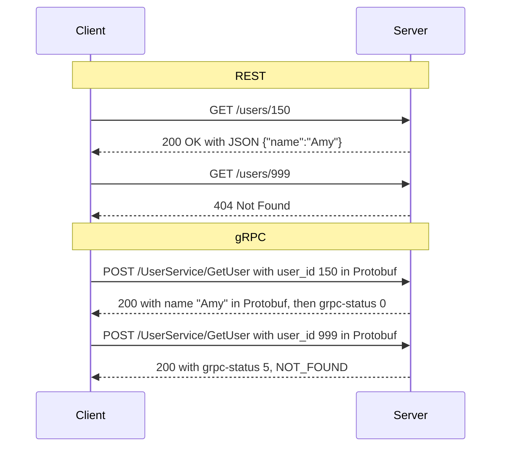

The `200` only says that a gRPC server answered: a tool that watches HTTP status codes counts a failed call as a success.
gRPC sends its status after the messages, so a streaming call can report how it ended.

| | REST | gRPC |
| --- | --- | --- |
| Contract | Optional, such as an OpenAPI document. | Required, usually a `.proto` file; client and server code is generated from it. |
| Messages | Usually JSON, which a person can read: `{"name":"Amy"}` is 14 bytes. | Usually Protobuf, which is binary and needs the schema to read: the same reply is [5 bytes](#encoding-the-string-amy). |
| Streaming | One request, one response; a series of events needs an add-on such as server-sent events. | Built in: the client, the server, or both can send a series of messages in one call. |
| Deadlines | Not built in; each client picks its own timeout. | Built in: the client's [deadline](#deadlines-and-retries) travels with the call. |
| Caching | Browsers and CDNs can cache `GET` responses. | Rarely cached, because every call is a `POST`. |
| Browsers | A page calls it with `fetch`. | A page cannot call it directly; it needs gRPC-Web, usually through a proxy. |
| Good fit | Public APIs, browser clients, and reads that can be cached. | Calls between your own services, streaming, and many languages sharing one contract. |

## How Protobuf works

Protocol Buffers, or Protobuf, defines structured messages and encodes them as binary data.
In a `.proto` file, describe the request, response, and service methods:

```proto
syntax = "proto3";

message GetUserRequest {
  int64 user_id = 1; // Field number, not a default value.
}

message GetUserResponse {
  string name = 1;
}

service UserService {
  rpc GetUser(GetUserRequest) returns (GetUserResponse);
}
```

Run the Protobuf compiler, `protoc`, with the language's gRPC plugin during the build.
It generates message types with serialization and parsing support, plus gRPC client stubs and server bindings.
You implement the server method's business logic.
Client and server can use different languages as long as their message definitions are compatible.

### What goes over the network

Field numbers identify fields within each message.
The binary payload contains field numbers, wire types, and encoded values; the receiver uses its message definition to interpret them.
Field names and the full `.proto` schema are not sent with every message.

#### Field tags

Each encoded field starts with a tag combining its field number and wire type:

```text
tag = (field_number << 3) | wire_type
```

The lowest three bits identify the wire type; the remaining bits identify the field number.
The tag itself is encoded as a variable-length integer, or **varint**.

| Wire type | Encoding used in these examples |
| --- | --- |
| `0` | Varint, used by `int64 user_id`. |
| `2` | Byte length followed by payload, used by `string name`. |

#### Encoding the integer 150

For `GetUserRequest` with `user_id = 150`:

1. Field 1 with wire type 0 gives `(1 << 3) | 0 = 8`, or hexadecimal `08`.
2. Split 150 into seven-bit groups, sending the least-significant group first.
   Each byte's highest bit is `1` when another byte follows and `0` for the final byte.

   | Hex byte | Continuation bit | Seven data bits | Contribution |
   | --- | --- | --- | --- |
   | `96` | `1` | `0010110` = 22 | 22 |
   | `01` | `0` | `0000001` = 1 | 1 × 128 |

3. Decoding gives `22 + 1 × 128 = 150`.

```text
tag         value
08          96 01
```

Small nonnegative integers need fewer bytes than large ones.

#### Encoding the string Amy

For `GetUserResponse` with `name = "Amy"`, field 1 uses wire type 2.
The length is a varint counting UTF-8 bytes, not characters.

```text
tag   length   UTF-8 payload
0A    03       41 6D 79
```

Here, `(1 << 3) | 2 = 10`, or hexadecimal `0A`.
The complete response payload is `0A 03 41 6D 79`.
The receiver uses the schema to interpret field 1 as `name` and the payload as a string.

The wire type also lets a parser skip an unknown field, which helps older readers handle newly added fields.

gRPC adds its own message framing and carries the payload over HTTP/2.

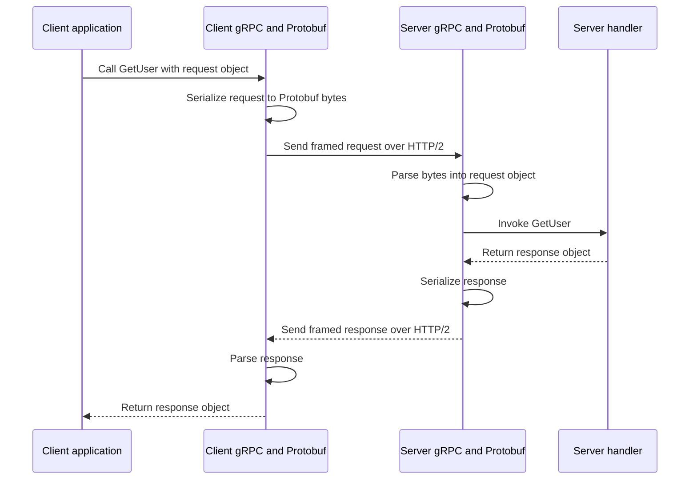

### Changing the schema safely

- Keep existing field numbers stable, and reserve the numbers of deleted fields so they cannot be reused.
- New fields need new numbers.
  Older binary readers can skip unknown fields, while newer readers must handle fields absent from older messages.
- Check compatibility before changing field types or meanings.
  Successful parsing alone does not prove that old and new applications interpret the data the same way.

## HTTP/1.1, HTTP/2, and HTTP/3

The HTTP/1.1 and HTTP/2 examples below use one already-established TCP connection and two independent read requests: A is slow, and B is fast.
The pipelining and multiplexing examples assume the server can process both requests concurrently.

### HTTP/1.1 without pipelining

HTTP/1.1 supports persistent TCP connections by default; a new connection is not required for every request.
The client waits for response A to finish before sending request B.
The connection is reused, but the requests do not overlap.

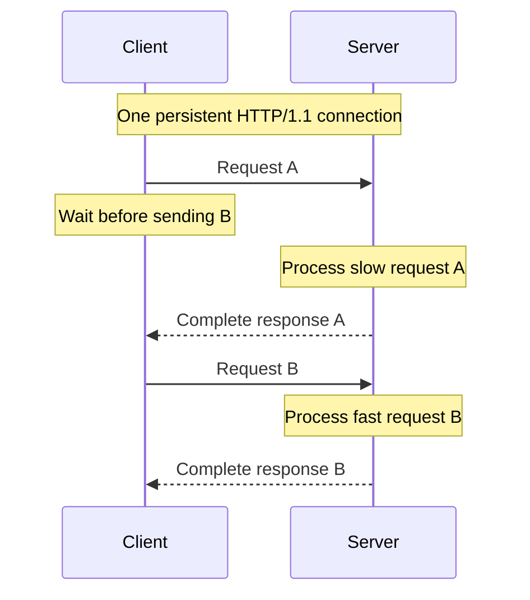

### HTTP/1.1 with pipelining

The client sends B on the same connection without waiting for response A.
The server must send the responses in request order.
Even if B is ready first, its response waits behind A: this is HTTP-level head-of-line blocking.

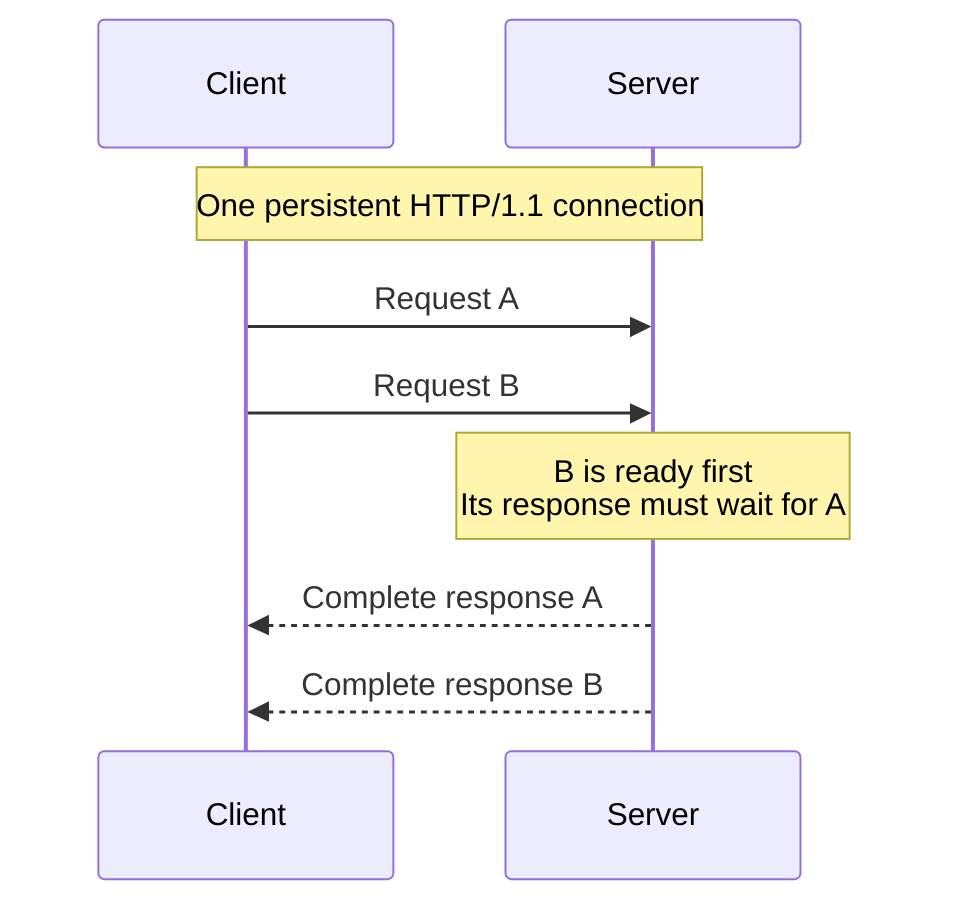

### HTTP/2 multiplexing

Requests use separate streams on the same TCP connection.
HTTP/2 splits message data into frames tagged with stream IDs, so response frames from different streams can be interleaved.
B's response can arrive before A's response finishes.

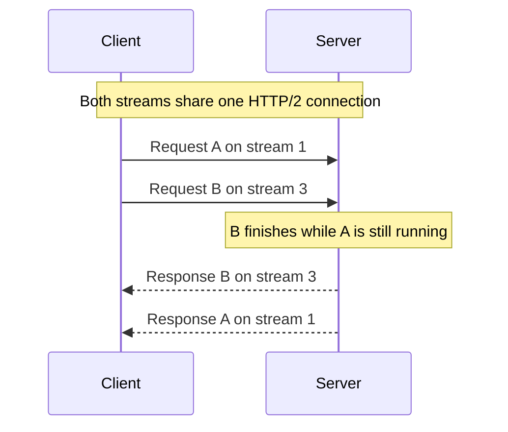

TCP still delivers bytes in order, so a missing TCP segment can delay data for multiple HTTP/2 streams until it is recovered.
HPACK reduces header size by using compact representations of header names and values, including entries reused within a connection.

For HTTPS, TLS negotiates HTTP/2 using ALPN and the `h2` identifier.
ALPN is a TLS handshake extension that lets the client and server agree on the application protocol.
HTTP/2 also supports cleartext TCP when the peers already know to use HTTP/2; certificates are therefore not inherent to the protocol itself.

WebSockets remain a separate protocol; see [HTTP/2 versus WebSockets](#http2-versus-websockets).

### HTTP/3 and QUIC

HTTP/3 multiplexes streams over QUIC rather than TCP.
QUIC runs over UDP and provides reliable delivery and ordering separately for each stream.

The following examples lose data belonging only to stream A, while data for stream B arrives successfully.
Assume the headers and control information needed to interpret both streams are already available.

#### HTTP/2 over TCP: B waits for A's missing bytes

TCP presents one ordered byte stream to HTTP/2 and does not understand HTTP/2 stream IDs.
Later bytes for B must wait behind the missing earlier bytes, even though B's data arrived intact.

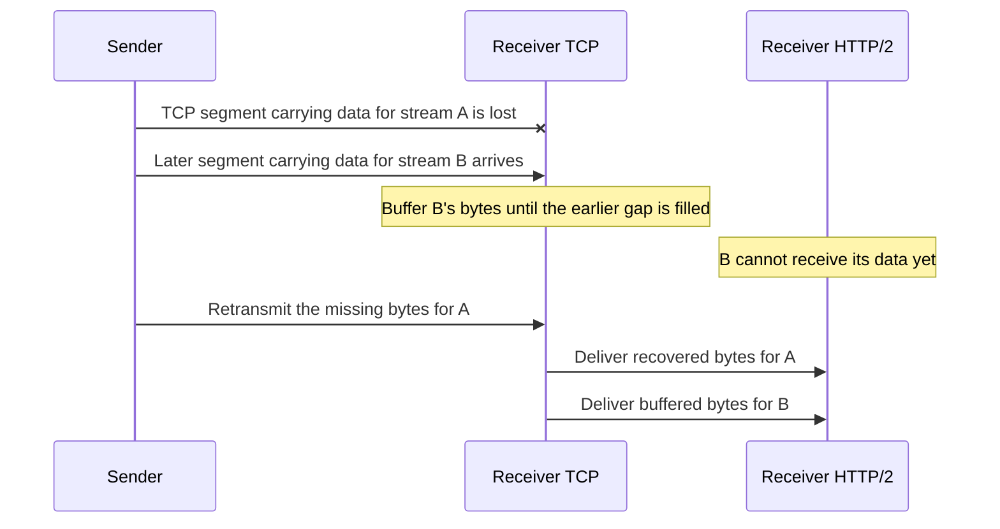

#### HTTP/3 over QUIC: B continues while A recovers

QUIC identifies each stream's data by its stream ID and byte offset.
It can deliver B's available data while recovering the missing data for A.

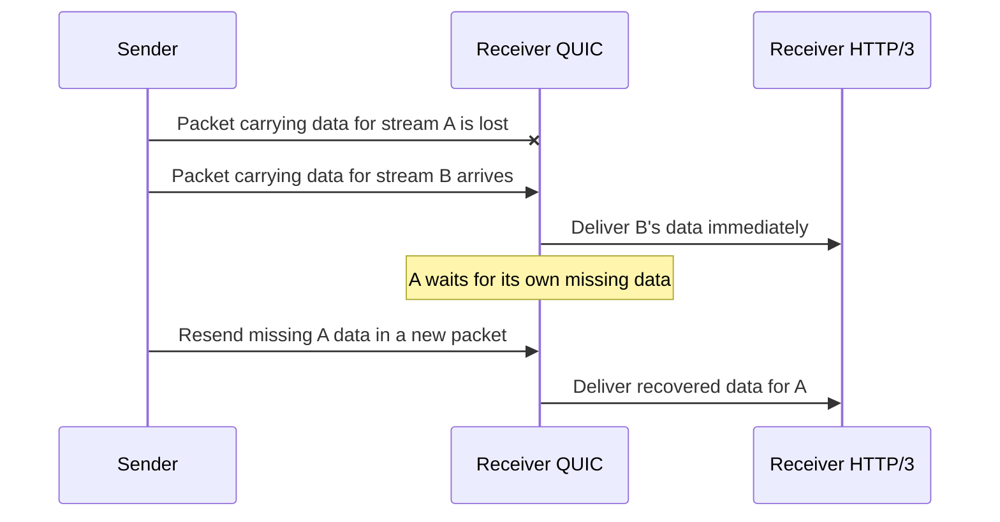

The improvement is removing transport-level head-of-line blocking between unaffected streams.
Ordering within each stream is still preserved.
Streams still share bandwidth and congestion control, and losing a packet containing data for several streams can delay all of those streams.

## Stubs, channels, connections, and streams

| Term | Role |
| --- | --- |
| Stub | Client methods corresponding to the service contract. |
| Channel | A reusable client object for a target, managing connections and routing calls. |
| Connection | A transport connection carrying HTTP/2 frames. |
| Stream | A bidirectional exchange within a connection, used by one RPC attempt. |

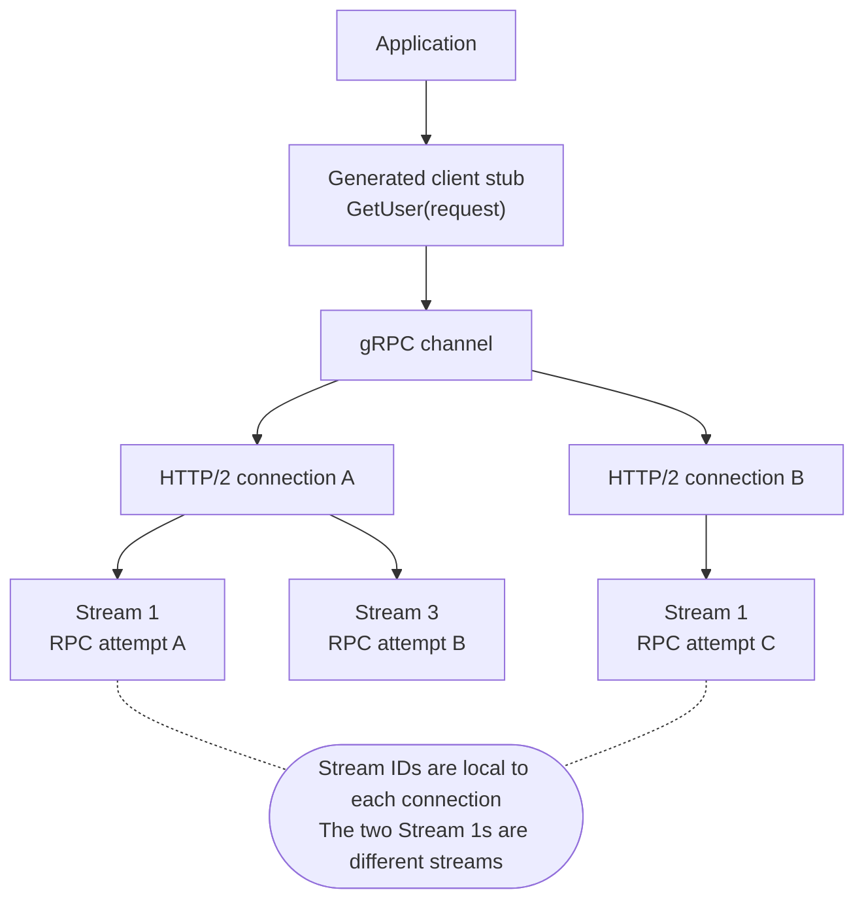

The application calls a stub method, and the stub uses the channel to make the RPC.
Multiple stubs can share the same channel.
The diagram is illustrative: a channel can have zero or more connections depending on its state and configuration.
Stream IDs belong to individual connections.
A retry can create a new stream for another attempt at the same RPC.

- Reuse channels and stubs instead of creating them for every call.
- Each connection has a concurrent-stream limit; additional calls may queue when it is reached.
- If measurements show contention from heavy traffic or long-lived calls, consider separate channels for those workloads.
- A blocking call waits on its calling thread; it does not limit the entire channel to one active call.
  Asynchronous APIs allow calls to proceed without tying up one waiting thread per call.

## Deadlines and retries

Set a realistic client deadline and carry the remaining time budget into downstream calls.
By default, gRPC does not set a deadline.
Server code must stop unnecessary work when cancellation is observed.

| Status | What to consider |
| --- | --- |
| `UNAVAILABLE` | The failing call may be retryable, provided repeating it is safe and time remains. |
| `ABORTED` | Retry the higher-level operation when required, such as restarting a read-modify-write sequence. |
| `DEADLINE_EXCEEDED` | The client ran out of time. The server may already have completed the operation, so a retry can repeat its effect. |

Configure retryable statuses, attempt limits, and backoff according to the operation.
Keep retries within the overall deadline, and make repeated effects safe through idempotency where needed.
Without an explicit retry policy, gRPC only retries certain low-level failures transparently.

## Keepalive and observability

gRPC keepalive uses HTTP/2 PING frames to check an existing connection.
This differs from HTTP/1.1 connection reuse, also commonly called keep-alive.
Coordinate settings with the server and proxies: excessive pings can cause the server to close the connection with `GOAWAY` and `too_many_pings`.
A responsive connection does not prove that the service can complete business requests.

Useful signals to monitor:

- Active RPC counts, to see how much work is in flight.
- Request counts by gRPC status, to distinguish successful calls from specific failures.
- TCP connection counts, to detect churn or unexpected connection growth.

Compare these signals with call latency and deployment timing when investigating failures.
For proxy behavior and draining during deployments, see the [Kubernetes cheat sheet](k8s.md#graceful-shutdown).

## HTTP/2 versus WebSockets

HTTP/2 changes how HTTP is carried, not how it works: the client sends a request, and the server answers it.
WebSocket is a separate protocol: after one HTTP handshake, either side can send a message at any time.

The examples below use a chat page where Alice sends messages and receives Bob's.

### HTTP/2: the client opens every stream

To receive messages as they happen, the client leaves one request open, and the server keeps adding to its response.
Each message Alice sends is a separate request on its own stream.

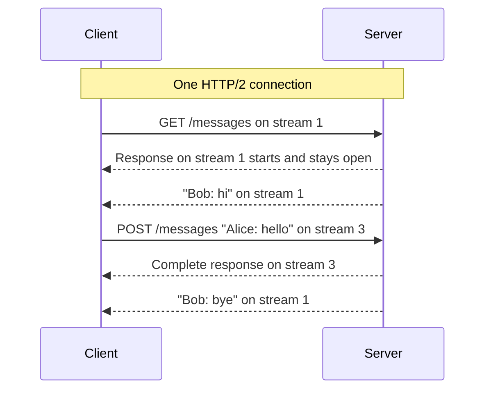

- In a browser, the open response is usually a server-sent events (SSE) stream, read with `EventSource`.
  Over HTTP/1.1, each open response uses up one of the six connections a browser allows per domain; over HTTP/2, it is one more stream on the shared connection.
- Between services, gRPC streaming calls use the same streams.
  In a bidirectional streaming call, the request stays open too, so both sides send messages on one stream.
  A browser hands a page the response only after the request is fully sent, so gRPC-Web offers server streaming but not bidirectional streaming.
- HTTP/2 server push was the one case where the server opened a stream, and it is not a way to send messages.
  It sent a resource, such as a stylesheet, before the browser requested it, and browsers have since turned it off.

### WebSocket: one handshake, then either side sends

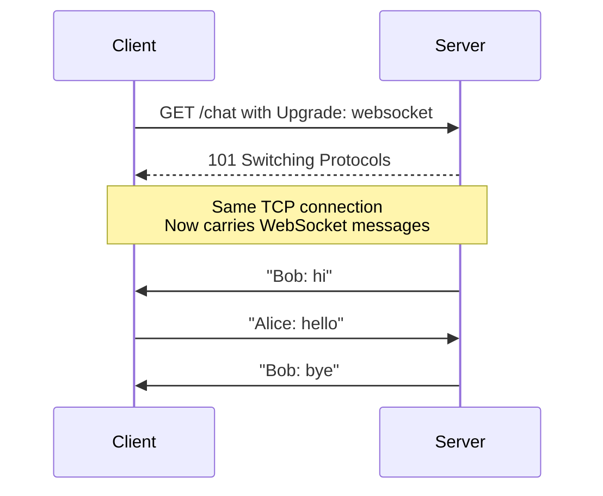

The handshake shown is HTTP/1.1, and the WebSocket then takes over the whole TCP connection.
When client and server both support it, a WebSocket can instead run on one HTTP/2 stream and share the connection with other requests.

### Side by side

| | HTTP/2 | WebSocket |
| --- | --- | --- |
| Who can send | The client starts every exchange with a request; the server answers on that stream. | Either side, at any time after the handshake. |
| What is sent | Requests and responses with headers; each response has a status and belongs to its request. | Text or binary messages with no HTTP headers or status; the application decides what they mean and which message answers which. |
| Parallel exchanges | Built in: one stream each, sharing a connection. | Not built in: one WebSocket carries one ordered sequence of messages in each direction. |
| Backpressure | Flow control per stream and per connection. | None of its own; it relies on TCP. |
| Browser API | `fetch` for a request and response; `EventSource` for a stream of server events. | `WebSocket`, for sending and receiving. |
| Good fit | APIs, gRPC between services, and one-way updates to a browser, such as notifications. | A browser and server that both send often, such as chat, shared editing, or games. |

In a browser, a WebSocket is worth it when both sides send often: `fetch` cannot send and receive at the same time on one stream, so each message from the page would be its own request.
When only the server sends often, an SSE stream on HTTP/2 does the job without a second protocol.
Outside a browser, one HTTP/2 stream already carries both directions, as in a gRPC bidirectional streaming call, so a WebSocket adds little.

### Backpressure

Backpressure means a slow receiver makes the sender slow down, instead of unread data piling up in memory.

HTTP/2 builds it in as flow control.
The receiver hands out credit in bytes, per stream and for the whole connection, and a sender that runs out must wait.
It needs its own because streams share one TCP connection: the receiver cannot stop reading one stream's bytes without stopping them all.
The diagram follows one stream's credit; the connection's credit works the same way.

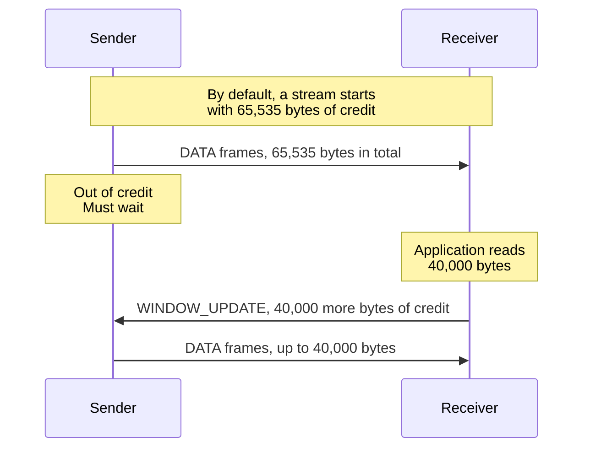

gRPC streaming calls rely on this: when the receiver falls behind, a write waits or the stream reports that it is not ready, depending on the language.

WebSocket adds no flow control of its own; it relies on TCP's.
The browser's `WebSocket` API does not pass that on to the page: `send()` only queues data, with `bufferedAmount` showing how much is waiting, and incoming messages are delivered whether or not the page keeps up.

Backpressure only makes a sender wait.
When the data keeps coming, as in a live feed, the server still needs a rule for a client that stays slow.
For example, a feed produces 1,000 messages per second and a phone on a weak network reads 200.
The server's queue for that client grows by 800 messages per second, so a limit of 16,000 messages is reached in 20 seconds.
At the limit, drop what can be dropped, such as all but the latest price, or close the connection and let the client reconnect and catch up.

### Scaling WebSocket servers

A WebSocket stays on the server that accepted it until it closes, so a load balancer chooses a server only once, when the client connects.
Capacity is counted in open connections rather than requests per second: each one holds memory and a socket even when idle.

With several servers, Alice and Bob can be connected to different ones.
The servers share a publish/subscribe system, such as Redis Pub/Sub, so a message reaches whichever server holds the recipient's connection.

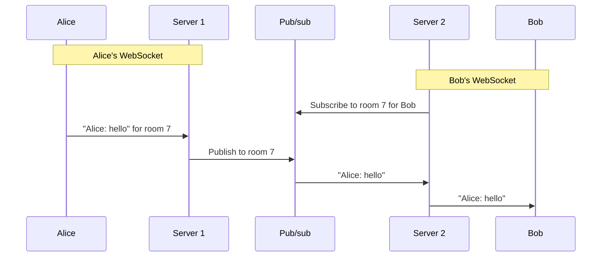

- Adding servers does not move existing connections; only new connections reach the new servers.
- When a server shuts down, all of its clients reconnect at once.
  Clients should retry with backoff and jitter, a growing and randomized delay, and the server should drain as described under [graceful shutdown](k8s.md#graceful-shutdown).
- After reconnecting, a client says which message it saw last, and the server sends what it missed.
  That needs the messages stored somewhere: Redis Pub/Sub loses a message for any subscriber that is disconnected when it is published.
- Long-lived HTTP/2 streams, such as SSE and gRPC streams, need the same design.
  SSE helps with one part: the browser reconnects by itself and, when events carry IDs, sends the last one it received in the `Last-Event-ID` header.

### WebTransport: streams and datagrams over HTTP/3

WebTransport is a newer way for a browser page and a server to send to each other at any time.
It solves a problem that a WebSocket cannot: a WebSocket is one ordered sequence of messages, so when a packet is lost, every message behind it waits until that packet is sent again.

For example, a game page sends its player's position 30 times a second, and chat messages, on one WebSocket.
When position 2 is lost, position 3 and a chat message wait until it is sent again, although position 3 has already replaced it.

WebTransport runs over HTTP/3: one request opens a session, and inside it either side can open streams or send datagrams.

- A stream delivers its data reliably and in order, like a WebSocket.
  A session can hold many, and because they are [QUIC streams](#http3-and-quic), lost data on one does not delay the others.
  The chat messages get their own stream.
- A datagram is a message that fits in one packet; it may be lost or arrive out of order, and is never sent again.
  That suits data that is useless when late: the next position replaces a lost one.

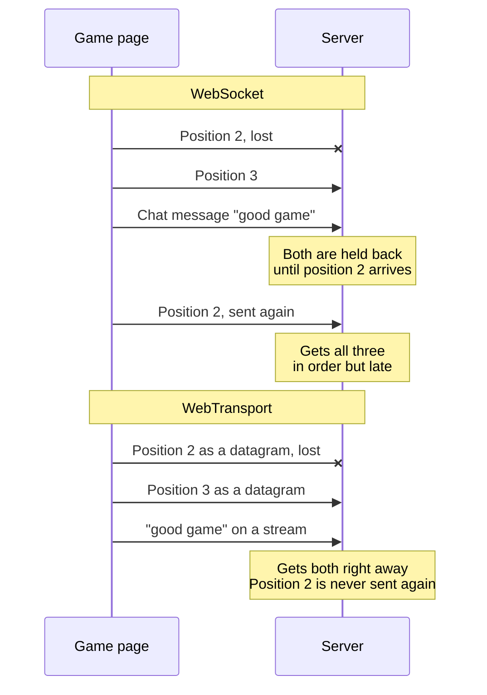

Streams also pass [backpressure](#backpressure) on to the page, which the `WebSocket` API does not.

WebTransport has worked in all major browsers only since March 2026, and the server must support HTTP/3.
A WebSocket remains the simpler default; WebTransport is worth it when a page needs datagrams or several independent streams.
