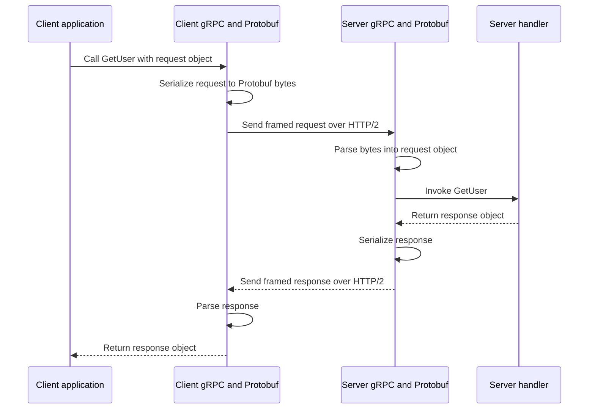
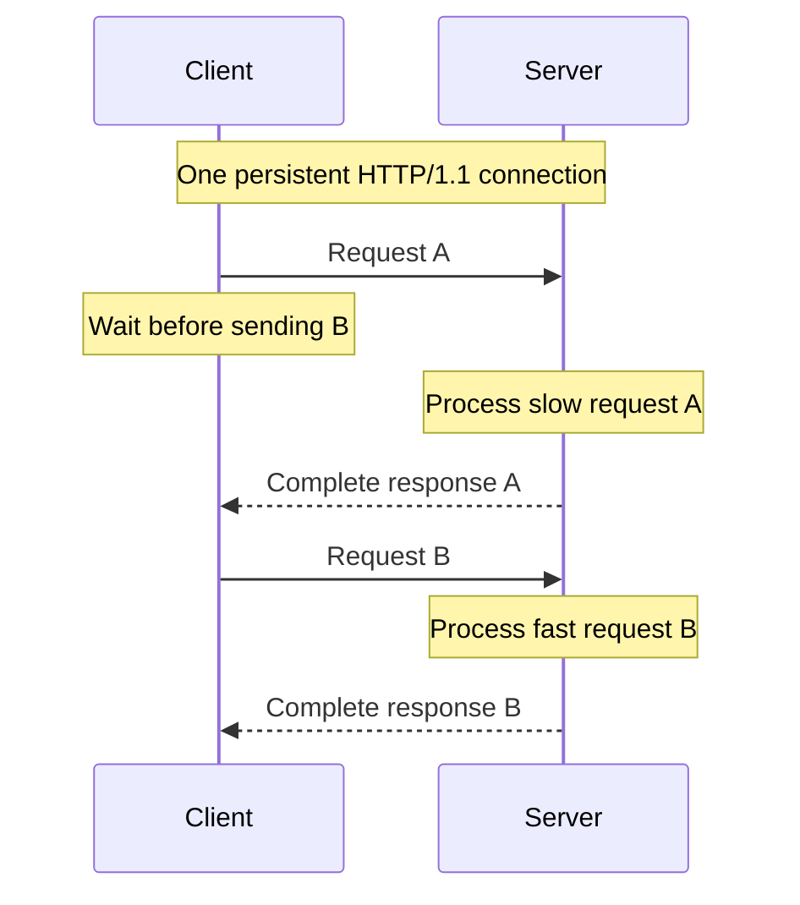
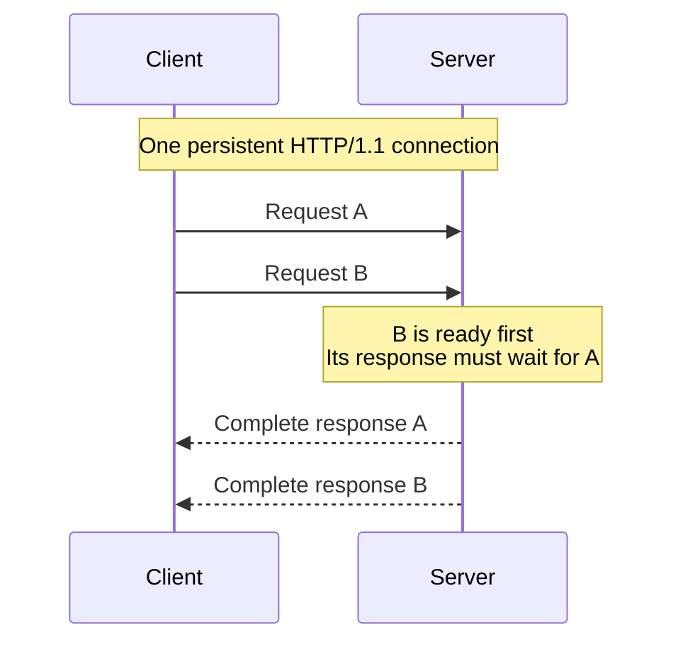
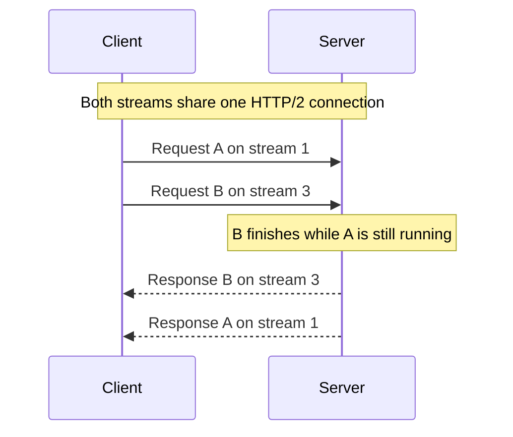
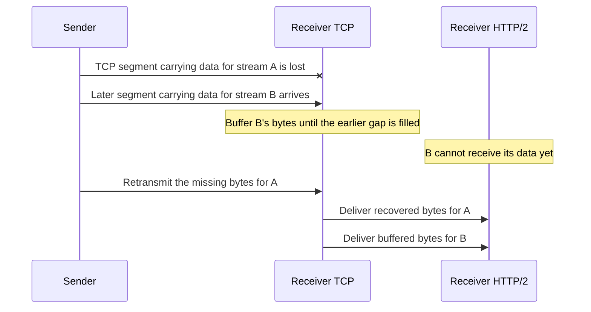
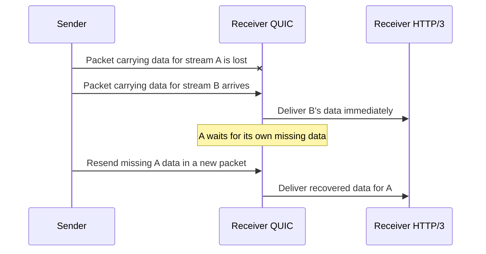

# gRPC and HTTP/2 Cheat Sheet

## What gRPC adds

gRPC lets a client call methods on a remote service using a defined contract, usually written with Protocol Buffers.
Generated client stubs handle message serialization and the call protocol.
The examples below use HTTP/2 as the transport.
A remote call can fail or time out even after the server has performed the requested work.

## How Protobuf works

Protocol Buffers, or Protobuf, defines structured messages and encodes them as binary data.
In a `.proto` file, describe the request, response, and service methods:

```proto
syntax = "proto3";

message GetUserRequest {
  int64 user_id = 1; // Field number, not a default value.
}

message GetUserResponse {
  string name = 1;
}

service UserService {
  rpc GetUser(GetUserRequest) returns (GetUserResponse);
}
```

Run the Protobuf compiler, `protoc`, with the language's gRPC plugin during the build.
It generates message types with serialization and parsing support, plus gRPC client stubs and server bindings.
You implement the server method's business logic.
Client and server can use different languages as long as their message definitions are compatible.

### What goes over the network

Field numbers identify fields within each message.
The binary payload contains field numbers, wire types, and encoded values; the receiver uses its message definition to interpret them.
Field names and the full `.proto` schema are not sent with every message.

#### Field tags

Each encoded field starts with a tag combining its field number and wire type:

```text
tag = (field_number << 3) | wire_type
```

The lowest three bits identify the wire type; the remaining bits identify the field number.
The tag itself is encoded as a variable-length integer, or **varint**.

| Wire type | Encoding used in these examples |
| --- | --- |
| `0` | Varint, used by `int64 user_id`. |
| `2` | Byte length followed by payload, used by `string name`. |

#### Encoding the integer 150

For `GetUserRequest` with `user_id = 150`:

1. Field 1 with wire type 0 gives `(1 << 3) | 0 = 8`, or hexadecimal `08`.
2. Split 150 into seven-bit groups, sending the least-significant group first.
   Each byte's highest bit is `1` when another byte follows and `0` for the final byte.

   | Hex byte | Continuation bit | Seven data bits | Contribution |
   | --- | --- | --- | --- |
   | `96` | `1` | `0010110` = 22 | 22 |
   | `01` | `0` | `0000001` = 1 | 1 × 128 |

3. Decoding gives `22 + 1 × 128 = 150`.

```text
tag         value
08          96 01
```

Small nonnegative integers need fewer bytes than large ones.

#### Encoding the string Amy

For `GetUserResponse` with `name = "Amy"`, field 1 uses wire type 2.
The length is a varint counting UTF-8 bytes, not characters.

```text
tag   length   UTF-8 payload
0A    03       41 6D 79
```

Here, `(1 << 3) | 2 = 10`, or hexadecimal `0A`.
The complete response payload is `0A 03 41 6D 79`.
The receiver uses the schema to interpret field 1 as `name` and the payload as a string.

The wire type also lets a parser skip an unknown field, which helps older readers handle newly added fields.

gRPC adds its own message framing and carries the payload over HTTP/2.



### Changing the schema safely

- Keep existing field numbers stable, and reserve the numbers of deleted fields so they cannot be reused.
- New fields need new numbers.
  Older binary readers can skip unknown fields, while newer readers must handle fields absent from older messages.
- Check compatibility before changing field types or meanings.
  Successful parsing alone does not prove that old and new applications interpret the data the same way.

## HTTP/1.1, HTTP/2, and HTTP/3

The HTTP/1.1 and HTTP/2 examples below use one already-established TCP connection and two independent read requests: A is slow, and B is fast.
The pipelining and multiplexing examples assume the server can process both requests concurrently.

### HTTP/1.1 without pipelining

HTTP/1.1 supports persistent TCP connections by default; a new connection is not required for every request.
The client waits for response A to finish before sending request B.
The connection is reused, but the requests do not overlap.



### HTTP/1.1 with pipelining

The client sends B on the same connection without waiting for response A.
The server must send the responses in request order.
Even if B is ready first, its response waits behind A: this is HTTP-level head-of-line blocking.



### HTTP/2 multiplexing

Requests use separate streams on the same TCP connection.
HTTP/2 splits message data into frames tagged with stream IDs, so response frames from different streams can be interleaved.
B's response can arrive before A's response finishes.



TCP still delivers bytes in order, so a missing TCP segment can delay data for multiple HTTP/2 streams until it is recovered.
HPACK reduces header size by using compact representations of header names and values, including entries reused within a connection.

For HTTPS, TLS negotiates HTTP/2 using ALPN and the `h2` identifier.
ALPN is a TLS handshake extension that lets the client and server agree on the application protocol.
HTTP/2 also supports cleartext TCP when the peers already know to use HTTP/2; certificates are therefore not inherent to the protocol itself.

WebSockets remain a separate protocol and can run over an HTTP/2 stream.

### HTTP/3 and QUIC

HTTP/3 multiplexes streams over QUIC rather than TCP.
QUIC runs over UDP and provides reliable delivery and ordering separately for each stream.

The following examples lose data belonging only to stream A, while data for stream B arrives successfully.
Assume the headers and control information needed to interpret both streams are already available.

#### HTTP/2 over TCP: B waits for A's missing bytes

TCP presents one ordered byte stream to HTTP/2 and does not understand HTTP/2 stream IDs.
Later bytes for B must wait behind the missing earlier bytes, even though B's data arrived intact.



#### HTTP/3 over QUIC: B continues while A recovers

QUIC identifies each stream's data by its stream ID and byte offset.
It can deliver B's available data while recovering the missing data for A.



The improvement is removing transport-level head-of-line blocking between unaffected streams.
Ordering within each stream is still preserved.
Streams still share bandwidth and congestion control, and losing a packet containing data for several streams can delay all of those streams.

## Stubs, channels, connections, and streams

| Term | Role |
| --- | --- |
| Stub | Client methods corresponding to the service contract. |
| Channel | A reusable client object for a target, managing connections and routing calls. |
| Connection | A transport connection carrying HTTP/2 frames. |
| Stream | A bidirectional exchange within a connection, used by one RPC attempt. |


The application calls a stub method, and the stub uses the channel to make the RPC.
Multiple stubs can share the same channel.
The diagram is illustrative: a channel can have zero or more connections depending on its state and configuration.
Stream IDs belong to individual connections.
A retry can create a new stream for another attempt at the same RPC.

- Reuse channels and stubs instead of creating them for every call.
- Each connection has a concurrent-stream limit; additional calls may queue when it is reached.
- If measurements show contention from heavy traffic or long-lived calls, consider separate channels for those workloads.
- A blocking call waits on its calling thread; it does not limit the entire channel to one active call.
  Asynchronous APIs allow calls to proceed without tying up one waiting thread per call.

## Deadlines and retries

Set a realistic client deadline and carry the remaining time budget into downstream calls.
By default, gRPC does not set a deadline.
Server code must stop unnecessary work when cancellation is observed.

| Status | What to consider |
| --- | --- |
| `UNAVAILABLE` | The failing call may be retryable, provided repeating it is safe and time remains. |
| `ABORTED` | Retry the higher-level operation when required, such as restarting a read-modify-write sequence. |
| `DEADLINE_EXCEEDED` | The client ran out of time. The server may already have completed the operation, so a retry can repeat its effect. |

Configure retryable statuses, attempt limits, and backoff according to the operation.
Keep retries within the overall deadline, and make repeated effects safe through idempotency where needed.
Without an explicit retry policy, gRPC only retries certain low-level failures transparently.

## Keepalive and observability

gRPC keepalive uses HTTP/2 PING frames to check an existing connection.
This differs from HTTP/1.1 connection reuse, also commonly called keep-alive.
Coordinate settings with the server and proxies: excessive pings can cause the server to close the connection with `GOAWAY` and `too_many_pings`.
A responsive connection does not prove that the service can complete business requests.

Useful signals to monitor:

- Active RPC counts, to see how much work is in flight.
- Request counts by gRPC status, to distinguish successful calls from specific failures.
- TCP connection counts, to detect churn or unexpected connection growth.

Compare these signals with call latency and deployment timing when investigating failures.
For proxy behavior and draining during deployments, see the [Kubernetes cheat sheet](k8s.md#graceful-shutdown).
