# Isolation Level Cheat Sheet

A companion to [Chapter 7: Transactions](../ddia/07-transactions.md), with anomaly tables and example transaction timelines.

Database transactions can interleave reads and writes, so applications need guarantees about what each transaction can observe.
An isolation level defines those guarantees.
Locks and multi-version concurrency control, or MVCC, are implementation techniques that a database can combine.
The sections below describe common models; exact behavior depends on the database and its settings.
Each section also notes which PostgreSQL isolation level, if any, uses that model.

- Statement: a single SQL operation, such as `SELECT` or `UPDATE`.
- Transaction: one or more statements committed or rolled back together.

| Anomaly | Meaning |
| --- | --- |
| Dirty read | Reading another transaction's uncommitted changes. |
| Nonrepeatable read | Reading the same row again and seeing a different committed value. |
| Phantom read | Repeating a query and seeing a changed set of matching rows because another transaction committed changes. |
| Read skew | Reading related values from different moments and seeing an inconsistent combination. |
| Lost update | Writing a value based on a stale read and overwriting another transaction's update. |
| Write skew | Transactions update different rows after reading a shared condition, and together violate that condition. |

The category tables assume each task keeps its related reads and writes in one transaction, and all concurrent transactions use the stated isolation model.
**Possible** means the model permits the anomaly without [additional protection](#two-controls-the-isolation-level-and-the-query).
**Prevented** means the model rules it out, aborting conflicting transactions when necessary.
Each **Possible** entry links to an example that states which isolation models it applies to.

The two read-committed models permit the same listed anomalies, although their blocking and within-statement read behavior differ.
Blocking, [deadlocks](#deadlocks), and transaction aborts can still occur even when these data anomalies are prevented.

The timelines below show example schedules, with time moving downward.
Each category starts with a normal flow, followed by examples of possible anomalies or conflict recovery.
The doctor examples use the rule that at least one doctor must remain on call.
Abort timing and the choice of transaction to abort depend on the database.

## Read Committed with Locks

| Dirty read | Nonrepeatable read | Phantom read | Read skew | Lost update | Write skew |
| --- | --- | --- | --- | --- | --- |
| Prevented | [Possible](#possible-anomaly-nonrepeatable-read) | [Possible](#possible-anomaly-phantom-read) | [Possible](#possible-anomaly-read-skew) | [Possible](#possible-anomaly-lost-update) | [Possible](#possible-anomaly-write-skew) |

- Reads exclude uncommitted data, commonly by acquiring shared locks that conflict with writes.
- Read locks can be released before the transaction ends, so later reads may see changed values or new matching rows.
- Separate read-then-write operations can lose updates unless the application protects the entire operation.

**PostgreSQL:** not offered.
Its `READ COMMITTED` level uses [Read Committed with MVCC](#read-committed-with-mvcc) instead.

### Normal Flow

The reader waits for an uncommitted write, then reads the committed value.

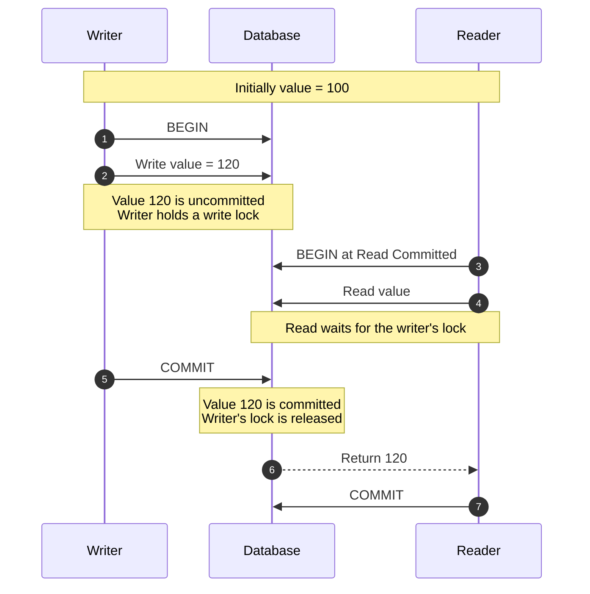

### Possible Anomaly: Lost Update

This example applies to both read-committed implementations without additional protection for the read-then-write operation.
Both transactions read the same counter, then write a replacement value calculated from that earlier read.
The writes are not atomic increments computed from the current database value.

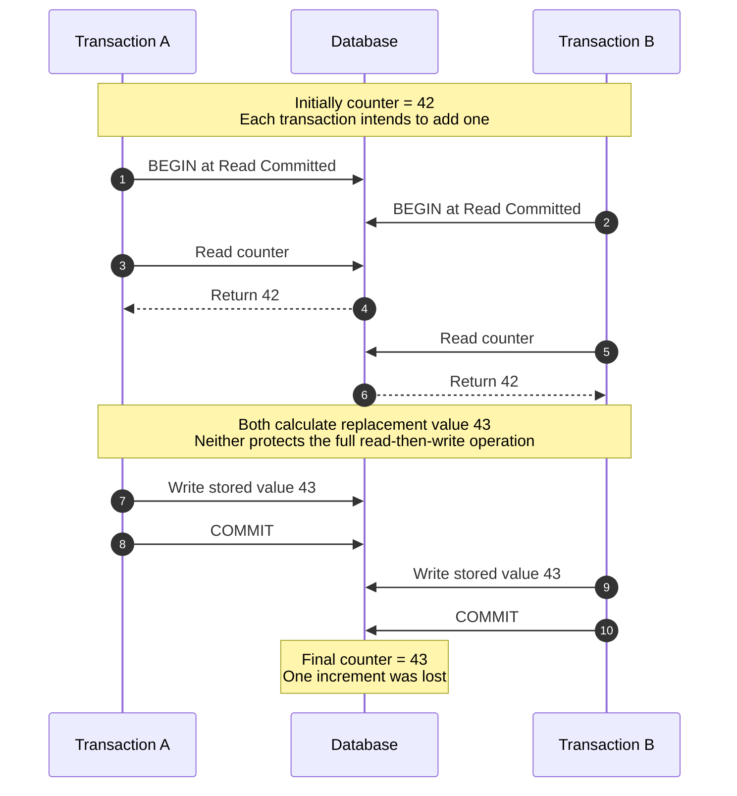

Protect read-then-write logic with a SQL update based on the current row value, an appropriate lock held across the read and write, or an update conditional on the expected value of a version column.
Handle a failed check by retrying or reporting the conflict.
[One Lost Update, Three Fixes](#one-lost-update-three-fixes) shows the lock and the check, next to raising the isolation level.

## Read Committed with MVCC

| Dirty read | Nonrepeatable read | Phantom read | Read skew | Lost update | Write skew |
| --- | --- | --- | --- | --- | --- |
| Prevented | [Possible](#possible-anomaly-nonrepeatable-read) | [Possible](#possible-anomaly-phantom-read) | [Possible](#possible-anomaly-read-skew) | [Possible](#possible-anomaly-lost-update) | [Possible](#possible-anomaly-write-skew) |

- Each statement reads a snapshot of data committed when that statement begins, plus its transaction's own changes.
- Ordinary snapshot reads avoid blocking row updates, but conflicting writers can still block each other.
- Later statements can see newer commits, so nonrepeatable reads, phantoms, and read skew remain possible.
- Separate read-then-write operations can still lose updates.

**PostgreSQL:** `READ COMMITTED`, the default level, uses this model.

- `READ UNCOMMITTED` is accepted but behaves like `READ COMMITTED`, so dirty reads never happen.
- When an `UPDATE` or `DELETE` reaches a row that another transaction is changing, it waits for that transaction to finish.
  If the other transaction commits, PostgreSQL re-checks the `WHERE` condition against the new row version and changes the row only if it still matches.
- A single `UPDATE ... SET hits = hits + 1` is therefore safe, but reading a value in one statement and writing it back in another can still lose an update.

### Normal Flow

The reader uses the last committed version while the writer's change is still uncommitted.

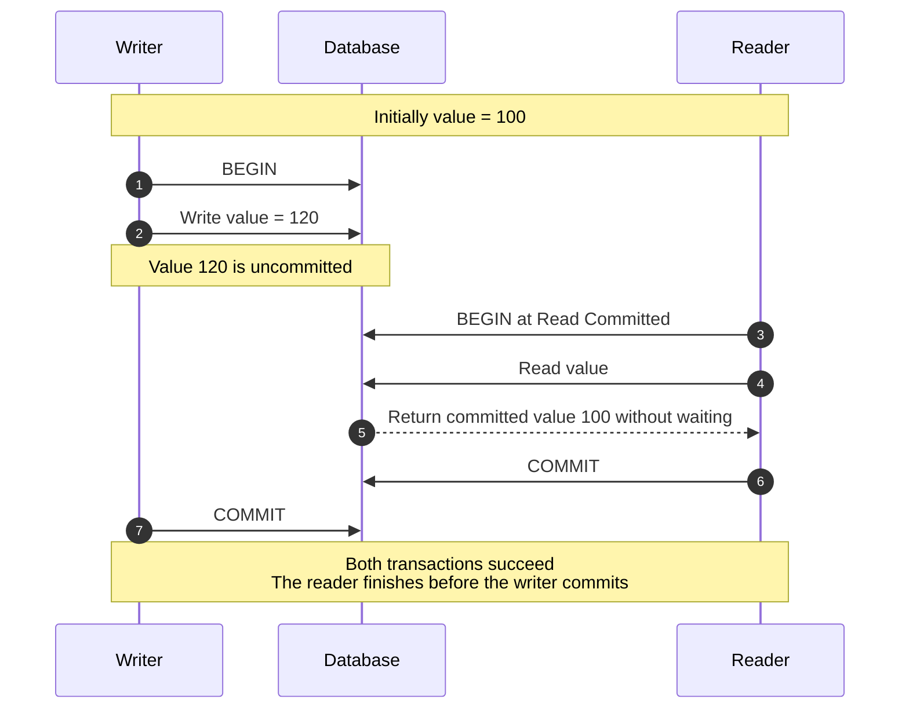

### Possible Anomaly: Nonrepeatable Read

This example applies to both read-committed implementations when the writer commits between the reader's statements.
A second statement in the same transaction can see a newer committed value.

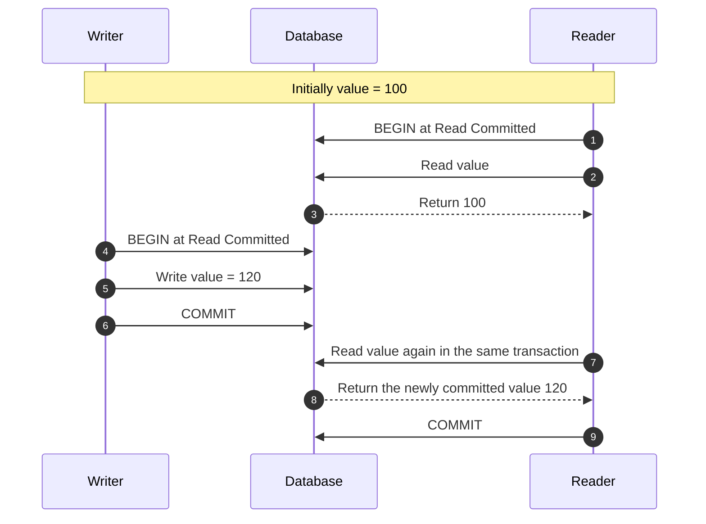

### Possible Anomaly: Phantom Read

This example applies to both read-committed implementations when another transaction inserts a matching row and commits between the reader's queries.
The same query returns a different set of rows.

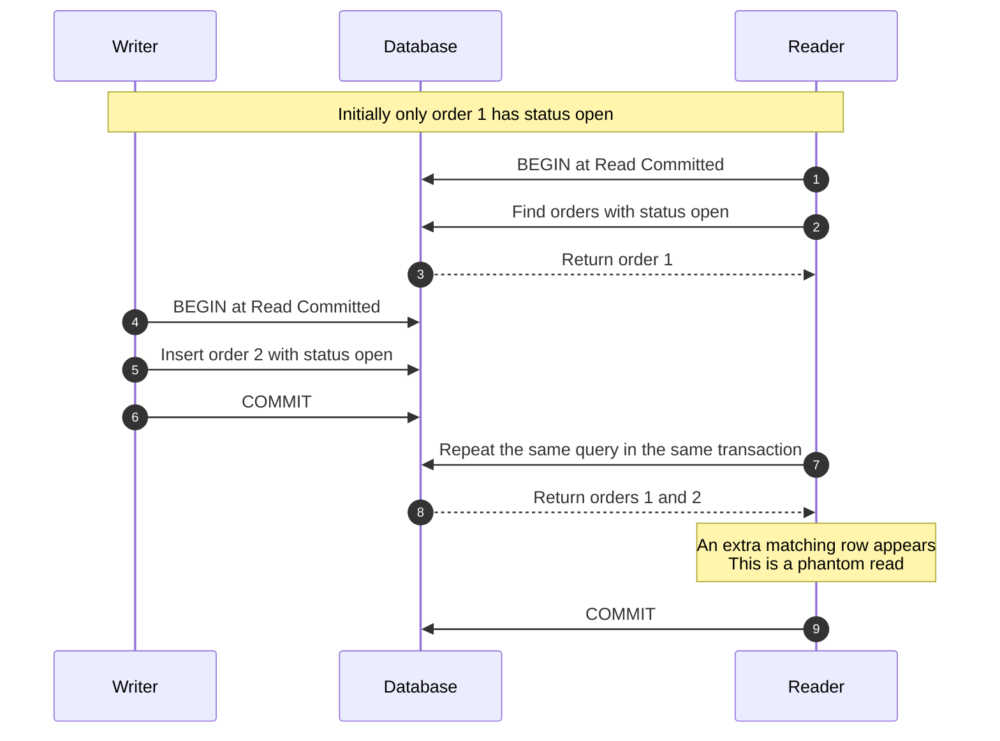

### Possible Anomaly: Read Skew

This example applies to both read-committed implementations when related values are read in separate statements.
A transfer preserves the total balance, but the reader combines a balance from before the transfer with one from afterward.

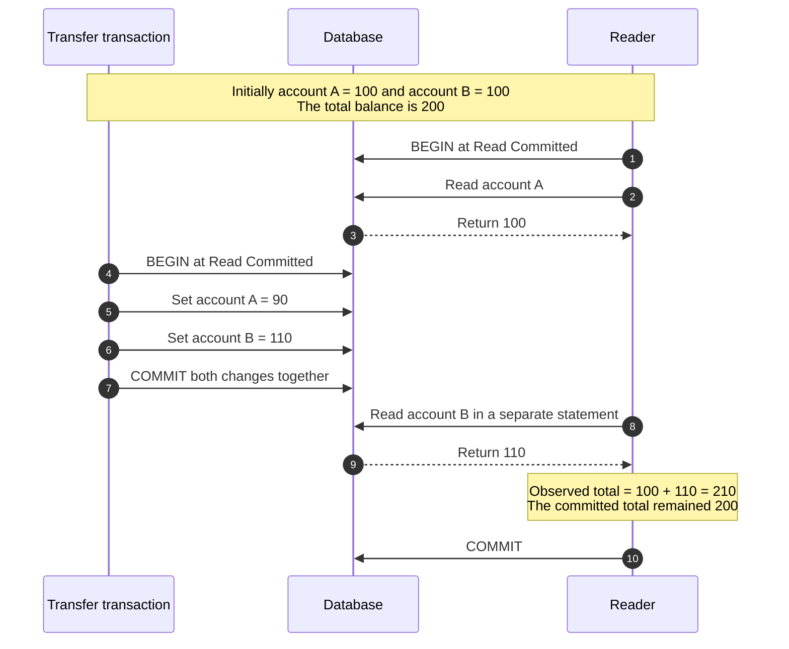

## Snapshot Isolation with MVCC

| Dirty read | Nonrepeatable read | Phantom read | Read skew | Lost update | Write skew |
| --- | --- | --- | --- | --- | --- |
| Prevented | Prevented | Prevented | Prevented | Prevented | [Possible](#possible-anomaly-write-skew) |

- Reads use a stable transaction snapshot, plus the transaction's own changes.
- Other transactions' commits do not change the values or matching rows seen by repeated snapshot reads.
- Conflicting concurrent writes to the same row cannot both commit under snapshot isolation.
- Write skew can still occur when transactions update different rows.

**PostgreSQL:** `REPEATABLE READ` uses this model.

- It also prevents phantom reads, which the SQL standard allows at this level.
- Changing a row that a concurrent transaction already changed and committed fails with a "could not serialize access" error, SQLSTATE `40001`.
  Roll back and rerun the whole transaction.

### Normal Flow

The reader keeps the same snapshot while another transaction commits a newer value.

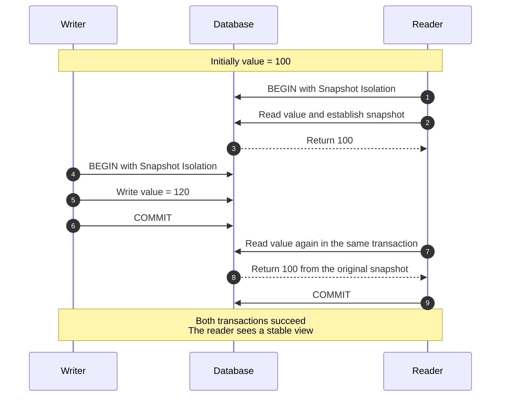

### Possible Anomaly: Write Skew

This example applies to both read-committed implementations and snapshot isolation when the on-call rule is checked using ordinary reads without additional protection.
Both transactions read that two doctors are on call before either commits.
Each then uses that earlier observation to take a different doctor off call.
Both commits can succeed, leaving nobody on call.

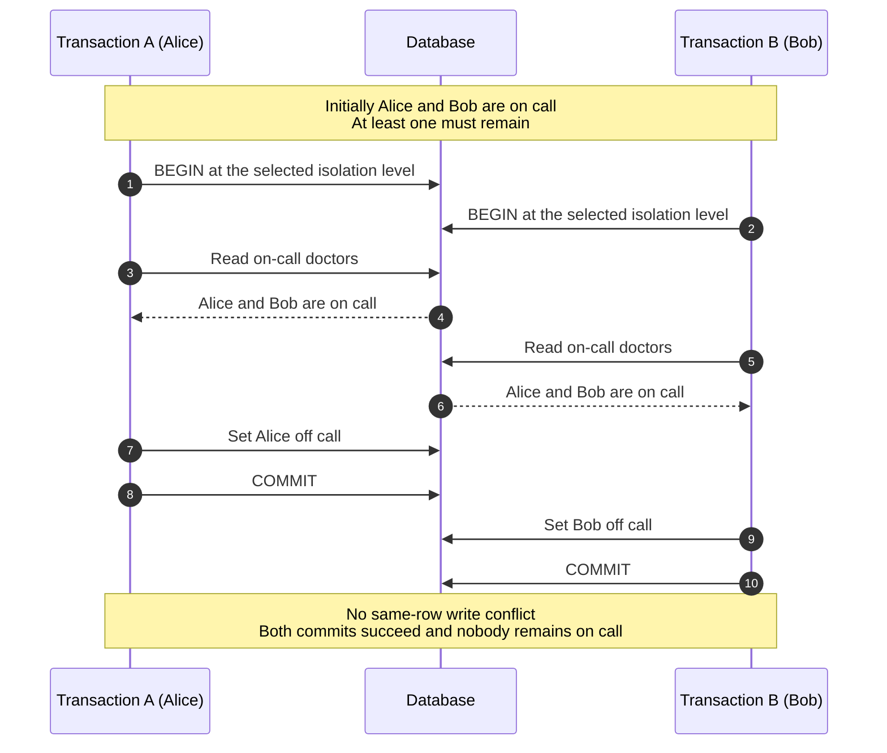

## Serializable Isolation with Locks

| Dirty read | Nonrepeatable read | Phantom read | Read skew | Lost update | Write skew |
| --- | --- | --- | --- | --- | --- |
| Prevented | Prevented | Prevented | Prevented | Prevented | Prevented |

- Committed results must match some order of running the transactions one at a time.
- Transactions can execute concurrently when their locks are compatible.
- Two-phase locking can enforce serializability, with range or predicate protection where needed to prevent phantoms.
- Conflicting operations may block, and deadlocks may require aborting and retrying a transaction.
- The standard example of **pessimistic concurrency control (lock)**: it expects conflicts, so a transaction waits until the data it needs is safe to use.

**PostgreSQL:** not offered.
Its `SERIALIZABLE` level uses [Serializable Snapshot Isolation](#serializable-snapshot-isolation) instead.

### Normal Flow

In this example, the transactions access separate counter rows and their locks are compatible.

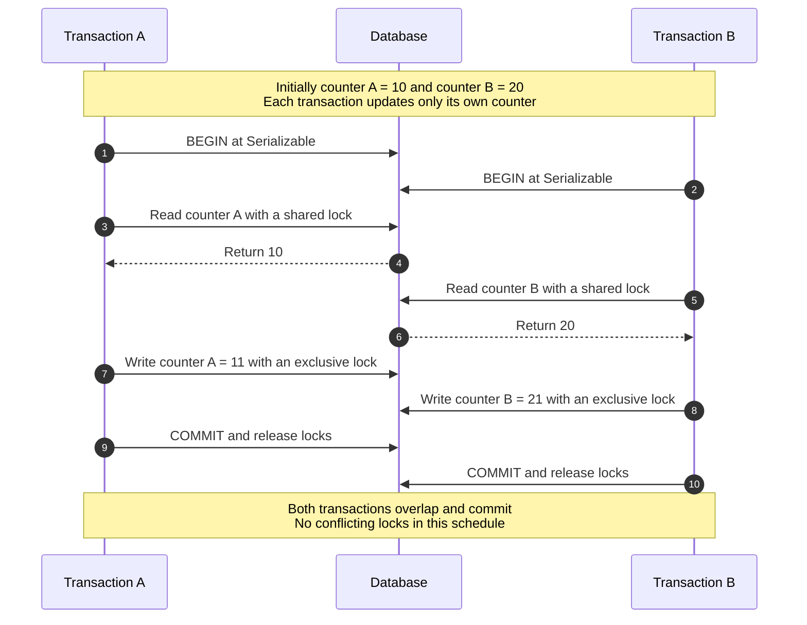

### Conflict and Recovery: Blocking

This is the doctor scenario that causes write skew under the weaker models.
Locks prevent it: a transaction cannot write a row that another unfinished transaction has read, and cannot read a row that another unfinished transaction has written.
Here Alice's transaction takes Alice off call before Bob's transaction reads.
Bob's read therefore waits until Alice's transaction commits, and then sees that only Bob remains on call.
No transaction aborts, and the result matches running Alice's transaction and then Bob's.

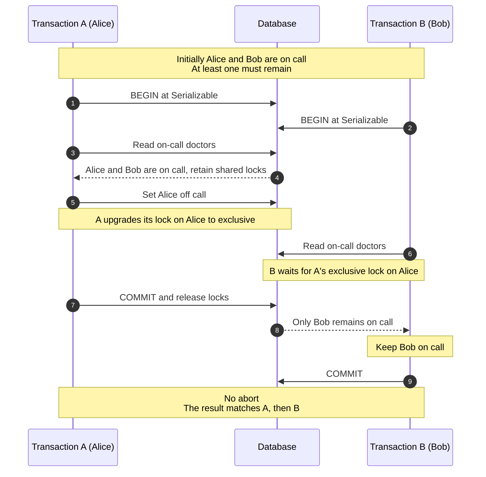

If both transactions read before either writes, as in the other sections, each then waits for the other's read lock, which is the [lock-upgrade deadlock](#serializable-isolation-with-locks-lock-upgrade).

## Serializable Snapshot Isolation

| Dirty read | Nonrepeatable read | Phantom read | Read skew | Lost update | Write skew |
| --- | --- | --- | --- | --- | --- |
| Prevented | Prevented | Prevented | Prevented | Prevented | Prevented |

- Combines snapshot reads with checks for dependency patterns that could produce a nonserializable result.
- Transactions run concurrently, but one may be aborted to preserve serializable results.
- Conflicting row updates may still wait for writers.
- Applications must be prepared to retry the entire transaction after a serialization failure.
- The standard example of **optimistic concurrency control**: it expects no conflict, so a transaction continues instead of waiting, and the database checks it at commit.

**PostgreSQL:** `SERIALIZABLE` uses this model.

- It records reads with predicate locks, shown as `SIReadLock` in `pg_locks`.
  These locks never block and cannot cause deadlocks; they only track read/write dependencies between transactions.
- A serialization failure returns SQLSTATE `40001`.
  Catch that code, roll back, and rerun the whole transaction from the start without reusing data read by the failed attempt.

### Normal Flow

The transactions read and update separate counters, and the dependency checks allow both to commit.

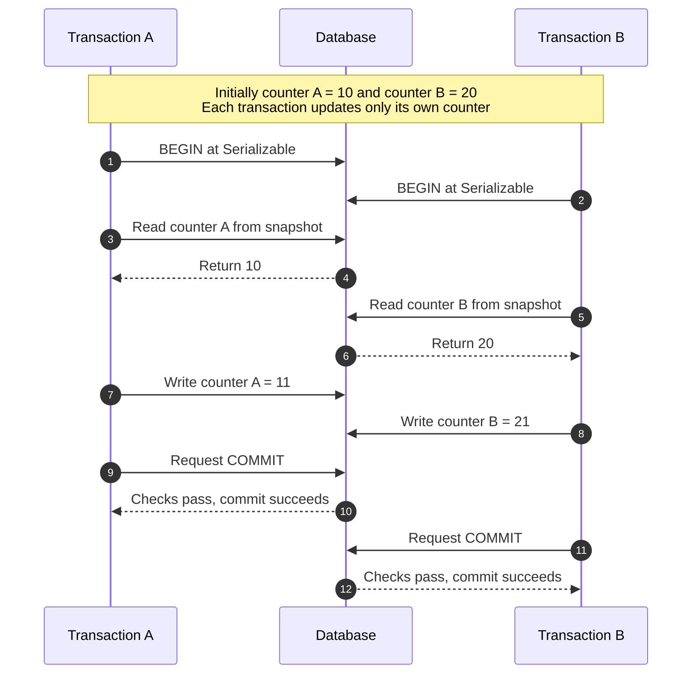

### Conflict and Recovery: Serialization Failure

This is the doctor scenario that causes write skew under the weaker models.
Serializable snapshot isolation prevents it: both transactions run without waiting, and the database rolls back the one that commits second.
The writes affect different rows, so there is no write/write conflict.
Each transaction acts on a premise it read at the start: two doctors are on call.
The database records each read, and when the other transaction writes a row that was read, it notes that the read may be outdated, without blocking.
Transaction A commits first, while B's write has not taken effect, so A succeeds.
When Transaction B commits, A's conflicting write has already committed, so B's premise is false and B is rolled back with a serialization failure.

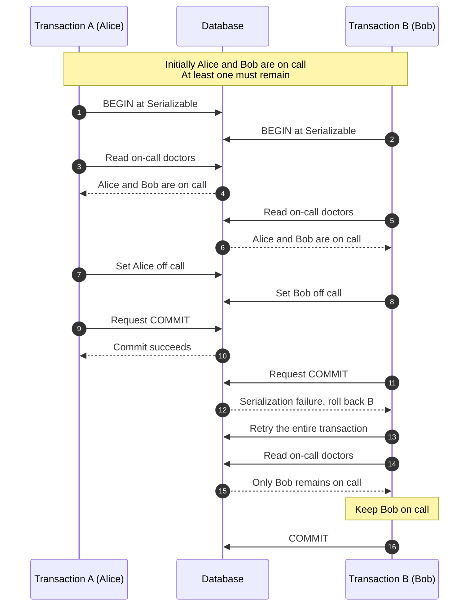

## Deadlocks

**Every model in this note can deadlock.**
A deadlock needs transactions that hold locks while waiting for others, in a cycle of waits.
All five models hold exclusive locks on modified rows until the transaction ends, so writes alone can form that cycle.
MVCC stops ordinary reads from blocking writes, but writers still block other writers.
Deadlocks are much more frequent under Serializable Isolation with Locks than under Read Committed with Locks, because shared read locks are held until the transaction ends.
Each retry redoes the transaction's work, so frequent deadlocks waste effort.

Serialization failures under snapshot isolation and serializable snapshot isolation are a separate kind of abort.
They are not deadlocks, but applications handle both by retrying.

The three examples below form the cycle in different ways.

| | [Write/write](#writewrite-deadlock) | [A read completes the cycle](#read-committed-with-locks-a-read-completes-the-cycle) | [Lock upgrade](#serializable-isolation-with-locks-lock-upgrade) |
| --- | --- | --- | --- |
| Applies to | All five models | Read Committed with Locks | Serializable Isolation with Locks |
| Steps | Each updates one row, then the other row, in opposite order | Each updates one row, then reads the row the other updated | Both read the same row, then both try to update it |
| Locks in the cycle | Exclusive write locks | Write locks that block reads | Shared read locks that block the upgrade to a write lock |
| Writes before the deadlock | One each | One each | None |
| After the abort | A continues, and B retries | A continues, and B retries | A commits, and B's retry reads A's new value, so no update is lost |

The [doctor example](#conflict-and-recovery-blocking) under Serializable Isolation with Locks hits this same deadlock if both transactions read before either writes.

### Write/Write Deadlock

This example applies to every model in this note.
The transactions update the same two rows in opposite order.

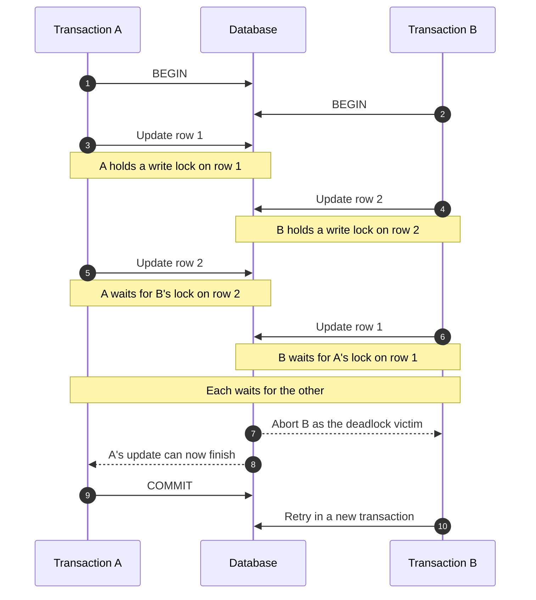

### Read Committed with Locks: A Read Completes the Cycle

Read locks are released early in this model, but a read must still wait for an uncommitted write.
A transaction that holds a write lock can therefore deadlock while waiting to read.
Under Read Committed with MVCC, both reads would return the last committed versions without waiting.

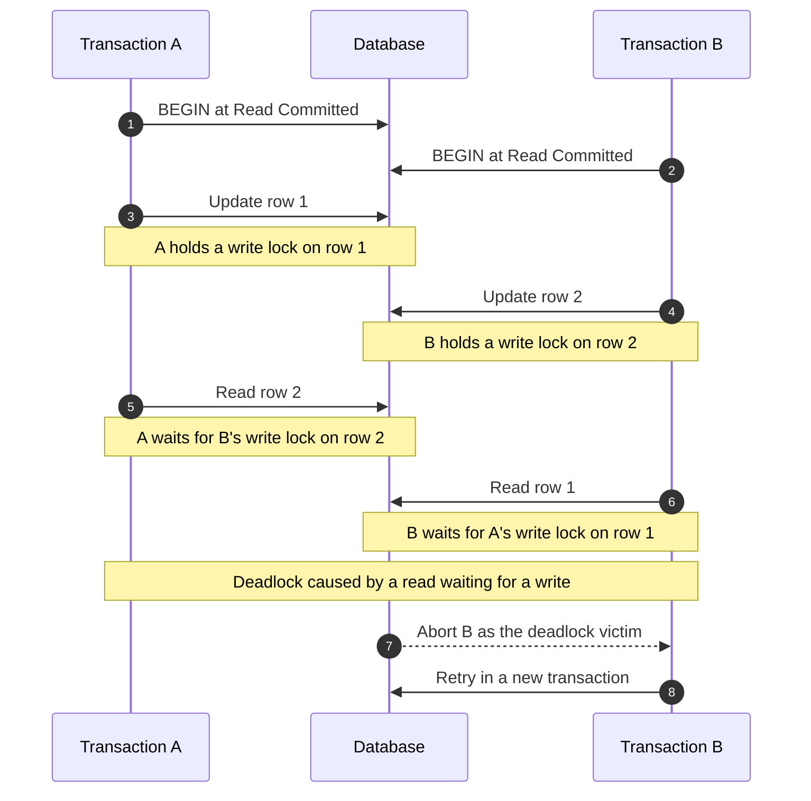

### Serializable Isolation with Locks: Lock Upgrade

This model holds shared read locks until the transaction ends, and any number of transactions can share one.
A write must upgrade the shared lock to an exclusive lock, which waits until no other transaction holds a shared lock on that row.
When two transactions read the same row and then both try to update it, each waits for the other's read lock.
No second row or business rule is needed; the anomaly this abort prevents is a lost update.

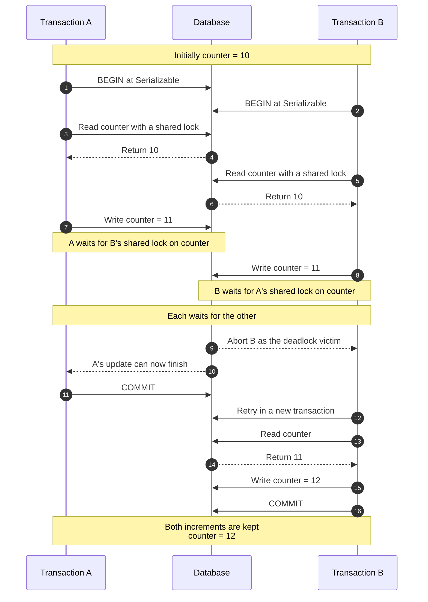

### Reducing Deadlocks

1. Access rows in a consistent order, for example by sorted primary key.
2. Keep transactions short, and avoid user interaction or network calls while holding locks.
3. Lock rows before reading them for an update, for example with `SELECT ... FOR UPDATE`, instead of upgrading a shared lock later.
4. Catch deadlock and serialization errors, roll back, and retry the entire transaction.
   In PostgreSQL, a deadlock victim fails with SQLSTATE `40P01` and a serialization failure with `40001`.

## Two Controls: The Isolation Level and the Query

The isolation level is a setting, and the sections above show what each setting protects.
A query can also carry protection of its own, such as a lock or a check.
The two are separate controls, and one transaction can use both.

| | Isolation level | Lock or check in a query |
| --- | --- | --- |
| What it is | A setting. | Extra SQL in one query. |
| Where it is set | As the database default, for a session, or for one transaction. | In each query that needs it. |
| What it covers | Every read and write in the transaction. | Only the rows of that query. |
| Who applies it | The database, to every query. | The application code, query by query. |
| Example | `BEGIN ISOLATION LEVEL SERIALIZABLE` | `SELECT ... FOR UPDATE`, or `UPDATE ... WHERE version = 7` |

**PostgreSQL:** the default level is `READ COMMITTED`, set by `default_transaction_isolation`.
`BEGIN ISOLATION LEVEL ...` sets the level for one transaction.

### One Lost Update, Three Fixes

All three fixes protect the counter in the [lost update](#possible-anomaly-lost-update) example.

Fix 1 changes the setting, and the queries stay plain.

```sql
BEGIN ISOLATION LEVEL SERIALIZABLE;
SELECT counter FROM counters WHERE id = 1;
UPDATE counters SET counter = 43 WHERE id = 1;
COMMIT;
```

Fix 2 keeps `READ COMMITTED` and adds a lock to the read.
`SELECT ... FOR UPDATE` reads the row and locks it until the transaction ends.

```sql
BEGIN;
SELECT counter FROM counters WHERE id = 1 FOR UPDATE;  -- returns 42 and locks the row
UPDATE counters SET counter = 43 WHERE id = 1;
COMMIT;                                                -- releases the lock
```

Fix 3 keeps `READ COMMITTED` and adds a check to the write.
The table gets a version column, and the update changes the row only if that column still holds the value that was read.

```sql
SELECT counter, version FROM counters WHERE id = 1;  -- returns 42 and version 7, no lock

UPDATE counters
SET counter = 43, version = 8
WHERE id = 1 AND version = 7;                        -- 1 row updated: success. 0 rows: conflict
```

- The version column is ordinary data that the application maintains.
  It is not the row versions that MVCC keeps inside the database.
- The check is safe only if the database tests the condition against the row's latest committed version, which PostgreSQL's read committed does, as [Read Committed with MVCC](#read-committed-with-mvcc) describes.
- DDIA calls this check compare-and-set.

| | Fix 1: the setting | Fix 2: a lock in the query | Fix 3: a check in the query |
| --- | --- | --- | --- |
| A second transaction on the same row | Fails with SQLSTATE `40001` in PostgreSQL, and the application reruns it. | Waits until the first one commits. | Updates 0 rows, and the application retries or reports the conflict. |
| Works only if | Every transaction that reads and then writes the counter uses that level. | Every such transaction takes the lock. Under MVCC, an ordinary `SELECT` does not wait for it. | Every write checks the version column and raises it. |

Fix 2 applies the pessimistic concurrency control of [Serializable Isolation with Locks](#serializable-isolation-with-locks) to one row, and fix 3 applies the optimistic concurrency control of [Serializable Snapshot Isolation](#serializable-snapshot-isolation).
A single statement such as `UPDATE counters SET counter = counter + 1 WHERE id = 1` needs none of the three, because the database reads and writes the current value in one step.

### Which One to Change

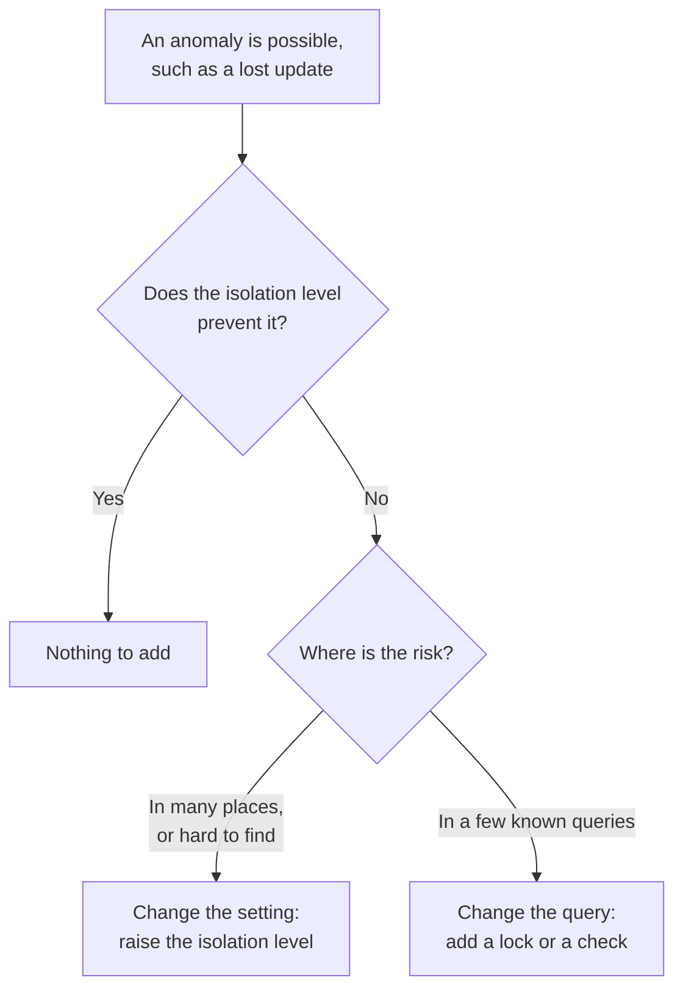

- **The anomaly tables show the setting alone.**
  **Possible** means possible without extra SQL.
  A lock or a check in the query can prevent the anomaly for the rows of that query.
- **A higher level costs every transaction that uses it.**
  Serializable Isolation with Locks adds waiting and deadlocks, and Serializable Snapshot Isolation adds retries.
  Read committed is the default in PostgreSQL, Oracle, and SQL Server, so applications often keep it and add SQL where a read-then-write needs it.
- **A lock or a check covers less than a serializable level.**
  It protects only the chosen rows, and only if every code path uses it.
  [Lock or Check](#lock-or-check) lists the limits.
- **A check also works where no level can.**
  No isolation level connects a read and a write that are in separate transactions, such as an edit form that stays open.
  A check on a version column does.

### Lock or Check

| | Lock in the query | Check in the query |
| --- | --- | --- |
| Conflicts are | Common, such as one stock row during a flash sale. | Rare, such as two admins editing the same profile. |
| The read and the write are | Close together, in one short transaction. | Possibly far apart, such as an edit form that stays open for minutes. |
| Risk | [Deadlocks](#deadlocks), and one slow transaction blocks the others. | Many retries when conflicts are frequent, and each retry redoes the work. |

Both protect a row that is read and then written, which leaves two limits:

- **Write skew:** in the doctor [write skew](#possible-anomaly-write-skew), each transaction updates a different row, so a version column on each doctor's row does not help.
  Lock the rows that the decision depends on, with `SELECT name FROM doctors WHERE on_call = true FOR UPDATE`.
  Under read committed, the second transaction waits and then sees that only one doctor remains on call.
- **Phantoms:** when the decision depends on no matching row existing, such as a free meeting room or an unused username, there is no row to lock or to check.
  Use a unique constraint where one fits, or a serializable isolation level.

Both serializable models rule out both cases without extra SQL.
