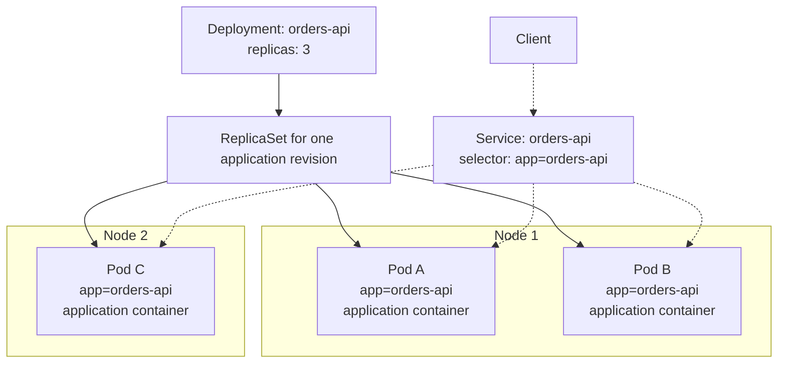
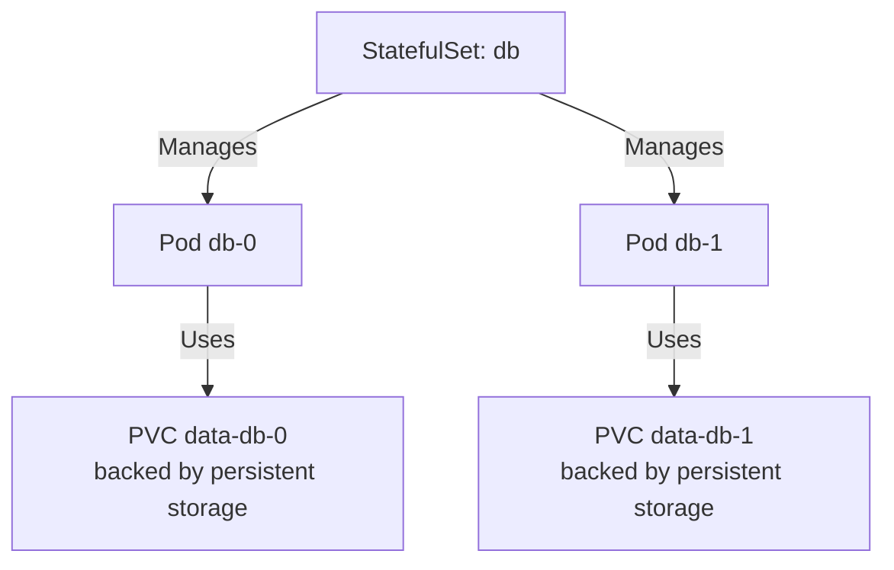
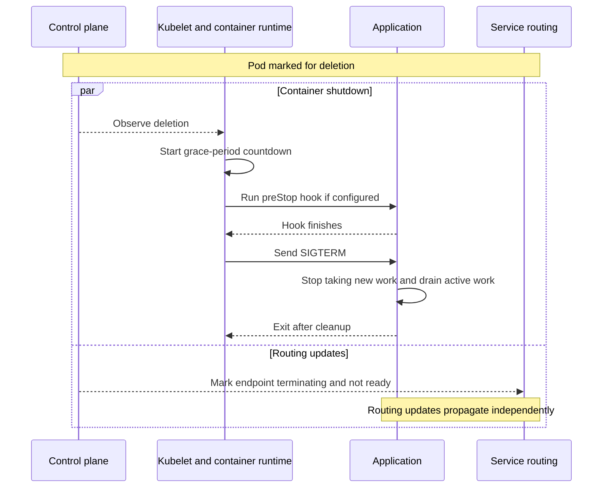
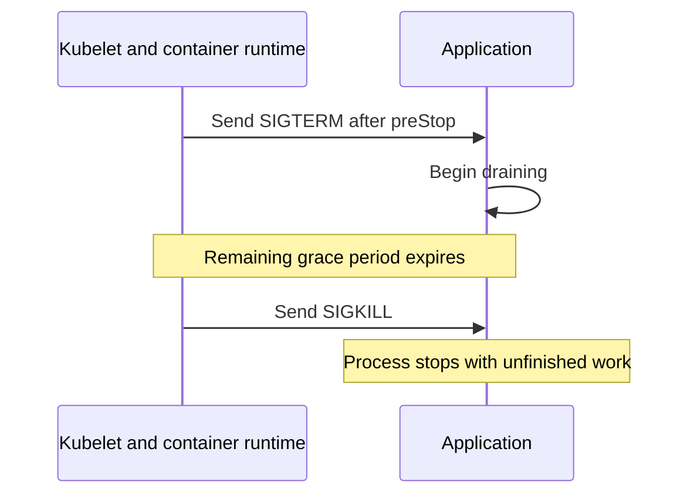
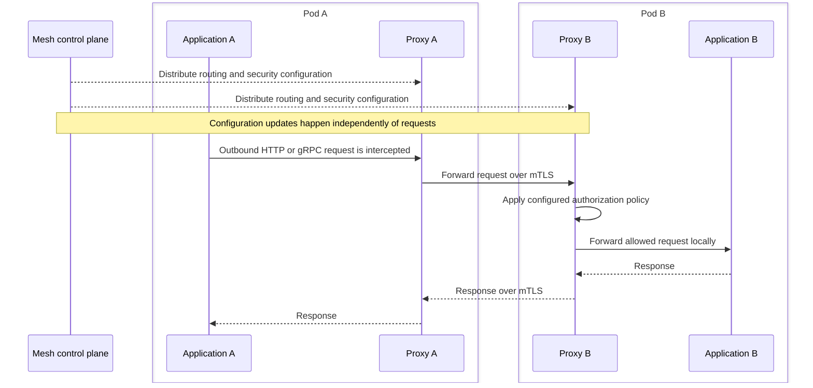

# Kubernetes Cheat Sheet

Practical notes on running applications in Kubernetes.

## Core concepts

Kubernetes runs containerized applications and keeps their actual state aligned with a declared desired state.
For example, you can declare that an API should have three replicas, and controllers work to maintain that number of Pods.

### Cluster, nodes, and Pods

| Term | Meaning |
| --- | --- |
| Cluster | The control plane and the nodes that run workloads. |
| Control plane | Components that expose the Kubernetes API, store cluster state, schedule Pods, and run controllers. |
| Node | A physical or virtual machine that runs Pods through a container runtime, supervised by an agent called the kubelet. |
| Namespace | A scope for names and organization of resources such as Pods, Services, and Deployments within a cluster. |
| Pod | The smallest unit Kubernetes schedules onto a node. Its containers share a network namespace and can mount shared volumes. |
| Container | Runs application or supporting software from a container image inside a Pod. |
| Service | A stable way to discover and reach backends, commonly a set of Pods selected by labels. |
| PersistentVolumeClaim, or PVC | A request for persistent storage, backed by a PersistentVolume whose lifecycle can outlast an individual Pod. |

The scheduler chooses a suitable node for a Pod, and that node's kubelet works with the container runtime to run its containers.
In the rest of the control plane, the API server exposes the Kubernetes API, etcd stores all cluster data, and the controller manager runs the built-in controllers.
Nodes can also run kube-proxy, an optional component that maintains the network rules behind Services.

An application container and its sidecar belong to the same Pod and run on the same node.
Each Pod gets its own IP address.
Its containers share that IP and its ports, so they can talk over `localhost` but must coordinate which ports they use.
A volume defined in the Pod can be mounted by all its containers, and its data survives a container restart.

A PVC asks for a size and an access mode and binds one-to-one to a matching PersistentVolume.
That volume is either created in advance by an administrator or provisioned on demand from the claim's StorageClass.
After the claim is deleted, the volume's reclaim policy decides what happens: `Delete`, the default for dynamically provisioned volumes, removes the storage, while `Retain` keeps it for manual cleanup.

### Resources that manage Pods

| Resource | What it manages | Typical use |
| --- | --- | --- |
| Deployment | ReplicaSets and their rollout, keeping interchangeable application replicas running. | A stateless HTTP API or worker service. |
| ReplicaSet | A requested number of matching Pod replicas. Usually managed through a Deployment. | Maintaining three Pods for one application revision. |
| StatefulSet | Pods with stable identities and, when configured, persistent storage associated with each identity. | A database or clustered service whose members need distinct names and storage. |
| DaemonSet | A Pod on each eligible node. | A node-level log collector or monitoring agent. |
| Job | Pods that run a task to completion, with configurable retries. | A batch calculation or migration task designed for safe retries. |
| CronJob | Jobs created according to a schedule. | A scheduled report or cleanup task. |

A Deployment is not a process or machine; its controller creates and updates the resources needed to run the application.
If a managed Pod must be replaced, the controller creates a new Pod rather than moving the old Pod to another node.
When a node fails, all its Pods fail, and they are not revived even if the node later recovers.

A ReplicaSet finds its Pods through its label selector and records ownership in each Pod's `metadata.ownerReferences`.
It also adopts any matching Pod that has no controller, so avoid creating bare Pods whose labels match a selector.
A ReplicaSet cannot roll its Pods to a new template by itself; the Deployment adds that.
When scaling down, it removes pending Pods first, then Pods with a lower `controller.kubernetes.io/pod-deletion-cost` annotation, then Pods on nodes running more replicas, then newer Pods.

### Deployment, ReplicaSet, Pods, and Service

This example shows a Deployment with three replicas after its rollout has settled.
Solid arrows show ownership, and dotted arrows show logical traffic routing.
The node placement is illustrative; actual placement depends on scheduling constraints and available resources.



Labels such as `app=orders-api` identify Pods; the Service's selector finds the matching backends.
EndpointSlices track those endpoints and their readiness for routing, and the control plane updates them whenever the set of matching Pods changes.
The diagram represents an ordinary ClusterIP Service with ready backends; the Service is a networking abstraction, not another application container.
It does not own or create the Pods.

ClusterIP is the default type.
The Service gets a stable virtual IP that is reachable only from inside the cluster, and its `port` maps to a `targetPort` on the Pods, which defaults to the same number.
Cluster DNS gives it the name `orders-api.<namespace>`, and Pods in the same namespace can use just `orders-api`.
`NodePort` and `LoadBalancer` Services build on ClusterIP to accept traffic from outside the cluster.
A headless Service, with `clusterIP: None`, gets no virtual IP and no proxying; DNS returns the backing Pod IPs directly.

During a rollout, a Deployment can manage old and new ReplicaSets at the same time while shifting the replica counts between them.
The Service can continue selecting ready Pods from both revisions when their labels match.
Only a change to the Pod template, `.spec.template`, starts a rollout; changing the replica count does not.
The Deployment labels each revision's ReplicaSet and Pods with a `pod-template-hash` so the revisions do not overlap.
Old ReplicaSets stay at zero replicas so the Deployment can roll back, and `revisionHistoryLimit` keeps 10 of them by default.
A rollout that makes no progress for `progressDeadlineSeconds`, 600 by default, is marked `ProgressDeadlineExceeded`, but Kubernetes does not roll it back automatically.

### StatefulSet: stable identity and storage

With a StatefulSet named `db`, members can have names such as `db-0` and `db-1`.
When `volumeClaimTemplates` are configured, each member receives its own PVC.



A replacement for `db-0` keeps that member name and can reuse its retained PVC, even though the Pod itself is new and its IP or node may change.
Each PVC is named from the claim template, the StatefulSet, and the ordinal, as in `data-db-0`.
The StatefulSet also needs a headless Service, named in `serviceName`, which you create yourself.
It gives each member a stable DNS name such as `db-0.<service>.<namespace>.svc.cluster.local`.

With the default `OrderedReady` policy, members start in order from `db-0`, and each must be Running and Ready before the next one starts.
Scale-down removes the highest ordinal first, and rolling updates also go from the highest ordinal down, one member at a time.
PVCs are kept when the StatefulSet is scaled down or deleted, unless `persistentVolumeClaimRetentionPolicy` sets `whenScaled` or `whenDeleted` to `Delete`; both default to `Retain`.
Deleting a StatefulSet does not guarantee ordered Pod shutdown, so scale it to zero first when order matters.
Database software still handles data replication, consistency, and backups.

## Graceful shutdown

**Kubernetes gives an application time to stop; the application must use that time to finish or safely hand off its work.**
The examples assume Linux containers using the usual `SIGTERM` stop signal.
A container image or lifecycle configuration can select a different signal.

### Normal termination

Pod deletion starts two independent paths: local container shutdown and updates to Service routing.
Routing changes can reach proxies and load balancers after shutdown has already started.
Existing connections also need application-level draining.



There is no guarantee that routing updates finish before the application receives `SIGTERM`.
An application that finishes early can exit immediately; it does not have to wait for the whole grace period.

The kubelet sends the stop signal to process 1 in each container.
Without native sidecars, containers receive it in no guaranteed order.
A terminating endpoint is not removed from its EndpointSlices at once; it stays with a `terminating` condition.
Its `ready` condition is always false, so load balancers stop sending it regular traffic, while its `serving` condition shows whether it can still handle draining connections.
Once the containers stop, the kubelet moves the Pod to `Succeeded` or `Failed`, and the API server removes the Pod object.
`kubectl delete --grace-period=0 --force` removes the object at once without waiting for the kubelet, so the old containers may still be running when a replacement with the same name starts.

### The grace period is one shared budget

`terminationGracePeriodSeconds` defaults to 30 seconds.
`kubectl delete --grace-period=<seconds>` can override it for a single deletion.
Set it explicitly when the workload needs a different budget, and inspect the actual Pod spec for chart or admission-controller overrides.

The countdown starts before `preStop`, and the hook must finish before the stop signal is sent.
For one application container with an 80-second grace period and a 10-second hook, roughly 70 seconds remain for shutdown and cleanup.
If the hook is still running when the grace period expires, the kubelet grants a one-time 2-second extension, so the shutdown plan should fit within the configured budget.
A `preStop` hook can run an `exec` command inside the container, using its resources, send an `httpGet` request to the container, or use the built-in `sleep` action, which needs no shell in the image.
A failing hook kills the container and records a `FailedPreStopHook` event; the hook's own output does not appear in Pod events.
Hooks are delivered at least once, so a hook may occasionally run twice and should be safe to repeat.

```yaml
# Deployment fragment: merge into the existing manifest.
spec:
  template:
    spec:
      terminationGracePeriodSeconds: 80
      containers:
        - name: app
          lifecycle:
            preStop:
              exec:
                command: ["/bin/sh", "-c", "sleep 10"]
```

This optional delay gives routing updates time to propagate before `SIGTERM`; it does not guarantee propagation has finished or drain requests itself.
Use it only when measurements justify the delay, and ensure the image contains the shell and `sleep` command.
The application continues running while the hook sleeps.

Choose the budget from measured hook time, outstanding work, drain rate, cleanup, and a margin.
For example, 1,200 queued tasks at 10 tasks per second need about 120 seconds to drain if no new tasks arrive.
Add the hook and cleanup time rather than treating 120 seconds as the whole Pod budget.

### When the budget runs out



`SIGKILL` gives the process no opportunity to run cleanup handlers.
Unfinished work needs a recovery mechanism, such as durable queues, checkpoints, or safe retries.

### What the application must do

1. Receive the stop signal.
   Run the application as the container's main process, or use a wrapper that forwards signals correctly.
   A shell entrypoint can use `exec` to replace itself with the application.
2. Stop admitting new requests, scheduled work, and queue tasks.
   Use the server framework's graceful-stop mechanism to coordinate listeners and existing connections.
3. Wait for active work within a bounded deadline.
   Finish durable effects before acknowledging tasks, and leave interrupted work safe to retry.
4. Close clients, flush necessary buffers, and exit before the remaining budget expires.

In a Dockerfile, the shell form `ENTRYPOINT app` runs the application under `/bin/sh -c`, which does not pass signals on.
The application is then not process 1, never receives `SIGTERM`, and is killed when the stop timeout expires.
The exec form `ENTRYPOINT ["app"]` runs it directly as process 1.
The image's `STOPSIGNAL` instruction sets the stop signal, which defaults to `SIGTERM`.

For example, gRPC graceful shutdown tells clients to stop sending new RPCs, then blocks until active RPCs finish.
Pair it with a timer that calls the forceful shutdown, which closes all connections and fails any remaining RPCs, so shutdown cannot block forever.
A framework's own shutdown timeout must fit within the remaining Pod budget.

### Readiness, liveness, and startup probes

| Probe | Question it answers | Effect of failure |
| --- | --- | --- |
| Readiness | Can this container serve traffic now? | Makes the Pod unready for normal Service traffic. |
| Liveness | Is this container stuck in a state that needs restarting? | Terminates the container after the failure threshold, subject to its restart policy. |
| Startup | Has this container finished starting? | Delays readiness and liveness checks until success, or terminates the container after the failure threshold. |

Readiness controls routing eligibility; it does not finish active requests.
Pod deletion marks the endpoint unready independently of a readiness probe.
Avoid making liveness fail merely because a shared dependency is temporarily unavailable: restarting every instance can make the outage worse.
Check back-end dependencies in readiness instead, so an outage stops traffic to the Pod without restarting it.
Readiness probes keep running for the container's whole life, and a readiness failure never restarts the container.

Each probe uses one check: `exec` passes on exit code 0, `httpGet` on a 2xx or 3xx status, `tcpSocket` when a connection opens, and `grpc` when the health status is `SERVING`.
Defaults are `initialDelaySeconds: 0`, `periodSeconds: 10`, `timeoutSeconds: 1`, `failureThreshold: 3`, and `successThreshold: 1`, which must stay 1 for liveness and startup probes.
A startup probe allows roughly `initialDelaySeconds + failureThreshold × periodSeconds` for the application to start.
Liveness and startup probes can set their own `terminationGracePeriodSeconds`, which replaces the Pod's value when that probe kills the container.

### Sidecars share the shutdown budget

Kubernetes-native sidecars are declared under `initContainers` with `restartPolicy: Always`.
They are on by default since Kubernetes v1.29 and stable since v1.33.
During normal Pod termination, Kubernetes stops the main containers first, then stops native sidecars in reverse declaration order.
The kubelet signals the sidecars only after the last main container has fully stopped, so a slow main container also delays them.
A sidecar declared as an ordinary container under `containers` does not receive this ordering guarantee.

This allows a native proxy sidecar to remain available while the application drains.
The application still needs its own graceful-stop logic, and sidecars use what remains of the same Pod budget.
If the main containers use up the grace period, all remaining containers, sidecars included, are stopped together with only a short grace period.
Non-zero sidecar exit codes during Pod termination are normal and can usually be ignored.
Check how the service mesh injects its proxy rather than assuming every proxy is a native sidecar.
See [service meshes and proxy sidecars](#service-meshes-and-proxy-sidecars) for their role in request handling.

### Diagnose interrupted requests using timestamps

Log when shutdown begins, when `SIGTERM` arrives, how much work remains, and when the process exits.
Compare these with client errors, proxy logs, and Pod events.

| Observation | What to investigate |
| --- | --- |
| Requests fail well before the Pod budget expires | Client deadlines, framework shutdown timeouts, proxy limits, and connection closure. |
| New requests reach a draining Pod | Routing propagation, existing persistent connections, and how the server stops admitting work. |
| The process exits immediately after `SIGTERM` | Missing graceful-stop handling, signal forwarding, or work that is not tracked. |
| Work remains when the process is forcibly stopped | A long hook, slow drain, new work still arriving, or insufficient budget. |
| Failures happen mainly during node replacement | The node's shutdown budget and the infrastructure's interruption deadline. |

A larger Pod grace period does not extend a client's RPC deadline.
For example, investigate a three-second client or proxy timeout when requests consistently fail at three seconds despite an 80-second Pod budget.

### Rollouts and node shutdown

- Changing a Deployment's Pod template starts a rollout.
  Verify the replacement Pods contain the new grace period; existing Pods do not inherit that template change in place.
- `maxSurge` allows replacement Pods above the desired count, while `maxUnavailable` limits unavailable replicas during a rolling update.
  Both default to 25%, `maxSurge` rounds up and `maxUnavailable` rounds down, and they cannot both be 0.
  With 3 replicas, the defaults keep at least 3 Pods available and at most 4 in total.
  Terminating Pods do not count as available, so the real Pod count and resource use can exceed `replicas + maxSurge` until old Pods finish their grace period.
  Budget capacity for replacements and still-terminating Pods, and measure readiness before retiring old instances.
  `minReadySeconds`, 0 by default, makes a new Pod stay ready for that long before it counts as available.
  These settings complement application draining.
- Graceful node shutdown has its own kubelet configuration and time allocation.
  On Linux, the kubelet takes a systemd inhibitor lock to delay the shutdown.
  `shutdownGracePeriod` sets the total delay, and `shutdownGracePeriodCriticalPods` reserves the last part of it for critical Pods; both default to 0, which turns the feature off.
  For example, 30 seconds in total with 10 for critical Pods gives regular Pods the first 20 seconds.
  `shutdownGracePeriodByPodPriority` can instead give each Pod priority range its own budget.
  A Pod's requested grace period cannot guarantee time beyond what the node has available.
  Abrupt node loss may allow no graceful shutdown at all.
  StatefulSet Pods on a lost node can stay `Terminating` with their volumes attached until an administrator confirms the node is down and adds the `node.kubernetes.io/out-of-service` taint.
  Long-running jobs need recoverable progress and an appropriate disruption policy.

## Service meshes and proxy sidecars

A **service mesh** manages communication between services through shared traffic, security, and observability policies.
In a sidecar-based mesh, a proxy runs alongside each participating application in its Pod.
For example, Istio uses Envoy proxies in its sidecar mode.
The mesh is an additional infrastructure component that must be installed and configured.

### Proxy sidecar and native sidecar describe different things

| Term | What it means |
| --- | --- |
| Sidecar | A supporting container that runs alongside the application in the same Pod, such as a proxy or log collector. |
| Proxy sidecar | A sidecar that handles network traffic on the application's behalf. |
| Native sidecar | A supporting container declared under `initContainers` with `restartPolicy: Always`, giving Kubernetes explicit lifecycle control. |

**Proxy describes the container's job; native describes how Kubernetes starts and stops it.**
A proxy can run as either an ordinary container or a native sidecar.
A native sidecar can also run something other than a proxy.
Unlike a normal init container, which finishes before the application starts, a native sidecar keeps running alongside it.

### How a request passes through the mesh

1. The mesh adds a proxy to participating Pods, often through an admission webhook when each Pod is created.
   In Istio, the `istio-injection=enabled` namespace label, or an `istio.io/rev` label for a specific control-plane revision, turns this on.
   A `sidecar.istio.io/inject` label on a Pod overrides the namespace setting.
   The webhook changes only new Pods, not the Deployment, so existing Pods must be recreated to get a proxy.
   Inspect the actual Pod to see what was injected.
2. The application and proxy share the Pod's network namespace.
   Traffic-redirection rules send selected inbound and outbound connections through the local proxy.
   In Istio sidecar mode, these are iptables rules.
   By default, an injected `istio-init` init container installs them, which requires granting the Pod the `NET_ADMIN` and `NET_RAW` capabilities.
   The Istio CNI node agent, a privileged DaemonSet, can install them during Pod network setup instead, so Pods need no extra privileges.
   It chains after the cluster's own CNI plugin rather than replacing it.
3. The **mesh control plane** distributes configuration, such as endpoints, routes, and security policies.
   The **data plane** consists of the proxies that handle application traffic.
   Requests pass through the proxies without being forwarded through the control plane.
   In Istio, the control plane is `istiod`.
   It handles service discovery, turns high-level routing rules into Envoy configuration that it pushes to the proxies at runtime, and acts as the certificate authority for mTLS.
   The Envoy proxies also report telemetry on the traffic they handle.

This example assumes both applications participate in the mesh and mutual TLS, or mTLS, is enabled between their proxies.



The application can keep addressing the destination service normally while the mesh handles the captured traffic.
Traffic excluded from interception does not receive these proxy features.
In this example, mTLS protects the connection between the proxies; it does not imply TLS on the local application-to-proxy connections.

During the handshake, Proxy A checks that the service account in Proxy B's certificate is allowed to run the target service.
Each workload's identity is its Kubernetes service account, carried in an X.509 certificate that `istiod` signs and the Istio agent in the Pod renews before it expires.
A `PeerAuthentication` policy sets the mode: `PERMISSIVE`, the default, accepts both mTLS and plaintext during migration, and `STRICT` accepts only mTLS.
Proxy B enforces `AuthorizationPolicy` resources.
With no policy, all requests are allowed; once any `ALLOW` policy applies to a workload, requests that match none of them are denied.
Policies are checked in the order `CUSTOM`, `DENY`, then `ALLOW`, so a matching `DENY` always wins.

### What the proxy provides

| Capability | Benefit | Application responsibility |
| --- | --- | --- |
| mTLS and workload identity | Encrypt connections and authenticate the services communicating over them. | Configure authorization and enforce business rules, such as whether a user owns an order. |
| Routing and load balancing | Select healthy destinations and split traffic between versions for gradual rollouts. | Keep versions compatible and define meaningful readiness checks. |
| Timeouts, retries, and circuit breaking | Bound waiting and limit calls to failing or overloaded destinations. | Choose safe retry behavior, preserve idempotency, and coordinate application and proxy retry budgets. |
| Metrics, access logs, and trace spans | Observe latency, traffic, errors, and service dependencies consistently. | Propagate trace context between calls and expose business-level metrics. |

These capabilities depend on the mesh, protocol, and configured policies.
Central configuration reduces the need to implement the same networking behavior separately in every language or service.
In Istio, a `VirtualService` sets routing, traffic weights, timeouts, and retries, and a `DestinationRule` defines version subsets, load balancing, and connection limits for circuit breaking.

| Istio behavior | Default |
| --- | --- |
| Load balancing | Least requests: send to the less busy of two randomly chosen hosts. |
| HTTP request timeout | Disabled. |
| HTTP retries | Two retries before returning an error. |

Application and proxy timeouts and retries work independently, so a shorter application timeout fires first and makes the proxy's setting irrelevant.
When every instance of a destination fails, the proxy returns a 503, so the application still needs its own fallback.

Istio exports service-level metrics for latency, traffic, errors, and saturation to Prometheus by default.
Access logs record each request with its source and destination details.
Proxies create trace spans automatically, but cannot link an incoming request to the outgoing calls it triggers.
The application must copy the tracing headers from each incoming request onto its outgoing requests: `x-request-id`, plus W3C `traceparent` and `tracestate` or the B3 `x-b3-*` headers, depending on the tracing backend.

### What native sidecars improve

- **Startup coordination:** Kubernetes starts native sidecars before the main containers.
  Configure a `startupProbe` when the next container must wait until the sidecar is usable; starting its process alone does not prove readiness.
- **Shutdown coordination:** main containers stop before native sidecars, allowing a proxy to support the application's final network calls while it drains.
  The [shared termination budget](#sidecars-share-the-shutdown-budget) still applies.
- **Job completion:** a native sidecar does not prevent a Job from completing after its main container finishes.

These are Kubernetes lifecycle features.
Unlike ordinary init containers, native sidecars support liveness, readiness, and startup probes, and a sidecar's readiness counts toward the Pod's readiness.
Changing a sidecar's image restarts only that container, not the Pod.
For scheduling, sidecar resource requests are added to those of the main containers.
Declaring a container as a native sidecar does not itself supply proxy software, traffic interception, or mesh policies.

### Costs and limits

- Proxies consume CPU and memory and add processing to each captured request.
- The mesh adds configuration, certificates, upgrades, and another layer to inspect when a request fails.
- Retries in both the application and proxy can multiply attempts, increasing load and repeating effects unless the operation is safe to retry.
- A proxy cannot finish application work on its behalf; both need coordinated graceful shutdown.

A service mesh does not always require a proxy in every Pod.
For example, Istio ambient mode uses node-level proxies and optional waypoint proxies for application-layer features.
The node-level proxy, ztunnel, provides Layer 4 features: mTLS, connection-level authorization, and TCP telemetry.
A waypoint is an Envoy proxy that can serve many Pods and adds Layer 7 features such as per-request routing, retries, and request metrics.
Joining ambient mode needs only a namespace label and no Pod restart, while sidecar mode needs Pods recreated to inject the proxy.
Ambient mode uses fewer resources, while sidecar mode supports the fuller feature set.
Native sidecars describe container lifecycle, while sidecar and ambient modes describe where mesh proxies run.
