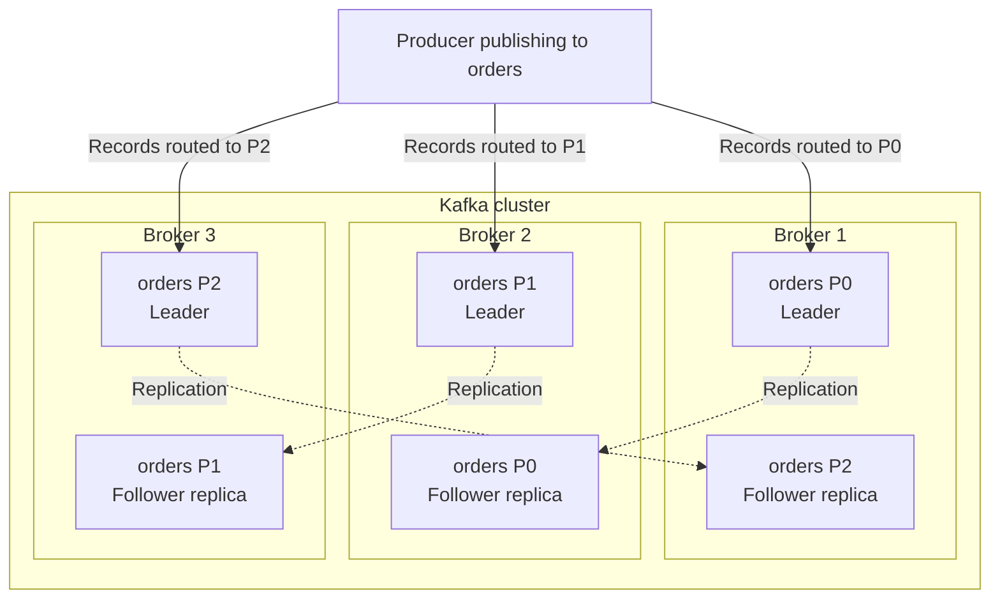
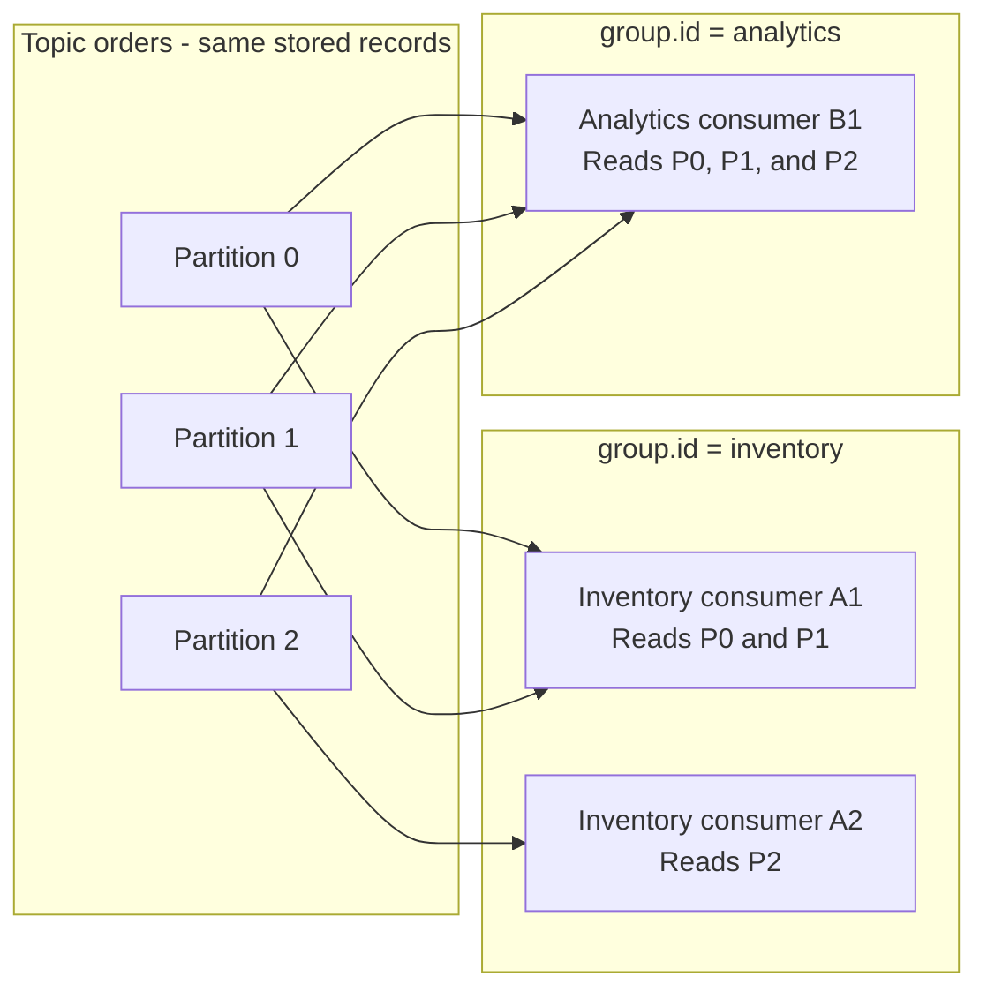
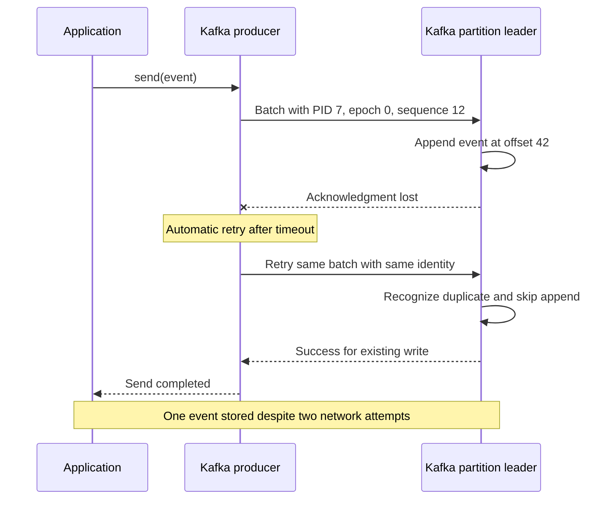
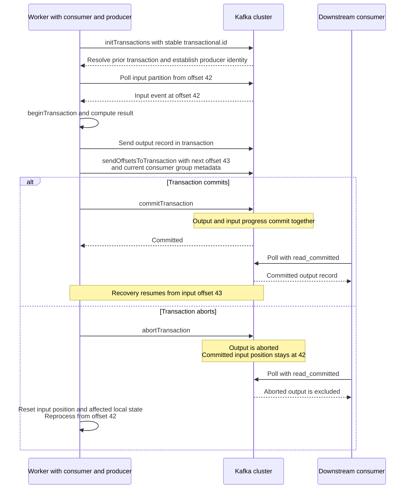
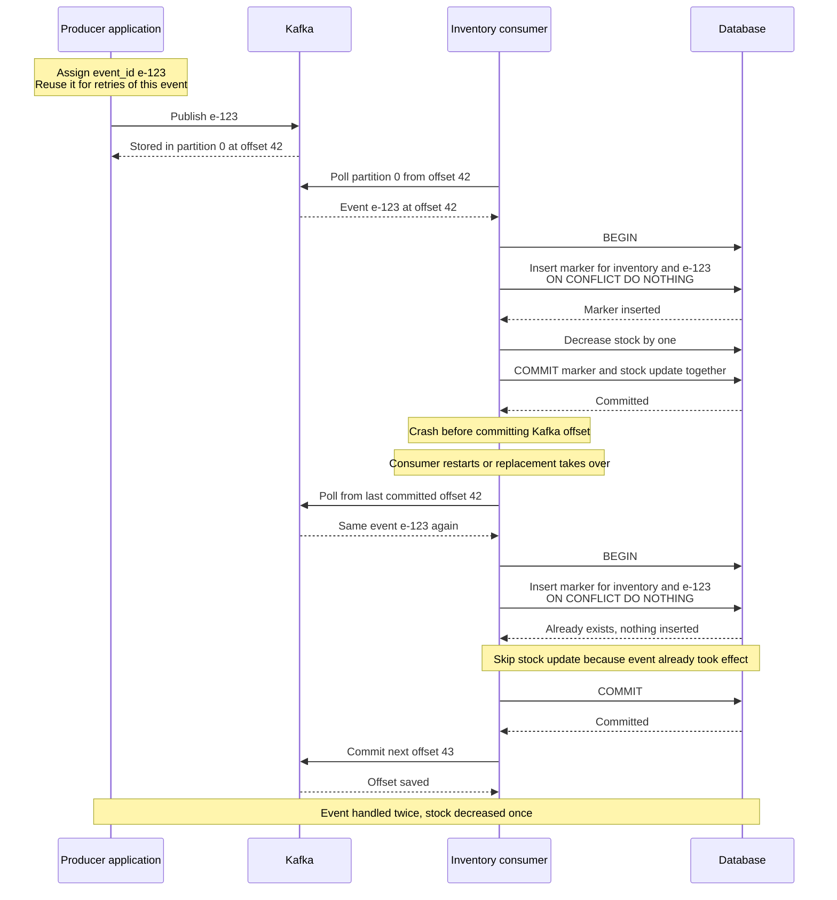
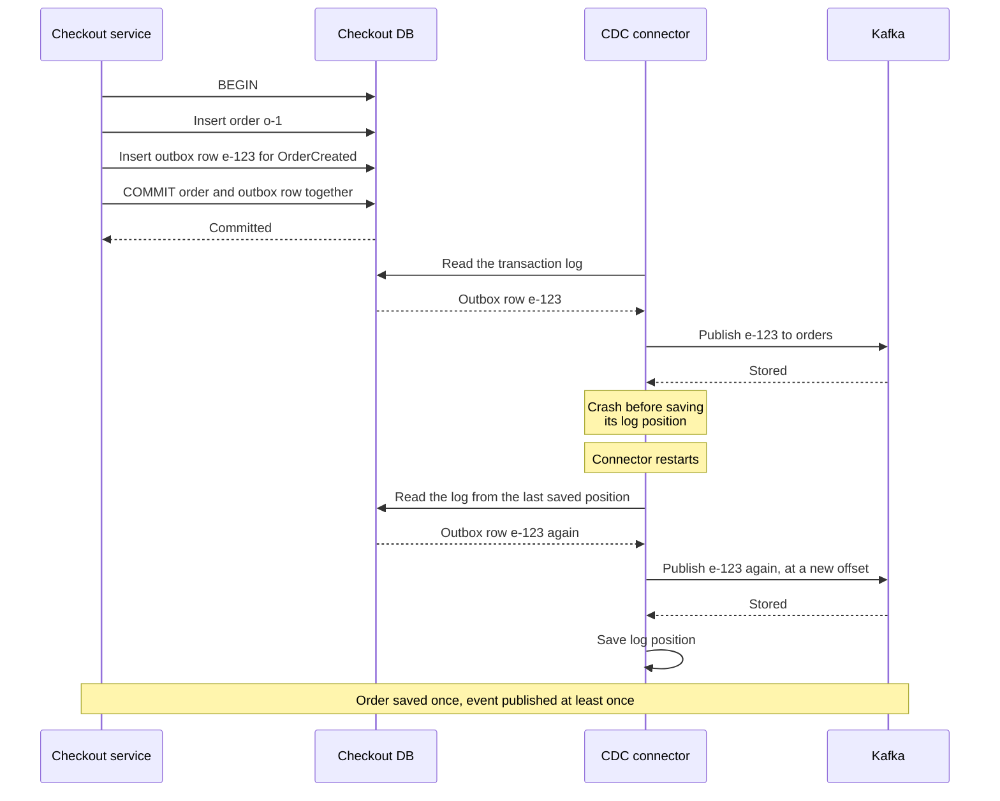
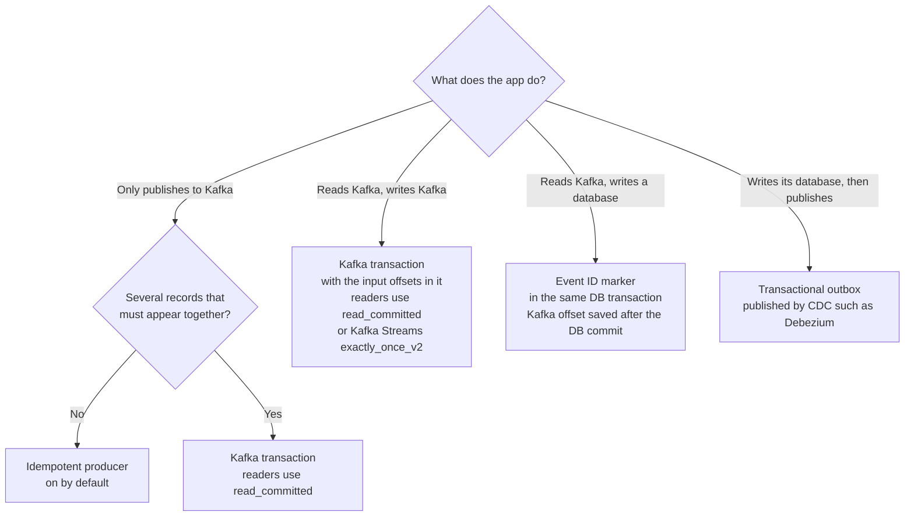
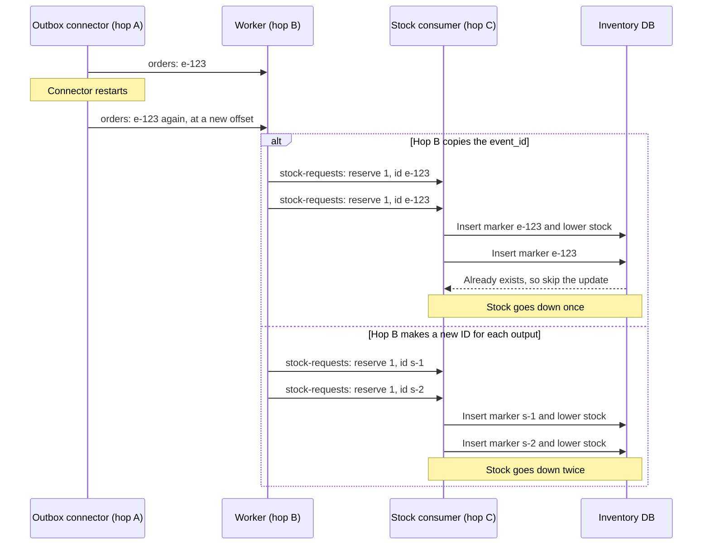
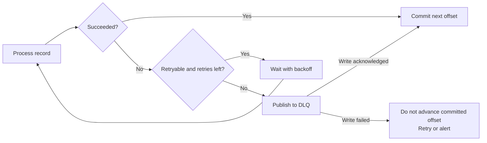

# Kafka Cheat Sheet

A companion to [DDIA Chapter 11: Stream Processing](../ddia/11-stream-processing.md) and [Chapter 12: The Future of Data Systems](../ddia/12-the-future-of-data-systems.md). Kafka settings below refer to the Java clients documented in Kafka 4.3.

The sheet has three parts:

- **Basics:** [brokers, topics, partitions, and consumer groups](#kafka-fundamentals-brokers-topics-partitions-and-consumer-groups).
- **Guarantees:** [what at most once, at least once, and exactly once mean](#delivery-guarantees-at-most-once-at-least-once-exactly-once), then one section for each of the four mechanisms, then [which mechanism to use and where its guarantee stops](#putting-it-together-which-mechanism-and-where-it-stops).
- **Bad records:** [poison pills and dead-letter queues](#poison-pills-and-dead-letter-queues).

## Kafka fundamentals: brokers, topics, partitions, and consumer groups

**Producers write events to topics. Kafka stores those events in partitions on brokers. Consumers fetch the events, and consumer groups decide which consumer reads each partition.**

| Term | Meaning | Example |
| --- | --- | --- |
| **Broker** | A Kafka server that stores partition replicas and serves client requests. Several brokers form a cluster. | Broker 1 stores some of the `orders` data. |
| **Topic** | A named stream of events, divided into partitions. | `orders` contains order events. |
| **Partition** | One ordered log within a topic. Each record has a position called an offset. | `orders`, partition 0, offset 42. |
| **Producer** | A client that publishes records to topic partitions. | The checkout service publishes `OrderCreated`. |
| **Consumer** | A client that fetches records and processes them. | An inventory worker updates stock. |
| **Consumer group** | Consumers with the same `group.id` that share partition assignments and track progress for one logical subscriber. | Several inventory workers use `group.id=inventory`. |

A topic is a logical name spanning its partitions. A broker can store partitions from many topics. Because one topic's partitions sit on different brokers, clients can read and write through many brokers at the same time, so a topic is not limited by one server.

### How partitions are stored across brokers

This example has one topic, `orders`, with three partitions and a replication factor of two. Each partition has a leader and one follower replica on another broker. Writes go to the leader; followers copy its log. The replicas are copies of the same partitions, so this is still three partitions, not six.



More partitions allow work to be spread across brokers and consumers. Replicas provide additional copies for recovery. When a leader fails, Kafka can elect an eligible replica as the new leader. Only **in-sync replicas (ISR)** are eligible: replicas whose broker is alive and that have not fallen behind the leader for longer than `replica.lag.time.max.ms`. A committed record is not lost as long as at least one in-sync replica stays alive. If every in-sync replica is down, Kafka by default waits for one to return instead of electing an out-of-sync replica that may be missing records (`unclean.leader.election.enable=false`). A broker can lead one partition while following another.

With standard key-based routing and a fixed partition count, records with the same key go to the same partition. For example, using `order_id` as the key keeps one order's events together. Kafka preserves log order within each partition; separate partitions have no single combined order.

### How consumer groups divide the work

The assignment rules here describe standard `KafkaConsumer` groups. Within a group, a partition is assigned to at most one consumer at a time. One consumer can own several partitions. Different groups maintain independent assignments and progress.



The arrows show records returned by consumer fetches. Each group can read the topic independently from its chosen starting positions; Kafka does not create another stored copy for each group.

For a group subscribed only to a three-partition topic, at most three consumers have partitions to read. A fourth remains idle. When a consumer joins or leaves, a **rebalance** can move partition ownership among group members. A rebalance also happens when a member fails or a subscribed topic gains partitions. A member counts as failed if its background heartbeats stop for longer than the session timeout, or if it goes longer than `max.poll.interval.ms` (5 minutes by default) between `poll()` calls. Before partitions move away, `ConsumerRebalanceListener.onPartitionsRevoked` lets the consumer commit its progress.

### Offsets track progress, while retention controls storage

Each group stores a committed next offset for each topic-partition. Both groups below read the same partition but have different saved progress. The example assumes those positions remain within the retained log:

| Group | Topic-partition | Committed next offset | Recovery starts from |
| --- | --- | --- | --- |
| `inventory` | `orders` P0 | 43 | Offset 43, or the next available record. |
| `analytics` | `orders` P0 | 10 | Offset 10, or the next available record. |

Offsets belong to individual partitions. `orders` P0 offset 42 and `orders` P1 offset 42 identify different records. Fetching advances a consumer's current position; committing saves a recovery position. The position is the offset of the next record `poll()` will return, one more than the highest offset seen. The committed offset should also be the next offset to read, so a group that finished offset 42 commits 43. By default, `enable.auto.commit=true` makes the consumer commit on a timer every `auto.commit.interval.ms` (5 seconds). With auto-commit off, the application commits with `commitSync()`, which blocks until done, or `commitAsync()`, which returns at once.

Reading or committing an offset does not delete the record. Topic policies control cleanup: time or size limits can delete old segments, and compaction can remove superseded values for a key. Replay is possible only while the required records remain available.

| Topic setting | Default | Effect |
| --- | --- | --- |
| `cleanup.policy` | `delete` | `delete` removes old segments by age or size. `compact` keeps the latest value for each key. `delete,compact` does both. |
| `retention.ms` | `604800000` (7 days) | Maximum age before old segments are deleted. `-1` means no time limit. |
| `retention.bytes` | `-1` (no limit) | Maximum size of each partition, not of the whole topic, before old segments are deleted. |

Cleanup works one whole segment file at a time (`segment.bytes`, 1 GiB by default), so a record can stay past its limit until its segment is closed and removed.

## Delivery guarantees: at most once, at least once, exactly once

A consumer does two things with each record: it processes the record, and it saves its offset. The order of the two decides what a crash in between does:

| The consumer's order | A crash in between | Name |
| --- | --- | --- |
| Save the offset, then process | The record is skipped, so its effect is lost. | **At most once** |
| Process, then save the offset | The record is processed again, so its effect can happen twice. | **At least once** |
| Both take effect together, or a repeat is detected and skipped | The record takes effect once. | **Exactly once** |

A producer has the same problem when a send gets no acknowledgment, because it cannot tell whether the record was stored. Giving up can lose the record, and sending again can store it twice, unless the broker recognizes the retry, as in [section 1](#1-idempotent-producer-a-retried-send-is-stored-once).

By default, Kafka gives at-least-once delivery, so replays are expected and duplicates are the usual problem.

### Exactly-once delivery vs. exactly-once processing

Delivery describes a message reaching a destination. Processing describes what happens because of that message. Always name the destination or effects covered by the guarantee.

| Guarantee | Meaning | What it does not establish |
| --- | --- | --- |
| **Exactly-once delivery** | Each message is accepted once at the specified delivery boundary, without loss or duplicate acceptance. Network attempts may still be retried. | That the receiver's business update successfully committed once. |
| **Exactly-once processing** | Each input contributes its intended committed effects once, even if failures cause retries. | That the processing code physically executes only once, or that every external side effect is covered. |

Kafka's idempotent producer prevents its automatic retries from appending duplicate log entries. It is on by default since Kafka 3.0 (`enable.idempotence=true`). That is a producer-to-Kafka guarantee. A consumer can still fetch the same record again after a crash.

For example, an order event can be **stored once in Kafka, read twice by a consumer, and decrease stock once in the database**. The second delivery is safe because the database recognizes the event ID and skips the repeated update. Conversely, receiving a record once does not prevent a crash before its database update commits.

Kafka Streams provides exactly-once processing for its Kafka output and managed state with `processing.guarantee=exactly_once_v2`. The default is `at_least_once`. With exactly-once on, each read-process-write step commits its input offsets, state store updates, and output records together, even if a client or broker fails midway. External database writes and API calls need their own coordination.

Sections 1 to 4 each close one gap where a record could be lost or doubled. [Putting it together](#putting-it-together-which-mechanism-and-where-it-stops) then shows when to use each one and where its guarantee stops.

## 1. Idempotent producer: a retried send is stored once

The application calls `send()` once. The producer client retries the same batch when its acknowledgment is lost.



The broker recognizes the retry by three numbers that every record batch carries, as `producerId`, `producerEpoch`, and `baseSequence`:

- **Producer ID (PID):** Kafka assigns it. It says which producer sent the batch.
- **Producer epoch:** Kafka assigns it too. It is that producer's generation number, which lets brokers reject a stale writer.
- **Sequence number:** the producer client counts its records in each partition.

For each producer, the broker remembers the last sequence number written to the partition and compares an incoming batch's first and last sequence numbers against it. A batch it has already written is a retry, so it skips the append. A sequence number is not an offset: above, sequence 12 is stored at offset 42.

Calling `send()` twice creates two records, even if the key and payload match. A new producer session can also publish the same business event again. Bare producer idempotency covers protocol retries within its session; it cannot deduplicate a resend by the application. If a `send()` still fails after the producer stops retrying, for example because the record expired in the buffer, the safe recovery is to close the producer and check the last produced records for duplicates.

```properties
enable.idempotence=true
acks=all
max.in.flight.requests.per.connection=5
```

Idempotency requires `acks=all`, retries greater than zero, and at most five in-flight requests per connection. These are also the defaults: `acks=all`, `retries=2147483647`, and five in-flight requests. The limit is five because the broker keeps at most five batches per producer for this check. With idempotency on, retries also do not reorder records. Leave `retries` at its supported default unless there is a reason to change it; `delivery.timeout.ms` (2 minutes by default) bounds how long a send keeps retrying. Explicitly enabling idempotency makes incompatible settings fail configuration validation with a `ConfigException`. If idempotency is only on by default, incompatible settings silently turn it off instead.

## 2. Kafka transaction: several Kafka writes, all or nothing

A Kafka transaction makes a group of writes visible all together or not at all. It gives three things:

| What it gives | Who needs it | Covered in |
| --- | --- | --- |
| Several records across partitions and topics appear together | Any producer that writes related records, even one that consumes nothing | [Several records at once](#several-records-at-once) |
| Only one live writer per `transactional.id` | Any transactional producer that can be restarted or replaced | [What `transactional.id` adds](#what-transactionalid-adds) |
| Output records and consumed offsets commit together | A worker that reads Kafka and writes Kafka | [Consume, transform, produce](#consume-transform-produce) |

The third is a special case of the first. `sendOffsetsToTransaction()` writes the consumer's offsets to Kafka's internal `__consumer_offsets` topic, inside the same transaction as the output.

On commit or abort, Kafka writes a marker record into each partition the transaction wrote to, and `read_committed` consumers use these markers to skip aborted records. A crash can leave a transaction pending until recovery or timeout resolves it. A restarted producer with the same `transactional.id` completes or aborts it, or the coordinator aborts it after `transaction.timeout.ms` (60000 ms, 1 minute, by default).

### Several records at once

The simplest use needs no consumer: a producer writes related records that must appear together. For example, an order gateway with no database of its own publishes to two topics:

```java
producer.initTransactions();      // once, at startup
producer.beginTransaction();
producer.send(new ProducerRecord<>("orders", "o-1", orderCreated));
producer.send(new ProducerRecord<>("payments", "o-1", paymentRequested));
producer.commitTransaction();     // read_committed readers see both, or neither
```

| The producer crashes after the first `send()` | What readers see |
| --- | --- |
| Without a transaction | `OrderCreated` without `PaymentRequested`, so the payment service never charges. A retry publishes `OrderCreated` a second time. |
| With a transaction | `read_committed` readers see neither record, because the open transaction is aborted. A retry publishes both, once. |

A batch job works the same way: if it crashes halfway through 10,000 records in one transaction, `read_committed` readers see none of them.

### What `transactional.id` adds

Use a stable logical writer name, such as `inventory-transformer-0`, and reuse it when replacing that writer. Give separate concurrent logical writers distinct IDs.

Initializing a replacement producer resolves the previous producer's transaction and fences the old instance. If the old process wakes up, it cannot continue writing with stale authority. Producer epochs support this fencing. The `transactional.id` names the writer across many transactions; it is not a business event ID.

Setting `transactional.id` enables transactional operation and implies producer idempotency. It does not deduplicate two independent committed transactions that contain the same business event. Its default is `null`, which allows only idempotent delivery. Call `initTransactions()` once before any other transactional method. A fenced old instance gets `ProducerFencedException`, which is fatal: its only option is to close. By default, transactions need a cluster of at least three brokers, set by the broker setting `transaction.state.log.replication.factor`.

An epoch can change without a process restart. The newer transaction protocol used by compatible Kafka 4.0+ clients and brokers advances it for each transaction, so a duplicate from one transaction cannot be written as part of the next. The `transaction.version` cluster feature controls it. Servers enable it automatically since Kafka 4.0, and an existing cluster can turn it on with `transaction.version=2`. A producer switches only at the start of its next transaction, never midway.

### What `read_committed` adds

| Consumer setting | Records returned |
| --- | --- |
| `isolation.level=read_uncommitted` | Includes records from open and aborted transactions. |
| `isolation.level=read_committed` | Returns committed transactional records and ordinary nontransactional records, subject to the partition's stable-offset boundary. |

The default is `read_uncommitted`. A `read_committed` consumer reads only up to the **last stable offset**, the position just before the first still-open transaction. Records always come back in offset order, so an open transaction can hold back later records in its partition until the outcome is known. `read_committed` filters transaction visibility; it does not prevent replay or make a database update idempotent.

### Consume, transform, produce

Without a transaction, a worker can publish output and then crash before committing its input offset. Recovery reads the input again and publishes another output record. Each attempt makes a new send, so producer retry deduplication does not solve this. Committing the offset first fails the other way: a crash before the publish skips the input, so its output is lost.

The solution is to commit the output and input progress in the same Kafka transaction. In this single-record example, input offset `42` is followed by next offset `43`.



The cluster lifeline groups the relevant brokers and coordinators. The diagram shows the application-level guarantee, not each internal protocol request.

For a custom Kafka-to-Kafka worker:

```properties
# Producer
transactional.id=inventory-transformer-0

# Consumer
enable.auto.commit=false
isolation.level=read_committed
```

Commit consumed positions through `producer.sendOffsetsToTransaction(nextOffsets, consumer.groupMetadata())`, followed by `commitTransaction()`. Those offsets count as committed only if the transaction commits. `ConsumerRecords.nextOffsets()` gives the next offset to read for each partition. Passing the consumer's group metadata, not just its group ID, gives stronger fencing of stale group members. Do not separately commit those offsets through the consumer. Handle rebalances, fencing, and aborted transactions correctly:

| Error | Response |
| --- | --- |
| `ProducerFencedException`, `OutOfOrderSequenceException`, `UnsupportedVersionException`, or `AuthorizationException` | Fatal. Close the producer. |
| Other `KafkaException` during the transaction | Call `abortTransaction()`. The consumer does not rewind by itself, so seek back to the committed offsets and reprocess. |
| `TimeoutException` from `commitTransaction()` | The commit may still have reached the broker. Retrying `commitTransaction()` is safe. Calling `abortTransaction()` instead is not. |

A commit timeout can leave the result uncertain, so it must not be treated as proof of an abort.

Kafka Streams manages the transaction and state-recovery machinery with `processing.guarantee=exactly_once_v2`. Arbitrary local variables, external database writes, and API calls are outside its managed-state guarantee.

### When a transaction is not worth it

- **One independent record per `send()`:** the idempotent producer, on by default, already stops retry duplicates and keeps their order.
- **Kafka to a database:** a Kafka transaction cannot include the database. Use the event ID marker in [section 3](#3-event-id-marker-a-replayed-event-changes-the-database-once).
- **A database write, then a publish:** use the transactional outbox in [section 4](#4-transactional-outbox-a-database-change-and-its-event-both-or-neither).

Transactions also cost something:

- Each commit adds round trips to the transaction coordinator and writes a marker into every partition the transaction touched. Put many records in one transaction rather than one transaction per record.
- `read_committed` readers cannot read past an open transaction, so a long transaction delays everyone reading those partitions.
- All or nothing holds only for `read_committed` readers. A `read_uncommitted` reader, the default, sees records from open and aborted transactions.

## 3. Event ID marker: a replayed event changes the database once

Suppose event `e-123` means **decrease stock by one**. The consumer stores an **event ID marker**: a row with a unique key on `(handler, event_id)`, which records that this handler has processed this event. Use a stable logical handler name such as `inventory` so independent operations can process the same event separately.

**Insert the marker and apply the stock update in the same database transaction. Commit the Kafka offset afterward.**



The consumer must inspect whether the marker was inserted. In PostgreSQL, `ON CONFLICT (handler, event_id) DO NOTHING RETURNING event_id` returns a row only for a successful insertion. The command tag agrees: `INSERT 0 1` for a new marker, `INSERT 0 0` for a skipped one. Apply the stock update only in that case. The conflict target needs a unique index or non-deferrable unique constraint on exactly `(handler, event_id)`; otherwise the statement fails with an error. A uniqueness constraint handles concurrent duplicate attempts; a separate unprotected check-then-write does not.

If the business update fails, roll back the marker too. A marker must never commit while the required business effect is missing.

| Failure or duplicate | Recovery |
| --- | --- |
| Crash before the DB transaction commits | Both writes roll back. Replay can apply both. |
| DB commit succeeds but its reply is lost | Retry the protected operation. The marker reveals whether it committed. |
| Crash after DB commit but before Kafka offset commit | Replay finds the marker and skips the stock update. |
| Kafka offset commit succeeds but its reply is lost | Any replay is safe because the DB effect was already committed. |
| Application republishes `e-123` at a new Kafka offset | The stable event ID still suppresses the repeated business effect. |

Kafka and the database do not share a transaction in this design. The durable marker makes the gap between their commits safe to retry. Kafka transactions alone do not include an external database. By default, Kafka gives at-least-once delivery, so replays are expected. For exactly-once effects in an external system, the classic options are a two-phase commit across both systems, which many systems do not support, or storing the consumer's position in the same place as the output so both update or neither does. The marker table uses a similar idea, but records event IDs instead of offsets.

### Conditions for the database guarantee

1. **Stable identity:** retries of one logical event reuse its ID. Different events receive different IDs. The same ID must not silently represent a changed operation.
2. **Atomic marker and effect:** both commit or roll back in one database transaction, with a database-enforced unique key.
3. **Marker lifetime:** keep deduplication records for the full replay and republication window.
4. **Safe offset progress:** disable auto-commit and advance offsets only after DB success. With parallel processing, never commit past unfinished earlier records in a partition.
5. **Eventual success:** durable input and retries are needed for the effect to happen at least once. Deduplication alone provides at-most-once effects.
6. **Covered side effects:** email, HTTP calls, and writes to another database need their own coordination or idempotency mechanism.

These conditions give one committed database effect per `(handler, event_id)` even when the consumer runs more than once. They do not make the processing function itself execute only once.

Using `(topic, partition, offset)` instead of a business event ID can suppress replay of the same Kafka record. It cannot recognize the same business event republished as a different record.

## 4. Transactional outbox: a database change and its event, both or neither

The sections above assume that the event reliably reaches Kafka. A service that must both update its own database and publish an event has one more commit gap, before Kafka. For example, the checkout service saves order `o-1` and publishes `OrderCreated`:

| Order of the two writes | A crash in between |
| --- | --- |
| Commit the order, then publish | The order exists, but no event says so. Stock is never reserved. |
| Publish, then commit the order | The event exists, but the order was never saved. Stock is reserved for an order that does not exist. |

A Kafka transaction cannot close this gap, because it cannot include the database. A **transactional outbox** turns the two writes into one. The service inserts the event into an outbox table in the same database transaction as its business change. A change-data-capture (CDC) connector, such as Debezium, then reads those inserts from the database's transaction log and publishes them to Kafka.



The connector delivers at least once: after a restart, it can publish an event that it already published. Consumers drop the repeat with the event ID marker from [section 3](#3-event-id-marker-a-replayed-event-changes-the-database-once), so each outbox row needs a stable ID.

With Debezium's outbox event router, the default columns are `id`, `aggregatetype`, `aggregateid`, `type`, and `payload`:

- `aggregatetype` picks the topic, `outbox.event.<aggregatetype>` by default.
- `aggregateid` becomes the record key, so one aggregate's events stay in order within a partition.
- `id` travels in a record header and can serve as the stable `event_id` that consumers deduplicate on.

## Putting it together: which mechanism, and where it stops

Each mechanism above protects one boundary, and only that one:

| Mechanism | What it protects | What it does not automatically protect |
| --- | --- | --- |
| [1. Idempotent producer](#1-idempotent-producer-a-retried-send-is-stored-once) | Automatic producer retries do not append duplicate records. | A new application-level `send()` of the same business event. |
| [2. Kafka transaction](#2-kafka-transaction-several-kafka-writes-all-or-nothing) | The records it writes, and any input offsets it saves, take effect together or not at all. All of them must be in one Kafka cluster. | A database update, an HTTP request, or a write to another Kafka cluster. |
| [3. Event ID marker](#3-event-id-marker-a-replayed-event-changes-the-database-once) | One committed database effect per logical event and handler. | Effects outside that database transaction. |
| [4. Transactional outbox](#4-transactional-outbox-a-database-change-and-its-event-both-or-neither) | The event gets published if and only if the database change commits. | Duplicate publishes, because CDC usually delivers at least once. |

### Which mechanism, when



Setting `transactional.id` also turns on idempotence, so a transactional producer is always idempotent too.

### Boundaries in one pipeline

Each mechanism covers one hop. In this order pipeline, every hop needs its own:

```text
Checkout DB --[A]--> orders --[B]--> stock-requests --[C]--> Inventory DB --[D]--> Email API
```

| Hop | Mechanism | Guarantee | Still possible |
| --- | --- | --- | --- |
| A: Checkout DB to `orders` | Transactional outbox and CDC | The event is published if and only if the order commits. | Usually at least once, so a connector restart can publish a duplicate. Readers deduplicate by `event_id`. |
| B: `orders` to `stock-requests` | Kafka transaction in the worker | Each input produces its output once, as `read_committed` readers see it. | A duplicate from hop A is a new input, so it gets its own output. Side effects inside the worker, such as an HTTP call, can repeat. |
| C: `stock-requests` to Inventory DB | Event ID marker in the same DB transaction, with the offset saved afterward | Stock goes down once per event. | The handler can run twice, so anything outside that DB transaction can repeat. |
| D: Inventory DB to an email API | Nothing from Kafka | None by default. | A retry sends a second email, unless the API accepts an idempotency key such as `Idempotency-Key: e-123`. |

Two rules connect the hops:

- **Hop C's consumer must use `read_committed`.** Otherwise it can act on a record that hop B wrote and then aborted, and lower stock for an event that never happened.
- **Hop B must copy each input's `event_id` into its output.** A duplicate from hop A reaches hop B as a new record, so hop B makes a second stock request. Hop C's marker can drop it only if both requests carry the same ID. When one input makes several outputs, derive their IDs from it, such as `e-123/1` and `e-123/2`.



## Poison pills and dead-letter queues

A **poison pill** is a record that repeatedly fails processing, such as malformed data or an unsupported schema.
Retrying it indefinitely can stall its partition.
A **dead-letter queue**, or **DLQ**, is an ordinary topic such as `orders.dlq` that preserves failed records for investigation and replay while other work continues.
Kafka does not automatically create one for each topic; the consumer application decides when and where to publish failures.



- Preserve the original key/value, source topic, partition, offset, and error details in the DLQ record.
  For decoding failures, consuming raw bytes and decoding in the handler lets you capture the malformed record.
- Disable auto-commit and never commit past unfinished earlier records in the partition.
  Auto-commit is on by default and saves positions on a timer, so with asynchronous handling it can save a position past records still in progress, and a crash then skips them.
  Publishing to a DLQ copies the record; it does not delete the original.
- A crash between the DLQ write and offset commit can produce duplicate DLQ entries.
  A [Kafka transaction](#2-kafka-transaction-several-kafka-writes-all-or-nothing) can commit both together, with DLQ consumers using `read_committed`.
- Monitor the DLQ, fix the cause, and replay deliberately with duplicate handling.
  Replay can change business-event order; if later events must wait, pause the affected partition instead of skipping ahead and keep polling to remain in the group.
