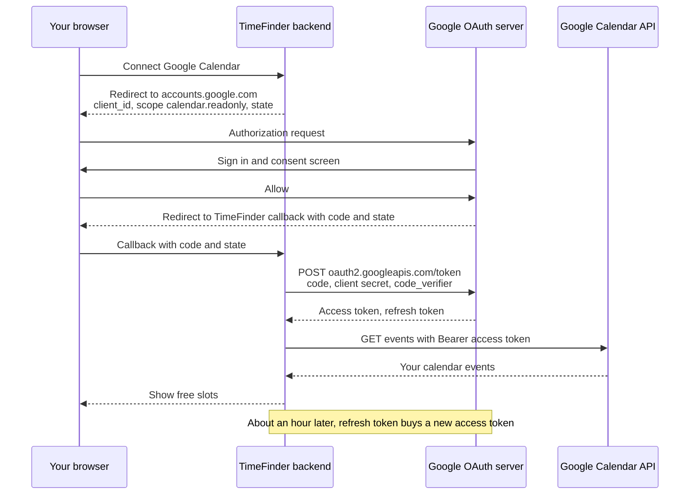
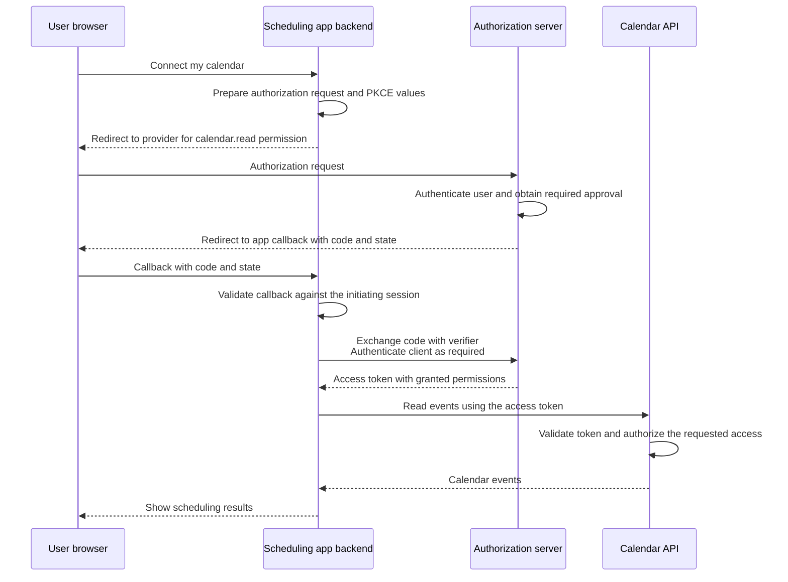
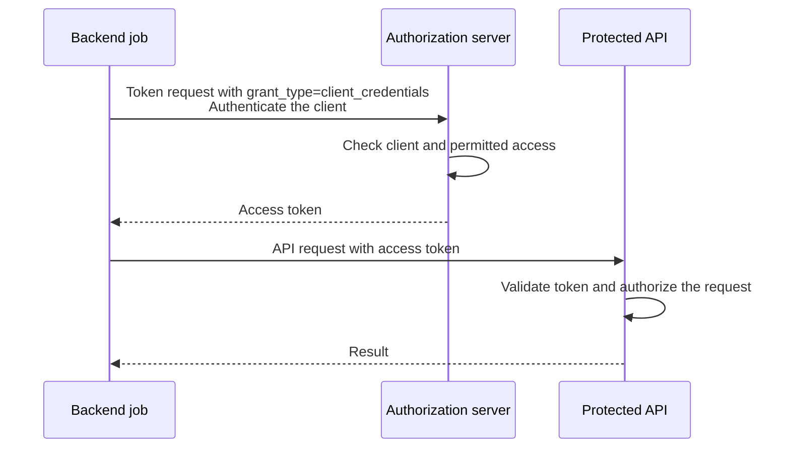
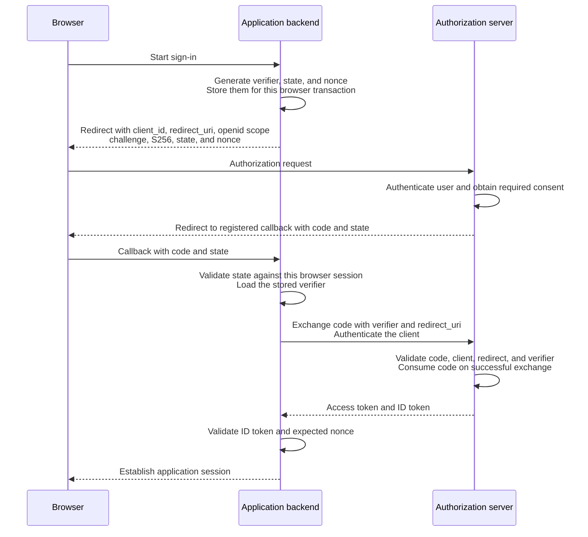
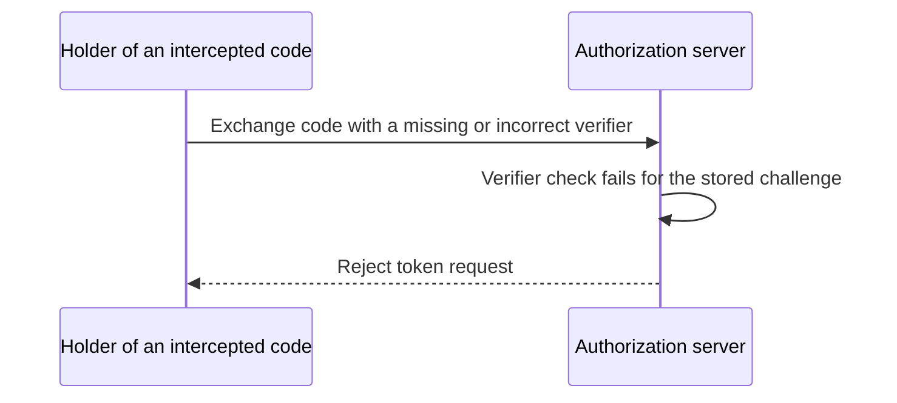

# OAuth Cheat Sheet

OAuth 2.0 lets an application obtain permission to access an API.
OpenID Connect, or OIDC, adds an identity layer for sign-in.

## How OAuth works, in general

Think of a hotel key card.
The front desk checks who you are once and gives you a card.
The card opens only your room, and only until checkout.
The doors never see your passport. They only check the card.

In OAuth, the front desk is the **authorization server**, the card is the **access token**, the rooms it opens are its **scopes**, and the doors are the **API**.

### Example: an app reads your Google Calendar

A scheduling app called TimeFinder wants to read your Google Calendar to find free slots.
It must not ask for your Google password.

| Role | In this example |
| --- | --- |
| Resource owner | You, with your Google account. |
| Client | TimeFinder's backend. |
| Authorization server | Google's OAuth server: `accounts.google.com` for sign-in and consent, `oauth2.googleapis.com` for tokens. |
| Resource server | The Google Calendar API at `www.googleapis.com/calendar/v3`. |

**Once, before any user:** TimeFinder registers in the Google Cloud console.
It gets a `client_id` and a client secret, and it registers its callback URL, `https://timefinder.example/oauth/callback`.
Google will only send codes to registered callback URLs.

**Each time a user connects:**

1. You click **Connect Google Calendar** in TimeFinder.
2. TimeFinder redirects your browser to Google, saying who it is and what it wants:

   ```text
   https://accounts.google.com/o/oauth2/v2/auth
     ?client_id=1234.apps.googleusercontent.com
     &redirect_uri=https://timefinder.example/oauth/callback
     &response_type=code
     &scope=https://www.googleapis.com/auth/calendar.readonly
     &access_type=offline
     &state=af0ifjsldkj
     &code_challenge=E9Melhoa2OwvFrEMTJguCHaoeK1t8URWbuGJSstw-cM
     &code_challenge_method=S256
   ```

3. Google signs you in, if you are not signed in already. Your password goes only to Google.
4. Google shows a consent screen: "TimeFinder wants to see your calendars." You click **Allow**.
5. Google redirects your browser back to TimeFinder with a short-lived **authorization code**:

   ```text
   https://timefinder.example/oauth/callback?code=4/0AeanS0b...&state=af0ifjsldkj
   ```

6. TimeFinder's backend checks that `state` matches what it sent, then exchanges the code for tokens, server to server:

   ```http
   POST /token HTTP/1.1
   Host: oauth2.googleapis.com
   Content-Type: application/x-www-form-urlencoded

   grant_type=authorization_code&code=4/0AeanS0b...
   &redirect_uri=https://timefinder.example/oauth/callback
   &client_id=1234.apps.googleusercontent.com&client_secret=<secret>
   &code_verifier=dBjftJeZ4CVP-mB92K27uhbUJU1p1r_wW1gFWFOEjXk
   ```

7. Google replies with tokens:

   ```json
   {
     "access_token": "ya29.a0Af...",
     "expires_in": 3599,
     "token_type": "Bearer",
     "scope": "https://www.googleapis.com/auth/calendar.readonly",
     "refresh_token": "1//0g..."
   }
   ```

8. TimeFinder calls the Calendar API with the access token:

   ```http
   GET /calendar/v3/calendars/primary/events HTTP/1.1
   Host: www.googleapis.com
   Authorization: Bearer ya29.a0Af...
   ```

9. After about an hour the access token expires.
   TimeFinder sends the refresh token to `oauth2.googleapis.com/token` with `grant_type=refresh_token` and gets a new access token, without bothering you.



What each side ends up knowing:

| Party | Knows your Google password? | Holds |
| --- | --- | --- |
| Google | Yes | Your account and the permission you granted. |
| TimeFinder | No | An access token for read-only calendar access, and a refresh token. |
| Calendar API | No | Only the token in each request, which it checks. |

You can take the permission back at any time at `myaccount.google.com/permissions`.
Google then revokes TimeFinder's refresh token, so it can no longer get new access tokens.

`access_type=offline` asks Google for a refresh token.
Without it, TimeFinder gets only the one-hour access token and must send you through consent again.
Google returns a refresh token only on the first consent, unless the request adds `prompt=consent`.

### OAuth vs "Sign in with Google"

OAuth alone answers **"may this app call this API?"** It does not tell the app who you are.
"Sign in with Google" is **OIDC** on top of the same flow:

| | OAuth only | OIDC sign-in |
| --- | --- | --- |
| Scope | `https://www.googleapis.com/auth/calendar.readonly` | `openid email profile` |
| Token for the app | Access token | Access token **and an ID token** |
| Question answered | "Can TimeFinder read this calendar?" | "Who is this user?" |

The ID token is a signed JWT that the app validates itself. Example claims:

```json
{
  "iss": "https://accounts.google.com",
  "aud": "1234.apps.googleusercontent.com",
  "sub": "110169484474386276334",
  "email": "you@gmail.com",
  "nonce": "n-0S6_WzA2Mj",
  "exp": 1793865600
}
```

Use `sub`, not `email`, as the stable user ID. An email address can change.

The rest of this sheet explains each piece in detail: the roles, tokens, client types, PKCE, and how to bind the result to the browser session.

## The roles

Suppose a scheduling application wants to read your calendar without asking for your calendar password.

| Role | Responsibility | Example |
| --- | --- | --- |
| Resource owner | Can authorize access to the protected resources. | You, as the calendar owner. |
| Client | Requests access and uses the resulting token. | The scheduling application. |
| Authorization server | Checks authorization requests and issues tokens. | The calendar provider's authorization service. |
| Resource server | Hosts the protected API and enforces access rules. | The calendar API. |

The authorization server and resource server are separate roles even when one provider operates both.
A **scope** names a requested permission, such as `calendar.read`.
The provider defines its meaning, and the permissions actually granted can differ from those requested.

## User-authorized access

The authorization-code flow lets the user authenticate with the provider and authorize the client.
The client receives a temporary code, exchanges it for an access token, and presents that token to the API.
The user's provider password stays with the provider.

This overview uses a web backend as the client and includes PKCE, whose details are explained below.



### Using the access token

A common way to call the API is an HTTP request with a bearer token:

```http
GET /events HTTP/1.1
Host: calendar.example.com
Authorization: Bearer <access_token>
```

Send it over HTTPS.
A bearer token lets its holder exercise the access it grants, so protect it like a credential.
The API checks token validity, its intended audience, granted permissions, and whether the requested resource is accessible.
For example, a read-only token does not grant permission to delete an event.

OAuth does not require access tokens to be JWTs.
An API may validate a signed token locally or check an opaque token through the issuer's supported validation mechanism, such as token introspection.

## Application-only access

A backend job can also need API access without acting for a signed-in user.
With the **client credentials** grant, a confidential client authenticates directly to the authorization server and receives a token for its assigned permissions.



This flow has no browser redirect or authorization code.
PKCE protects code exchange, so it is not part of this grant.
Request a new token through the same client-authentication flow when it expires.

## Keep the credentials separate

| Value | Purpose |
| --- | --- |
| `client_id` | Public identifier for the application. |
| Client secret | Authenticates a confidential client to the authorization server. It does not identify the user. |
| Authorization code | Short-lived, single-use value exchanged at the token endpoint. It is bound to the client, redirect URI, and PKCE challenge when PKCE is used. |
| Access token | Allows access to the intended API within the granted permissions. |
| Refresh token | An optional credential presented to the authorization server to obtain a new access token. It is not sent to the resource API. |
| ID token | OIDC identity information intended for the client to validate during sign-in. |
| Application session | The application's own login state, often represented by a session cookie. |

The authorization server determines an access token's lifetime.
When a refresh token is issued, the client can request a replacement access token while the refresh token and authorization remain valid.

## Public and confidential clients

| Client type | Can it keep an application credential confidential? | Example |
| --- | --- | --- |
| Public | No. A secret embedded in distributed client code can be extracted. | A browser application or native app. |
| Confidential | Yes, within its protected server environment. | A web backend performing the token exchange. |

For user authorization, use authorization code flow with PKCE for public clients.
PKCE is also recommended for confidential clients, which still authenticate at the token endpoint using a secret or another configured method.
Client authentication and PKCE protect different parts of the flow and can be used together.

## How PKCE works

PKCE means **Proof Key for Code Exchange**.
The client generates a new random `code_verifier` for each authorization attempt and derives a `code_challenge` from it.
With the `S256` method:

```text
code_challenge = BASE64URL(SHA256(ASCII(code_verifier)))
```

Base64url encoding omits trailing `=` padding.
The verifier must contain 43–128 permitted URL-safe characters and enough randomness to resist guessing.
For example, 32 random bytes encoded as base64url produce a 43-character verifier:

```python
import base64
import hashlib
import secrets


code_verifier = secrets.token_urlsafe(32)
digest = hashlib.sha256(code_verifier.encode('ascii')).digest()
code_challenge = base64.urlsafe_b64encode(digest).rstrip(b'=').decode('ascii')
```

Send the challenge with the authorization request using `code_challenge_method=S256`.
Keep the verifier with the client's pending transaction, then send it to the token endpoint during the code exchange.
The authorization server hashes the supplied verifier and checks it against the challenge associated with that code.

## OIDC sign-in with authorization code and PKCE

This example uses a confidential web backend and OIDC sign-in.
The backend stores the verifier and correlation values against the initiating browser session.



The browser carries the challenge and authorization code, but the backend keeps its client secret and verifier out of the redirect URLs.
For a public client, the client itself retains the verifier and performs the exchange without a client secret.

## Why an intercepted code is insufficient

Knowing the code and challenge does not reveal the random verifier.
The token endpoint rejects an exchange without the matching verifier.



A client secret alone does not bind a code to a particular browser's authorization attempt.
If a code is injected into another browser's flow, correct transaction binding makes the client use that flow's verifier, which will not match the injected code's challenge.

## Bind the result to the initiating session

| Mechanism | What to check |
| --- | --- |
| `state` | Match the callback to a pending authorization transaction bound to the initiating browser session. This helps prevent cross-site request forgery. |
| PKCE | Present the verifier saved for that transaction so the authorization server can validate the code exchange. |
| OIDC `nonce` | If sent, require the same value in the validated ID token to associate it with the sign-in attempt. |

For OIDC, validate the ID token's signature with trusted provider keys, issuer, audience, expiry, and expected nonce before establishing the application session.
An arbitrary access token or authorization code is not sufficient proof of identity for the application's login session.

PKCE protects the code exchange.
Protect tokens and application sessions separately, use HTTPS for web redirects and token exchanges, and validate registered redirect URIs.
Multi-factor authentication strengthens user authentication; it does not replace PKCE or session binding.
