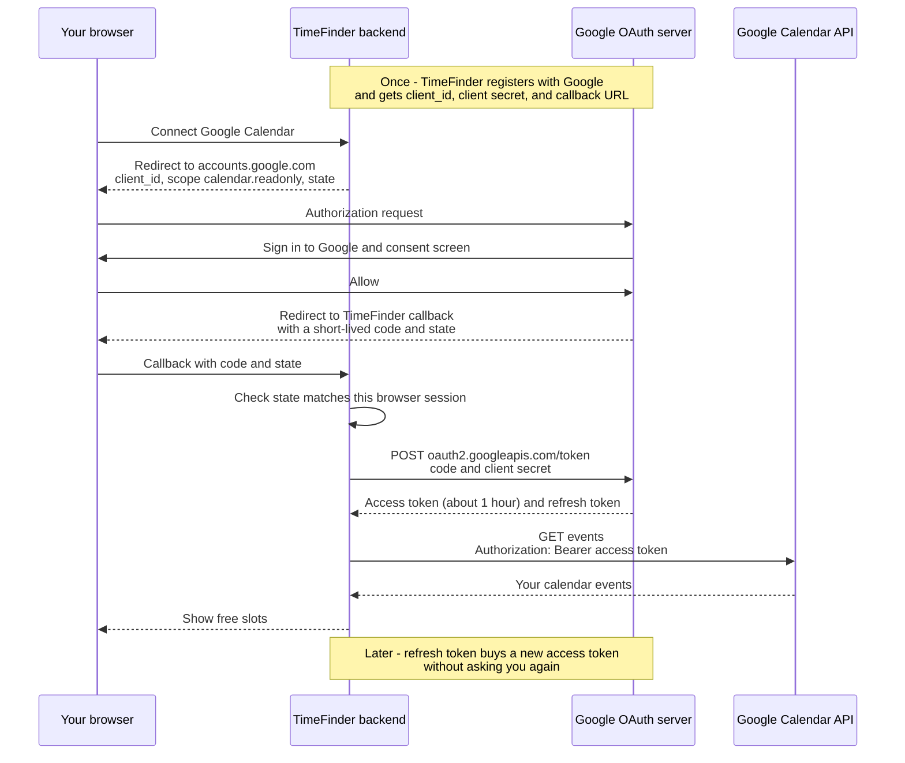
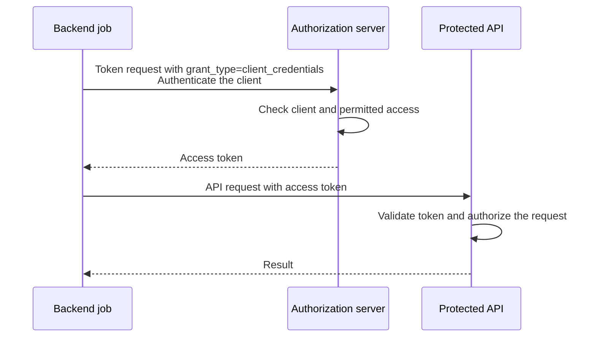
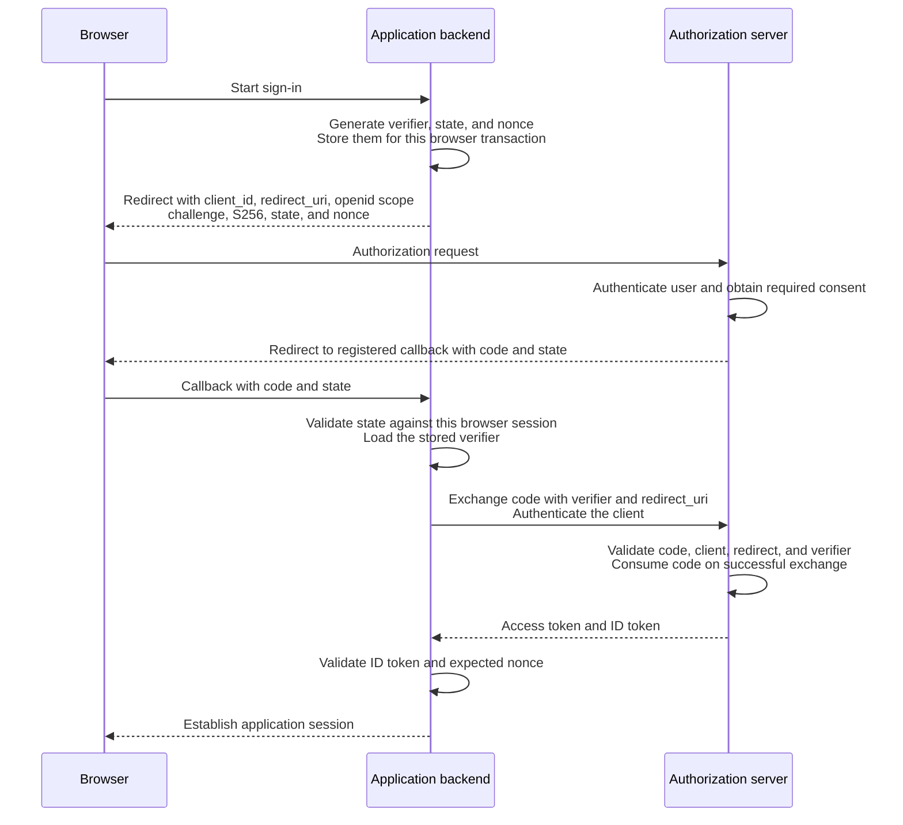
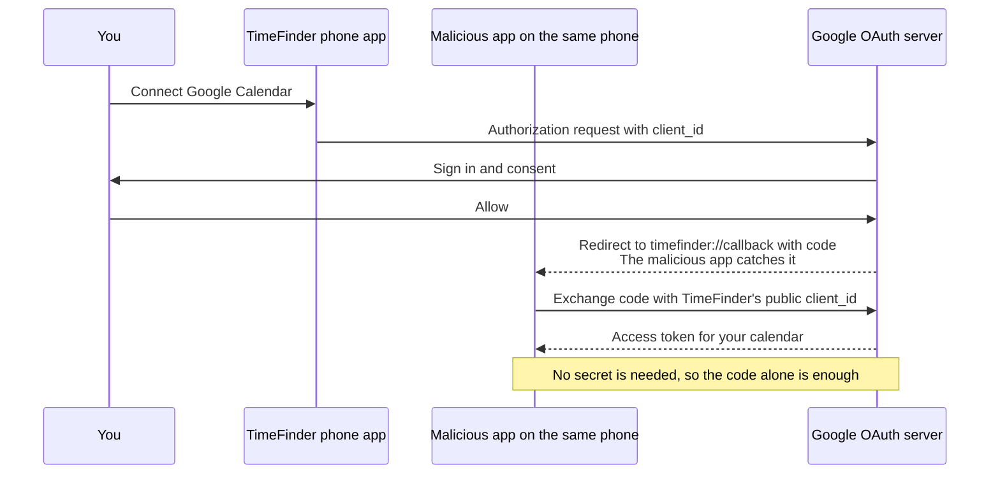
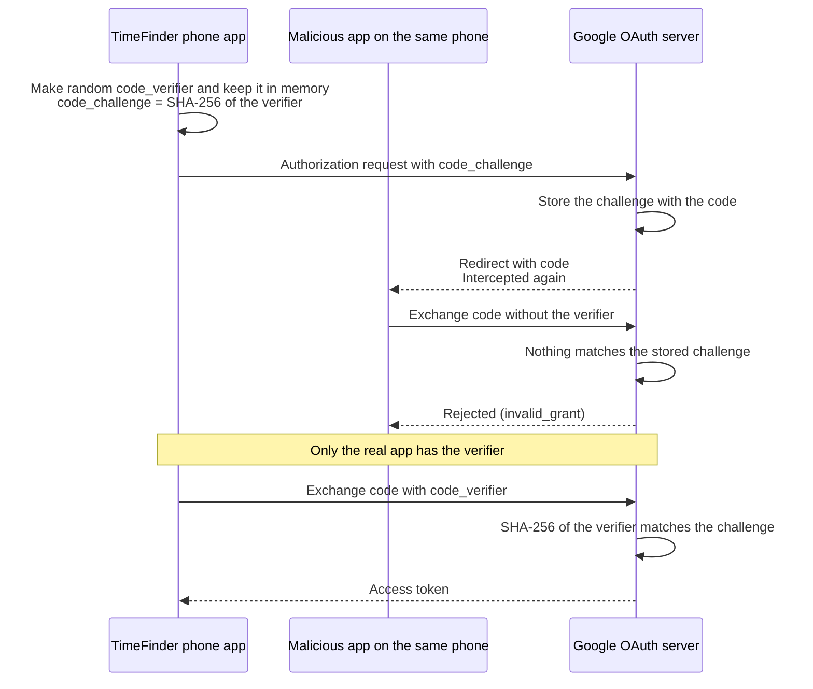

# OAuth Cheat Sheet

OAuth 2.0 lets an application obtain permission to access an API.
OpenID Connect, or OIDC, adds an identity layer for sign-in.

## How OAuth works

Example: a scheduling app, TimeFinder, wants to read your Google Calendar without asking for your Google password.

| Role | Responsibility | In this example |
| --- | --- | --- |
| Resource owner | Can authorize access to the protected resources. | You, with your Google account. |
| Client | Requests access and uses the resulting token. | TimeFinder's backend. |
| Authorization server | Checks authorization requests and issues tokens. | Google: `accounts.google.com` and `oauth2.googleapis.com`. |
| Resource server | Hosts the protected API and enforces access rules. | Google Calendar API. |



- Your password goes only to Google. TimeFinder only ever holds tokens.
- The token is limited to its **scope**, here read-only calendar access.
- You can revoke the access at any time at `myaccount.google.com/permissions`.
- "Sign in with Google" is the same flow with the `openid` scope. Google then also returns an ID token that says who you are (see [OIDC sign-in](#oidc-sign-in-with-authorization-code-and-pkce)).

The authorization server and resource server are separate roles even when one provider operates both.
A **scope** names a requested permission, such as `calendar.read`.
The provider defines its meaning, and the permissions actually granted can differ from those requested.

### Using the access token

A common way to call the API is an HTTP request with a bearer token:

```http
GET /events HTTP/1.1
Host: calendar.example.com
Authorization: Bearer <access_token>
```

Send it over HTTPS.
A bearer token lets its holder exercise the access it grants, so protect it like a credential.
The API checks token validity, its intended audience, granted permissions, and whether the requested resource is accessible.
For example, a read-only token does not grant permission to delete an event.

OAuth does not require access tokens to be JWTs.
An API may validate a signed token locally or check an opaque token through the issuer's supported validation mechanism, such as token introspection.

## Application-only access

A backend job can also need API access without acting for a signed-in user.
With the **client credentials** grant, a confidential client authenticates directly to the authorization server and receives a token for its assigned permissions.



This flow has no browser redirect or authorization code.
PKCE protects code exchange, so it is not part of this grant.
Request a new token through the same client-authentication flow when it expires.

## Keep the credentials separate

| Value | Purpose |
| --- | --- |
| `client_id` | Public identifier for the application. |
| Client secret | Authenticates a confidential client to the authorization server. It does not identify the user. |
| Authorization code | Short-lived, single-use value exchanged at the token endpoint. It is bound to the client, redirect URI, and PKCE challenge when PKCE is used. |
| Access token | Allows access to the intended API within the granted permissions. |
| Refresh token | An optional credential presented to the authorization server to obtain a new access token. It is not sent to the resource API. |
| ID token | OIDC identity information intended for the client to validate during sign-in. |
| Application session | The application's own login state, often represented by a session cookie. |

The authorization server determines an access token's lifetime.
When a refresh token is issued, the client can request a replacement access token while the refresh token and authorization remain valid.

## Public and confidential clients

| Client type | Can it keep an application credential confidential? | Example |
| --- | --- | --- |
| Public | No. A secret embedded in distributed client code can be extracted. | A browser application or native app. |
| Confidential | Yes, within its protected server environment. | A web backend performing the token exchange. |

For user authorization, use authorization code flow with [PKCE](#pkce-the-attack-it-stops) for public clients.
PKCE is also recommended for confidential clients, which still authenticate at the token endpoint using a secret or another configured method.
Client authentication and PKCE protect different parts of the flow and can be used together.

## OIDC sign-in with authorization code and PKCE

This example uses a confidential web backend and OIDC sign-in.
The backend stores the verifier and correlation values against the initiating browser session.



The browser carries the challenge and authorization code, but the backend keeps its client secret and verifier out of the redirect URLs.
For a public client, the client itself retains the verifier and performs the exchange without a client secret.

With Google, the ID token's claims look like this. Use `sub`, not `email`, as the stable user ID, because an email address can change.

```json
{
  "iss": "https://accounts.google.com",
  "aud": "1234.apps.googleusercontent.com",
  "sub": "110169484474386276334",
  "email": "you@gmail.com",
  "nonce": "n-0S6_WzA2Mj"
}
```

## Bind the result to the initiating session

| Mechanism | What to check |
| --- | --- |
| `state` | Match the callback to a pending authorization transaction bound to the initiating browser session. This helps prevent cross-site request forgery. |
| PKCE | Present the verifier saved for that transaction so the authorization server can validate the code exchange. |
| OIDC `nonce` | If sent, require the same value in the validated ID token to associate it with the sign-in attempt. |

For OIDC, validate the ID token's signature with trusted provider keys, issuer, audience, expiry, and expected nonce before establishing the application session.
An arbitrary access token or authorization code is not sufficient proof of identity for the application's login session.

Protect tokens and application sessions separately, use HTTPS for web redirects and token exchanges, and validate registered redirect URIs.
Multi-factor authentication strengthens user authentication; it does not replace PKCE or session binding.

## PKCE: the attack it stops

PKCE means **Proof Key for Code Exchange**.
It makes a stolen authorization code useless.

### The attack, without PKCE

TimeFinder also has a phone app. A phone app is a public client: it has no client secret, because anyone can extract one from the app.
Google sends the code back to `timefinder://callback`.
A malicious app on the same phone registers the same `timefinder://` scheme and receives the code instead.



### The same attack, with PKCE

Before each sign-in, the real app makes a random secret, the `code_verifier`, and keeps it in memory.
It sends only its hash, the `code_challenge`, to Google.
Google stores the challenge with the code.
To exchange the code, the caller must show the verifier that matches.



- The challenge passes through the browser and redirects, but the verifier never does.
- A hash cannot be reversed, so seeing the challenge does not reveal the verifier.
- Web backends benefit too. If an attacker injects a stolen code into another user's sign-in, the backend sends that session's verifier, which does not match the injected code's challenge.
- A client secret alone does not help here: it proves which app is calling, not which sign-in attempt the code belongs to.

### How the values are made

With the `S256` method:

```text
code_challenge = BASE64URL(SHA256(ASCII(code_verifier)))
```

- Make a new verifier for every authorization attempt: 43–128 URL-safe characters with enough randomness to resist guessing.
- Base64url encoding omits trailing `=` padding.
- Send the challenge with `code_challenge_method=S256`, and the verifier at the token endpoint.

```python
import base64
import hashlib
import secrets


code_verifier = secrets.token_urlsafe(32)  # 32 random bytes -> 43 characters
digest = hashlib.sha256(code_verifier.encode('ascii')).digest()
code_challenge = base64.urlsafe_b64encode(digest).rstrip(b'=').decode('ascii')
```
