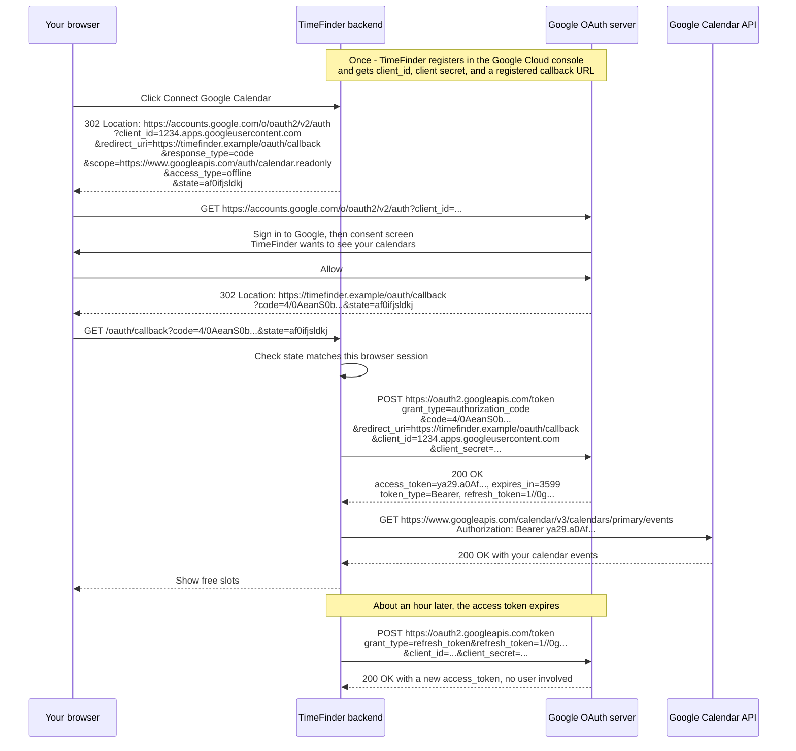
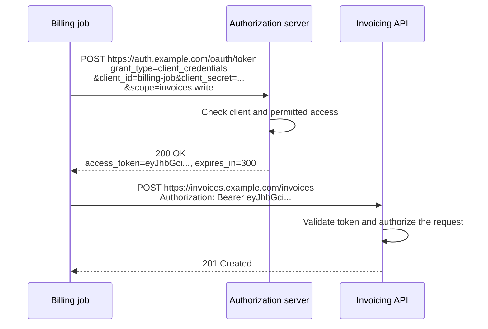
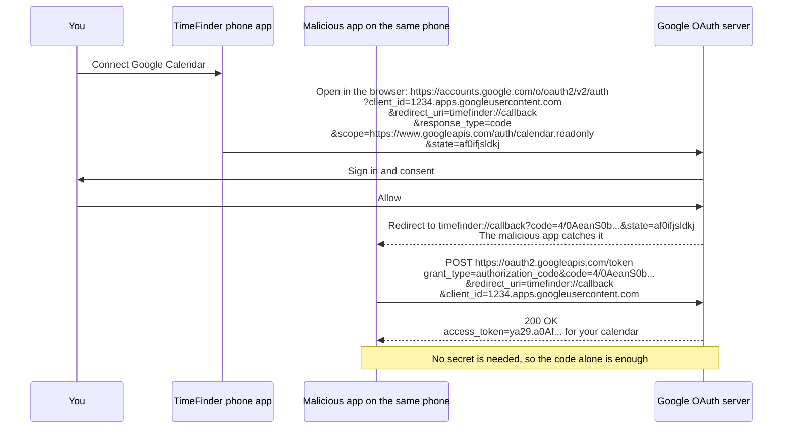
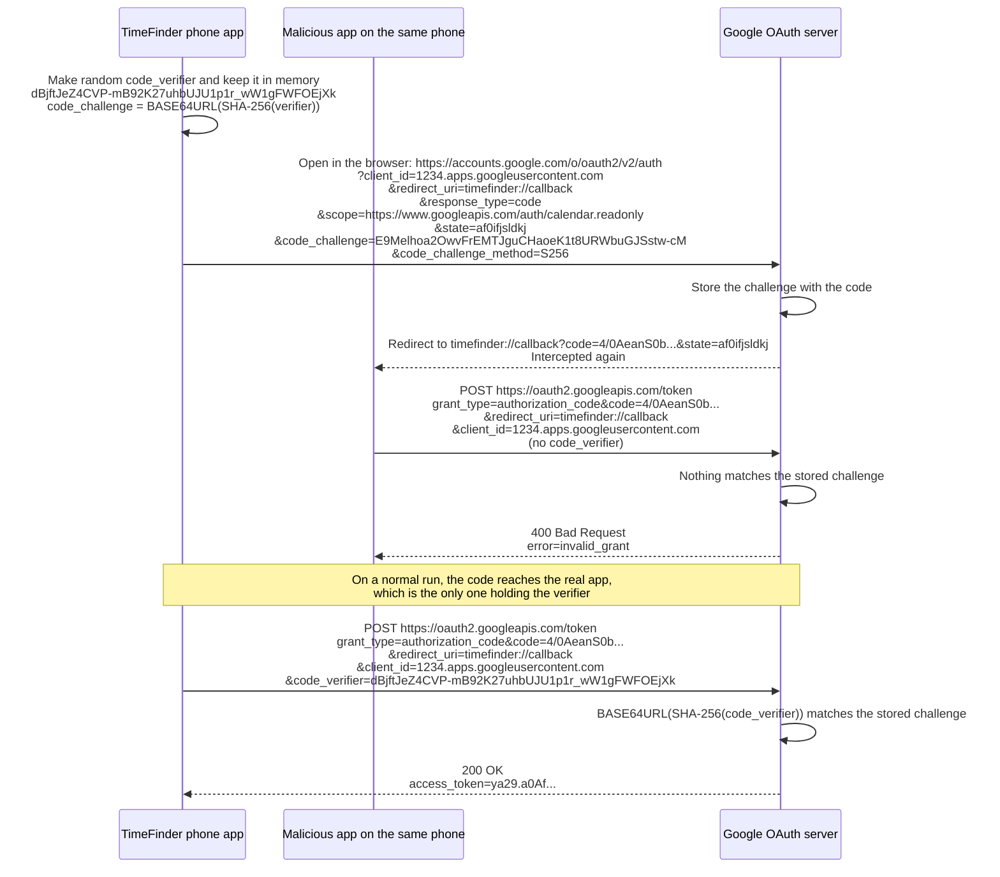
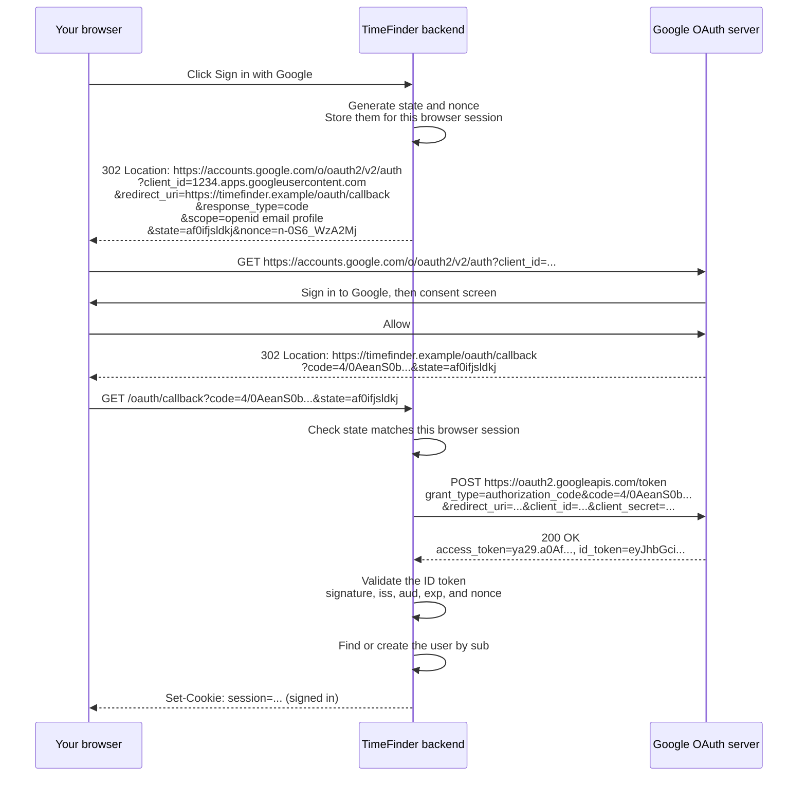

# OAuth Cheat Sheet

OAuth 2.0 lets an application obtain permission to access an API.
OpenID Connect, or OIDC, adds an identity layer for sign-in.

## How OAuth works

Example: a scheduling app, TimeFinder, wants to read your Google Calendar without asking for your Google password.

| Role | Responsibility | In this example |
| --- | --- | --- |
| Resource owner | Can authorize access to the protected resources. | You, with your Google account. |
| Client | Requests access and uses the resulting token. | TimeFinder's backend. |
| Authorization server | Checks authorization requests and issues tokens. | Google: `accounts.google.com` and `oauth2.googleapis.com`. |
| Resource server | Hosts the protected API and enforces access rules. | Google Calendar API. |



`access_type=offline` asks Google for a refresh token. Without it, TimeFinder gets only the one-hour access token.

- Your password goes only to Google. TimeFinder only ever holds tokens.
- The token is limited to its **scope**, here read-only calendar access.
- You can revoke the access at any time at `myaccount.google.com/permissions`.

The authorization server and resource server are separate roles even when one provider operates both.
A **scope** names a requested permission, such as `calendar.read`.
The provider defines its meaning, and the permissions actually granted can differ from those requested.

### Using the access token

A common way to call the API is an HTTP request with a bearer token:

```http
GET /events HTTP/1.1
Host: calendar.example.com
Authorization: Bearer <access_token>
```

Send it over HTTPS.
A bearer token lets its holder exercise the access it grants, so protect it like a credential.
The API checks token validity, its intended audience, granted permissions, and whether the requested resource is accessible.
For example, a read-only token does not grant permission to delete an event.

OAuth does not require access tokens to be JWTs.
An API may validate a signed token locally or check an opaque token through the issuer's supported validation mechanism, such as token introspection.

## Application-only access

The app acts **as itself**, not for a user.
No user signs in, and there is no browser, consent screen, or authorization code.
With the **client credentials** grant, a confidential client authenticates directly to the authorization server and receives a token for its own assigned permissions.

| | User-delegated access (the Google flow above) | Application-only access |
| --- | --- | --- |
| Acts as | A user, with their consent | The app itself |
| User involved? | Yes: sign in and consent | No |
| The token means | "TimeFinder, for Alice" | "The billing service" |
| Can access | That user's data, within the scope | What the app itself was granted |
| Refresh token? | Often | No. Request a new token instead. |

Examples:

- One microservice calls another, with tokens from Keycloak, Okta, or Auth0 (which calls this "machine-to-machine").
- A nightly job pushes reports to an internal analytics API.
- A backend calls Microsoft Graph with application permissions to read the company directory, approved once by an admin.



This flow has no browser redirect or authorization code.
Cache the token in memory and request a new one through the same flow when it expires.

### Not the same as storing user tokens

A backend that saves users' refresh tokens in its database is **not** application-only access:

1. Alice connects Google Calendar through the user flow, with `access_type=offline`.
2. TimeFinder saves Alice's refresh token in its database, encrypted.
3. At 3 AM a sync job loads it, gets a fresh access token, and reads Alice's calendar.

The job runs without Alice present, but it still acts **as Alice**, with her consent, and it stops working if she revokes access.
This is called offline access.

Quick test: ask whose permission the token carries. A specific user's means user-delegated access, even when it runs from a database at 3 AM. Only the app's own means application-only access.

## Keep the credentials separate

| Value | Purpose |
| --- | --- |
| `client_id` | Public identifier for the application. |
| Client secret | Authenticates a confidential client to the authorization server. It does not identify the user. |
| Authorization code | Short-lived, single-use value exchanged at the token endpoint. It is bound to the client and redirect URI. |
| Access token | Allows access to the intended API within the granted permissions. |
| Refresh token | An optional credential presented to the authorization server to obtain a new access token. It is not sent to the resource API. |
| Application session | The application's own login state, often represented by a session cookie. |

The authorization server determines an access token's lifetime.
When a refresh token is issued, the client can request a replacement access token while the refresh token and authorization remain valid.

## Public and confidential clients

| Client type | Can it keep an application credential confidential? | Example |
| --- | --- | --- |
| Public | No. A secret embedded in distributed client code can be extracted. | A browser application or native app. |
| Confidential | Yes, within its protected server environment. | A web backend performing the token exchange. |

A confidential client proves who it is at the token endpoint with its secret or another configured method.
A public client cannot, so anyone holding its authorization code can try to exchange it.

## PKCE: the attack it stops

PKCE means **Proof Key for Code Exchange**.
It makes a stolen authorization code useless.

### The attack, without PKCE

TimeFinder also has a phone app. A phone app is a public client: it has no client secret, because anyone can extract one from the app.
Google sends the code back to `timefinder://callback`.
A malicious app on the same phone registers the same `timefinder://` scheme and receives the code instead.



### The same attack, with PKCE

Before each authorization request, the real app makes a random secret, the `code_verifier`, and keeps it in memory.
It sends only its hash, the `code_challenge`, to Google.
Google stores the challenge with the code.
To exchange the code, the caller must show the verifier that matches.



- The challenge passes through the browser and redirects, but the verifier never does.
- A hash cannot be reversed, so seeing the challenge does not reveal the verifier.
- Web backends benefit too. If an attacker injects a stolen code into another user's authorization attempt, the backend sends that session's verifier, which does not match the injected code's challenge.
- A client secret alone does not help here: it proves which app is calling, not which authorization attempt the code belongs to.

### When to use it

- **Public clients** (phone and browser apps): always. They have no secret, so PKCE is their only protection for the code exchange.
- **Confidential clients** (web backends): recommended too. The secret and PKCE protect different things and work together.
- **Any authorization code flow,** whatever it is used for.
- **Client credentials:** not applicable. There is no authorization code to protect.
- **Bind it to the session:** store the verifier with the same pending transaction as `state`, and send exactly that verifier when exchanging that code.

### How the values are made

With the `S256` method:

```text
code_challenge = BASE64URL(SHA256(ASCII(code_verifier)))
```

- Make a new verifier for every authorization attempt: 43–128 URL-safe characters with enough randomness to resist guessing.
- Base64url encoding omits trailing `=` padding.
- Send the challenge with `code_challenge_method=S256`, and the verifier at the token endpoint.

```python
import base64
import hashlib
import secrets


code_verifier = secrets.token_urlsafe(32)  # 32 random bytes -> 43 characters
digest = hashlib.sha256(code_verifier.encode('ascii')).digest()
code_challenge = base64.urlsafe_b64encode(digest).rstrip(b'=').decode('ascii')
```

## OIDC sign-in

OAuth alone answers "may this app call this API?" It does not tell the app who the user is.
OIDC, as in "Sign in with Google", is the same authorization code flow with two additions:

1. The app asks for the `openid` scope, usually with `email profile`, and sends a random `nonce`.
2. Google returns an **ID token** next to the access token. The ID token says who the user is, and it is meant for the app itself, not for an API.

| | OAuth only | OIDC sign-in |
| --- | --- | --- |
| Question answered | "Can TimeFinder read this calendar?" | "Who is this user?" |
| Scope | `https://www.googleapis.com/auth/calendar.readonly` | `openid email profile` |
| The app receives | Access token | Access token **and ID token** |



The ID token is a signed JWT. Decoded, Google's claims look like this:

```json
{
  "iss": "https://accounts.google.com",
  "aud": "1234.apps.googleusercontent.com",
  "sub": "110169484474386276334",
  "email": "you@gmail.com",
  "nonce": "n-0S6_WzA2Mj",
  "exp": 1793865600
}
```

Before signing the user in, validate the ID token:

| Check | Why |
| --- | --- |
| Signature, with Google's published keys | The token really came from Google and was not changed. |
| `iss` | It was issued by the expected provider. |
| `aud` equals your `client_id` | It was issued to your app, not to another app. |
| `exp` | It has not expired. |
| `nonce` equals the value you stored | It belongs to this sign-in attempt and is not replayed. |

- Use `sub`, not `email`, as the stable user ID, because an email address can change.
- After sign-in, the app uses its own session, usually a cookie. The ID token is not sent to APIs.
- An access token or authorization code is not proof of identity. Only a validated ID token is.
- Use [PKCE](#pkce-the-attack-it-stops) here too. The diagram leaves it out to stay short, but sign-in uses the same code exchange, so the same attack applies. A phone or browser app must use it, and a web backend should.

## Bind the result to the initiating session

| Mechanism | What to check |
| --- | --- |
| `state` | Match the callback to a pending authorization transaction bound to the initiating browser session. This helps prevent cross-site request forgery. |
| PKCE verifier | Send the verifier saved for that transaction so the authorization server can validate the code exchange. |
| OIDC `nonce` | If sent, require the same value in the validated ID token to associate it with the sign-in attempt. |

Protect tokens and application sessions separately, use HTTPS for web redirects and token exchanges, and validate registered redirect URIs.
Multi-factor authentication strengthens user authentication; it does not replace session binding.
