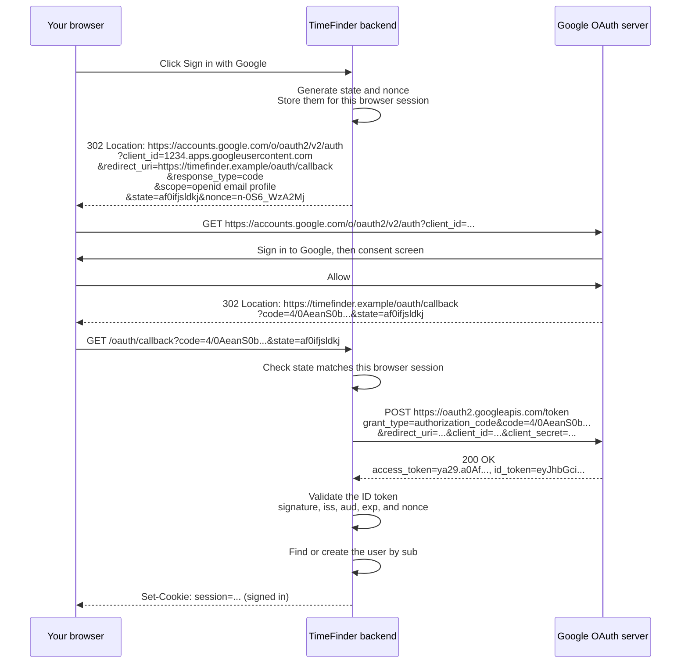
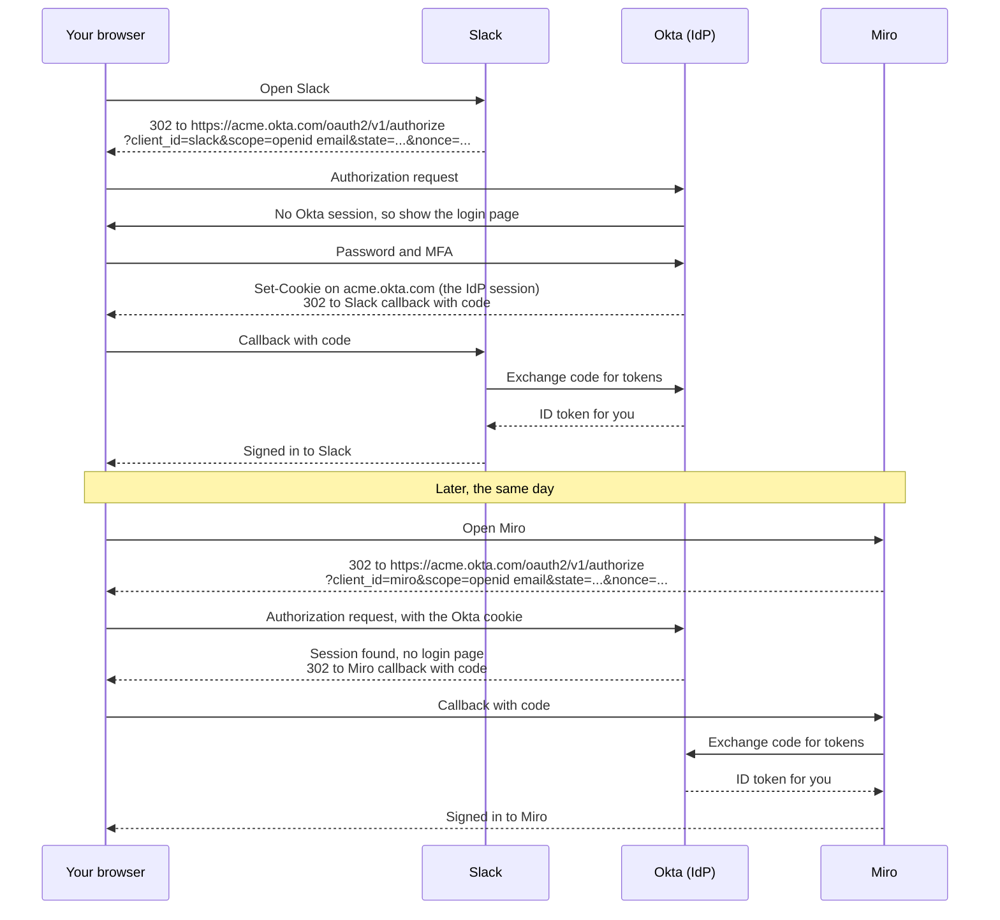

# OIDC Cheat Sheet

OpenID Connect, or OIDC, is a thin identity layer on top of OAuth 2.0.
OAuth answers "may this app call this API?" OIDC adds "who is this user?"
It reuses OAuth's redirects, endpoints, and authorization code flow, so read the [OAuth cheat sheet](oauth.md) first.

## What OIDC adds to OAuth

```text
┌─────────────────────────────────────────────────────────┐
│ OIDC adds                                               │
│  - the openid scope                                     │
│  - the ID token: a signed JWT that says who the user is │
│  - nonce: ties the ID token to one sign-in attempt      │
│  - /userinfo: an endpoint for more profile claims       │
│  - discovery: /.well-known/openid-configuration         │
│  - JWKS: the provider's public signing keys             │
├─────────────────────────────────────────────────────────┤
│ OAuth 2.0, unchanged underneath                         │
│  - authorization code flow, redirects, state, PKCE      │
│  - /authorize and /token endpoints                      │
│  - access and refresh tokens, client_id, client secret  │
└─────────────────────────────────────────────────────────┘
```

| | OAuth only | OIDC sign-in |
| --- | --- | --- |
| Question answered | "Can TimeFinder read this calendar?" | "Who is this user?" |
| Scope | `https://www.googleapis.com/auth/calendar.readonly` | `openid email profile` |
| The app receives | Access token | Access token **and ID token** |
| The token is for | The API | The app itself |

Google's OIDC endpoints, as listed in its discovery document at `https://accounts.google.com/.well-known/openid-configuration`:

| Purpose | URL |
| --- | --- |
| Authorization | `https://accounts.google.com/o/oauth2/v2/auth` |
| Token | `https://oauth2.googleapis.com/token` |
| User info | `https://openidconnect.googleapis.com/v1/userinfo` |
| Signing keys (JWKS) | `https://www.googleapis.com/oauth2/v3/certs` |

The authorization and token endpoints are the same ones the OAuth flow uses.

## How OIDC sign-in works

"Sign in with Google" on TimeFinder:



The ID token is a signed JWT. Decoded, Google's claims look like this:

```json
{
  "iss": "https://accounts.google.com",
  "aud": "1234.apps.googleusercontent.com",
  "sub": "110169484474386276334",
  "email": "you@gmail.com",
  "nonce": "n-0S6_WzA2Mj",
  "exp": 1793865600
}
```

Before signing the user in, validate the ID token:

| Check | Why |
| --- | --- |
| Signature, with the provider's JWKS keys | The token really came from Google and was not changed. |
| `iss` | It was issued by the expected provider. |
| `aud` equals your `client_id` | It was issued to your app, not to another app. |
| `exp` | It has not expired. |
| `nonce` equals the value you stored | It belongs to this sign-in attempt and is not replayed. |

- Use `sub`, not `email`, as the stable user ID, because an email address can change.
- After sign-in, the app uses its own session, usually a cookie. The ID token is not sent to APIs.
- An access token or authorization code is not proof of identity. Only a validated ID token is.
- Use [PKCE](oauth.md#pkce-the-attack-it-stops) here too. The diagram leaves it out to stay short, but sign-in uses the same code exchange, so the same attack applies. A phone or browser app must use it, and a web backend should.

## SSO with OIDC

SSO is not a protocol. It is the result: sign in once, then get into many apps.
OIDC gives SSO when **many apps use the same identity provider (IdP)**, such as Okta or Google.

The "single" part comes from **the IdP's own session cookie**, not from any OAuth token:

1. The first app does a normal OIDC sign-in. While the user signs in, the IdP sets a session cookie on its own domain.
2. The second app does its own OIDC sign-in from scratch. It redirects to the IdP, the IdP finds its cookie, skips the login page, and sends a code straight back.
3. Each app gets its own ID token and creates its own session. The apps never share tokens or cookies. They only trust the same IdP.

Example: your company uses Okta for Slack and Miro.



The same happens with Google every day:

| What you do | What happens |
| --- | --- |
| Sign in to Gmail | Google sets its session cookie on `accounts.google.com`. |
| Click "Sign in with Google" on Notion | Notion redirects to Google. Google finds its cookie and shows "Continue as you@gmail.com", with no password. |
| The same on Figma | A separate OIDC sign-in, again with no password. |

What SSO does **not** mean:

- **No shared session.** `miro.com` cannot read `slack.com`'s cookie. Each app has its own session.
- **No automatic sign-out.** Signing out of one app does not sign you out of the others or of the IdP. That needs extra logout support, such as OIDC Back-Channel Logout (see the [JWT and Distributed Sessions cheat sheet](distributed-sessions.md)).
- **Still time-limited.** When the IdP session expires, the next app shows the login page again.
- An app can check for an IdP session without showing any page by adding `prompt=none`. The IdP then returns a code if a session exists, or an error such as `login_required` if not.

### OIDC vs SAML for SSO

Both use the same trick, an IdP session cookie, with different protocols:

| | OIDC | SAML |
| --- | --- | --- |
| Built on | OAuth 2.0 | Its own standard, not OAuth |
| Identity proof | ID token (JSON, a signed JWT) | Assertion (signed XML) |
| Typical use | Modern web and mobile apps, "Sign in with Google" | Older enterprise apps and many corporate SSO setups |

SAML is covered in the [SSO, SAML, and SCIM cheat sheet](sso-saml-scim.md).

## Bind the result to the sign-in attempt

OIDC adds `nonce` to OAuth's `state` and PKCE checks (see [OAuth: bind the result](oauth.md#bind-the-result-to-the-initiating-session)):

| Mechanism | What to check |
| --- | --- |
| `nonce` | Generate it per sign-in, store it with the pending transaction, and require the same value in the validated ID token. |

`state` protects the callback. `nonce` protects the ID token: an ID token stolen from another sign-in carries a different `nonce`, so the app rejects it.
