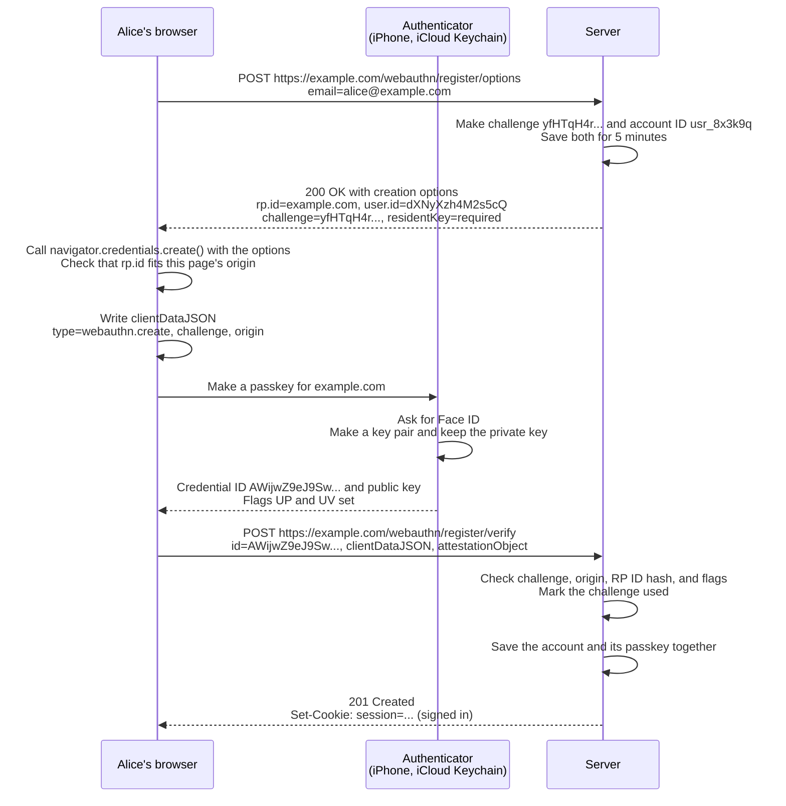
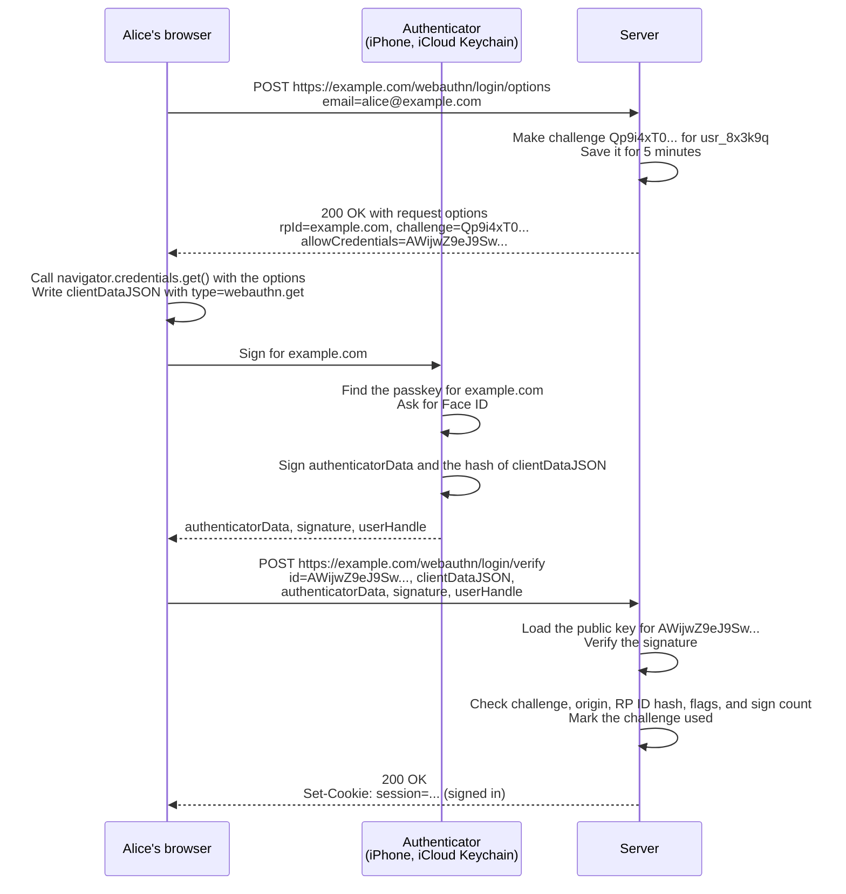
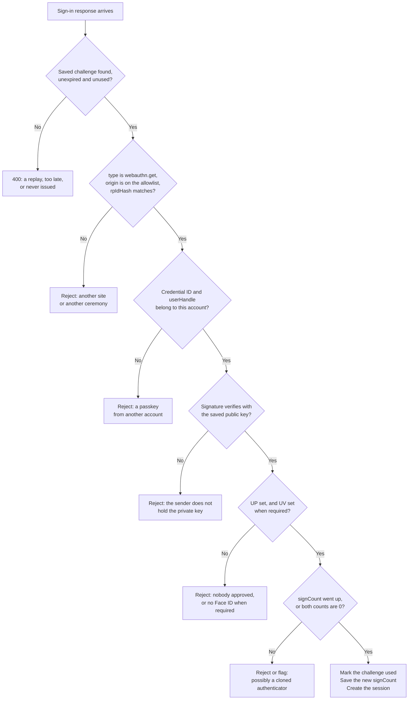
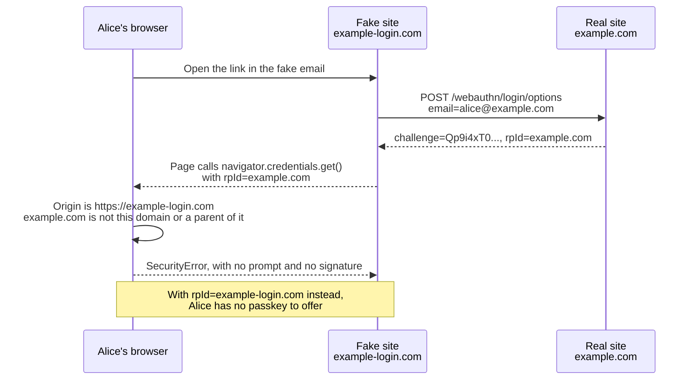
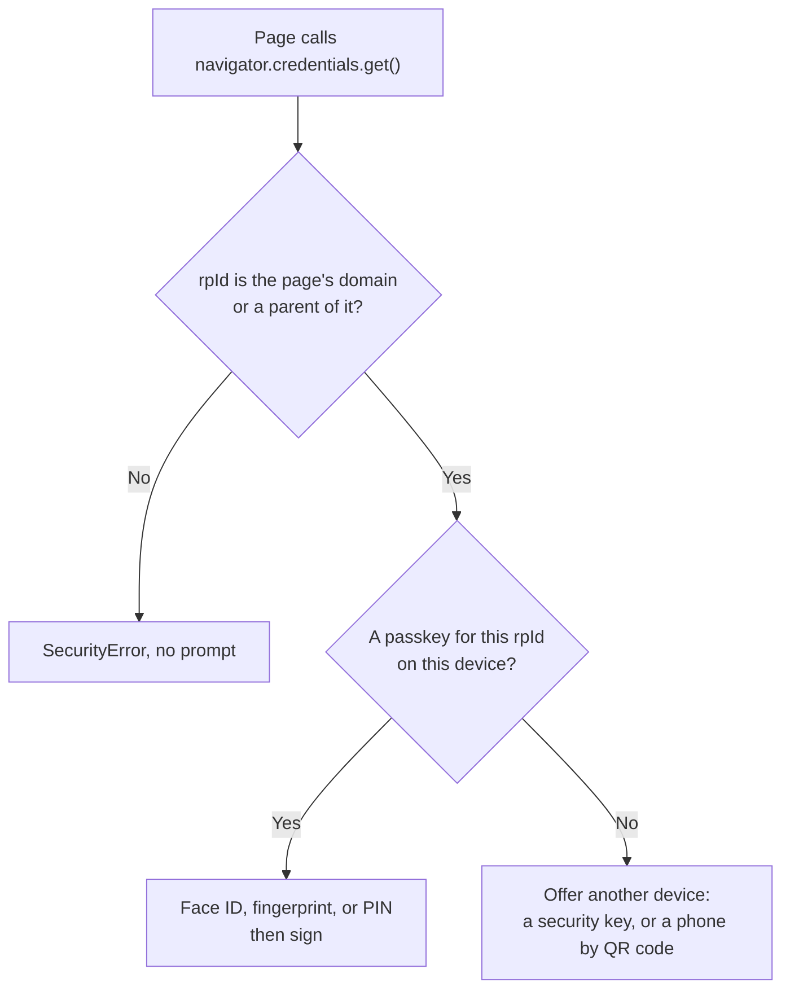
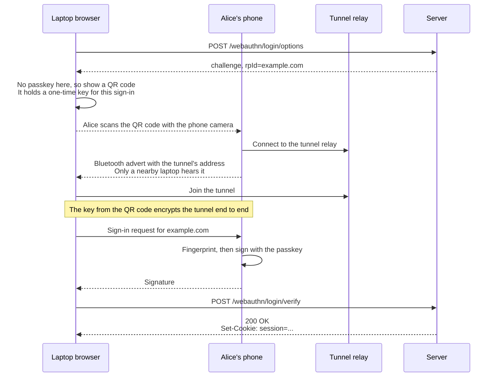
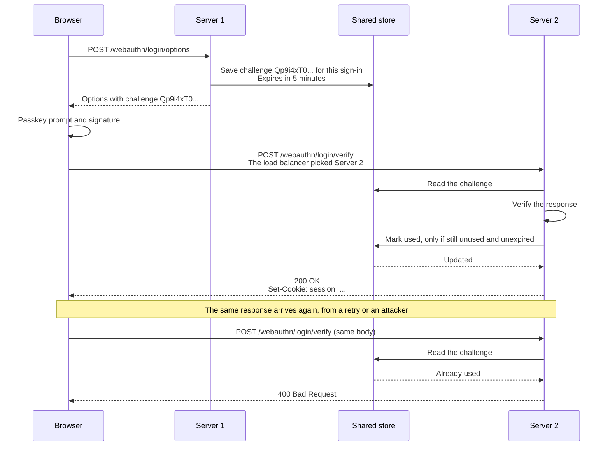
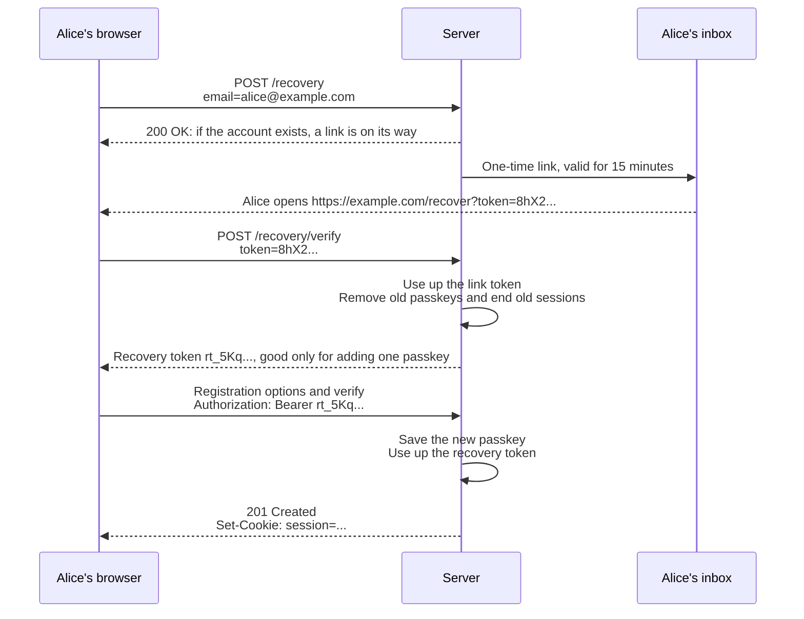

# Passkeys and WebAuthn Cheat Sheet

A passkey replaces a password with a key pair.
The private key stays on the user's device or in their passkey manager, and the server stores only the public key.
To sign in, the device signs a fresh challenge from the server after the user unlocks it with a face, a fingerprint, or the screen lock PIN.
WebAuthn is the browser and operating system API that creates and uses passkeys.
Key pairs and signatures are explained in the [cryptography cheat sheet](cryptography.md#symmetric-and-asymmetric-cryptography).

## The idea in one picture

```text
Registration, once per passkey
  Server  -- challenge ------>  Device makes a key pair for example.com
  Server  <-- public key -----  and keeps the private key
  Server saves the credential ID and public key for Alice

Sign-in, every time
  Server  -- new challenge -->  Alice unlocks the device with Face ID
  Server  <-- signature ------  The device signs the challenge with the private key
  Server checks the signature with Alice's saved public key
```

The private key never leaves the device, so a database leak or a fake site gets nothing that can sign in.

### Compared with passwords and one-time codes

| | Password | One-time code (SMS or app) | Passkey |
| --- | --- | --- | --- |
| The user | Remembers and types it | Types a code | Unlocks the device |
| The server stores | A password hash | A phone number or a code secret | A public key |
| A database leak gives | Hashes to crack offline | Secrets that make valid codes | Nothing that can sign in |
| A fake login site can | Collect it | Collect it and use it within seconds | Get nothing. The browser offers the passkey only on the real domain. |
| Reuse across sites | Common | Not applicable | Impossible. Each site gets its own key pair. |

## Terms

Example: Alice signs up to the website at `example.com` on her iPhone.

| Term | Meaning | In this example |
| --- | --- | --- |
| Relying party (RP) | The site or app the user signs in to. Its server checks the passkey. | The website at `example.com` |
| RP ID | The domain a passkey belongs to | `example.com` |
| Authenticator | Holds the private key and checks the user's face, fingerprint, or PIN | Alice's iPhone, with Face ID |
| Passkey provider | Stores passkeys and syncs them across the user's devices | iCloud Keychain. Others: Google Password Manager, 1Password |
| Client | Runs WebAuthn and passes messages between the page and the authenticator | Safari, or iOS itself for a native app |
| Credential ID | The passkey's public ID. The server finds the public key by it. | `AWijwZ9eJ9Sw...` |
| User handle | The account ID stored with the passkey, sent as `user.id` | `dXNyXzh4M2s5cQ`, the bytes of `usr_8x3k9q` |
| Challenge | Random bytes from the server, used once | `yfHTqH4rTAaRX6LX6DsQxPWmni1xuAw_Tl1qe4ydDh8` |
| Ceremony | WebAuthn's name for one registration or one sign-in | |

- A passkey is a **discoverable credential**: it stores the account name and user handle with the key. The device can then list accounts, such as `alice@example.com`, before the server knows who is signing in.
- **FIDO2** is the umbrella name. WebAuthn is the API that pages and servers use. CTAP is how the browser talks to an external authenticator, such as a security key or a phone.

## Two requests per ceremony

Registration and sign-in follow the same three steps:

1. **Options:** the app asks the server for options. The server makes a challenge, saves it, and returns the options.
2. **Device:** the app passes the options to WebAuthn. The device asks the user to unlock it and returns a response.
3. **Verify:** the app sends the response to the server. The server checks it against the saved challenge and its own records.

On the web, registration calls `navigator.credentials.create()` and sign-in calls `navigator.credentials.get()`.
Native apps do the same through the OS: Authentication Services on iOS, and Credential Manager on Android.
The endpoint URLs below are examples. WebAuthn defines the messages, not the endpoints.

## Registration: create a passkey

Alice signs up with her email on her iPhone.



The creation options the server returns:

```json
{
  "rp": { "id": "example.com", "name": "Example" },
  "user": {
    "id": "dXNyXzh4M2s5cQ",
    "name": "alice@example.com",
    "displayName": "Alice"
  },
  "challenge": "yfHTqH4rTAaRX6LX6DsQxPWmni1xuAw_Tl1qe4ydDh8",
  "pubKeyCredParams": [
    { "type": "public-key", "alg": -8 },
    { "type": "public-key", "alg": -7 },
    { "type": "public-key", "alg": -257 }
  ],
  "authenticatorSelection": {
    "residentKey": "required",
    "userVerification": "preferred"
  },
  "excludeCredentials": [],
  "attestation": "none"
}
```

| Field | Meaning |
| --- | --- |
| `rp.id` | The domain the passkey will belong to. |
| `user.id` | A random account ID of up to 64 bytes. It comes back at sign-in as `userHandle`. Never use the email. |
| `user.name`, `user.displayName` | Shown in the passkey picker. |
| `challenge` | At least 16 random bytes, used once. |
| `pubKeyCredParams` | Key types the server can verify, as COSE numbers: -8 is EdDSA, -7 is ES256, -257 is RS256. |
| `residentKey: "required"` | Make a discoverable credential, which is what makes it a passkey. |
| `userVerification` | Ask for a face, fingerprint, or PIN. `"preferred"` does not enforce it, so the server checks the UV flag. |
| `authenticatorAttachment: "platform"` | Optional. Use only the device's own authenticator, not a security key or another phone. |
| `excludeCredentials` | The account's existing credential IDs, so the same provider does not make a duplicate. |
| `attestation: "none"` | Skip proof of the authenticator's make and model. Most consumer apps do. |

Binary values, such as `challenge` and `user.id`, travel as base64url strings.
The page turns them back into bytes with `PublicKeyCredential.parseCreationOptionsFromJSON()` or a small helper library.

The response the browser sends to `/webauthn/register/verify`:

```json
{
  "id": "AWijwZ9eJ9Sw...",
  "type": "public-key",
  "response": {
    "clientDataJSON": "eyJ0eXBlIjoid2ViYXV0aG4uY3JlYXRlIiwiY2hh...",
    "attestationObject": "o2NmbXRkbm9uZWdhdHRTdG10...",
    "transports": ["internal", "hybrid"]
  },
  "authenticatorAttachment": "platform"
}
```

`clientDataJSON` is written by the browser, not by the page. Decoded:

```json
{
  "type": "webauthn.create",
  "challenge": "yfHTqH4rTAaRX6LX6DsQxPWmni1xuAw_Tl1qe4ydDh8",
  "origin": "https://example.com",
  "crossOrigin": false
}
```

`attestationObject` is CBOR, a compact binary form of JSON.
Its `authData` holds the RP ID hash, the flags, the sign count, and the new credential ID and public key.
The server saves one row per passkey:

| Column | Example | Used for |
| --- | --- | --- |
| `credential_id` | `AWijwZ9eJ9Sw...` | Finding the passkey at sign-in |
| `user_id` | `usr_8x3k9q` | The account it belongs to |
| `public_key` | `pQECAyYgASFYI...`, a COSE key | Verifying signatures |
| `sign_count` | `0` | Spotting a cloned authenticator |
| `transports` | `["internal", "hybrid"]` | Telling the browser where to look at sign-in |
| `backed_up` | `true`, from the BS flag | Knowing whether the passkey syncs |
| `name`, `created_at`, `last_used_at` | `iPhone`, ... | Listing passkeys in account settings |

- **Save the account together with its first passkey.** If Alice closes the prompt, nothing is saved, so a mistyped email leaves no account behind.
- **Guard who may add a passkey.** Add one to an existing account only from a signed-in session or a recovery token. Sign-up must refuse an email that already has an account. Otherwise anyone could attach their own passkey to Alice's account.
- With `attestation: "none"`, the registration response carries no signature. It is trusted because it answers a challenge the server issued to this sign-up or to a signed-in user.

## Sign-in: use the passkey

Alice comes back and enters her email first, so the server can list her passkeys in `allowCredentials`.



The request options the server returns:

```json
{
  "challenge": "Qp9i4xT0p9C4XD6RpgR70uj1PBqbYtB-T4WjxrHQnnI",
  "rpId": "example.com",
  "allowCredentials": [
    { "type": "public-key", "id": "AWijwZ9eJ9Sw...", "transports": ["internal", "hybrid"] }
  ],
  "userVerification": "preferred"
}
```

The response the browser sends to `/webauthn/login/verify`:

```json
{
  "id": "AWijwZ9eJ9Sw...",
  "type": "public-key",
  "response": {
    "clientDataJSON": "eyJ0eXBlIjoid2ViYXV0aG4uZ2V0IiwiY2hhbGxl...",
    "authenticatorData": "o3mm9u6vuaVeN4wRgDTidR5oL6ufLTCrE9ISVYbOGUcdAAAAAA",
    "signature": "MEUCIQDx...",
    "userHandle": "dXNyXzh4M2s5cQ"
  }
}
```

- The passkey is used only at sign-in. Afterwards the app uses its normal session, usually a cookie, as after an OIDC or SAML sign-in. See the [JWT and distributed sessions cheat sheet](distributed-sessions.md).
- A synced passkey's private key reaches Alice's other Apple devices only through her provider's end-to-end encrypted sync. It never reaches the server.

### Three ways to start sign-in

| Flow | `allowCredentials` | The server finds the account by | Note |
| --- | --- | --- | --- |
| Email first | The account's credential IDs | The email typed first | Simple, but the options request can reveal which emails have accounts. |
| Account picker | Empty | `userHandle` in the response | The OS lists every passkey for the RP ID, and the user picks one. |
| Autofill | Empty, and the call adds `mediation: "conditional"` | `userHandle` in the response | Passkeys appear in the username field's suggestions, when it has `autocomplete="username webauthn"`. |

With an empty `allowCredentials`, the server does not know the account yet.
It ties the challenge to the browser's pending sign-in instead, for example with a short-lived cookie.

## What gets signed

```text
clientDataJSON, written by the browser
  {"type":"webauthn.get","challenge":"Qp9i4xT0...","origin":"https://example.com"}

authenticatorData, written by the authenticator: 37 bytes at sign-in
  ┌────────────────────────┬────────┬───────────┐
  │ rpIdHash               │ flags  │ signCount │
  │ SHA-256("example.com") │ 0x1D   │ 0         │
  │ 32 bytes               │ 1 byte │ 4 bytes   │
  └────────────────────────┴────────┴───────────┘

signature = Sign(private key, authenticatorData || SHA-256(clientDataJSON))
            (|| means "joined end to end")
```

One signature covers the challenge and origin from the browser, and the RP ID hash and flags from the authenticator.
A page cannot change any of them without breaking the signature.

| Bit | Flag | Set when |
| --- | --- | --- |
| 0 | UP, user present | Someone approved the prompt. |
| 2 | UV, user verified | The user passed Face ID, a fingerprint, or a PIN. |
| 3 | BE, backup eligible | The passkey can sync to other devices. |
| 4 | BS, backup state | The passkey is synced now. |
| 6 | AT, attested data | Registration only: the new credential ID and public key follow. |

Here `0x1D` sets UP, UV, BE, and BS: Alice approved, passed Face ID, and her passkey is synced.

## What the server checks

For a sign-in response:



- Registration runs the challenge, origin, RP ID hash, and flag checks, with `type` set to `webauthn.create`. There is no saved key yet, so instead of a signature it checks that the new key uses an algorithm you allowed.
- Synced passkeys usually keep `signCount` at 0, which is why two zeros pass.
- Use a maintained library for these checks, such as SimpleWebAuthn for TypeScript or py_webauthn for Python. CBOR and COSE parsing are easy to get wrong.
- Set user verification explicitly on the server. Libraries differ: some require UV by default even when the options said `"preferred"`.
- The challenge does the job that `state` and `nonce` do in OIDC: it ties the result to one attempt. See [OIDC: bind the result](oidc.md#bind-the-result-to-the-sign-in-attempt).

## Why phishing fails

Two rules make a passkey useless on a fake site:

1. **The browser checks the RP ID.** A page can use only its own domain, or a parent of it, as the RP ID.
2. **The browser writes the origin.** `clientDataJSON` carries the page's real origin, and the signature covers it.

Alice gets a fake email with a link to `https://example-login.com`:



Compare a one-time code: the fake page asks Alice for the code and uses it on the real site within seconds.
With a passkey, Alice has nothing to type, and nothing works on another domain.

### RP ID and origins

| Page origin | May use RP ID `example.com`? | Why |
| --- | --- | --- |
| `https://example.com` | Yes | Same domain |
| `https://app.example.com` | Yes | A subdomain. The server must also list this origin. |
| `https://example-login.com` | No | A different domain |
| `https://example.com.attacker.net` | No | The domain is `attacker.net` |
| `http://example.com` | No | WebAuthn needs HTTPS. Only `http://localhost` works without it, for development. |

- **Choose the RP ID once.** A passkey works only for the RP ID it was made for, so a later change means every user makes a new passkey. Use the main domain, `example.com`, so every subdomain can use it.
- **List exact origins on the server.** Any subdomain may use the main domain's RP ID. If `pages.example.com` hosts user content, a script there can ask for Alice's passkey, and only the origin check rejects the result.
- **Other domains,** such as `example.co.uk`, can share the RP ID in newer browsers. List them in `https://example.com/.well-known/webauthn`, a feature called Related Origin Requests.

## Native apps

A native app has no web origin.
Instead, the RP's domain publishes a file that names the app, and the OS checks it before the app may use that domain's passkeys.
A fake app with another team ID or signing key gets nothing.

| | iOS | Android |
| --- | --- | --- |
| The domain hosts | `https://example.com/.well-known/apple-app-site-association` | `https://example.com/.well-known/assetlinks.json` |
| The file names | The app ID: team ID and bundle ID | The package name and the SHA-256 of the signing certificate |
| The app adds | The Associated Domains entitlement `webcredentials:example.com` | Nothing more for passkeys |
| `origin` the server receives | `https://example.com` | `android:apk-key-hash:` and the certificate hash in base64url |

`apple-app-site-association`:

```json
{
  "webcredentials": {
    "apps": ["ABCDE12345.com.example.app"]
  }
}
```

`assetlinks.json`, where `get_login_creds` lets the app use the domain's passkeys and `handle_all_urls` is for App Links, which often share the file:

```json
[
  {
    "relation": [
      "delegate_permission/common.handle_all_urls",
      "delegate_permission/common.get_login_creds"
    ],
    "target": {
      "namespace": "android_app",
      "package_name": "com.example.app",
      "sha256_cert_fingerprints": [
        "14:6D:E9:83:C5:73:06:50:D8:EE:B9:95:2F:34:FC:64:16:A0:83:42:E6:1D:BE:A8:8A:04:96:B2:3F:CF:44:E5"
      ]
    }
  }
]
```

The same certificate hash appears twice, in two encodings:

```text
assetlinks.json   14:6D:E9:83:C5:73:06:50:...:3F:CF:44:E5     (hex with colons)
Server allowlist  android:apk-key-hash:FG3pg8VzBlDY7rmVLzT8ZBagg0LmHb6oigSWsj_PROU   (base64url)
```

- Each signing key has its own hash: debug, release, and, with Play App Signing, Google's app signing key rather than your upload key. List every key that ships.
- Serve both files over HTTPS as JSON, without redirects. Android fetches `assetlinks.json` through Google, so `robots.txt` must not block it.
- Both platforms cache these files, so a fix can take a while to reach devices.

## Where passkeys live

| | Synced passkey | Device-bound passkey |
| --- | --- | --- |
| Stored in | A passkey provider, such as iCloud Keychain, Google Password Manager, or 1Password | One device, or a security key such as a YubiKey |
| On a new phone | Already there after signing in to the provider | Must be made again |
| After losing a device | Still on the user's other devices | Gone. Use another passkey or recovery. |
| Flags | BE=1 and BS=1 | BE=0 |
| `signCount` | Usually stays 0 | Usually goes up |
| Attestation | Usually none | Often available, for companies that allow only certain keys |

When a page asks for a passkey:



### Signing in on a laptop with a phone's passkey

Alice is on a friend's laptop, and her passkey is on her phone.
The laptop shows a QR code, and the phone acts as the authenticator.
This is called cross-device sign-in, or the hybrid transport.



- The Bluetooth step proves the phone is near the laptop. A QR code shown on an attacker's screen far away is useless.
- The relay forwards only encrypted bytes.
- The server sees a normal sign-in. The laptop's browser still checks the RP ID and writes the origin.

## Keeping the challenge between requests

The options request and the verify request can reach different servers behind a load balancer, or arrive after a deploy.
So the challenge must live where every server can read it, as sessions do. See [where session lookups happen](distributed-sessions.md#where-session-lookups-happen).



| Where to keep it | Works across servers? | Single use? | Note |
| --- | --- | --- | --- |
| One server's memory | No | Yes | Fails when the second request reaches another server, or after a restart. |
| Shared store, such as Redis or a database row with an expiry | Yes | Yes, with an atomic "mark used" or delete | The usual choice. |
| Signed and encrypted cookie | Yes | No, unless used challenges are also recorded | Needs no store, but a copied response works again until the cookie expires. |

- Make at least 16 random bytes with a secure random generator. 32 is common.
- Expire it after a few minutes.
- Keep one current challenge per pending ceremony: the browser's sign-in attempt, or the account in an email-first flow. A newer options request replaces the older one.
- Mark it used before creating the session, with a conditional write, so two copies cannot both succeed. If a later step fails, the user requests new options.

## Recovery and more than one passkey

A passkey-only account is only as safe as its recovery path.

- Let users add several passkeys, such as a phone, a laptop, and a security key. List them in settings with a name and last-used time, and let users remove them.
- When adding a passkey, send the existing ones in `excludeCredentials`, so the same provider does not make a duplicate.
- When every passkey is lost, the user proves control of a verified channel, often the email address, and then registers a new passkey.



- Answer the same way whether or not the email has an account, and limit the request rate, so the endpoint does not reveal who has an account.
- Removing old passkeys and sessions shuts out whoever has the lost phone.
- Keep every token single-use and short-lived. The email link is now the easiest way into the account.

## Passkeys, OIDC, and SAML

| | Passkey | Sign in with Google (OIDC) | Company SSO (SAML) |
| --- | --- | --- | --- |
| Who checks the user | Your own server | Google | The company IdP, such as Okta |
| Your server stores | Public keys | Google's `sub` for the user | The IdP's NameID for the user |
| Needs a third party at sign-in | No | Yes | Yes |
| Phishing resistant | Yes | Depends on how the user signs in to Google | Depends on how the user signs in to the IdP |

They combine well: an IdP can use passkeys for its own login, and every app behind it then gets phishing-resistant SSO.
See the [OIDC cheat sheet](oidc.md) and the [SSO, SAML, and SCIM cheat sheet](sso-saml-scim.md).

## Common pitfalls

| Pitfall | Consequence | Fix |
| --- | --- | --- |
| Challenge kept in one server's memory | Sign-in fails when the verify request reaches another server, or after a deploy | Keep it in a shared store with an expiry. |
| Challenge not marked used | A copied response signs in again | Mark it used with a conditional write before creating the session. |
| Email used as `user.id` | Personal data sits in every passkey manager, and an email change breaks the link | Use a random account ID. |
| RP ID set to a subdomain, such as `login.example.com` | Passkeys do not work on `app.example.com` | Use the main domain, and choose it once. |
| Origin allowlist matches any subdomain | A page with user content on a subdomain can get a valid sign-in | List exact origins. |
| Android release origin missing | Sign-in works in debug builds but fails in the store build | Add the `android:apk-key-hash:` origin for every signing key that ships. |
| Relying on `userVerification: "preferred"` | A sign-in without a face, fingerprint, or PIN is accepted | Check the UV flag when you need it. |
| Rejecting a `signCount` of 0 | Every synced passkey fails | Compare counts only when one of them is above 0. |
| One passkey and no recovery | A lost phone means a lost account | Allow several passkeys and offer recovery. |
| A passkey removed on the server stays in the user's manager | The user keeps picking a passkey that no longer works | Tell the provider with the WebAuthn Signal API, such as `PublicKeyCredential.signalUnknownCredential()`, where supported. |
| Email-first options fail for unknown emails | Attackers learn which emails have accounts | Use the account picker, or return believable options for unknown emails. |
