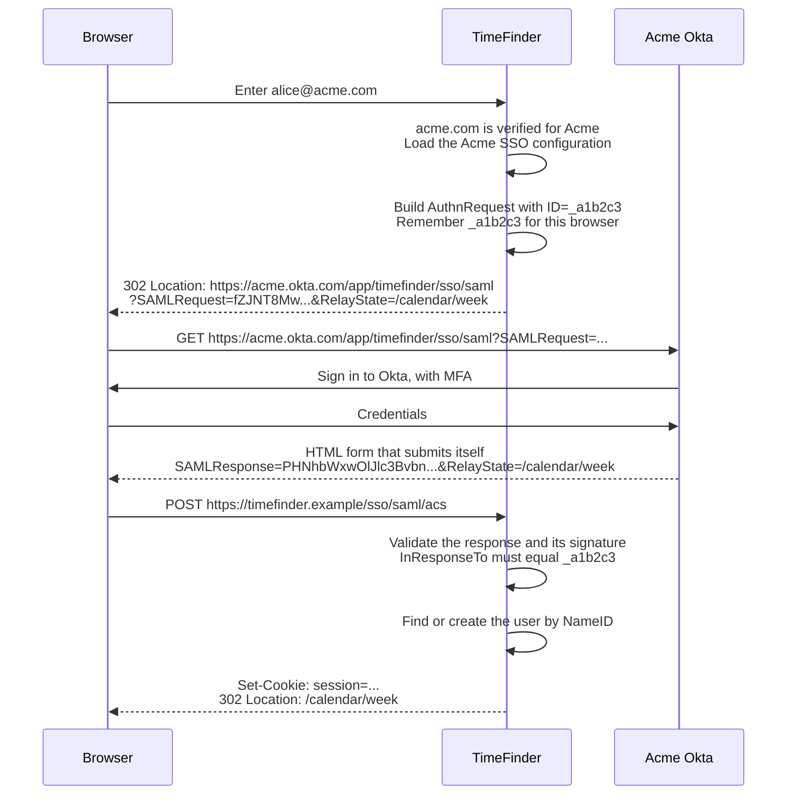
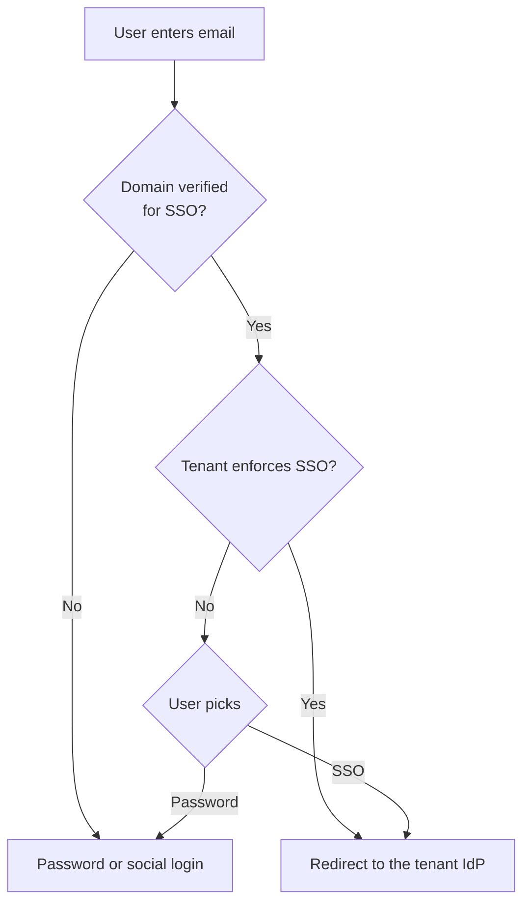
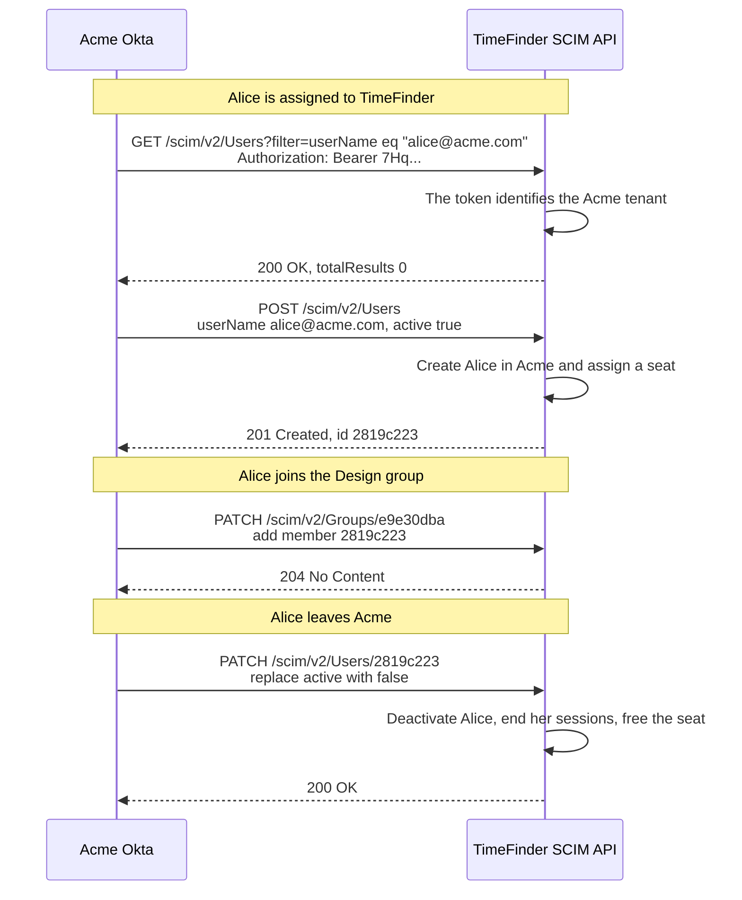

# SSO, SAML, and SCIM Cheat Sheet

Single sign-on, or SSO, lets employees use one company login for every work app.
SAML is a common protocol for that login. SCIM is a separate API that keeps each app's user list in sync with the company directory.

## The three terms

| Term | What it is | Question it answers | When it runs |
| --- | --- | --- | --- |
| SSO | A goal: one company login for many apps | "Can I use my company account here?" | At login |
| SAML 2.0 | An XML protocol for SSO. The identity provider sends a signed assertion through the browser. | "How does the app know the company vouches for this user?" | At login, through the browser |
| SCIM 2.0 | A REST API standard for creating, updating, and removing users and groups | "How does the app learn about new hires, team moves, and leavers?" | Any time, server to server |

SSO can also run on OIDC instead of SAML. See [OIDC sign-in](oauth.md#oidc-sign-in).

Think of an office building: SAML is the badge reader at the door, and SCIM is HR updating the list of who holds a badge.

## Roles and terms

Example: Acme uses Okta for its employees. Acme buys TimeFinder, a SaaS scheduling app, for the whole company.

| Term | Meaning | In this example |
| --- | --- | --- |
| Identity provider (IdP) | Authenticates users and vouches for them | Acme's Okta |
| Service provider (SP) | The app that trusts the IdP | TimeFinder |
| Tenant | One customer's space inside the SP, often called an organization | Acme's TimeFinder organization |
| Assertion | Signed XML that says who the user is, for which app, and until when | "This is alice@acme.com, for TimeFinder, valid for 5 minutes" |
| Assertion Consumer Service (ACS) | The SP endpoint that receives the assertion | `https://timefinder.example/sso/saml/acs` |
| Entity ID | A unique name for each side | `https://timefinder.example` and `http://www.okta.com/exk1a2b3` |
| Metadata | XML that describes one side: entity ID, endpoints, and signing certificate | Exchanged once during setup |
| NameID | The user identifier inside the assertion, usually an email address | `alice@acme.com` |
| RelayState | An opaque value that comes back unchanged, such as where to go after login | `/calendar/week` |

## One employee's lifecycle

1. **Hired.** IT assigns Alice to TimeFinder in Okta. Okta calls TimeFinder's SCIM API with `POST /scim/v2/Users`, and TimeFinder creates her account in the Acme organization. (SCIM)
2. **First login.** Alice types `alice@acme.com` on TimeFinder. She is sent to Okta, signs in with MFA, and lands back in TimeFinder, signed in. (SAML)
3. **Team move.** Alice joins the Design group in Okta. Okta calls `PATCH /scim/v2/Groups/{id}` to add her. (SCIM)
4. **Leaves.** IT unassigns her. Okta calls `PATCH /scim/v2/Users/{id}` with `active: false`. TimeFinder deactivates her and ends her sessions. (SCIM)

Without SCIM, step 1 happens at her first login instead, which is called just-in-time provisioning.
Step 4 never reaches TimeFinder: Okta stops new logins, but her TimeFinder account and seat stay until an admin removes them.

## How SAML login works

### One-time setup

1. TimeFinder gives Acme its entity ID and ACS URL, or its SP metadata.
2. Acme creates a TimeFinder app in Okta and gives TimeFinder the Okta SSO URL, entity ID, and signing certificate, or the IdP metadata.
3. Acme proves it owns `acme.com`, usually with a DNS TXT record such as `timefinder-verification=8f3a...`. TimeFinder now maps `acme.com` to Acme's SSO configuration.

Domain verification matters: without it, anyone could claim `acme.com` and capture Acme employees' logins.

### SP-initiated login

The user starts at the app. This is the most common flow.



Two bindings carry the messages:

| Message | Binding | Why |
| --- | --- | --- |
| AuthnRequest, SP to IdP | HTTP-Redirect: deflated, base64-encoded, in the query string | It is small. |
| Response, IdP to SP | HTTP-POST: base64-encoded, in a form that submits itself | Signed assertions are too large for a URL. |

The browser carries every message. The app and the IdP never talk to each other directly during login.

### What the messages look like

AuthnRequest, before encoding:

```xml
<samlp:AuthnRequest ID="_a1b2c3" Version="2.0" IssueInstant="2026-11-05T09:00:00Z"
    AssertionConsumerServiceURL="https://timefinder.example/sso/saml/acs"
    ProtocolBinding="urn:oasis:names:tc:SAML:2.0:bindings:HTTP-POST">
  <saml:Issuer>https://timefinder.example</saml:Issuer>
  <samlp:NameIDPolicy Format="urn:oasis:names:tc:SAML:1.1:nameid-format:emailAddress"/>
</samlp:AuthnRequest>
```

Response, trimmed to the parts the app checks:

```xml
<samlp:Response ID="_r9" InResponseTo="_a1b2c3"
    Destination="https://timefinder.example/sso/saml/acs">
  <samlp:Status>
    <samlp:StatusCode Value="urn:oasis:names:tc:SAML:2.0:status:Success"/>
  </samlp:Status>
  <saml:Assertion ID="_as7">
    <saml:Issuer>http://www.okta.com/exk1a2b3</saml:Issuer>
    <ds:Signature>... covers the element with ID _as7 ...</ds:Signature>
    <saml:Subject>
      <saml:NameID>alice@acme.com</saml:NameID>
      <saml:SubjectConfirmation Method="urn:oasis:names:tc:SAML:2.0:cm:bearer">
        <saml:SubjectConfirmationData InResponseTo="_a1b2c3"
            Recipient="https://timefinder.example/sso/saml/acs"
            NotOnOrAfter="2026-11-05T09:05:00Z"/>
      </saml:SubjectConfirmation>
    </saml:Subject>
    <saml:Conditions NotBefore="2026-11-05T08:59:30Z" NotOnOrAfter="2026-11-05T09:05:00Z">
      <saml:AudienceRestriction>
        <saml:Audience>https://timefinder.example</saml:Audience>
      </saml:AudienceRestriction>
    </saml:Conditions>
    <saml:AttributeStatement>
      <saml:Attribute Name="firstName"><saml:AttributeValue>Alice</saml:AttributeValue></saml:Attribute>
      <saml:Attribute Name="groups"><saml:AttributeValue>Design</saml:AttributeValue></saml:Attribute>
    </saml:AttributeStatement>
  </saml:Assertion>
</samlp:Response>
```

### Validate the response

| Check | Why |
| --- | --- |
| Status is `Success` | The IdP did authenticate the user. |
| Signature, with the certificate stored for this tenant | The assertion came from Acme's IdP and was not changed. |
| The signature covers the assertion you read | Blocks XML signature wrapping, where an attacker adds an unsigned assertion next to the signed one. Read data only from the signed element. |
| `Issuer` equals the tenant's IdP entity ID | It came from the expected IdP. |
| `Audience` equals your entity ID | It was issued for your app, not for another app that trusts the same IdP. |
| `Destination` and `Recipient` equal your ACS URL | It was sent to this endpoint. |
| `NotBefore` and `NotOnOrAfter`, with about a minute of clock skew | It is current. |
| `InResponseTo` equals a request you sent from this browser | It answers your own login attempt. |
| Assertion `ID` not seen before | Stops replay. Keep each ID until its `NotOnOrAfter` passes. |
| Strong algorithms only, such as RSA-SHA256 | SHA-1 signatures are weak. |

Use a mature SAML library with secure validation turned on. XML parsing and signature checks are easy to get wrong.

### SP-initiated vs IdP-initiated

In IdP-initiated login, Alice clicks the TimeFinder tile on her Okta dashboard. Okta posts an assertion to TimeFinder without any AuthnRequest.

| | SP-initiated | IdP-initiated |
| --- | --- | --- |
| Starts at | The app | The IdP dashboard |
| `InResponseTo` | Present. Check it. | Absent, so the response cannot be tied to a browser session. |
| Main risk | Low when every check above passes | Login CSRF and replay of a captured response |
| Mitigation | Normal validation | Very short validity, a replay cache, and a per-tenant switch to turn it off |

### Deciding how a user signs in

Finding the right IdP from an email address is called home realm discovery.



### Per-tenant SSO configuration

| Setting | Example | Note |
| --- | --- | --- |
| IdP entity ID | `http://www.okta.com/exk1a2b3` | Checked against `Issuer`. |
| IdP SSO URL | `https://acme.okta.com/app/timefinder/sso/saml` | Where AuthnRequests go. |
| Signing certificates | X.509 in PEM format | Allow two during rotation. Warn admins before one expires. |
| Verified domains | `acme.com`, `acme.co.uk` | Decide which users go to this IdP. |
| Enforcement | Optional or required | Keep a break-glass admin who can sign in if the IdP breaks. |
| JIT provisioning | On, default team "All staff", default role "Member" | What happens to users the app has never seen. |
| Multiple IdPs | Okta for staff, Entra ID for a subsidiary | Route by domain, or let the user choose. |

## Provisioning: JIT vs SCIM

| | Just-in-time (JIT) | SCIM |
| --- | --- | --- |
| How | Create the account when the first valid assertion arrives | The IdP calls the app's API whenever the directory changes |
| Account exists before first login? | No | Yes, so colleagues can share work with a new hire on day one |
| Updates | Only at login, from assertion attributes | As soon as they change |
| Leavers | The app is never told. The account stays until an admin removes it. | Deactivated right away |
| Groups | Only from login attributes, if the IdP sends them | Full group sync |
| Effort | Small | An API to build and maintain |

Many apps support both: JIT as a simple start, and SCIM for larger customers.

## How SCIM works

SCIM 2.0 is defined in RFC 7643, the schema, and RFC 7644, the protocol. The app is the SCIM server, and the IdP is the client.

### Setup

1. An Acme admin enables SCIM in TimeFinder. TimeFinder shows a base URL and a bearer token, once.
2. The admin pastes both into the Okta app.
3. Okta now calls TimeFinder whenever the assigned users or groups change.

```text
Base URL:  https://timefinder.example/scim/v2
Header:    Authorization: Bearer 7Hq...   (one token per tenant)
```

### Endpoints

| Endpoint | Methods | Purpose |
| --- | --- | --- |
| `/Users` | GET with `filter`, POST | Search and create users |
| `/Users/{id}` | GET, PUT, PATCH, DELETE | Read, replace, update, and remove one user |
| `/Groups` | GET with `filter`, POST | Search and create groups |
| `/Groups/{id}` | GET, PATCH, DELETE | Change membership, rename, and remove a group |
| `/ServiceProviderConfig`, `/ResourceTypes`, `/Schemas` | GET | Tell the IdP what the server supports, such as PATCH, filtering, or bulk |

### Calls in a typical sync



Okta searches before it creates, so a user who already exists is linked instead of duplicated.

Create a user:

```http
POST /scim/v2/Users HTTP/1.1
Host: timefinder.example
Authorization: Bearer 7Hq...
Content-Type: application/scim+json

{
  "schemas": ["urn:ietf:params:scim:schemas:core:2.0:User"],
  "userName": "alice@acme.com",
  "name": { "givenName": "Alice", "familyName": "Smith" },
  "emails": [{ "value": "alice@acme.com", "primary": true }],
  "externalId": "00u1a2b3c4",
  "active": true
}
```

Deactivate a user:

```http
PATCH /scim/v2/Users/2819c223 HTTP/1.1
Host: timefinder.example
Authorization: Bearer 7Hq...
Content-Type: application/scim+json

{
  "schemas": ["urn:ietf:params:scim:api:messages:2.0:PatchOp"],
  "Operations": [{ "op": "replace", "path": "active", "value": false }]
}
```

### What each call should do in the app

| SCIM call | Typical effect in the app |
| --- | --- |
| `POST /Users` | Create the account, or link an existing one with the same email. Add it to the tenant with a default role and a seat. Optionally send a welcome email. |
| `PATCH` or `PUT` with `active: false` | Block sign-in, end active sessions, and free the seat. Keep the user's data. |
| `PATCH` with `active: true` | Restore access. Return `409` if no seat is free. |
| `DELETE /Users/{id}` | Remove the user from the tenant and reassign their content. Many IdPs send `active: false` by default instead. |
| Custom attributes, such as `department` or `userType` | Map to roles, license types, or billing groups. |
| Group member added or removed | Add or remove team membership. |

### SCIM server pitfalls

- **Filters:** support at least `userName eq "..."`, because IdPs search before they create. Return `totalResults`, and support paging with `startIndex` and `count`.
- **IdP dialects:** Microsoft Entra ID sends capitalized operations such as `"Replace"`, and strings such as `"False"` for booleans. Accept both forms.
- **Errors:** return SCIM error bodies with the right status: `409` for duplicates, `404` for unknown IDs, and `400` for bad filters.
- **Token:** store only a hash, show it once, allow rotation, and rate-limit each tenant. Anyone with the token can add users to the tenant.
- **Stable IDs:** keep the SCIM `id` stable and store the IdP's `externalId`, so renames and email changes do not create duplicates.

## How SAML and SCIM fit together

- **Same identity key.** The SAML NameID and the SCIM `userName` must hold the same value, usually the email. Otherwise SCIM creates one account and SAML login creates another.
- **SCIM usually requires SSO.** SCIM-created users have no password, so they need SSO to sign in.
- **Same verified domains.** Provision only users whose email domain the tenant has verified.
- **Logout is SAML's weak spot.** SAML Single Logout is fragile and rarely relied on. A SCIM deactivation is how the app learns to end sessions early.
- **JIT and SCIM can both be on.** SCIM handles most users, and JIT catches anyone who logs in before the next sync. Both paths should give the same default team and role.

## Common pitfalls

| Pitfall | Consequence | Fix |
| --- | --- | --- |
| Not checking `Audience` | An assertion issued for another app that trusts the same IdP is accepted. | Require your exact entity ID. |
| Reading attributes outside the signed element | Signature wrapping lets an attacker change who is signing in. | Read only from the signed assertion. |
| No replay cache with IdP-initiated login | A captured response can be posted again. | Store assertion IDs until they expire. |
| Unverified domains | Anyone can claim `acme.com` and capture its users' logins. | Require DNS TXT verification. |
| SSO enforced with no fallback | An expired IdP certificate locks out the whole company. | Keep a break-glass admin and alert before certificates expire. |
| Treating SCIM `DELETE` as "erase everything" | A leaver's documents disappear. | Deactivate the user and reassign content instead. |
| Checking SCIM state only at login | A deactivated user keeps an open session for days. | Revoke sessions on `active: false`. |
