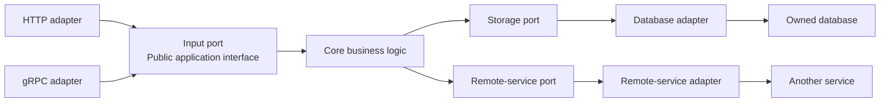
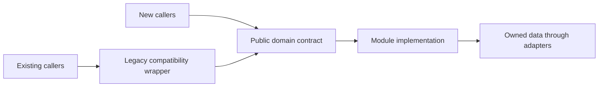

# Service Boundaries and Testing Cheat Sheet

Clear ownership and interfaces make it easier to test changes without starting the entire system.
This applies to modules inside a monolith as well as separately deployed services.

## Define the domain boundary first

- Group related business rules and data under clear ownership.
  The owning team should understand the code, storage, operational configuration, and alerts for that domain.
- Expose a public contract and keep implementation details internal.
  Other domains should use that contract instead of importing internal classes or reaching directly into owned data.
- A module can establish these boundaries without introducing a network call or separate deployment.
  Consider a microservice when independent scaling, deployment, or failure containment justifies the operational cost.
- One domain can span several services.
  A helper that transforms a domain's events does not necessarily represent a separate business domain.

Use architecture checks to prevent forbidden imports and dependency cycles.
Directory names alone do not enforce encapsulation.

## Separate core logic from adapters

A **port** is an interface through which the application interacts with its surroundings.
An **adapter** connects that interface to a technology such as HTTP, gRPC, or a database.

- **Primary adapters** accept incoming requests and call the application.
- **Core logic** applies business rules through its interfaces.
- **Secondary adapters** perform outgoing operations requested by the core.

The arrows below show calls at runtime.
The core depends on port interfaces, while secondary adapters implement those interfaces.

The core can be tested through these interfaces with controlled substitutes for its dependencies.
Transport parsing and database queries can be tested separately from the business rules.

## Name tests by the boundary they cover

Labels such as unit and integration test are useful, but specify what is real and what is replaced in each test.

| Test boundary | What to verify | What to run or replace |
| --- | --- | --- |
| Core | Business rules, validation, and calculations. | Run real core logic with test doubles for external ports. |
| Primary adapter | Request parsing, HTTP headers or gRPC metadata, response mapping, and protocol errors. | Run the adapter with a controlled substitute for the application interface. |
| Secondary adapter | Queries, persistence mappings, message encoding, and calls through client libraries. | Test against owned infrastructure where practical, such as a database container. Use controlled endpoints for other services. |
| Contract between domains | Whether the consumer's requests and expected responses match what the provider supports. | Verify consumer expectations against the provider, rather than trusting a consumer-side mock alone. |
| Selected end-to-end workflows | Whether important user journeys work across the deployed components. | Run the relevant components together, including the wiring the workflow depends on. |

Contract tests check compatibility at an interaction boundary.
They do not establish that the provider stored the right business data or that an entire deployed workflow succeeds.
Keep those responsibilities covered by the appropriate functional and end-to-end tests.

## Extract a module without breaking existing callers

1. Identify the behavior and data owned by the domain.
   Establish a data-access boundary; a physical database migration is not always necessary at this stage.
2. Introduce a public contract and move the owned behavior behind it.
3. Keep a compatibility wrapper for existing callers while new callers adopt the contract directly.
4. Enforce the module boundary and add focused tests for its core and adapters.
5. Migrate callers and legacy tests gradually, then remove compatibility code when it is no longer needed.

The wrapper preserves the existing callers' expected behavior while delegating the extracted operations.
Moving classes into a new directory without controlling access leaves the original coupling in place.

### Transition existing tests carefully

- Tests for a caller can replace the extracted domain with a test double at its public contract.
  Test the extracted domain's real behavior in its own suite.
- Treat an existing shared legacy fake as a compatibility fixture.
  Avoid making new tests depend on it, and migrate toward fixtures controlled by each test suite.
- If a shared fake or public contract changes, validate the dependent tests too.
  Passing against a fake alone does not demonstrate that the real implementations still work together.

## Run tests according to the change's impact

- Run the core and adapter tests together for a change contained within a module.
- Also test affected consumers when public contracts, shared code, or shared test fixtures change.
- Broaden validation when build configuration or dependency changes can affect several modules.

Targeted testing depends on enforced boundaries and knowledge of dependencies.
Changing the directory used for a test filter does not by itself make a change isolated.

## Choose integration environments deliberately

| Approach | Benefit | Trade-off |
| --- | --- | --- |
| In-process test doubles | Fast tests with controlled dependency behavior. | Do not exercise the real network boundary. Keep substitution in test wiring rather than scattered environment checks. |
| A separate mock service | Exercises the real client and transport against controlled responses. | Adds another service to maintain, and its behavior can drift from the provider. |
| Real collaborating services | Exercises actual integrations and deployment wiring. | Costs more to run and makes failures harder to isolate as the number of dependencies grows. |

Use focused tests for most behavior and broader integration tests where they provide additional confidence.
The balance depends on the domain's failure impact and the interactions that must work together.
