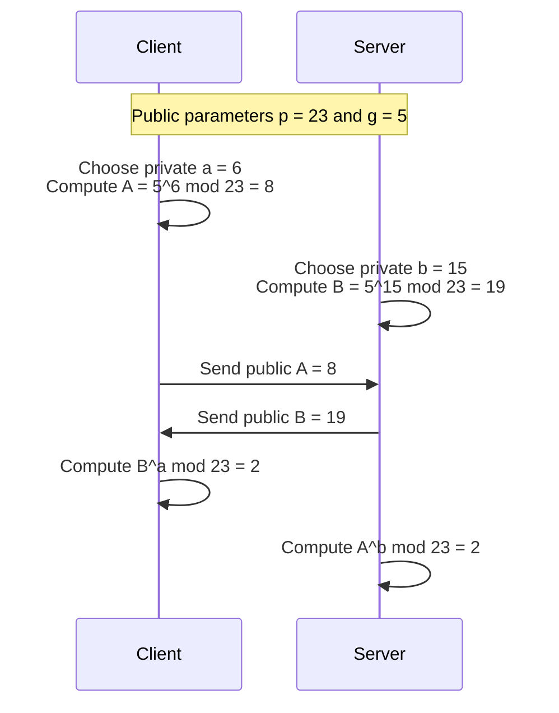
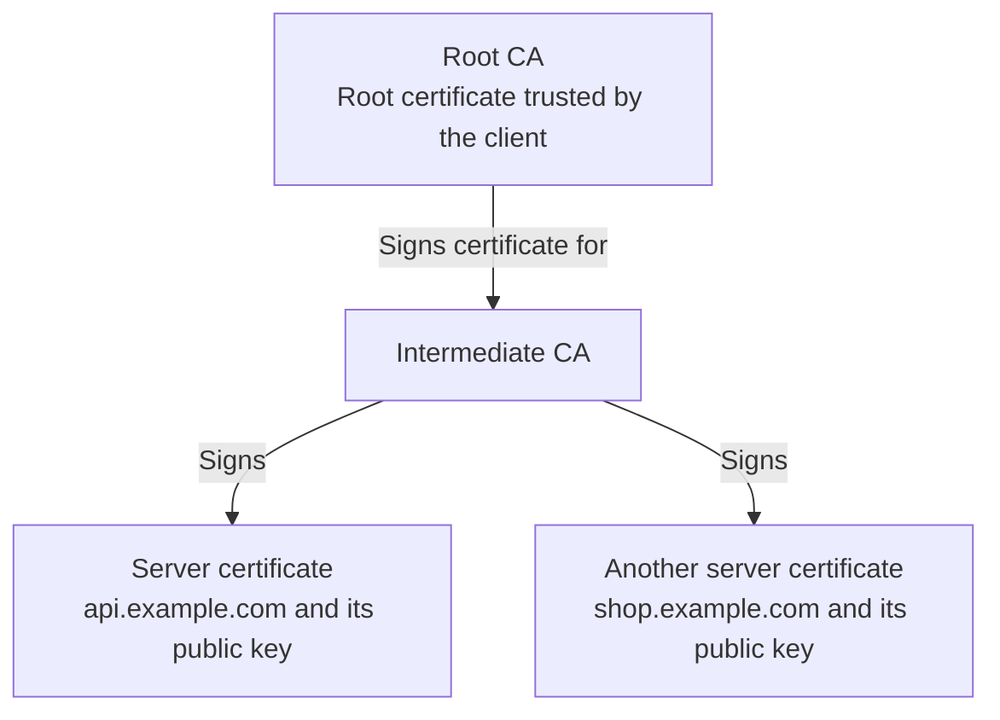
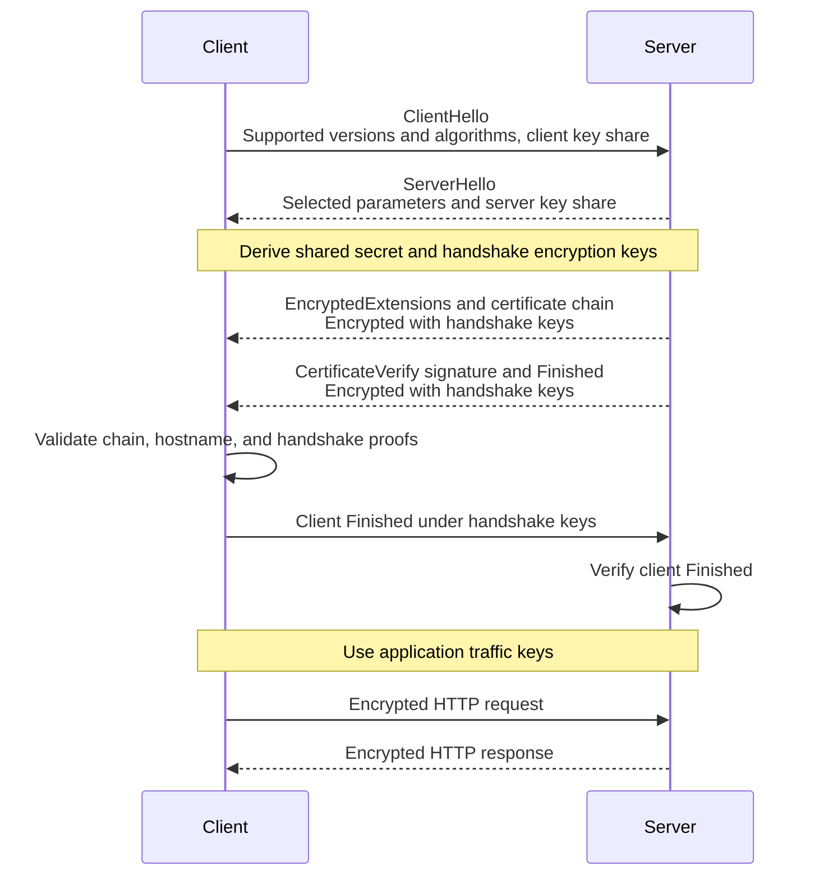
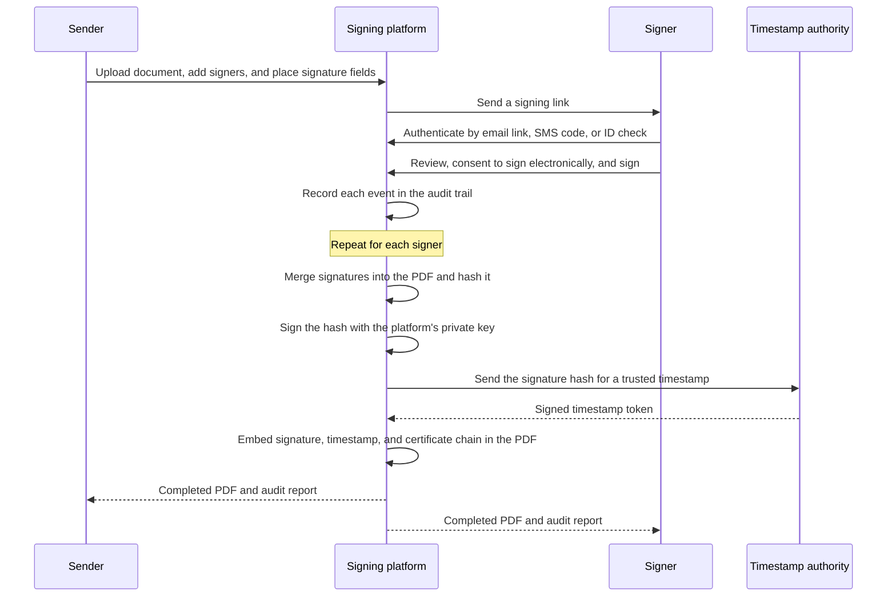
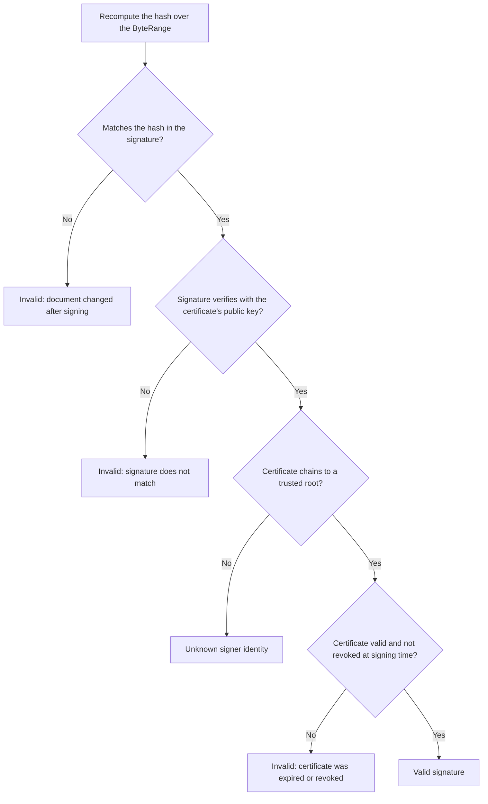

# HTTP and TLS Cheat Sheet

## HTTP, HTTPS, and SSL

HTTP defines requests and responses: methods, paths, headers, status codes, and bodies.
HTTPS protects that communication with authenticated encryption.
For HTTPS, HTTP/1.1 and HTTP/2 use TLS over TCP.
HTTP/3 uses QUIC over UDP, with TLS 1.3 providing its handshake and key establishment.

**SSL is the obsolete predecessor of TLS.**
The phrase “SSL certificate” usually means a certificate used with TLS today.
The examples below focus on a fresh, certificate-authenticated TLS 1.3 connection.

HTTPS protects the HTTP path, query, headers, and body between the TLS endpoints.
An observer can still see information such as destination IP addresses, traffic sizes, and timing.
HTTP versions and their multiplexing behavior are covered in the [gRPC and HTTP note](grpc.md#http11-http2-and-http3).

## Symmetric and asymmetric cryptography

**Symmetric cryptography** uses shared secret key material.
Both endpoints know the keys needed to protect and read their traffic.
TLS uses authenticated encryption, such as AES-GCM or ChaCha20-Poly1305, to provide confidentiality and detect tampering efficiently.

**Asymmetric cryptography** uses a mathematically related public and private key pair.
The public key can be shared, while the private key must remain secret.
Secure algorithms and key sizes make deriving the private key from the public key impractical.

| Operation | How the keys are used | Purpose |
| --- | --- | --- |
| Public-key encryption | Encrypt for the recipient using its public key; the recipient decrypts with its private key. | Deliver confidential data to a key holder. RSA-OAEP is one example. |
| Digital signature | Sign with a private key; verify the message and signature using the public key. | Detect modification and prove control of the signing key. Examples include RSA-PSS and ECDSA. |
| Key agreement | Each party combines its own private value with the other party's public value. | Derive shared secret material without sending the secret itself. ECDHE is a common TLS example. |

These are different operations, and not every key type supports all of them.
A signature does not hide the signed message.
It also does not tell you who owns the public key until you establish a trustworthy identity binding.

## How two parties derive the same secret

This small-number Diffie-Hellman example illustrates the arithmetic.
The values are deliberately tiny and insecure; real protocols use strong parameters.
Here, `^` means exponentiation and `mod` means the remainder after division.



Both calculations produce `g^(a*b) mod p`.
The private values are never sent.
Elliptic-curve Diffie-Hellman uses curve operations to achieve the same key-agreement goal.
The “ephemeral” part of ECDHE means fresh temporary key pairs are used for the exchange.

TLS derives traffic keys from the shared secret and handshake context rather than using this raw number directly.
Key agreement alone does not authenticate the peer: an intermediary could otherwise establish a separate secret with each endpoint.
Certificates and handshake signatures supply that authentication.

## What a certificate contains

An X.509 server certificate binds a public key to service identities under an issuer's signature.

| Field | What it tells the client |
| --- | --- |
| Public key | Which key can verify the server's proof of possession. |
| Subject Alternative Name, or SAN | The DNS names or IP addresses covered by the certificate. |
| Validity interval | When the certificate starts and stops being valid. |
| Issuer and signature | Which CA issued it and the signature used to verify that issuance. |
| Usage and constraints | Whether the key and certificate may be used for the intended purpose. |

The certificate is public information and does not contain the server's private key.
A certificate covering `shop.example.com` does not authenticate `api.example.com` merely because its signature is valid.

## Certificate authorities and the chain of trust

A **certificate authority**, or **CA**, checks an applicant's authorization for the requested identity and signs a certificate.
For a domain-validated website certificate, the central check is control of the domain.
That does not establish that the site's content or business is trustworthy.



The server normally supplies its leaf certificate and the necessary intermediate certificates.
The client builds a chain to a trust anchor already accepted by its browser, operating system, or application trust store.
The root is normally omitted from the server's chain.

A root is commonly self-signed, but its self-signature does not create trust.
Trust comes from the client's configured trust store and policy.
Private infrastructure can use its own CA when its clients are configured to trust that CA.

### How a server gets a certificate

1. Generate a key pair and retain the private key securely.
2. Create a certificate signing request, or CSR, containing the public key and requested names.
   Sign the CSR to prove possession of the corresponding private key.
3. Complete the CA's domain-control checks, such as an HTTP or DNS challenge.
4. The CA issues a signed certificate.
   Configure the TLS endpoint with the certificate chain and access to the private key.

The CA does not need the server's private key.
Certificate renewal repeats issuance before expiry; compromised certificates may need revocation and key replacement.

## What the browser verifies

| Check | Why it matters |
| --- | --- |
| Certificate signatures and chain | Connect the server certificate to a locally trusted issuer. |
| Expected hostname | Match the requested hostname against the certificate's SAN identities. |
| Validity and permitted use | Reject expired, not-yet-valid, or unsuitable certificates. |
| Client security policy | Apply relevant algorithm, revocation, and certificate-transparency requirements. |
| Handshake signature | Confirm that the peer controls the private key corresponding to the server certificate. |

The CA's certificate signature and the server's handshake signature are separate:

- The **CA signs the certificate** using the CA's private key.
  The client checks it with the issuer's public key.
- The **server signs the handshake** using its own certificate private key.
  The client checks it with the public key in the server certificate.

Copying a public certificate is therefore insufficient to impersonate its server.
The CA is not a participant in the connection's key agreement, although certificate validation can involve network checks depending on client policy and cached information.

## A TLS 1.3 handshake

This example uses ephemeral Diffie-Hellman after a TCP connection has been established.
The certificate key authenticates the handshake, while the temporary key shares establish the shared secret.



`CertificateVerify` signs the handshake context with the certificate's private key.
`Finished` authenticates the handshake transcript using derived secret key material.
TLS derives separate keys for the two traffic directions and for handshake versus application traffic.

The HTTP payload is protected with symmetric encryption; the server's certificate key does not encrypt every request or response.
With ephemeral key agreement and erased temporary secrets, later disclosure of the certificate private key alone does not reveal previously recorded sessions.
This property is called **forward secrecy**.

## Where TLS protection ends

- **TLS termination:** if a load balancer terminates TLS, it can read the HTTP traffic.
  Protecting the next hop to an application requires a separate secure connection.
- **Mutual TLS:** the server also requests and verifies a client certificate and proof of its private key.
  This authenticates a client identity, while application authorization still decides what that identity may do.
- **Application login:** ordinary server-authenticated HTTPS does not log a user into the application.
  Cookies, sessions, and identity protocols provide that layer, as described in the [OAuth note](oauth.md).

## Electronic signatures

Document signing uses the same certificates and digital signatures as TLS.
The difference is what gets signed and how long the proof must last.
A TLS handshake signature proves possession of a key once, during one connection.
A document signature stays attached to a file and must still be verifiable years later, offline, by someone who was never part of the exchange.

### Electronic signature versus digital signature

An **electronic signature** is a legal concept: any electronic mark or action that shows a person's intent to sign, such as typing a name or clicking "Sign".
A **digital signature** is the cryptographic mechanism: a private key signs a hash of the document, and the public key in a certificate verifies it.
Most signing platforms combine both.
They capture the signer's intent and evidence, then protect the result with a digital signature so later tampering is detectable.

Laws differ by region.
The US relies mainly on ESIGN and UETA, which focus on intent, consent, and record keeping.
The EU's eIDAS regulation defines three levels:

| Level | Who controls the signing key | Typical evidence | Typical use |
| --- | --- | --- | --- |
| Simple | The platform seals the document with its own key | Email link, audit trail, IP address, and timestamps | Most commercial contracts |
| Advanced | A key uniquely linked to the signer and under the signer's sole control | Signer certificate plus identity verification | Higher-value or regulated agreements |
| Qualified | A qualified certificate from a trusted provider, with the key in certified signing hardware | Verified identity, often in person or by ID check | Treated as equal to a handwritten signature in the EU |

### The signing workflow

A typical platform workflow, where the platform seals the final document, looks like this:



1. **Prepare:** the sender uploads the document, adds signers in order, and places the fields each signer must complete.
2. **Invite and authenticate:** each signer receives a link and proves their identity at the strength the sender required.
3. **Capture intent:** the signer reviews the document, agrees to sign electronically, and applies a signature.
   The visible signature image is only a representation and provides no security by itself.
4. **Record evidence:** the platform logs who did what and when, how they authenticated, and from which IP address.
5. **Seal:** after the last signer, the platform hashes the final PDF, signs that hash with its private key, and embeds the result.
6. **Timestamp:** a timestamp authority signs proof that the signature existed at a given time.
7. **Distribute:** everyone receives the sealed PDF and the audit report, which is often sealed as well.

With advanced or qualified signatures, step 5 uses each **signer's own key** instead of, or in addition to, the platform's key.
That key usually lives in a remote hardware security module, or HSM, run by a trust service provider.
The platform sends only the document hash, the signer authorizes the operation with a one-time code, and the HSM returns the signature.
The private key never leaves the HSM, and the document itself does not need to be sent to the provider.

### What is inside a signed PDF

PDF signatures follow the **PAdES** standard, which embeds a CMS signature, also known as PKCS#7, inside the file.

```
+--------------------------------------------------+
| PDF bytes covered by the signature (part 1)      |
+--------------------------------------------------+
| Signature placeholder: CMS SignedData            |  <- excluded from the hash
|   - Hash of the covered bytes                    |
|   - Signing time and other signed attributes     |
|   - Signature over those attributes              |
|   - Signer certificate and intermediate CAs      |
|   - Timestamp token and revocation data          |
+--------------------------------------------------+
| PDF bytes covered by the signature (part 2)      |
+--------------------------------------------------+
```

A **ByteRange** entry lists which bytes are hashed: everything except the placeholder that holds the signature.
Each additional signer appends an **incremental update** instead of rewriting the file, so earlier signatures stay valid.
Other formats apply the same idea to other documents: **XAdES** signs XML, and **CAdES** signs arbitrary files with a CMS signature.

### How a verifier checks a signed document



The trusted roots come from document trust lists, such as the Adobe Approved Trust List or the EU Trusted Lists, rather than from the browser's TLS trust store.
Validity is judged **at signing time**, proven by the timestamp, rather than at the moment of verification.

### Keeping signatures valid for years

Signing certificates often expire within one to three years, but contracts must stay verifiable much longer.
PAdES defines levels that add more evidence to the file:

| Level | Adds | Why |
| --- | --- | --- |
| B-B | The basic signature and signer certificate | Detects tampering and identifies the key |
| B-T | A trusted timestamp | Proves when the signature was made |
| B-LT | Embedded certificate chain and revocation responses, such as OCSP or CRL data | Allows verification after the CA's revocation services disappear |
| B-LTA | Periodic archive timestamps over everything above | Protects against older algorithms becoming weak over time |

### Comparison with TLS

| | TLS server authentication | Document signature |
| --- | --- | --- |
| What is signed | The live handshake transcript | A hash of the document |
| Who signs | The server | The platform, the signer, or both |
| Where the proof lives | In the connection, gone afterward | Embedded in the file |
| When it is verified | Once, during the handshake | Any time later, offline |
| Trust source | Browser or operating system trust store | Document trust lists |
| Time handling | Certificate must be valid now | Certificate must have been valid at the timestamped signing time |
| Confidentiality | Encrypts traffic with symmetric keys | None: signing does not hide the document |
