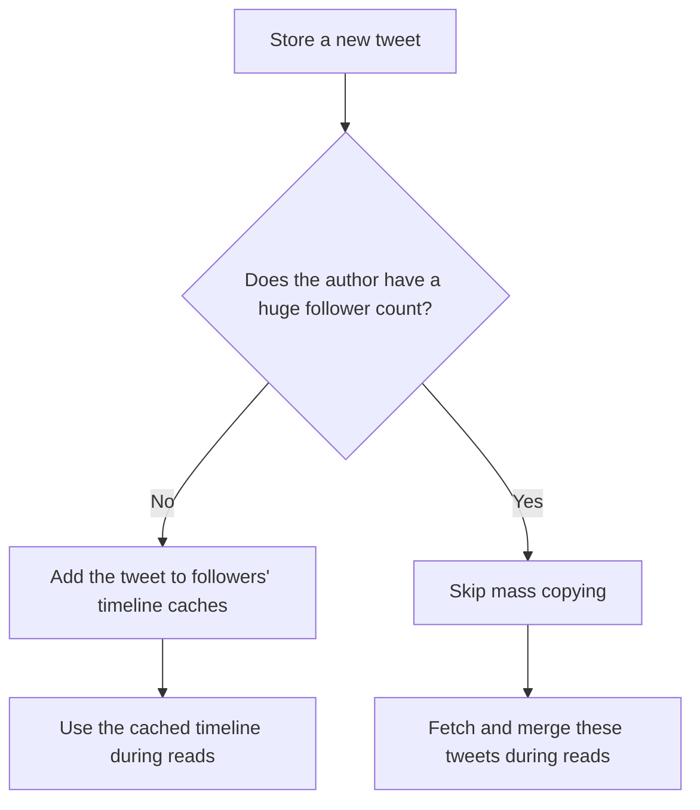

# Chapter 1: Reliable, Scalable, and Maintainable Applications

*Designing Data-Intensive Applications*, 2017 first edition. Printed pages 3–23.

Source: Martin Kleppmann, *Designing Data-Intensive Applications* (O'Reilly, 2017).

An application is **data-intensive** when its main challenges are data volume, data complexity, or the rate of change. A compute-intensive application's main constraint is the computation itself (p. 3).

The chapter establishes three goals that guide the rest of the book:

| Goal | The question it answers |
|---|---|
| **Reliability** | Can the system keep working correctly when things go wrong? |
| **Scalability** | Can it maintain acceptable performance as a particular workload grows? |
| **Maintainability** | Can people understand, operate, and change it over time? |

**1. Combining tools makes you a data system designer.** (pp. 4–6)

An application may combine a database, cache, search index, message queue, and batch jobs. Each component solves part of the problem, but your application must make them work together.

For example, updating a database creates further questions: When does the cache update? When does the search index reflect the change? What happens if one update succeeds and another fails?

**The important lesson:** choosing good components is only part of the work. You also own the correctness of their interactions.

**2. Reliability means handling faults without losing the required service.** (pp. 6–10)

“Working correctly” includes correct results, acceptable performance under the expected load, and protection against unauthorized access. A reachable server returning incorrect data does not meet that requirement.

The distinction between a **fault** and a **failure** is central:

- A **fault** happens when a component stops behaving correctly.
- A **failure** happens when the overall system stops providing the service users require.

For example, a database machine crashing is a fault. If another machine takes over and users can continue working correctly, the fault has not caused a service failure.

The chapter separates faults into three groups:

| Source | Example | Useful responses |
|---|---|---|
| Hardware | Failed disk or lost machine | Redundancy and recovery mechanisms |
| Software | An input crashes every server running the same code | Test assumptions, isolate processes, monitor behavior |
| Humans | Incorrect production configuration | Safe interfaces, gradual rollouts, rollback tools |

A subtle point: **more replicas do not automatically protect against software bugs.** The same input can trigger the same bug on every replica. Hardware can also share a cause of failure, such as excessive heat in the same rack. Redundancy helps only to the extent that the remaining components can survive the fault.

Recovery paths also need testing. Deliberately stopping a process can reveal that failover does not work as expected.

**What to remember:** define which faults you intend to tolerate, then verify that users still receive the promised behavior.

**3. Scalability only makes sense relative to a workload.** (pp. 10–13, 17–18)

Calling a system “scalable” leaves too much unspecified. First describe its **load parameters**, such as:

- Requests per second.
- Read-to-write ratio.
- Data size.
- Concurrent users.
- Cache hit rate.
- How unevenly work is distributed.

Then ask either:

1. If load increases while resources stay fixed, how does performance change?
2. How many additional resources are needed to preserve performance?

The workload’s distribution matters. An average can hide a few users or requests that generate most of the work.

The chapter’s Twitter example illustrates this using historical figures from 2012:

| Timeline approach | Work happens when… | Main trade-off |
|---|---|---|
| Assemble on read | Someone opens their timeline | Cheap posting, expensive reading |
| Precompute on write | Someone posts a tweet | More work during posting, cheap reading |

With roughly **4,600 tweets per second** and **75 followers per tweet on average**, precomputing produces about **345,000 timeline-cache writes per second**.

But a celebrity with millions of followers makes that approach expensive. The hybrid described in the book handles those users differently:



**The important lesson:** the best design depends on which operations are common, expensive, and unusually large.

Scaling up means using a more powerful machine. Scaling out means spreading work across machines. Both are useful; distributing state introduces additional coordination and operational complexity. **Elasticity** means automatically adjusting resources as load changes; scaling can also be done manually.

The chapter also warns against designing for an imagined future workload. Scaling choices depend on assumptions about usage, and those assumptions may change as the product develops.

**4. Performance is a distribution, so averages are insufficient.** (pp. 13–17)

Two measurements matter:

- **Throughput:** how much work completes per second.
- **Response time:** how long a client waits for a response, including processing, network delays, and queueing.

The server's **service time** is only the time spent processing the request. For example, a request might need 10 ms of processing but wait 500 ms in a queue first. Slow requests can hold up otherwise quick requests behind them, increasing the response-time tail.

Percentiles describe different parts of the response-time distribution:

| Metric | Meaning |
|---|---|
| p50 | Half of requests complete at or below this time |
| p95 | 95% complete at or below this time |
| p99 | 99% complete at or below this time |

A good p50 can coexist with a painful p99. The slow end of the distribution is called the **tail**. These percentiles describe requests. A user making many requests has more opportunities to encounter a slow one, so “1% of requests are slow” does not mean “only 1% of users experience slowness.”

Tail behavior becomes especially important when one user request needs results from many backend calls. Even when calls run in parallel, the user waits for the slowest required result.

For a numerical illustration added to explain the book's point: if each backend call independently has a 1% chance of being slow, a request requiring all 100 calls has roughly a **63% chance of encountering at least one slow call**:

```text
P(at least one slow call) = 1 - P(all calls are fast)
                         = 1 - 0.99^100
                         ≈ 63.4%
```

The independence assumption matters; correlated delays change this calculation.

Three practical details are worth retaining:

- Measure from the client’s perspective so waiting time is included.
- A load test that waits for every response before sending another request can hide queueing problems.
- **Do not average p99 values across servers.** Combine the underlying distributions or compatible histograms, then calculate the percentile.

Make performance goals measurable. An illustrative **service level objective (SLO)** could be “99% of timeline requests complete within one second over the measurement window.” Evaluate it under a stated workload; a percentile measured at light load does not establish behavior at peak load.

**5. Maintainability includes operation, understanding, and change.** (pp. 18–22)

The chapter breaks maintainability into three parts:

| Principle | What it means in practice |
|---|---|
| **Operability** | Make health visible, routine work easy, and recovery predictable |
| **Simplicity** | Remove unnecessary complexity and expose understandable abstractions |
| **Evolvability** | Make future changes possible without excessive effort or risk |

Simplicity concerns how much someone must understand to make a safe change. Short code can still hide tangled dependencies and surprising behavior.

The book distinguishes **inherent complexity**, which belongs to the problem, from **accidental complexity**, which comes from the implementation. Good abstractions help reduce the latter.

Evolvability also extends beyond refactoring code: changing schemas, moving data, replacing components, and changing how services interact all matter.

**A quick recall check before Chapter 2:**

1. Why might three identical replicas all fail together?
2. Why can two systems with the same requests per second need very different architectures?
3. How can a service have a good median response time while many users still experience slow pages?

<details>
<summary>Suggested answers</summary>

1. The same bug, bad configuration, or shared dependency can affect all three. Replicas do not automatically make faults independent.
2. Request size, read/write mix, work per request, and skew can differ. Requests per second describes only one part of load.
3. The median hides the slow tail, and a page or session can involve many requests. One slow required call can delay the whole page.

</details>

Next is **Chapter 2: Data Models and Query Languages**, covering relational, document, and graph models and the trade-offs behind them.
