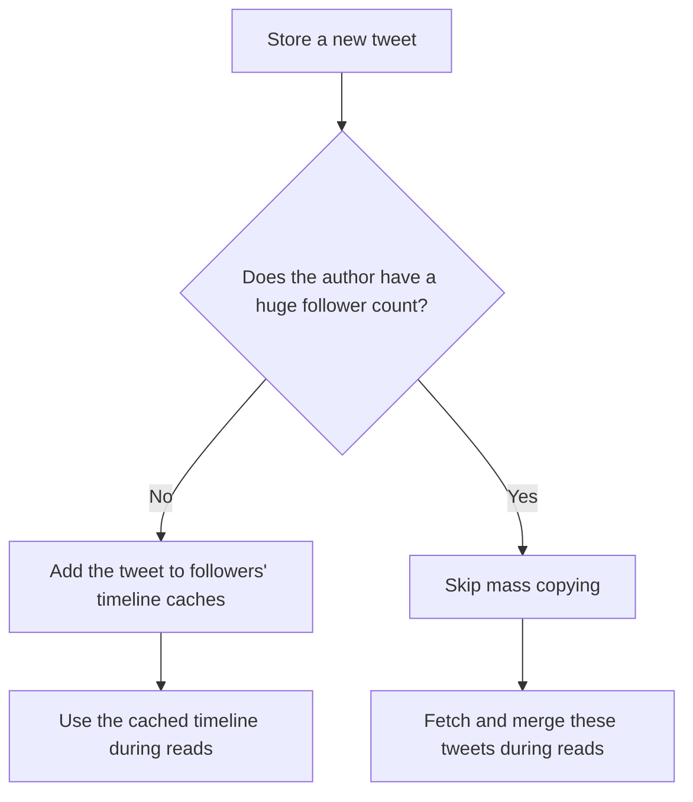
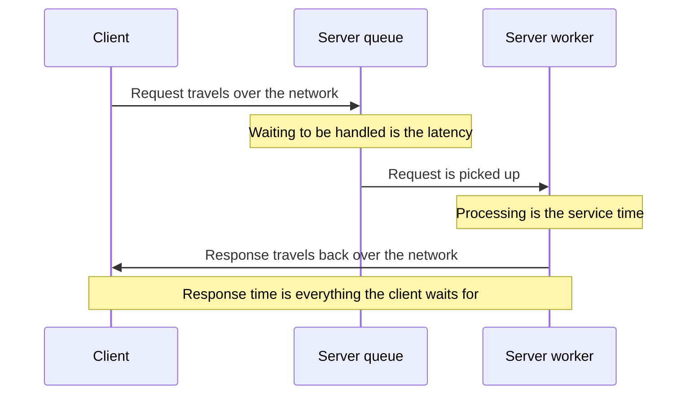

# Chapter 1: Reliable, Scalable, and Maintainable Applications

*Designing Data-Intensive Applications*, 2017 first edition. Printed pages 3–23.

Source: Martin Kleppmann, *Designing Data-Intensive Applications* (O'Reilly, 2017).

An application is **data-intensive** when its main challenges are data volume, data complexity, or the rate of change. A compute-intensive application's main constraint is the computation itself (p. 3).

The chapter establishes three goals that guide the rest of the book:

| Goal | The question it answers |
|---|---|
| **Reliability** | Can the system keep working correctly when things go wrong? |
| **Scalability** | Can it maintain acceptable performance as a particular workload grows? |
| **Maintainability** | Can people understand, operate, and change it over time? |

**1. Combining tools makes you a data system designer.** (pp. 4–6)

An application may combine a database, cache, search index, message queue, and batch jobs. Each component solves part of the problem, but your application must make them work together.

Why group databases, queues, and caches under one term, **data systems**? Partly because the categories are blurring: Redis is a datastore that is also used as a message queue, and Kafka is a message queue with database-like durability (p. 4).

For example, updating a database creates further questions: When does the cache update? When does the search index reflect the change? What happens if one update succeeds and another fails?

**The important lesson:** choosing good components is only part of the work. You also own the correctness of their interactions.

**2. Reliability means handling faults without losing the required service.** (pp. 6–10)

“Working correctly” includes correct results, tolerance of user mistakes, acceptable performance under the expected load, and protection against unauthorized access. A reachable server returning incorrect data does not meet that requirement.

The distinction between a **fault** and a **failure** is central:

- A **fault** happens when a component stops behaving correctly.
- A **failure** happens when the overall system stops providing the service users require.

For example, a database machine crashing is a fault. If another machine takes over and users can continue working correctly, the fault has not caused a service failure.

The chapter separates faults into three groups:

| Source | Example | Useful responses |
|---|---|---|
| Hardware | Failed disk or lost machine | Redundancy and recovery mechanisms |
| Software | An input crashes every server running the same code | Test assumptions, isolate processes, monitor behavior |
| Humans | Incorrect production configuration | Safe interfaces, gradual rollouts, rollback tools |

Hardware faults are routine at scale. A hard disk lasts 10 to 50 years on average (its mean time to failure, or MTTF), so a cluster of 10,000 disks should expect about one dead disk per day (p. 7). The classic answer is redundant parts: RAID, dual power supplies, hot-swappable CPUs, and backup power. But systems now use more machines, which means proportionally more faults, and cloud VMs (on AWS, for example) can disappear without warning. So systems increasingly tolerate the loss of whole machines in software. A bonus: you can patch one node at a time, a **rolling upgrade**, without taking the whole system down (p. 8).

A subtle point: **more replicas do not automatically protect against software bugs.** The same input can trigger the same bug on every replica. For example, the leap second on June 30, 2012 triggered a Linux kernel bug that made many applications hang at the same time. Such bugs often lie dormant until an unusual situation breaks an assumption the software makes about its environment (p. 9). Correlated faults like this tend to cause many more system failures than hardware faults, which are mostly independent. Hardware can also share a cause of failure, such as excessive heat in the same rack. Redundancy helps only to the extent that the remaining components can survive the fault.

People are a major source of outages. In one study of large internet services, operator configuration errors were the leading cause, while hardware faults played a role in only 10–25% of outages (p. 9). Besides the table's responses, the book recommends sandbox environments with real data where people can experiment without affecting users, thorough testing at all levels, tools to recompute data after a bad computation, and detailed monitoring, which other engineering fields call telemetry (pp. 9–10).

Recovery paths also need testing. Deliberately stopping a process can reveal that failover does not work as expected. The book's example is randomly killing individual processes without warning, and Netflix's Chaos Monkey is one example of this approach (p. 7). Many critical bugs come from poor error handling, and regular deliberate faults keep that code exercised.

**What to remember:** define which faults you intend to tolerate, then verify that users still receive the promised behavior.

**3. Scalability only makes sense relative to a workload.** (pp. 10–13, 17–18)

Calling a system “scalable” leaves too much unspecified. First describe its **load parameters**, such as:

- Requests per second.
- Read-to-write ratio.
- Data size.
- Concurrent users.
- Cache hit rate.
- How unevenly work is distributed.

Then ask either:

1. If load increases while resources stay fixed, how does performance change?
2. How many additional resources are needed to preserve performance?

The workload’s distribution matters. An average can hide a few users or requests that generate most of the work.

The chapter’s Twitter example illustrates this using historical figures from 2012:

| Timeline approach | Work happens when… | Main trade-off |
|---|---|---|
| Assemble on read | Someone opens their timeline | Cheap posting, expensive reading |
| Precompute on write | Someone posts a tweet | More work during posting, cheap reading |

Posting even 12,000 tweets per second, the peak rate, would be fairly easy on its own. The challenge is **fan-out**: each user follows many people, and many people follow each user. Twitter first assembled timelines on read, but struggled to keep up with timeline queries, so it moved the work to write time. That pays off because reads far outnumber posts: the 2012 figures show about **300,000 timeline reads per second**, roughly 65 times the average posting rate.

With roughly **4,600 tweets per second** and **75 followers per tweet on average**, precomputing produces about **345,000 timeline-cache writes per second**.

But a celebrity with millions of followers makes that approach expensive. Some users have over 30 million followers, so one of their tweets means over 30 million timeline writes, and Twitter aims to deliver tweets to followers within five seconds. The hybrid described in the book handles those users differently:



So for Twitter, the key load parameter is the distribution of followers per user, perhaps weighted by how often each user tweets, because it sets the fan-out load (p. 13).

**The important lesson:** the best design depends on which operations are common, expensive, and unusually large.

Scaling up means using a more powerful machine. Scaling out means spreading work across machines. Both are useful; distributing state introduces additional coordination and operational complexity. **Elasticity** means automatically adjusting resources as load changes; scaling can also be done manually.

Scaling out is also called a **shared-nothing** architecture. One machine is simpler, but high-end machines get very expensive, so very heavy workloads often must scale out. Stateless services are fairly easy to spread across machines, but stateful data systems are not. So the common wisdom was to keep a database on one node until cost or high-availability needs forced it to be distributed, though better tools may change this (p. 18). Good architectures usually mix approaches. Elastic scaling helps when load is highly unpredictable, but manual scaling is simpler and has fewer operational surprises (p. 17).

There is no one-size-fits-all scalable architecture. A system built for 100,000 requests per second of 1 kB each looks very different from one built for 3 requests per minute of 2 GB each, even though both move about 100 MB per second.

The chapter also warns against designing for an imagined future workload. Scaling choices depend on assumptions about usage, and those assumptions may change as the product develops. Even a good fit does not last forever: an architecture built for one level of load rarely copes with 10 times that load, so a fast-growing service may need a rethink at every order of magnitude (p. 17).

**4. Performance is a distribution, so averages are insufficient.** (pp. 13–17)

Two measurements matter:

- **Throughput:** how much work completes per second. Batch systems such as Hadoop usually care most about this.
- **Response time:** how long a client waits for a response, including processing, network delays, and queueing. Online systems usually care most about this.

The server's **service time** is only the time spent processing the request. For example, a request might need 10 ms of processing but wait 500 ms in a queue first. Slow requests can hold up otherwise quick requests behind them, increasing the response-time tail.

This effect is called **head-of-line blocking**. A server can process only a few requests in parallel, limited for example by its CPU cores, so queueing delays often make up a large part of response time at high percentiles (pp. 15–16).

**Latency** is not a synonym for response time. It is the time a request spends waiting to be handled, when it is latent and awaiting service (p. 14):



Even identical requests vary. A context switch, a lost network packet and TCP retransmission, a garbage collection pause, or a page fault can add delay at random. The mean does not tell you how many users actually saw a given delay, so percentiles are usually better (pp. 14–15).

Percentiles describe different parts of the response-time distribution:

| Metric | Meaning |
|---|---|
| p50 | Half of requests complete at or below this time |
| p95 | 95% complete at or below this time |
| p99 | 99% complete at or below this time |
| p999 | 99.9% complete at or below this time |

A good p50 can coexist with a painful p99. The slow end of the distribution is called the **tail**. These percentiles describe requests. A user making many requests has more opportunities to encounter a slow one, so “1% of requests are slow” does not mean “only 1% of users experience slowness.”

Amazon shows both why the tail matters and where to stop. It sets response-time goals for internal services at p99.9, the slowest 1 in 1,000 requests, because those often come from customers with the most data on their accounts: they have made many purchases, which makes them the most valuable customers. Amazon has also seen that 100 ms of extra response time reduces sales by 1%. But it judged p99.99 too expensive for the benefit, since the slowest 1 in 10,000 requests are easily affected by random events outside its control.

Tail behavior becomes especially important when one user request needs results from many backend calls. Even when calls run in parallel, the user waits for the slowest required result. The book calls this **tail latency amplification**: the more backend calls a request needs, the larger the share of user requests that end up slow (p. 16).

For a numerical illustration added to explain the book's point: if each backend call independently has a 1% chance of being slow, a request requiring all 100 calls has roughly a **63% chance of encountering at least one slow call**:

```text
P(at least one slow call) = 1 - P(all calls are fast)
                         = 1 - 0.99^100
                         ≈ 63.4%
```

The independence assumption matters; correlated delays change this calculation.

Three practical details are worth retaining:

- Measure from the client’s perspective so waiting time is included.
- A load test that waits for every response before sending another request can hide queueing problems.
- **Do not average p99 values across servers.** Combine the underlying distributions or compatible histograms, then calculate the percentile.

Make performance goals measurable. An illustrative **service level objective (SLO)** could be “99% of timeline requests complete within one second over the measurement window.” Evaluate it under a stated workload; a percentile measured at light load does not establish behavior at peak load.

The book's own example is a **service level agreement (SLA)**, a contract about expected performance and availability. It might count the service as up only while the median response time is under 200 ms and p99 is under 1 s, and require 99.9% uptime. If the SLA is not met, customers can demand a refund (p. 15).

**5. Maintainability includes operation, understanding, and change.** (pp. 18–22)

The chapter breaks maintainability into three parts:

| Principle | What it means in practice |
|---|---|
| **Operability** | Make health visible, routine work easy, and recovery predictable |
| **Simplicity** | Remove unnecessary complexity and expose understandable abstractions |
| **Evolvability** | Make future changes possible without excessive effort or risk |

Why it matters: most of the cost of software comes from ongoing maintenance, not the first build (p. 18). For operability, the book cites the view that good operations can often make up for weak software, while even well-built software needs good operations to stay reliable (p. 19). A data system helps by offering good monitoring, support for automation, no dependence on any single machine, good docs and an easy operational model (if I do X, Y happens), defaults that admins can override, self-healing with manual control when needed, and predictable behavior (p. 20).

Simplicity concerns how much someone must understand to make a safe change. Short code can still hide tangled dependencies and surprising behavior.

A project mired in complexity is called a **big ball of mud**. Symptoms include an exploding state space, tight coupling, tangled dependencies, inconsistent naming, and hacks or special cases that work around problems elsewhere. Complexity makes changes slower and riskier, because hidden assumptions and unexpected interactions are easy to miss. Simpler need not mean fewer features: it can mean removing accidental complexity (pp. 20–21).

The book distinguishes **inherent complexity**, which belongs to the problem, from **accidental complexity**, which comes from the implementation. Good abstractions help reduce the latter. SQL, for example, hides how data is laid out on disk and in memory, how requests from many clients interleave, and what a crash could leave half-done. Many applications share that one abstraction, so an improvement inside the database helps all of them.

Evolvability also extends beyond refactoring code: changing schemas, moving data, replacing components, and changing how services interact all matter. The book's example asks how you would "refactor" Twitter's home timelines from assembling on read to precomputing on write (p. 22).

**A quick recall check before Chapter 2:**

1. Why might three identical replicas all fail together?
2. Why can two systems with the same requests per second need very different architectures?
3. How can a service have a good median response time while many users still experience slow pages?
4. How do latency and response time differ?
5. Why have systems moved from hardware redundancy toward software fault tolerance?

<details>
<summary>Suggested answers</summary>

1. The same bug, bad configuration, or shared dependency can affect all three. Replicas do not automatically make faults independent.
2. Request size, read/write mix, work per request, and skew can differ. Requests per second describes only one part of load.
3. The median hides the slow tail, and a page or session can involve many requests. One slow required call can delay the whole page.
4. Response time is everything the client waits for: service time plus network and queueing delays. Latency is only the time a request spends waiting to be handled.
5. More machines mean proportionally more hardware faults (10,000 disks lose about one per day), and cloud VMs can disappear without warning. Tolerating the loss of whole machines in software also allows rolling upgrades without downtime.

</details>

Next is **Chapter 2: Data Models and Query Languages**, covering relational, document, and graph models and the trade-offs behind them.
