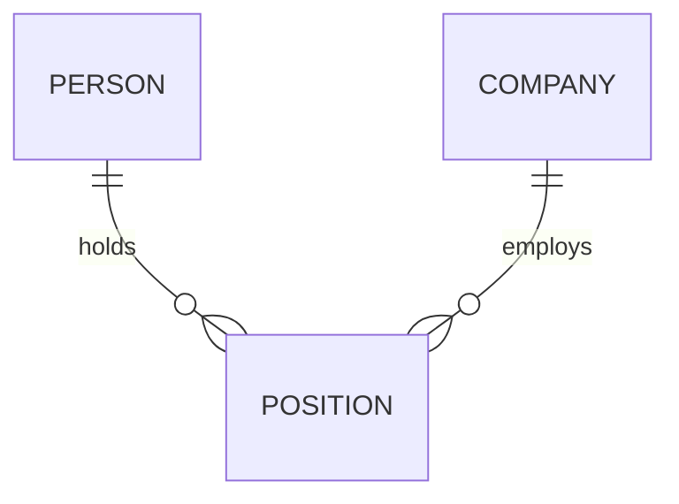
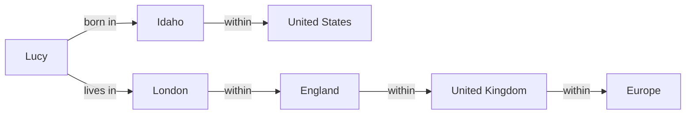

# Chapter 2: Data Models and Query Languages

*Designing Data-Intensive Applications*, 2017 first edition. Printed pages 27–64.

Source: Martin Kleppmann, *Designing Data-Intensive Applications* (O'Reilly, 2017).

Your choice of data model shapes both your application code and the questions you can easily ask.

The central idea: **choose a model around your data’s relationships and access patterns.**

| Model | Natural fit | Main trade-off |
|---|---|---|
| **Document** | Self-contained records with nested children, often read together | Relationships across documents require more work |
| **Relational** | Shared entities, joins, and many-to-many relationships | Nested application objects need mapping to tables |
| **Graph** | Rich connections and queries that follow paths between entities | The benefit depends on path queries; many-to-many relationships alone also fit relational tables |

**NoSQL** is an umbrella term covering different systems, not one data model. Using different kinds of datastore for different requirements is called **polyglot persistence** (p. 29). Model choice also does not settle separate questions about fault tolerance or concurrency (p. 38).

The book names four forces behind NoSQL: scaling beyond what relational databases easily achieve (very large datasets or very high write throughput), a preference for free and open source software, specialized queries the relational model supports poorly, and frustration with restrictive relational schemas (p. 29).

**1. A document is convenient when the data belongs together.** (pp. 29–32, 38–41)

The book uses a résumé as an example. A person has several jobs, education records, and contact details. These form a tree that fits naturally into JSON. Here is a cut-down version with made-up values (the book's Example 2-1 is a full LinkedIn profile, pp. 31–32):

```json
{
  "user_id": 42,
  "name": "Alex",
  "positions": [
    {"company": "Acme", "title": "Engineer"},
    {"company": "Example", "title": "Developer"}
  ]
}
```

If the application usually loads the whole résumé, keeping it together can simplify reads and application code.

In a normalized relational design, those positions would usually live in another table. Translating between application objects and database rows is called the **object-relational impedance mismatch**. An ORM reduces the boilerplate, but the difference between the models remains.

Splitting such a tree across several tables is called **shredding**, and for document-like data it can lead to cumbersome schemas and needlessly complicated code. Documents have their own limit: you cannot point directly at a nested item, only describe where it sits, such as the second position of user 251. That is rarely a problem while nesting stays shallow (pp. 38–39).

The document’s advantage depends on its use: storing everything together helps when you read it together. To show a whole profile, the relational design needs one query per table or a join across all of them, while the document needs a single query.

Large documents with frequent small reads or updates can make that arrangement less attractive. The database usually loads the whole document even to read a small part, and an update typically rewrites all of it unless its encoded size stays the same. So the book advises keeping documents fairly small and avoiding writes that make them grow.

**2. Shared entities turn a simple tree into a network of relationships.** (pp. 33–39)

Now suppose each company needs its own page, logo, and current name.

If thousands of résumés each contain a copy of the company’s details, a company update requires changing thousands of documents. Partial updates can leave conflicting copies.

Instead, give the company a stable ID and reference it:



Each position connects one person with one company. The person-to-positions relationship is one-to-many; positions-to-company is many-to-one. Together they support a many-to-many relationship between people and companies.

This illustrates **normalization**: store a shared fact in one place and refer to it elsewhere.

The book's first case is simpler: its profile stores `region_id` and `industry_id` rather than text such as "Greater Seattle Area". A standard list gives consistent spelling, avoids ambiguity between places with the same name, makes renaming easy, allows translation, and improves search (the list can know that Seattle is in Washington). The deeper reason: an ID means nothing to humans, so it never needs to change. Anything meaningful to humans may change one day, and every duplicated copy would then need updating (p. 33).

| Approach | Benefit | Cost |
|---|---|---|
| Reference shared data | One authoritative value to update | Reads may need joins or additional lookups |
| Duplicate shared data | Reads can retrieve everything together | Copies must be kept consistent |

**Removing a database join does not necessarily remove the work.** Your application may end up performing the join through several requests, or maintaining duplicated data.

The book also shows how new features introduce relationships: recommendations connect one user’s résumé to another user’s profile. A recommendation appears on the recommended user’s résumé along with the author’s name and photo. If the author changes their photo, all their recommendations must show the new one, so each recommendation should reference the author’s profile rather than copy it. A design that starts as independent documents can become interconnected.

The book points out that this debate is as old as databases (pp. 36–38):

| Model | How it handles relationships |
|---|---|
| **Hierarchical** (IBM's IMS, 1968) | A tree of records nested in records, much like JSON. One-to-many works well, but many-to-many is hard and there are no joins, so developers duplicate data or resolve references by hand |
| **Network** (CODASYL, 1970s) | A record can have several parents, so many-to-many is possible. But links work like pointers, and code must follow access paths by hand (see point 4) |
| **Relational** (SQL) | Rows in tables, related by keys and joined at query time. The query optimizer picks the access path |
| **Document** | Nests one-to-many data inside the parent, like IMS. For many-to-one and many-to-many it stores an ID (a document reference) and resolves it at read time, like a relational foreign key |

**3. “Schemaless” usually means the schema lives in your code.** (pp. 39–42)

If your application expects `user.positions` to be an array, it already assumes a schema—even if the database does not enforce it.

The chapter distinguishes:

| Approach | When structure is checked | Similar to |
|---|---|---|
| **Schema-on-write** | The database checks data as it is written | Static (compile-time) type checking |
| **Schema-on-read** | Application code interprets the structure when reading | Dynamic (runtime) type checking |

As with static versus dynamic typing, neither is right in general (p. 40). Schema-on-read is useful when records have different shapes or come from external systems you do not control.

Schema-on-write helps document and enforce a consistent structure.

Neither approach eliminates schema evolution. If you introduce a new field, existing records still lack it. You need a migration, compatible reading code, or both.

The book’s example splits a full `name` field into `first_name` and `last_name`:

| Step | Schema-on-read (document database) | Schema-on-write (relational database) |
|---|---|---|
| Change the structure | Start writing new documents with the new fields | `ALTER TABLE users ADD COLUMN first_name text` |
| Handle old records | Reading code fills in `first_name` from `name` when it is missing | An `UPDATE` sets `first_name` from `name` in every row |

Most relational databases add the column in milliseconds. MySQL is the book's notable exception: it copies the whole table, which can take minutes or hours on a large table, though tools exist to work around this (p. 40). The `UPDATE` is slow on a large table in any database, because it rewrites every row. To avoid it, you can leave `first_name` as `NULL` and fill it in at read time, just as a document database would.

Also, these models can coexist. A relational database can hold document-shaped values alongside tables and joins. The representation and the decision to enforce a schema are separate choices.

The book sees the two models converging. Apart from MySQL, most relational databases gained XML support in the mid-2000s, and PostgreSQL (since 9.3), MySQL (since 5.7), and DB2 (since 10.5) support JSON documents. On the other side, RethinkDB supports joins, and some MongoDB drivers resolve references on the client, which is likely slower than a join inside the database. It calls a hybrid of the two models a good route for future databases (pp. 41–42).

**4. Declarative queries let you describe the result and leave execution choices to the database.** (pp. 36–38, 42–46)

Compare two approaches:

- **Imperative:** iterate through records, check conditions, and collect matches.
- **Declarative:** state which records should match.

For example:

```sql
SELECT name
FROM users
WHERE country = 'DE';
```

This specifies the result without requiring a particular index, scan method, or execution order.

The optimizer can choose a plan and adapt when indexes or data distributions change. That separation is valuable for both performance and maintainability.

The historical lesson comes from older databases that required developers to follow fixed **access paths**. Changing how data was accessed could force substantial application rewrites. In the 1970s network model (CODASYL), records pointed to each other much like pointers in a program, and code could reach a record only by following a chain of links from a root record. A relational query optimizer chooses this path instead: declare a new index, and existing queries can use it without any change. The key insight: a general-purpose query optimizer is hard to build, but it is built once and every application using the database benefits (p. 38).

Two details worth remembering:

- SQL does not guarantee result order without `ORDER BY`. So the database can move records around, for example to reclaim disk space, without breaking queries. With imperative code, it could never be sure the code does not rely on the order. SQL's limited power gives the optimizer more room (p. 43).
- SQL does not require execution on a single machine. Declarative queries can also be executed across machines. Because they state only the pattern of results, not the algorithm, they have a better chance than imperative code of getting faster through parallel execution. This matters because CPUs now get faster mainly by adding cores (pp. 43, 48).

**5. Graphs make connections and paths explicit.** (pp. 49–63)

A graph contains:

- **Vertices:** entities such as people, cities, and countries.
- **Edges:** relationships such as “born in,” “lives in,” and “within.”

In the **property graph** model, each vertex has an ID, its incoming and outgoing edges, and properties (key-value pairs). Each edge has an ID, a tail vertex where it starts, a head vertex where it ends, a label naming the relationship, and properties. The whole graph fits in two relational tables, `vertices` and `edges`, with indexes on both ends of each edge (pp. 50–51). This gives three strengths: any vertex can connect to any other, edges can be followed forward and backward, and labels let one graph hold many kinds of data. Facebook, for example, keeps people, locations, events, checkins, and comments in a single graph (p. 49). New features often just add vertices and edges, so graphs are good for evolvability (p. 52).

The book’s example connects people to locations:



Now ask: **Who was born somewhere within the United States and currently lives somewhere within Europe?**

The challenge is that location paths have different lengths. A birthplace might be recorded as a city, state, or country. So the number of joins is not known in advance, unlike a typical relational query (pp. 53–54).

Graph query languages can express these variable-length paths directly. SQL can express them with recursive queries, though the syntax may be more involved. The book’s SQL version uses recursive common table expressions (`WITH RECURSIVE`, standard since SQL:1999) and takes 29 lines, against 4 for the Cypher query below.

Here is a shortened version of the book's Cypher query (pp. 52–54):

```cypher
MATCH
  (p)-[:BORN_IN]->()-[:WITHIN*0..]->(:Location {name: 'United States'}),
  (p)-[:LIVES_IN]->()-[:WITHIN*0..]->(:Location {name: 'Europe'})
RETURN p.name
```

The repeated `p` requires the same person to match both patterns. `WITHIN*0..` means zero or more containment edges: a location can be the target itself or be nested within it. The query describes the required paths; the database chooses how to find matches.

The chapter introduces several related approaches:

| Approach | Important idea |
|---|---|
| **Property graph / Cypher** | Nodes and edges can carry properties; queries match graph patterns |
| **Triple-store / SPARQL** | Facts have the form `(subject, predicate, object)`, such as `(lucy, age, 33)` for a property or `(lucy, marriedTo, alain)` for an edge |
| **Datalog** | Reusable rules derive new facts from existing facts |

For example, Datalog rules can express: if Idaho is within the US, and the US is within North America, then Idaho is within North America.

Graph databases are not CODASYL in disguise (p. 60):

| | CODASYL network model | Graph database |
|---|---|---|
| Schema | Fixed which record type can nest in which | Any vertex can link to any other |
| Reaching a record | Only by following an access path | Directly by ID, or through an index |
| Order | Children form an ordered set the database must maintain | Vertices and edges are unordered |
| Queries | Imperative, and easily broken by schema changes | Declarative languages such as Cypher or SPARQL, with imperative code optional |

**The key distinction:** relational databases can represent graph data. Graph models make certain relationship-heavy questions more natural to express.

**6. MapReduce separates custom computation from distributed execution.** (pp. 46–48)

Some NoSQL datastores, including MongoDB and CouchDB, support a limited form of MapReduce for read-only queries across many documents. The chapter briefly introduces the pattern through MongoDB:

1. **Map:** produce key-value pairs from records.
2. Group values by key.
3. **Reduce:** combine each group.

For the book's monthly shark-count report, two December 1995 sightings of 3 and 4 sharks give:

```text
Map outputs:     ("1995-12", 3), ("1995-12", 4)
Grouped values:  ("1995-12", [3, 4])
Reduce result:   ("1995-12", 7)
```

MapReduce sits between imperative and declarative approaches: you supply computation functions, while the framework controls their execution. Restricted functions without side effects make retrying and moving computation easier.

Writing coordinated map and reduce functions can be more work than expressing the same result in a declarative query, and a declarative query gives the optimizer more room. So MongoDB 2.2 added a declarative **aggregation pipeline** that declares filtering and grouping stages. A query can be declarative even when its syntax is JSON rather than SQL. The book's moral: a NoSQL system may end up reinventing SQL in disguise (p. 48). Chapter 10 returns to distributed processing in detail.

**A quick recall check:**

1. When does embedding a company’s details inside every user document become troublesome?
2. Where does the schema exist when the database does not enforce one?
3. Why is “find every location inside Europe, at any depth” naturally expressed as a graph query?
4. What did document databases take from the hierarchical model, and what did they not take?
5. How could you store a property graph in a relational database, and why are graph queries still awkward in SQL?

<details>
<summary>Suggested answers</summary>

1. When the company is a shared entity whose details must stay consistent. Each change must reach every duplicate, or readers can see conflicting values.
2. In the assumptions made by readers and writers. Flexible storage still requires code to handle missing fields, different shapes, and old versions.
3. The number of containment relationships varies. A graph query can express a variable-length path; SQL can express the same idea with recursion.
4. They nest one-to-many data inside the parent record, like IMS. But for many-to-one and many-to-many they store IDs and resolve them at read time, like relational foreign keys, instead of making code follow access paths.
5. Use two tables, vertices and edges, with indexes on each edge's tail and head vertex. But a question like "lives anywhere within Europe" needs a variable number of joins, so SQL needs a recursive common table expression: 29 lines against 4 in Cypher.

</details>

Next is **Chapter 3: Storage and Retrieval**—how indexes, storage engines, and disk layouts make these models work efficiently.
