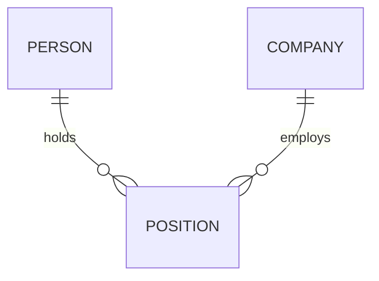
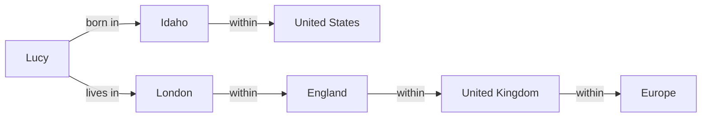

# Chapter 2: Data Models and Query Languages

*Designing Data-Intensive Applications*, 2017 first edition. Printed pages 27–64.

Source: Martin Kleppmann, *Designing Data-Intensive Applications* (O'Reilly, 2017).

Your choice of data model shapes both your application code and the questions you can easily ask.

The central idea: **choose a model around your data’s relationships and access patterns.**

| Model | Natural fit | Main trade-off |
|---|---|---|
| **Document** | Self-contained records with nested children, often read together | Relationships across documents require more work |
| **Relational** | Shared entities, joins, and many-to-many relationships | Nested application objects need mapping to tables |
| **Graph** | Rich connections and queries that follow paths between entities | The benefit depends on path queries; many-to-many relationships alone also fit relational tables |

**NoSQL** is an umbrella term covering different systems, not one data model. Using different kinds of datastore for different requirements is called **polyglot persistence** (p. 29). Model choice also does not settle separate questions about fault tolerance or concurrency (p. 38).

**1. A document is convenient when the data belongs together.** (pp. 29–32, 38–41)

The book uses a résumé as an example. A person has several jobs, education records, and contact details. These form a tree that fits naturally into JSON:

```json
{
  "user_id": 42,
  "name": "Alex",
  "positions": [
    {"company": "Acme", "title": "Engineer"},
    {"company": "Example", "title": "Developer"}
  ]
}
```

If the application usually loads the whole résumé, keeping it together can simplify reads and application code.

In a normalized relational design, those positions would usually live in another table. Translating between application objects and database rows is called the **object-relational impedance mismatch**. An ORM reduces the boilerplate, but the difference between the models remains.

The document’s advantage depends on its use: storing everything together helps when you read it together. Large documents with frequent small reads or updates can make that arrangement less attractive.

**2. Shared entities turn a simple tree into a network of relationships.** (pp. 33–39)

Now suppose each company needs its own page, logo, and current name.

If thousands of résumés each contain a copy of the company’s details, a company update requires changing thousands of documents. Partial updates can leave conflicting copies.

Instead, give the company a stable ID and reference it:



Each position connects one person with one company. The person-to-positions relationship is one-to-many; positions-to-company is many-to-one. Together they support a many-to-many relationship between people and companies.

This illustrates **normalization**: store a shared fact in one place and refer to it elsewhere.

| Approach | Benefit | Cost |
|---|---|---|
| Reference shared data | One authoritative value to update | Reads may need joins or additional lookups |
| Duplicate shared data | Reads can retrieve everything together | Copies must be kept consistent |

**Removing a database join does not necessarily remove the work.** Your application may end up performing the join through several requests, or maintaining duplicated data.

The book also shows how new features introduce relationships: recommendations connect one user’s résumé to another user’s profile. A design that starts as independent documents can become interconnected.

**3. “Schemaless” usually means the schema lives in your code.** (pp. 39–42)

If your application expects `user.positions` to be an array, it already assumes a schema—even if the database does not enforce it.

The chapter distinguishes:

| Approach | When structure is checked |
|---|---|
| **Schema-on-write** | The database checks data as it is written |
| **Schema-on-read** | Application code interprets the structure when reading |

Schema-on-read is useful when records have different shapes or come from external systems you do not control.

Schema-on-write helps document and enforce a consistent structure.

Neither approach eliminates schema evolution. If you introduce a new field, existing records still lack it. You need a migration, compatible reading code, or both.

Also, these models can coexist. A relational database can hold document-shaped values alongside tables and joins. The representation and the decision to enforce a schema are separate choices.

**4. Declarative queries let you describe the result and leave execution choices to the database.** (pp. 36–38, 42–46)

Compare two approaches:

- **Imperative:** iterate through records, check conditions, and collect matches.
- **Declarative:** state which records should match.

For example:

```sql
SELECT name
FROM users
WHERE country = 'DE';
```

This specifies the result without requiring a particular index, scan method, or execution order.

The optimizer can choose a plan and adapt when indexes or data distributions change. That separation is valuable for both performance and maintainability.

The historical lesson comes from older databases that required developers to follow fixed **access paths**. Changing how data was accessed could force substantial application rewrites.

Two details worth remembering:

- SQL does not guarantee result order without `ORDER BY`.
- SQL does not require execution on a single machine. Declarative queries can also be executed across machines.

**5. Graphs make connections and paths explicit.** (pp. 49–63)

A graph contains:

- **Vertices:** entities such as people, cities, and countries.
- **Edges:** relationships such as “born in,” “lives in,” and “within.”

The book’s example connects people to locations:



Now ask: **Who was born somewhere within the United States and currently lives somewhere within Europe?**

The challenge is that location paths have different lengths. A birthplace might be recorded as a city, state, or country.

Graph query languages can express these variable-length paths directly. SQL can express them with recursive queries, though the syntax may be more involved.

Here is a shortened version of the book's Cypher query (pp. 52–54):

```cypher
MATCH
  (p)-[:BORN_IN]->()-[:WITHIN*0..]->(:Location {name: 'United States'}),
  (p)-[:LIVES_IN]->()-[:WITHIN*0..]->(:Location {name: 'Europe'})
RETURN p.name
```

The repeated `p` requires the same person to match both patterns. `WITHIN*0..` means zero or more containment edges: a location can be the target itself or be nested within it. The query describes the required paths; the database chooses how to find matches.

The chapter introduces several related approaches:

| Approach | Important idea |
|---|---|
| **Property graph / Cypher** | Nodes and edges can carry properties; queries match graph patterns |
| **Triple-store / SPARQL** | Facts have the form `(subject, predicate, object)` |
| **Datalog** | Reusable rules derive new facts from existing facts |

For example, Datalog rules can express: if Idaho is within the US, and the US is within North America, then Idaho is within North America.

**The key distinction:** relational databases can represent graph data. Graph models make certain relationship-heavy questions more natural to express.

**6. MapReduce separates custom computation from distributed execution.** (pp. 46–48)

The chapter briefly introduces this pattern:

1. **Map:** produce key-value pairs from records.
2. Group values by key.
3. **Reduce:** combine each group.

For a monthly animal-count report:

```text
Map outputs:     (December, 3), (December, 4)
Grouped values:  (December, [3, 4])
Reduce result:   (December, 7)
```

MapReduce sits between imperative and declarative approaches: you supply computation functions, while the framework controls their execution. Restricted functions without side effects make retrying and moving computation easier.

Writing coordinated map and reduce functions can be more work than expressing the same result in a declarative query. The chapter contrasts them with an **aggregation pipeline** that declares filtering and grouping stages. A query can be declarative even when its syntax is JSON rather than SQL. Chapter 10 returns to distributed processing in detail.

**A quick recall check:**

1. When does embedding a company’s details inside every user document become troublesome?
2. Where does the schema exist when the database does not enforce one?
3. Why is “find every location inside Europe, at any depth” naturally expressed as a graph query?

<details>
<summary>Suggested answers</summary>

1. When the company is a shared entity whose details must stay consistent. Each change must reach every duplicate, or readers can see conflicting values.
2. In the assumptions made by readers and writers. Flexible storage still requires code to handle missing fields, different shapes, and old versions.
3. The number of containment relationships varies. A graph query can express a variable-length path; SQL can express the same idea with recursion.

</details>

Next is **Chapter 3: Storage and Retrieval**—how indexes, storage engines, and disk layouts make these models work efficiently.
