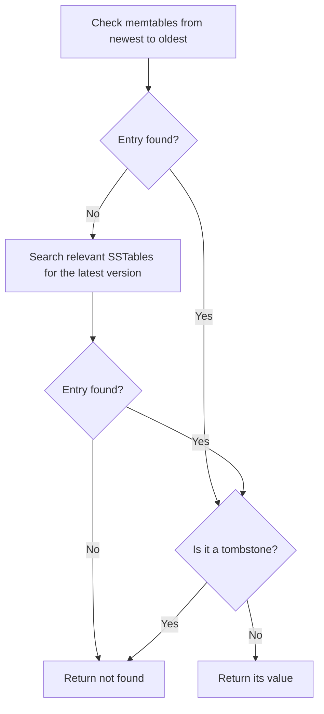

# Chapter 3: Storage and Retrieval

*Designing Data-Intensive Applications*, 2017 first edition. Printed pages 69–104.

Source: Martin Kleppmann, *Designing Data-Intensive Applications* (O'Reilly, 2017).

Chapter 2 covered how you represent and query data. Chapter 3 explains how a storage engine arranges bytes so those reads and writes are efficient.

The central idea: **a storage layout helps some access patterns and makes others more expensive. Choose it around the work your application actually does.**

**1. Indexes trade extra work on writes for faster reads.** (pp. 70–71)

The chapter starts with a tiny database that appends every update to a file:

```text
42,Alex
17,Sam
42,Alexandra
```

Appending is efficient. But finding the latest value for key `42` requires scanning the file unless you keep an additional lookup structure.

That structure is an **index**: information derived from the data that helps locate records.

An index uses storage and must be maintained when indexed data changes. Adding indexes to support every possible query makes writes more expensive.

**The important lesson:** an index should earn its maintenance cost through the queries it helps.

**2. An append-only log plus a hash index makes a useful key-value store.** (pp. 72–75)

Keep an in-memory hash map from each key to the byte offset of its latest value in the file.

1. Append an update to the log.
2. Update the key's offset in the hash map.
3. On a read, use the offset to go directly to the value.

Split the log into segments and periodically **compact** them, removing obsolete versions. A deletion is represented by a **tombstone**, a marker that prevents an older value from reappearing during merging.

For example, if an old segment contains `42=Alex` and a newer one contains `42=DELETED`, reads must report that key as absent. Discarding the tombstone while leaving the older value searchable would incorrectly bring Alex back.

Two limitations motivate the next design:

- In this design, the index for all keys must fit in memory.
- A hash index does not put keys in order, so it is poorly suited to range scans.

**3. SSTables and LSM-trees combine sorted reads with efficient batch writes.** (pp. 76–79)

An **SSTable**, or Sorted String Table, stores key-value pairs sorted by key. Sorting provides three advantages:

- Files can be merged efficiently, like the merge step in merge sort.
- A small, sparse index can locate a block of keys without indexing every key in memory.
- Nearby keys can be scanned and compressed together.

Incoming writes need not arrive in order. An **LSM-tree**, or Log-Structured Merge-Tree, handles this by accumulating them in a sorted in-memory structure called a **memtable**, then flushing sorted files to disk.

The simplified write path is:

1. Append the write to a recovery log, the **write-ahead log (WAL)**.
2. Insert or update the entry in the memtable.
3. When the memtable fills, freeze it and flush it as an immutable SSTable. New writes go to a new memtable while the old one is being flushed.
4. Merge SSTables through background compaction, discarding obsolete versions when safe.

The WAL allows recovery of writes that have not yet reached an SSTable. Durability also depends on when the log is actually persisted to storage. Once the corresponding data is safely stored in an SSTable, its recovery-log portion can be discarded.

For the chapter's simple key-value model, reads check in-memory tables from newest to oldest, including any still being flushed, then search relevant SSTables for the latest version. A tombstone counts as a result: it means the key is deleted, so the engine must not fall back to an older value.



A **Bloom filter** can establish that a key is definitely absent from an SSTable, avoiding an unnecessary read. A “possibly present” result still requires a lookup.

The chapter distinguishes **size-tiered compaction**, which combines smaller tables into larger ones, from **leveled compaction**, which organizes data into levels with files covering key ranges. This choice affects merging work and disk-space use.

**What to remember:** fast writes do not eliminate work. They defer some work to flushing and compaction.

**4. B-trees organize storage into a balanced tree of pages.** (pp. 79–83)

A B-tree divides storage into fixed-size pages. Internal pages contain key boundaries and references to child pages. Leaf pages contain values or references to them.

To find key `251`, follow the root's range containing `251`, then keep narrowing the range until reaching the appropriate leaf.

Each page can reference many children, so a large dataset can fit into a shallow tree. B-trees support both exact lookups and ordered range scans.

In the basic design, updates modify pages in place. If a page fills, it splits and its parent must be updated. Because a crash could interrupt this multi-page change, a WAL records modifications before the corresponding tree pages are written. Recovery uses that log to restore a consistent state.

The chapter also describes variants using copy-on-write instead of overwriting existing pages.

**An important distinction:** both B-tree and LSM engines can use a WAL. The WAL is a recovery mechanism; the main data structures are still different.

**5. Compare LSM-trees and B-trees by their total work, including background work.** (pp. 83–85)

| Aspect | LSM-tree | B-tree |
|---|---|---|
| Main write strategy | Buffer writes, flush sorted files, merge later | Update pages and split them when needed |
| Exact reads | May consult multiple structures or files | Follow a path through the tree |
| Range scans | Supported by sorted files | Supported by sorted keys and leaf pages |
| Typical strength | High write throughput and compact storage | Efficient reads and often more predictable response times |
| Important cost | Compaction consumes bandwidth and temporary space | Page updates, splits, and recovery logging |

These are tendencies, not a universal ranking. Workload, hardware, implementation, and configuration matter.

**Write amplification** means one application write causes multiple storage writes. It can happen in both designs: through WAL and page writes in B-trees, or WAL, flushing, and repeated compaction in LSM-trees.

Sequential writes can make an LSM-tree fast even though it rewrites data. Neither design always has lower write amplification; configuration and workload determine the total bytes written.

Compaction also competes with foreground requests. If it cannot keep up, files accumulate, reads do more work, and disk usage grows. Average throughput can look acceptable while slow requests become much slower.

**The important lesson:** a short benchmark on an empty database can miss the costs that appear as the database grows and background work accumulates.

**6. Other index structures optimize different questions.** (pp. 85–90)

| Structure | What it helps with | Trade-off or limitation |
|---|---|---|
| Secondary index | Find records by a field other than the primary key | Adds maintenance and storage costs |
| Clustered index | Keep row data within the index structure | The layout favors that index's ordering |
| Covering index | Include enough data to answer certain queries from the index | Duplicates additional column values |
| Composite index | Search or sort by an ordered combination of fields | Column order affects which queries benefit |
| Spatial index | Search geographic areas or multiple dimensions | Requires specialized structures, such as R-trees |
| Full-text index | Find documents containing words and support text-oriented matching | Uses structures and processing beyond ordinary key lookup |

A secondary index can be unique or nonunique. With a nonunique key such as `country=DE`, the index must identify all matching records. It may store references to rows in a separate **heap file**, or to their primary keys. “Covering” describes whether the index contains all data needed by a particular query; an index can cover one query but not another.

For example, an index on `(last_name, first_name)` groups people by last name, then first name. It helps searches by last name or by both fields. A search by first name alone does not get the same direct narrowing from that ordering.

An **in-memory database** changes another part of the design. It can avoid overhead associated with disk-oriented data structures while still using logs or snapshots for durability. Keeping data in RAM does not by itself specify whether acknowledged writes survive a crash.

**7. Transaction processing and analytics have different access patterns.** (pp. 90–95)

| Property | OLTP: transaction processing | OLAP: analytical processing |
|---|---|---|
| Typical question | “What is this customer's order?” | “What was revenue by region last year?” |
| Records touched | A small number per request | Often millions or more |
| Read shape | Retrieve or update particular records | Scan selected columns and aggregate |
| Write shape | Frequent small inserts and updates | Bulk loads or incoming event streams |
| Main priority | Fast interactive operations | Efficient processing of large datasets |

Both can use SQL. Their shared query language does not imply that they should use the same physical layout. **OLTP describes a workload; it does not by itself promise ACID transaction guarantees.** Those guarantees are examined in Chapter 7.

A separate **data warehouse** lets expensive analytical queries run without competing directly with production transactions. The chapter describes **ETL**, or Extract–Transform–Load: copy data from operational systems, clean and reshape it, then load it for analysis.

Warehouses often use a **star schema**: a central fact table records events, such as individual sales, and references dimension tables describing products, customers, stores, and dates. A **snowflake schema** further normalizes those dimensions into related tables.

**8. Column storage makes large analytical scans cheaper.** (pp. 95–101)

A simplified physical layout shows the difference:

```text
Rows:
  [sale_id=1, country=DE, amount=10]
  [sale_id=2, country=FR, amount=20]

Columns:
  sale_id: [1, 2]
  country: [DE, FR]
  amount:  [10, 20]
```

A query summing amounts by country needs only the `country` and `amount` columns. On a table with 100 columns, avoiding the other 98 can save substantial reading and decoding work.

Column storage also enables:

- **Compression:** similar or repeated values are stored together.
- **Bitmap filtering:** combine matching row positions with operations such as AND and OR.
- **Vectorized processing:** process batches of values efficiently using CPU caches and suitable instructions.
- **Useful sort orders:** group related rows so queries can narrow scans and compression can improve.

All columns must preserve the same logical row alignment. Sorting each column independently would destroy the relationship between its values and the other columns.

Compressed, sorted columns make individual updates harder. The chapter shows how buffering writes and merging them into column files in batches can help.

Also, a **column-family data model** does not by itself imply this analytics-oriented physical layout. Logical data models and physical storage layouts are separate choices.

**9. Materialized views move repeated calculations out of the read path.** (pp. 101–103)

A regular view stores a query definition. A **materialized view** stores its results, such as daily sales totals by product and store.

Reads can then use the precomputed totals. The cost is additional storage and the work needed to update or refresh those results as source data changes.

A **data cube** organizes precomputed aggregates across several dimensions.

Precomputation also limits which questions the saved result can answer. Daily totals alone cannot tell you how many individual purchases exceeded a particular amount. Keeping detailed source data preserves flexibility for future questions.

**A quick recall check:**

1. Why does an LSM-tree still need a WAL if it eventually writes everything into SSTables?
2. How can background compaction affect p99 response time even when average throughput looks good?
3. Why can column storage help an aggregate query but be awkward for frequent small updates?
4. How does a covering index differ from an index that only points to rows elsewhere?

<details>
<summary>Suggested answers</summary>

1. Recent writes may exist only in memory when the process crashes. A durably persisted WAL lets the engine reconstruct them before they have been flushed to SSTables.
2. Compaction shares storage bandwidth with foreground requests. Some requests wait much longer even when overall throughput remains acceptable.
3. Aggregates can scan only the required columns and benefit from compression. Small updates must preserve row alignment and deal with compressed, sorted data, so buffering and batch merging help.
4. A covering index contains the values required by that query, potentially avoiding a separate row fetch. An index containing only references requires another lookup for the missing values.

</details>

Next is **Chapter 4: Encoding and Evolution**, covering how data formats and schemas change while old and new code coexist.
