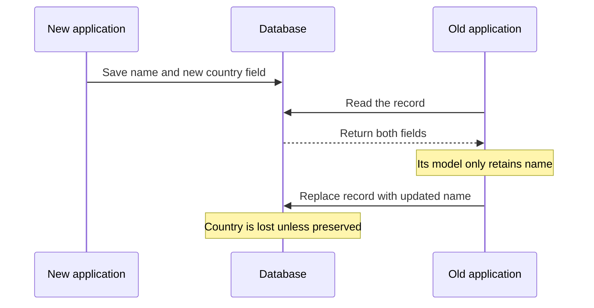

# Chapter 4: Encoding and Evolution

*Designing Data-Intensive Applications*, 2017 first edition. Printed pages 111–140.

Source: Martin Kleppmann, *Designing Data-Intensive Applications* (O'Reilly, 2017).

The central idea: **data formats determine whether old and new versions of an application can work together. Compatibility is part of deployment design.**

**1. Plan for different versions to coexist.** (pp. 111–112)

A rolling deployment changes a few servers at a time. Mobile clients may remain on old releases for months. Stored records may outlive several generations of application code. You cannot assume that every writer and reader upgrades together.

| Compatibility | What it allows | Example |
|---|---|---|
| **Backward** | New code reads old data | Version 2 reads a record written by version 1 |
| **Forward** | Old code reads new data | Version 1 reads a record written by version 2 |

Forward compatibility often means understanding the known parts and safely ignoring additions. It does not require old code to implement new behavior.

For a rolling upgrade or rollback, both directions may matter. Compatibility must cover meaning as well as successful parsing: a field that changes from cents to euros can remain an integer while silently breaking readers.

**2. Encoding turns application data into bytes.** (pp. 112–117)

In memory, objects can contain pointers and language-specific structures. Storage and network communication require a self-contained sequence of bytes. Encoding, or serialization, performs that conversion; decoding reconstructs a usable representation.

| Format family | Benefit | Main concern |
|---|---|---|
| Language-specific serialization | Convenient for that language's objects | Language coupling, weak evolution support, and potentially unsafe deserialization |
| JSON, XML, CSV | Broad support and accessible text representations | Types and compatibility depend on conventions and readers |
| Schema-driven binary formats | Compact representations and explicit types | Readers need the appropriate schema information |

Language-specific formats include Java's `java.io.Serializable`, Ruby's `Marshal`, and Python's `pickle`. To restore objects of the original types, the decoder must be able to create instances of arbitrary classes. So an attacker who gets your application to decode bytes of their choosing can create arbitrary objects, which often lets them run their own code. Versioning and efficiency are often afterthoughts in these libraries too; Java's built-in serialization, for example, is known for slow, bloated output. So the book advises using them only for very short-lived data.

Text does not eliminate type problems. For example, JSON numbers can exceed the exact integer range of a reader using floating-point numbers, and binary data needs a convention such as base64, which makes it about 33% larger. A format accepted by two libraries can still be interpreted differently.

The book's example is Twitter's tweet IDs. They are 64-bit integers, but integers above 253 cannot be stored exactly in the double-precision floats that JavaScript uses for JSON numbers. So Twitter's API sent every ID both as a JSON number and as a decimal string.

Still, JSON, XML, and CSV work well enough for many uses, and they will likely remain the usual formats for exchanging data between organizations. There, getting everyone to agree on a format matters more than how compact or elegant it is.

**3. Thrift and Protocol Buffers identify fields with stable tags.** (pp. 117–121)

Thrift and Protocol Buffers encode each field as a numeric tag plus enough type information to decode or skip it. Field names never appear in the encoded data.

Think of `1 = user name` and `2 = favorite number`. Each reader learns which meaning belongs to each tag from its schema.

Leaving out field names shrinks records a lot. The book encodes one example record, a person with `userName`, `favoriteNumber`, and `interests`, in several formats (pp. 116–122):

| Encoding | Size | Why |
|---|---|---|
| JSON without whitespace | 81 bytes | Text, with every field name |
| MessagePack, a binary JSON | 66 bytes | Binary, but still stores every field name |
| Thrift BinaryProtocol | 59 bytes | Numeric tags replace field names |
| Thrift CompactProtocol | 34 bytes | Packs type and tag into one byte, and uses variable-length integers, so 1337 takes 2 bytes instead of 8 |
| Protocol Buffers | 33 bytes | Bit packing similar to CompactProtocol |
| Avro, see point 4 | 32 bytes | Only the values, with no tags or types |

Tags also set the rules for schema evolution:

- Adding a field can preserve forward compatibility because an old reader can skip an unknown tag.
- To preserve backward compatibility, new code must handle records where that field is absent. So a field added after the first deployment cannot be `required`, or new code would reject every old record. It must be optional or have a default.
- Removing a field requires considering readers that still expect it. So you can remove only an optional field, never a `required` one.
- **Never reuse a removed field's tag for a different meaning.** Old records and readers still associate the tag with its original meaning.
- Changing a field name can leave the binary representation unchanged, but changing its tag would make all existing encoded data invalid. Changing its type needs separate compatibility analysis.

Exact rules depend on the encoding and schema conventions. “Both are integers” is insufficient if a larger value can overflow an older reader's narrower type. For example, change a field from a 32-bit to a 64-bit integer. New code reads old values by filling the extra bits with zeros, but old code still holds the value in a 32-bit variable, so a large new value gets truncated.

**4. Avro resolves a writer's schema against a reader's schema.** (pp. 122–128)

Avro's binary records omit field tags. The writer's schema tells the decoder how to interpret the bytes. The bytes are just the values, one after another. Nothing in them names a field or its type, so only the exact schema used for writing can decode them. The reader's schema describes the structure the consuming application expects.

The decoder uses both schemas to resolve their differences:

| Difference | Resolution described in the chapter |
|---|---|
| Writer has an extra field | Reader ignores it |
| Reader expects a field absent from the writer's schema | Use the reader's declared default, if one exists |
| Fields are in a different order | Match by name during schema resolution |
| Field types differ | Only compatible conversions are allowed |

For example, version 2 adds `country` with a default of `"unknown"`. A version 2 reader can fill in that default when reading version 1 data. Without a suitable default, that reader cannot simply invent a missing required value.

This gives Avro's main rule: to stay compatible in both directions, add or remove only fields that have a default value. Adding a field without a default breaks backward compatibility, because a new reader has nothing to fill in for old records. Removing one breaks forward compatibility, because an old reader has nothing to fill in for new records. A field may be null only if its type is a union that includes null, such as `union { null, long }`, so Avro uses unions and defaults instead of `optional` and `required`. Renaming a field works through aliases in the reader's schema, which is backward compatible but not forward compatible. Adding a branch to a union behaves the same way.

The writer's schema must remain available. Sending it with every record would waste the space savings, because a schema is often bigger than the record. A file can carry it once for many records; individually stored records can identify a schema version kept in a registry, as LinkedIn's Espresso does. Two processes on a network connection can agree on a schema version when the connection opens, as Avro RPC does. Keeping bytes while losing the schema needed to decode them is not sufficient preservation.

Leaving tags out pays off when a program generates the schema. For example, to dump a relational database to Avro files, you can generate one record schema per table, with one field per column. If a column is added or dropped, the export simply generates a new schema, and readers still match fields by name. With Thrift or Protocol Buffers, someone would have to assign tag numbers to columns by hand, or a generator would have to take care never to reuse an old tag.

Schemas also act as documentation that cannot drift out of date, because decoding needs them. A database of schema versions lets you check backward and forward compatibility before deploying. In statically typed languages, code generated from the schema enables compile-time type checks. Their value extends beyond reducing message size: the book concludes that schema evolution gives the flexibility of schemaless JSON databases, with better guarantees and tooling.

**5. Data outlives code, and read-modify-write can erase unknown fields.** (pp. 129–131)

A database is a communication channel between a writer and a reader that may run years later. A deployment does not automatically migrate every old record.

So databases need both directions. Backward compatibility lets later code read what earlier code wrote. Forward compatibility matters during a rolling upgrade, when old instances may read values that new instances just wrote. Rewriting every old record into a new schema is expensive on a large dataset, so databases avoid it where they can. Most relational databases, for example, add a column with a null default without rewriting rows, and fill in nulls when reading old ones.

There is also a less obvious compatibility problem:

An old reader might successfully ignore an unfamiliar field, yet destroy it when saving the record again. Check the entire decode–modify–encode path, including application model objects. Preserving unknown fields in the serialization library alone may not be enough.

**6. Service calls must expose network uncertainty.** (pp. 131–136)

RPC makes remote operations convenient to call by making them look like local function calls, which the book calls **location transparency**. But remote execution behaves differently from an ordinary local call:

- Requests and responses can be delayed or lost independently.
- A timeout may occur after the server has performed the operation.
- Retrying can repeat an effect unless the protocol supports deduplication or idempotence.
- Latency is much higher and varies wildly: under a millisecond at good times, many seconds when the network is congested or the service is overloaded.
- Arguments need serialization, and different languages may interpret types differently.

REST and RPC both require compatibility planning. Microservices aim to let each team deploy its service independently, so old and new versions of clients and servers run at the same time. If servers upgrade before clients, as the book assumes, new servers must accept old requests, and old clients must understand the relevant parts of new responses. That is backward compatibility on requests and forward compatibility on responses. Other deployment orders may require compatibility in the opposite directions too.

Compatibility is harder across organizations. A service provider often cannot force clients to upgrade, so compatibility may have to last indefinitely, and a breaking change often means running several API versions side by side. There is no agreed way for a client to pick a version. RESTful APIs often put it in the URL or the HTTP `Accept` header, and services that identify clients by API key can store each client's chosen version on the server.

REST is not a protocol but a design philosophy built on HTTP: URLs identify resources, and HTTP features handle caching, authentication, and content types. Its rival SOAP is an XML protocol with a large family of `WS-*` standards. SOAP relies heavily on generated code and tools, and it has fallen out of favor outside large enterprises.

The chapter compares ecosystem and debugging benefits of HTTP-based APIs with the efficiency and tooling of schema-driven RPC:

| | REST, usually JSON over HTTP | Schema-driven RPC, such as gRPC with Protocol Buffers |
|---|---|---|
| Strengths | Easy to try and debug with a web browser or `curl`, with no code generation or installs. Every mainstream language supports it, and many tools already exist: caches, load balancers, proxies, firewalls, and monitoring. | A custom binary encoding can perform better than generic JSON. Code generated from the schema allows type checking at compile time, and gRPC also supports streams of requests and responses. |
| Typical use | Public APIs | Calls between services of the same organization, usually in the same datacenter |

A pleasant API does not remove the need to handle timeouts and mixed versions.

**7. Message brokers decouple execution time, but compatibility remains.** (pp. 136–139)

A broker can buffer messages while consumers are unavailable, send one message to several recipients, and redeliver after failures. Producers need not contact each recipient directly.

Messaging is usually one-way and asynchronous: the sender does not wait for delivery or expect a reply, and any reply travels on a separate queue. Brokers usually do not enforce a data model, since a message is just bytes with some metadata. If the encoding is both backward and forward compatible, publishers and consumers can be changed and deployed in any order.

That creates another separation between the time and version that wrote data and the time and version that reads it. Queued messages may remain after a deployment, and replay may expose much older messages. Consumers that transform and republish messages must also preserve information they do not understand when that information is needed downstream.

Distributed actors encapsulate state and communicate with messages. Even if the framework makes a remote actor look convenient to contact, messages still cross version and failure boundaries. Making local and remote actors look the same works better than in RPC, because the actor model already assumes a message can be lost even within one process. Versions are the harder part: during a rolling upgrade, nodes on the new and old versions send messages to each other in both directions. In the book, Akka used Java's built-in serialization by default, which is neither forward nor backward compatible, though it can be replaced with Protocol Buffers to allow rolling upgrades. Orleans' default format did not support rolling upgrades, so a new version meant starting a new cluster and moving traffic to it.

**A quick recall check:**

1. Which compatibility direction lets new code read old records?
2. Why is reusing a Protocol Buffers or Thrift field tag dangerous?
3. How can an old application erase a field it never understood?
4. Does an RPC timeout prove that the server did nothing?
5. In Avro, why may you add or remove only fields that have a default value?
6. Why do public APIs often run several versions side by side?

Suggested answers

1. Backward compatibility. Forward compatibility allows old code to read new data.
2. Existing bytes and old readers associate that tag with its old meaning. Reuse can make valid-looking data mean something different.
3. It can discard the field during decoding into its own model and then replace the stored record with that incomplete representation.
4. No. The server may have performed the operation and lost or delayed the response. Safe retry behavior needs an explicit design.
5. A new reader needs a default to fill in a field that old records lack, or backward compatibility breaks. An old reader needs a default for a removed field that new records lack, or forward compatibility breaks.
6. The provider often cannot force clients to upgrade, so compatibility may have to last indefinitely. A breaking change therefore often ships as a new API version next to the old one.

Next is **Chapter 5: Replication**, covering how copies of the same data stay coordinated across machines.
