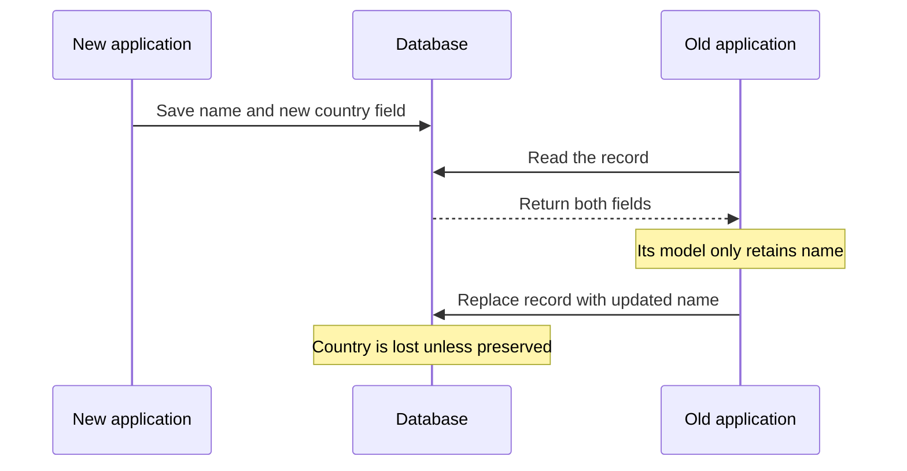

# Chapter 4: Encoding and Evolution

*Designing Data-Intensive Applications*, 2017 first edition. Printed pages 111–140.

Source: Martin Kleppmann, *Designing Data-Intensive Applications* (O'Reilly, 2017).

The central idea: **data formats determine whether old and new versions of an application can work together. Compatibility is part of deployment design.**

**1. Plan for different versions to coexist.** (pp. 111–112)

A rolling deployment changes a few servers at a time. Mobile clients may remain on old releases for months. Stored records may outlive several generations of application code. You cannot assume that every writer and reader upgrades together.

| Compatibility | What it allows | Example |
|---|---|---|
| **Backward** | New code reads old data | Version 2 reads a record written by version 1 |
| **Forward** | Old code reads new data | Version 1 reads a record written by version 2 |

Forward compatibility often means understanding the known parts and safely ignoring additions. It does not require old code to implement new behavior.

For a rolling upgrade or rollback, both directions may matter. Compatibility must cover meaning as well as successful parsing: a field that changes from cents to euros can remain an integer while silently breaking readers.

**2. Encoding turns application data into bytes.** (pp. 112–117)

In memory, objects can contain pointers and language-specific structures. Storage and network communication require a self-contained sequence of bytes. Encoding, or serialization, performs that conversion; decoding reconstructs a usable representation.

| Format family | Benefit | Main concern |
|---|---|---|
| Language-specific serialization | Convenient for that language's objects | Language coupling, weak evolution support, and potentially unsafe deserialization |
| JSON, XML, CSV | Broad support and accessible text representations | Types and compatibility depend on conventions and readers |
| Schema-driven binary formats | Compact representations and explicit types | Readers need the appropriate schema information |

Text does not eliminate type problems. For example, JSON numbers can exceed the exact integer range of a reader using floating-point numbers, and binary data needs a convention such as base64. A format accepted by two libraries can still be interpreted differently.

**3. Thrift and Protocol Buffers identify fields with stable tags.** (pp. 117–122)

The binary formats discussed in the chapter encode a field's numeric tag and enough type information to decode or skip it. The field name need not appear in every record.

Think of `1 = user name` and `2 = favorite number`. A new reader learns which meaning belongs to each tag from its schema.

- Adding a field can preserve forward compatibility because an old reader can skip an unknown tag.
- To preserve backward compatibility, new code must handle records where that field is absent.
- Removing a field requires considering readers that still expect it.
- **Never reuse a removed field's tag for a different meaning.** Old records and readers still associate the tag with its original meaning.
- Changing a field name can leave the binary representation unchanged. Changing its type needs separate compatibility analysis.

Exact rules depend on the encoding and schema conventions. “Both are integers” is insufficient if a larger value can overflow an older reader's narrower type.

**4. Avro resolves a writer's schema against a reader's schema.** (pp. 122–128)

Avro's binary records omit field tags. The writer's schema tells the decoder how to interpret the bytes. The reader's schema describes the structure the consuming application expects.

The decoder uses both schemas to resolve their differences:

| Difference | Resolution described in the chapter |
|---|---|
| Writer has an extra field | Reader ignores it |
| Reader expects a field absent from the writer's schema | Use the reader's declared default, if one exists |
| Fields are in a different order | Match by name during schema resolution |
| Field types differ | Only compatible conversions are allowed |

For example, version 2 adds `country` with a default of `"unknown"`. A version 2 reader can fill in that default when reading version 1 data. Without a suitable default, that reader cannot simply invent a missing required value.

The writer's schema must remain available. A file can carry it once for many records; individually stored records can identify a schema version kept in a registry. Keeping bytes while losing the schema needed to decode them is not sufficient preservation.

Schemas also provide documentation, validation, and opportunities for code generation. Their value extends beyond reducing message size.

**5. Data outlives code, and read-modify-write can erase unknown fields.** (pp. 129–131)

A database is a communication channel between a writer and a reader that may run years later. A deployment does not automatically migrate every old record.

There is also a less obvious compatibility problem:

An old reader might successfully ignore an unfamiliar field, yet destroy it when saving the record again. Check the entire decode–modify–encode path, including application model objects. Preserving unknown fields in the serialization library alone may not be enough.

**6. Service calls must expose network uncertainty.** (pp. 131–136)

RPC makes remote operations convenient to call, but remote execution has different failure modes from an ordinary local call:

- Requests and responses can be delayed or lost independently.
- A timeout may occur after the server has performed the operation.
- Retrying can repeat an effect unless the protocol supports deduplication or idempotence.
- Arguments need serialization, and different languages may interpret types differently.

REST and RPC both require compatibility planning. If servers upgrade before clients, new servers must accept old requests, and old clients must understand the relevant parts of new responses. Other deployment orders may require compatibility in the opposite directions too.

The chapter compares ecosystem and debugging benefits of HTTP-based APIs with the efficiency and tooling of schema-driven RPC. A pleasant API does not remove the need to handle timeouts and mixed versions.

**7. Message brokers decouple execution time, but compatibility remains.** (pp. 136–139)

A broker can buffer messages while consumers are unavailable, distribute work, and redeliver after failures. Producers need not contact each recipient directly.

That creates another separation between the time and version that wrote data and the time and version that reads it. Queued messages may remain after a deployment, and replay may expose much older messages. Consumers that transform and republish messages must also preserve information they do not understand when that information is needed downstream.

Distributed actors encapsulate state and communicate with messages. Even if the framework makes a remote actor look convenient to contact, messages still cross version and failure boundaries.

**A quick recall check:**

1. Which compatibility direction lets new code read old records?
2. Why is reusing a Protocol Buffers or Thrift field tag dangerous?
3. How can an old application erase a field it never understood?
4. Does an RPC timeout prove that the server did nothing?

Suggested answers

1. Backward compatibility. Forward compatibility allows old code to read new data.
2. Existing bytes and old readers associate that tag with its old meaning. Reuse can make valid-looking data mean something different.
3. It can discard the field during decoding into its own model and then replace the stored record with that incomplete representation.
4. No. The server may have performed the operation and lost or delayed the response. Safe retry behavior needs an explicit design.

Next is **Chapter 5: Replication**, covering how copies of the same data stay coordinated across machines.
