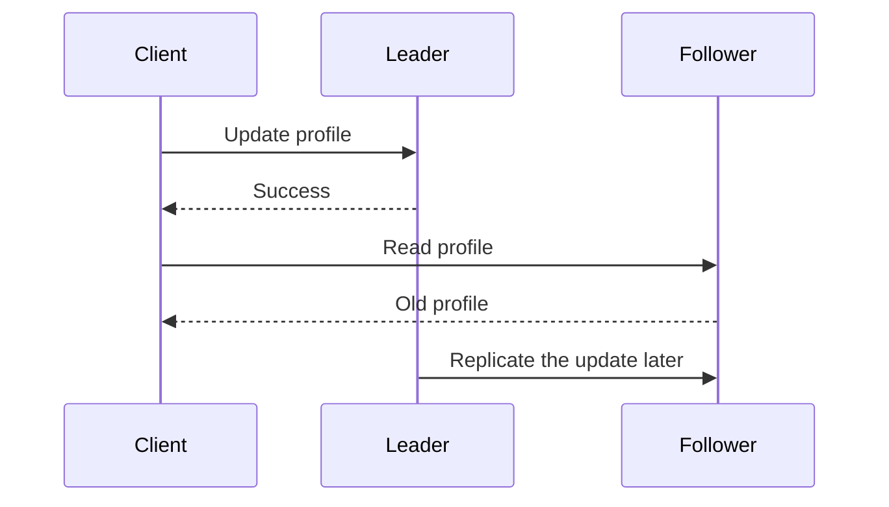

# Chapter 5: Replication

*Designing Data-Intensive Applications*, 2017 first edition. Printed pages 151–193.

Source: Martin Kleppmann, *Designing Data-Intensive Applications* (O'Reilly, 2017).

The central idea: **keeping copies is easy until writes, failures, and delays make those copies disagree. A replication design must specify what users see during that disagreement.**

**1. Replication has several purposes, with different trade-offs.** (pp. 151–155)

Replicas can keep a service available after failures, place reads near users, increase read capacity, and support disconnected operation. They do not automatically increase write capacity or make every read current.

| Design | Who accepts writes? | Main challenge |
|---|---|---|
| Single leader | One leader for the replicated dataset | Leader availability and stale follower reads |
| Multiple leaders | Several leaders | Concurrent updates need conflict handling |
| Leaderless | Writes go to several replicas without one ordering leader | Version reconciliation, quorums, and repair |

With **synchronous replication**, the leader waits for an acknowledgment from the required follower before acknowledging success. This preserves a copy at that follower, but an unavailable synchronous follower can block progress. With **asynchronous replication**, the leader can acknowledge before followers catch up, reducing waiting but risking loss of acknowledged writes if failover selects an outdated replica.

The exact acknowledgment policy matters more than the word “replicated.” Ask which failures a successful write is supposed to survive.

**2. Single-leader replication needs both recovery and safe failover.** (pp. 155–161)

A new follower needs a consistent snapshot plus the replication-log position corresponding to that snapshot. It copies the snapshot, then replays changes after that position. Copying a changing database without that boundary can miss or duplicate changes.

A recovering follower can resume from its last applied log position. A failed leader is harder:

1. Decide that the leader is unavailable, usually using a timeout.
2. Choose an appropriate follower as the new leader.
3. Redirect clients and other followers.
4. Prevent the old leader from continuing to accept conflicting writes if it returns.

Timeouts can be wrong. A paused or isolated leader may still be alive. Two nodes acting as leader create **split brain**. Promoting a lagging follower can lose writes even when clients previously received success.

Replication logs also differ:

| Log form | What followers receive | Main concern |
|---|---|---|
| Statements | Operations to execute | Nondeterminism and execution order can produce different results |
| Physical/WAL | Low-level storage modifications | Coupling to storage format and software version |
| Logical/row-based | Changes to records | More independent of storage internals and useful for downstream consumers |

Application-level or trigger-based replication offers flexibility but adds implementation work and opportunities for mistakes.

**3. Replication lag creates distinct user-visible anomalies.** (pp. 161–167)

Eventual consistency means replicas can converge when updates stop and replication succeeds. It does not specify a short maximum delay or guarantee what a user observes before convergence.

| Guarantee | Problem it prevents | Example |
|---|---|---|
| **Read your writes** | Missing your own successful update | You save a profile and immediately see the new version |
| **Monotonic reads** | Going backward after seeing newer data | Refreshing does not replace a new comment with an older view |
| **Consistent prefix reads** | Observing effects before their causes | A reply appears after the question it answers |

Possible remedies include routing selected reads to the leader, keeping a user's reads on a consistent replica, or carrying a version/log position and waiting until a replica reaches it. Each remedy has limits, especially across devices and partitions. State the guarantee you need rather than asking vaguely for “less lag.”

**4. Multiple leaders trade independent writes for conflict handling.** (pp. 168–176)

Multiple leaders can be useful across datacenters, on devices that work offline, or in collaborative editing. Each location can accept changes without waiting for a distant leader.

If two users independently rename the same document, both local writes can succeed before replication reveals the conflict. Applying messages in arrival order can leave replicas with different final values.

Conflict handling must make replicas converge:

- Route all writes for a record through one leader where practical, avoiding concurrent cross-leader edits.
- Choose a deterministic winner, accepting that other updates may be discarded.
- Preserve conflicting versions and merge them in application code or with user input.
- Use data structures with defined merge semantics, such as suitable CRDTs.

**Last-write-wins is a conflict policy, not a promise that no data is lost.** Timestamp-based winners can discard meaningful changes, and physical clocks may disagree. A convergent result can still be wrong for the business requirement.

Replication topology also matters: paths can fail, messages can arrive out of order, and loops require duplicate suppression.

**5. Leaderless quorums establish overlap under specific assumptions.** (pp. 177–184)

Let `n` be the number of replicas for one key, `w` the write acknowledgments required, and `r` the read responses required.

If reads and writes use the same replica set and `w + r > n`, every qualifying read set overlaps every qualifying write set. With `n=3, w=2, r=2`, at least one read responder belongs to the successful write set.

**Overlap alone does not establish linearizability.** Concurrent operations, partially successful writes, version selection, changing membership, and failure recovery still matter. A write reported as failed may already exist on some replicas.

Replicas catch up through:

- **Read repair:** a read notices an outdated replica and updates it.
- **Anti-entropy:** background processes compare replicas and repair differences, including data nobody reads.

A **sloppy quorum** accepts responses from reachable substitute nodes outside the key's normal replica set. **Hinted handoff** later transfers those writes to their intended replicas. This improves availability, but the usual read/write overlap argument no longer holds across the normal home nodes.

**6. Concurrency is about missing causal knowledge.** (pp. 184–191)

If operation B observes A and then updates its result, A happened before B. If neither operation knew about the other, they are concurrent in this sense—even if their wall-clock timestamps differ.

Version metadata allows the database to distinguish an update that supersedes an old value from independent updates that should coexist as conflicting versions, sometimes called **siblings**. With several replicas accepting writes, **version vectors** track causal context across replicas.

For a shopping cart, merging concurrent additions might use a union. Deletions need more care: blindly taking a union can restore an item someone removed. Tombstones or a data type with explicit removal semantics preserve that intent.

Detecting concurrency and resolving it are separate tasks. Version metadata identifies the conflict; the application still needs a valid meaning for the merged result.

**A quick recall check:**

1. Can asynchronous replication lose a write that was acknowledged?
2. How do monotonic reads differ from reading your own writes?
3. Why does `w + r > n` not prove linearizability?
4. Why can a union be the wrong merge for shopping carts?

Suggested answers

1. Yes, if the leader fails before a surviving replacement has that write.
2. Monotonic reads prevent moving backward from any version already observed. Read-your-writes ensures your own successful changes are visible.
3. It establishes set overlap under assumptions, not a complete protocol for concurrent writes, read ordering, failed operations, or membership changes.
4. Union preserves additions but can undo removals. The merge must retain enough information to distinguish an intentional deletion from missing data.

Next is **Chapter 6: Partitioning**, covering how a dataset and its workload are divided across machines.
