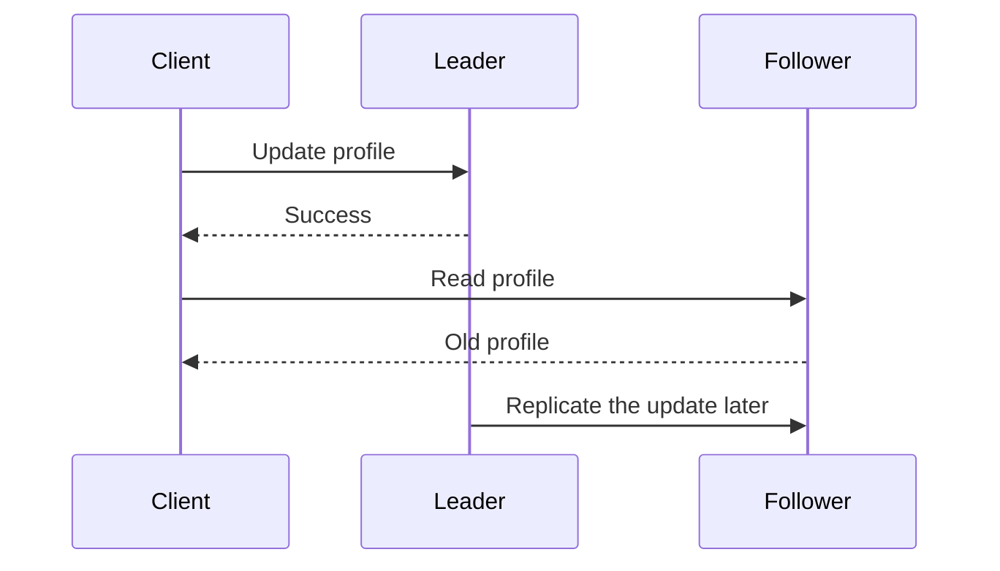
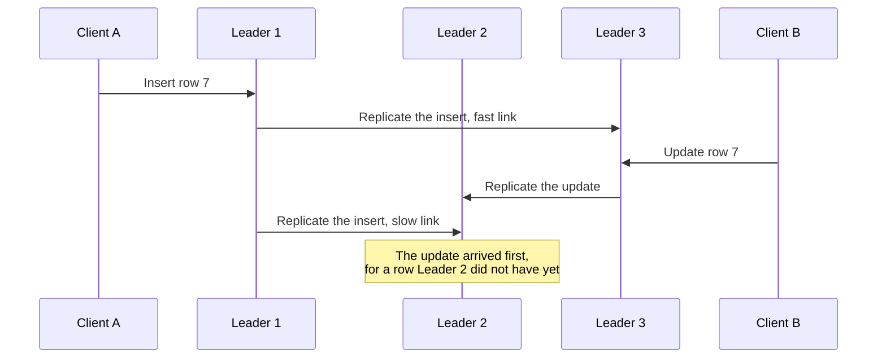
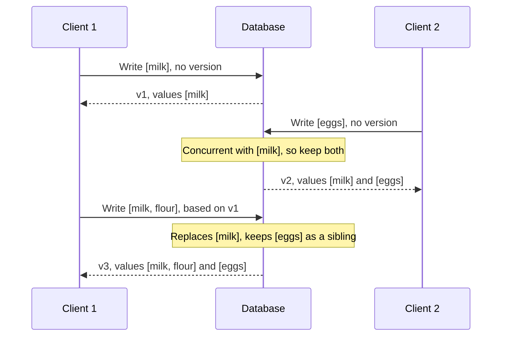

# Chapter 5: Replication

*Designing Data-Intensive Applications*, 2017 first edition. Printed pages 151–193.

Source: Martin Kleppmann, *Designing Data-Intensive Applications* (O'Reilly, 2017).

The central idea: **keeping copies is easy until writes, failures, and delays make those copies disagree. A replication design must specify what users see during that disagreement.**

**1. Replication has several purposes, with different trade-offs.** (pp. 151–155)

Replicas can keep a service available after failures, place reads near users, increase read capacity, and support disconnected operation. They do not automatically increase write capacity or make every read current.

| Design | Who accepts writes? | Main challenge |
|---|---|---|
| Single leader | One leader for the replicated dataset | Leader availability and stale follower reads |
| Multiple leaders | Several leaders | Concurrent updates need conflict handling |
| Leaderless | Writes go to several replicas without one ordering leader | Version reconciliation, quorums, and repair |

With **synchronous replication**, the leader waits for an acknowledgment from the required follower before acknowledging success. This preserves a copy at that follower, but an unavailable synchronous follower can block progress. With **asynchronous replication**, the leader can acknowledge before followers catch up, reducing waiting but risking loss of acknowledged writes if failover selects an outdated replica.

Making every follower synchronous is impractical: any one node outage would block all writes. In practice, enabling synchronous replication usually means one synchronous follower and the rest asynchronous, a setup called **semi-synchronous**. If that follower fails or slows down, an asynchronous one is made synchronous, so the latest data is always on at least two nodes. Fully asynchronous setups are also widely used, especially with many followers or followers spread across regions, because the leader keeps accepting writes even when every follower lags.

The exact acknowledgment policy matters more than the word “replicated.” Ask which failures a successful write is supposed to survive.

**2. Single-leader replication needs both recovery and safe failover.** (pp. 155–161)

A new follower needs a consistent snapshot plus the replication-log position corresponding to that snapshot. It copies the snapshot, then replays changes after that position. Copying a changing database without that boundary can miss or duplicate changes.

A recovering follower can resume from its last applied log position. A failed leader is harder:

1. Decide that the leader is unavailable, usually using a timeout.
2. Choose a new leader, by election or by a controller node. The best candidate is usually the most up-to-date follower, which loses the least data. Getting all nodes to agree on it is a consensus problem (Chapter 9).
3. Redirect clients and other followers.
4. Prevent the old leader from continuing to accept conflicting writes if it returns.

Timeouts can be wrong. A paused or isolated leader may still be alive. Two nodes acting as leader create **split brain**. Promoting a lagging follower can lose writes even when clients previously received success.

Choosing the timeout is a trade-off. A long timeout means a longer outage before recovery. A short one causes needless failovers, for example during a load spike or a network glitch, and a needless failover makes a struggling system worse. As a safety catch against split brain, some systems shut one node down when they detect two leaders (**fencing**, or STONITH), but a careless design can shut down both. Because none of this has an easy fix, some operations teams prefer manual failover even when the software can fail over automatically.

Lost writes can also break systems outside the database. In one GitHub incident, an outdated MySQL follower became leader. Its auto-increment counter was behind, so it reused primary keys the old leader had already assigned. Redis also stored those keys, so some private data was shown to the wrong users.

Replication logs also differ:

| Log form | What followers receive | Main concern |
|---|---|---|
| Statements | Operations to execute | Nondeterminism and execution order can produce different results |
| Physical/WAL | Low-level storage modifications | Coupling to storage format and software version |
| Logical/row-based | Changes to records | More independent of storage internals. External systems, such as a data warehouse, can consume it too (**change data capture**) |

For example, a statement that calls `NOW()` or `RAND()` can produce a different value on each replica. The leader can substitute fixed values, but there are so many edge cases that other log forms are now generally preferred. A physical log often blocks a common zero-downtime upgrade: upgrade the followers first, then fail over to one of them. That only works if followers can run a newer version than the leader.

Trigger-based replication moves the work into application code. It helps when you need to copy only part of the data, replicate to a different kind of database, or apply custom conflict logic. But it has more overhead and is more prone to bugs than built-in replication.

**3. Replication lag creates distinct user-visible anomalies.** (pp. 161–167)

Eventual consistency means replicas can converge when updates stop and replication succeeds. It does not specify a short maximum delay or guarantee what a user observes before convergence. Lag is often a fraction of a second, but near capacity or during network problems it can grow to several seconds or minutes.

| Guarantee | Problem it prevents | Example |
|---|---|---|
| **Read your writes**, also called read-after-write | Missing your own successful update | You save a profile and immediately see the new version |
| **Monotonic reads** | Going backward after seeing newer data | Refreshing does not replace a new comment with an older view |
| **Consistent prefix reads** | Observing effects before their causes | A reply appears after the question it answers |

Possible remedies include routing selected reads to the leader, keeping a user's reads on a consistent replica, or carrying a version/log position and waiting until a replica reaches it. Each remedy has limits, especially across devices and partitions.

| Remedy | Example | Limit |
|---|---|---|
| Read from the leader when the user may have changed the data | Read your own profile from the leader and other people's profiles from followers | If users can edit most things, nearly every read goes to the leader. A rule such as reading from the leader for one minute after an update can help |
| Keep each user on one replica | Choose the replica from a hash of the user ID | Gives monotonic reads, but if that replica fails, the user's reads must move to another one |
| Wait for a known log position | The client remembers the log position or timestamp of its latest write. A replica serves the read only after catching up to it | The user's other devices do not know that position, so it must be stored centrally |

Datacenters add another limit. A desktop computer on home broadband and a phone on a cellular network may reach different datacenters, so a remedy that reads from the leader may first need all of a user's devices routed to the same one. Consistent prefix reads are a particular problem in partitioned databases, where partitions apply writes independently. One fix is to write causally related data, such as a question and its answer, to the same partition, though that is not always efficient.

Ask what users would see if lag reached minutes or hours. If the experience would be bad, design for a stronger guarantee, for example read-after-write, instead of treating asynchronous replication as if it were synchronous. Handling this in the application is hard to get right. That is why databases offer transactions: the database gives the guarantee, so application code stays simpler (Chapters 7 and 9).

State the guarantee you need rather than asking vaguely for “less lag.”

**4. Multiple leaders trade independent writes for conflict handling.** (pp. 168–177)

Multiple leaders can be useful across datacenters, on devices that work offline, or in collaborative editing. Each location can accept changes without waiting for a distant leader.

Within one datacenter, the extra complexity rarely pays off. Across datacenters, the book compares one leader with a leader in each datacenter:

| Concern | Single leader | Leader per datacenter |
|---|---|---|
| Write latency | Every write crosses the internet to the leader's datacenter | Writes are processed locally and replicated asynchronously, so users don't feel the delay between datacenters |
| Datacenter outage | Fail over to a follower in another datacenter | The other datacenters keep running on their own and sync up once the failed one is back |
| Network problems between datacenters | Very sensitive, because writes go synchronously over that link | A brief interruption does not stop writes |

An offline calendar app is the extreme case: each device's local database is a leader, and sync lag can be hours or days. Multi-leader support is often bolted onto a database, so it can clash with auto-increment keys, triggers, and integrity constraints. It is often considered risky and best avoided if possible.

If two users independently rename the same document, both local writes can succeed before replication reveals the conflict. Applying messages in arrival order can leave replicas with different final values.

With a single leader, the second writer would block or be aborted and could retry. With multiple leaders, both writes succeed and the conflict only surfaces later, when the user may no longer be around to settle it. Waiting for a write to reach every leader before confirming it would catch conflicts in time, but it gives up the main benefit of multiple leaders. You might as well use one leader.

Conflict handling must make replicas converge:

- Route all writes for a record through one leader where practical, avoiding concurrent cross-leader edits. For example, give each user a home datacenter. This common advice breaks down when the home must change, such as after a datacenter failure or when the user moves.
- Choose a deterministic winner, accepting that other updates may be discarded.
- Preserve conflicting versions and merge them in application code or with user input.
- Use data structures with defined merge semantics, such as suitable CRDTs.

**Last-write-wins is a conflict policy, not a promise that no data is lost.** Timestamp-based winners can discard meaningful changes, and physical clocks may disagree. A convergent result can still be wrong for the business requirement.

Replication topology also matters: paths can fail, messages can arrive out of order, and loops require duplicate suppression.

In a circular or star topology, each write passes through several nodes, so one failed node can block the flow. Each write carries the IDs of the nodes it has passed, so a node can ignore its own changes when they come back around. An all-to-all topology avoids that single point of failure, but one write can overtake another that it depends on:

Attaching timestamps does not fix this, because clocks are not reliably in sync. Version vectors, covered below, can order these events.

**5. Leaderless quorums establish overlap under specific assumptions.** (pp. 177–184)

Dynamo-style databases, such as Riak, Cassandra, and Voldemort, let any replica accept writes. The client, or a coordinator that does not impose an order, sends each write to several replicas in parallel. Reads also go to several replicas, and version numbers show which reply is newest. There is no failover: a replica that was down simply missed some writes and must catch up.

Let `n` be the number of replicas for one key, `w` the write acknowledgments required, and `r` the read responses required.

If reads and writes use the same replica set and `w + r > n`, every qualifying read set overlaps every qualifying write set. With `n=3, w=2, r=2`, at least one read responder belongs to the successful write set.

Requests normally go to all `n` replicas at once. `w` and `r` only set how many replies to wait for, and if too few nodes reply, the operation returns an error. A common choice is an odd `n` (3 or 5) with `w = r = (n + 1) / 2`, rounded up. Quorums need not be majorities, as long as every read set overlaps every write set.

| Setting | Effect |
|---|---|
| `n=3, w=2, r=2` | Tolerates one unavailable node |
| `n=5, w=3, r=3` | Tolerates two unavailable nodes |
| `w=n, r=1` | Fast reads for read-heavy loads, but one failed node makes every write fail |
| `w + r ≤ n` | Lower latency and higher availability, but stale reads become more likely |

**Overlap alone does not establish linearizability.** Concurrent operations, partially successful writes, version selection, changing membership, and failure recovery still matter. A write reported as failed may already exist on some replicas.

Even with `w + r > n`, cases like these can return stale data or lose writes:

| Case | What goes wrong |
|---|---|
| A write runs at the same time as a read | The write has reached only some replicas, so the read may return the old or the new value |
| Two concurrent writes are resolved by timestamp | Clock skew can make last-write-wins discard a write |
| A replica is restored from an old copy | A node holding the new value fails and is rebuilt from a replica with the old value, so fewer than `w` replicas now hold the new value |

So Dynamo-style quorums usually do not provide read-your-writes, monotonic reads, or consistent prefix reads. Treat `w` and `r` as a way to make stale reads less likely, not as a guarantee.

Replicas catch up through:

- **Read repair:** a read notices an outdated replica and updates it.
- **Anti-entropy:** background processes compare replicas and repair differences, including data nobody reads.

Without anti-entropy, a value that is rarely read can stay missing from some replicas, so it is less durable.

Monitor staleness as well. With a leader, lag is easy to measure: subtract a follower's log position from the leader's. Leaderless systems have no fixed write order, which makes this harder, but measuring it is how you put a number on “eventual.”

A **sloppy quorum** accepts responses from reachable substitute nodes outside the key's normal replica set. **Hinted handoff** later transfers those writes to their intended replicas. This improves availability, but the usual read/write overlap argument no longer holds across the normal home nodes. In effect, a sloppy quorum only promises that the write is stored on some `w` nodes. A read may not see it until hinted handoff finishes.

**6. Concurrency is about missing causal knowledge.** (pp. 184–191)

If operation B observes A and then updates its result, A happened before B. If neither operation knew about the other, they are concurrent in this sense—even if their wall-clock timestamps differ.

Version metadata allows the database to distinguish an update that supersedes an old value from independent updates that should coexist as conflicting versions, sometimes called **siblings**. With several replicas accepting writes, **version vectors** track causal context across replicas.

With a single replica, one version number per key is enough. Each write carries the version from the client's last read, if any, and merges all the values that read returned. The database replaces values up to that version and keeps newer ones as siblings:

A write with no version is concurrent with everything, so it replaces nothing. A version vector extends this to several replicas: each replica keeps its own version number for each key and tracks the numbers it has seen from the other replicas.

For a shopping cart, merging concurrent additions might use a union. Deletions need more care: blindly taking a union can restore an item someone removed. Tombstones or a data type with explicit removal semantics preserve that intent.

Last write wins (LWW) skips all this. It keeps the write with the biggest timestamp and silently drops the other concurrent writes, even ones already reported as successful. When the book was written, LWW was Cassandra's only conflict resolution method and an option in Riak. Lost writes may be fine for a cache. Otherwise, the only safe way to use LWW is to write each key once and never update it, for example by using a UUID as the key.

Detecting concurrency and resolving it are separate tasks. Version metadata identifies the conflict; the application still needs a valid meaning for the merged result.

**A quick recall check:**

1. Can asynchronous replication lose a write that was acknowledged?
2. How do monotonic reads differ from reading your own writes?
3. Why does `w + r > n` not prove linearizability?
4. Why can a union be the wrong merge for shopping carts?
5. Why is the failover timeout hard to choose?
6. Why does a leader in each datacenter cope better with an unreliable link between datacenters?

Suggested answers

1. Yes, if the leader fails before a surviving replacement has that write.
2. Monotonic reads prevent moving backward from any version already observed. Read-your-writes ensures your own successful changes are visible.
3. It establishes set overlap under assumptions, not a complete protocol for concurrent writes, read ordering, failed operations, or membership changes.
4. Union preserves additions but can undo removals. The merge must retain enough information to distinguish an intentional deletion from missing data.
5. Too long, and recovery after a real failure is slow. Too short, and a load spike or network glitch triggers needless failovers, which make a struggling system worse.
6. With one leader, writes from other datacenters cross that link synchronously, so link problems hit them directly. With a leader per datacenter, writes complete locally and replicate asynchronously, so a brief interruption doesn't stop writes.

Next is **Chapter 6: Partitioning**, covering how a dataset and its workload are divided across machines.
