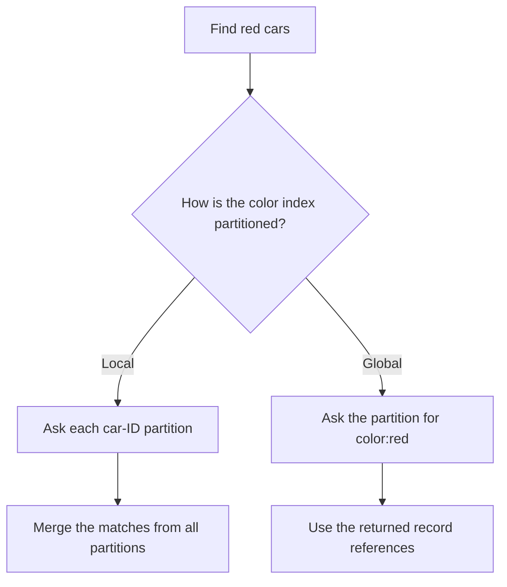
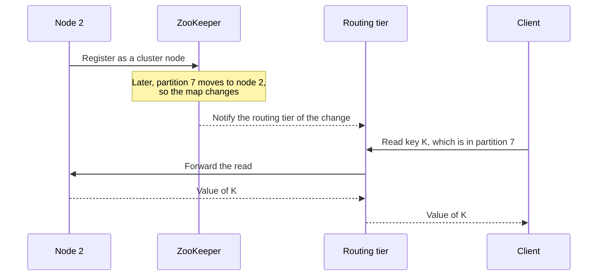

# Chapter 6: Partitioning

*Designing Data-Intensive Applications*, 2017 first edition. Printed pages 199–218.

Source: Martin Kleppmann, *Designing Data-Intensive Applications* (O'Reilly, 2017).

The central idea: **partitioning spreads data and work across machines, but success depends on distributing the actual workload and keeping common operations local.**

**1. Partitioning and replication solve different problems.** (pp. 199–201)

Partitioning divides a dataset into subsets, also called shards. Replication keeps several copies of a subset. A system commonly combines them: each partition has replicas, potentially with its own leader.

Partitions go by many names. MongoDB, Elasticsearch, and SolrCloud say shard. HBase says region, Bigtable says tablet, Cassandra and Riak say vnode, and Couchbase says vBucket. Every record lives in exactly one partition, so each partition is in effect a small, separate database.

A physical node can hold several partitions. Moving a partition between nodes is different from changing which partition a key belongs to.

Evenly dividing bytes does not guarantee evenly dividing work. A partition with a few extremely popular records can be overloaded while a much larger partition is idle. Any unevenness in data or queries across partitions is **skew**; a partition that gets far more than its share of the load is a **hot spot**.

**2. Range and hash partitioning favor different queries.** (pp. 201–205)

| Approach | How records are placed | Benefit | Cost |
|---|---|---|---|
| Key range | Consecutive key ranges belong to partitions | Nearby keys and range scans stay together | Sequential or popular ranges can become hot |
| Hash | A hash of the key determines its partition | Different keys tend to spread more evenly | Original key order is lost across partitions |

Key-range boundaries must follow the data, not the alphabet, or some partitions end up far bigger than others. Bigtable, HBase, RethinkDB, and pre-2.4 MongoDB use key ranges.

Partitioning sensor readings only by timestamp sends all current writes to one partition, the one for today. Putting the sensor name before the timestamp in the key spreads the writes, but fetching several sensors over a time range then takes a separate range query per sensor.

A partitioning hash need not be cryptographic (Cassandra and MongoDB use MD5), but it must give the same result in every process. Java's `Object.hashCode()` and Ruby's `Object#hash` can differ between processes, so they are unsafe. Losing key order also has a price: in hash mode, MongoDB sends every range query to all partitions, and Riak, Couchbase, and Voldemort don't support range queries on the primary key.

A hybrid key can use one component for placement and another for ordering. For example, partition by a hash of `user_id`, then keep each user's records ordered by `timestamp`. This makes one user's time-range query convenient while spreading different users across the cluster. Cassandra works this way with a compound primary key: only the first column is hashed, and the other columns sort the data within the partition. A query must give an exact value for the first column, and can then range-scan the others.

**Choose the partition key together with the query patterns.** A convenient write distribution can make common reads expensive, and vice versa.

**3. Hashing does not split one hot key.** (p. 205)

Every request for the same key has the same hash. A celebrity's record or a popular counter can still overload one partition.

Most databases cannot detect and offset this on their own, so the application has to. One application-level remedy is to split that logical key into several physical keys, such as `(post_id, bucket)`, and distribute writes across buckets. Reads then fetch and combine the pieces. For example, appending a random two-digit number to a hot key spreads its writes over 100 keys, so each read must fetch all 100.

This introduces extra bookkeeping and read work, so applying it indiscriminately can make ordinary records more expensive. The important distinction is between skew across many keys, which hashing can reduce, and load concentrated on one key, which hashing alone cannot fix.

**4. Secondary indexes need their own partitioning strategy.** (pp. 206–209)

Suppose car records are partitioned by car ID, but a query asks for all red cars. The color does not tell the query which car-ID partitions contain matches.

| Index strategy | Write behavior | Read behavior |
|---|---|---|
| **Local/document-partitioned** | Update the record and its index in the same partition | A query without the partition key searches every partition and merges results |
| **Global/term-partitioned** | A record change may update index partitions elsewhere | A lookup for a particular term goes to that term's index partition |

Local-index queries often use **scatter/gather**. Their response time can depend on the slowest participating partition, connecting this chapter to tail amplification in Chapter 1.

Local indexes are still widely used, for example in MongoDB, Riak, Cassandra, Elasticsearch, SolrCloud, and VoltDB. Vendors advise choosing the partitioning so that secondary-index queries hit one partition, but that is often impossible, for example when one query filters on both color and make.

A global index covers the data of all partitions, but it can't sit on one node, which would become a bottleneck. So it is partitioned too, either by the term itself or by its hash. Term order allows range scans, such as over asking price, while hashing spreads load more evenly.

Global indexes make targeted lookups easier, but maintaining them may require work across several partitions. If updates are asynchronous, the index can lag behind the underlying records. Fetching referenced records can also require further requests.

For example, adding one red Honda can update the term `color:red` on one index partition and `make:Honda` on another. Updating both atomically needs a distributed transaction, which not every database supports, so global indexes are often updated asynchronously. Amazon DynamoDB says its global secondary indexes normally catch up within a fraction of a second, but can lag longer during infrastructure faults.

**5. Rebalancing should move only the data needed.** (pp. 209–214)

Nodes are added, removed, or replaced, and data volume changes. Rebalancing changes ownership while the system continues serving requests.

The book sets three minimum goals for any rebalancing scheme:

1. Afterward, data, reads, and writes are shared fairly across nodes.
2. During rebalancing, the database keeps accepting reads and writes.
3. No more data moves than necessary, so rebalancing is fast and light on network and disk.

The simple rule `hash(key) % number_of_nodes` is troublesome: changing the node count remaps a large fraction of keys.

For example, a key with hash 123456 is on node 6 of 10, because `123456 % 10 = 6`. With 11 nodes it moves to node 3, and with 12 nodes to node 0. Most other keys move each time too.

The chapter describes three alternatives:

| Strategy | How it adapts | Main trade-off |
|---|---|---|
| Fixed number of partitions | Move whole partitions between nodes | Initial partition count affects future capacity and overhead |
| Dynamic partitions | Split large partitions and merge small ones | Adapts to data volume, but an empty database starts as one partition on one node |
| Partitions proportional to nodes | Add or split partitions as nodes join | Needs hash partitioning. Random splits can be uneven, but even out over many partitions |

With many more partitions than nodes, a new node can take selected partitions from existing nodes without remapping all keys. Very large partitions are expensive to move; too many tiny partitions increase management overhead.

For example, a 10-node cluster might start with 1,000 partitions, about 100 per node. Riak, Elasticsearch, Couchbase, and Voldemort work this way. Many such systems never split partitions, so the initial count is also the most nodes the cluster can ever use.

Dynamic partitioning, used by HBase and RethinkDB, lets the count follow the data. HBase splits a partition once it passes 10 GB by default. An empty database starts with one partition, though, so one node takes every write until the first split. HBase and MongoDB let you **pre-split** an empty database, which for key ranges means guessing the key distribution up front.

Cassandra instead keeps a fixed number of partitions per node, 256 by default when the book was written. A joining node picks that many existing partitions at random, splits them, and takes half of each. Random split points require hash partitioning. This is the closest match to the original meaning of **consistent hashing**, a term the book suggests avoiding because it causes so much confusion.

Put simply: with a fixed count, each partition grows with the dataset. With dynamic partitioning, the count grows with the dataset. With a fixed count per node, the count grows with the cluster, so partition size stays fairly stable.

Automatic rebalancing reduces manual work, but data movement consumes disk and network capacity. Mistaking a temporarily slow node for a failed node and immediately moving its data can increase load at exactly the wrong time, and can even cause a cascading failure. So the book favors a human in the loop: slower, but with fewer surprises. Couchbase, Riak, and Voldemort, for example, propose a new assignment automatically but wait for an administrator to commit it.

**6. Request routing must track changing ownership.** (pp. 214–216)

Clients need to find the partition responsible for a key, and the IP address and port of the node that holds it. This is a case of **service discovery**, a problem any service on a network has. Common approaches are:

1. Contact any node, which forwards the request if necessary.
2. Contact a routing tier that knows partition ownership.
3. Let clients maintain enough partition metadata to contact the owner directly.

Some systems use a coordination service to distribute assignments; others use communication among cluster nodes. All approaches must cope with ownership changes and stale routing information.

For example, HBase and SolrCloud use ZooKeeper, as Kafka did when the book was written. Nodes register in ZooKeeper, which keeps the authoritative map of partitions to nodes, and the routing tier subscribes to changes:

Cassandra and Riak avoid this external dependency. Their nodes spread cluster changes among themselves with a gossip protocol, and any node can forward a request to the owner. This puts more complexity into the database nodes.

Complex analytical queries in **massively parallel processing (MPP)** databases can involve several stages of partitioned execution, including joins and aggregation. Partitioning enables parallel work, but cross-partition communication remains part of its cost.

**7. Partition independence has limits.** (pp. 216–218)

The reason partitions scale is that much of their work can proceed independently. Operations spanning them—global indexes, joins, transfers, or uniqueness rules—need additional coordination or a deliberately weaker guarantee. The book ends with a question for the next chapters: what happens if a write to one partition succeeds but the write to another fails?

The useful design question is: **which operations stay within one partition, and what happens when they cannot?** Chapter 7 introduces transactions, and Chapter 9 examines coordination across nodes.

**A quick recall check:**

1. Why can a perfectly uniform hash function still leave one partition overloaded?
2. Why does a local secondary index often require scatter/gather?
3. What changes when a fixed partition moves to a new node?
4. What is the cost of splitting one hot counter across several keys?
5. How can fully automatic rebalancing make an overload worse?
6. Why is Java's `Object.hashCode()` unsafe for choosing partitions?

Suggested answers

1. Requests may concentrate on a single key. Identical keys always hash to the same place.
2. It describes only records in its own primary partition. Without knowing the primary partition, a query must search multiple local indexes.
3. The partition-to-node assignment changes. The key-to-partition mapping can stay the same.
4. Writes can spread across nodes, but reads must combine the buckets and the application must manage that representation.
5. An overloaded node responds slowly and is declared dead. Moving its partitions adds load to it, to the other nodes, and to the network, which can cascade. A human in the loop is slower but safer.
6. The same key can hash to different values in different processes, so nodes and clients would disagree on where it lives. The hash need not be cryptographic, but it must be the same everywhere.

Next is **Chapter 7: Transactions**, covering which combinations of concurrent operations a database allows.
