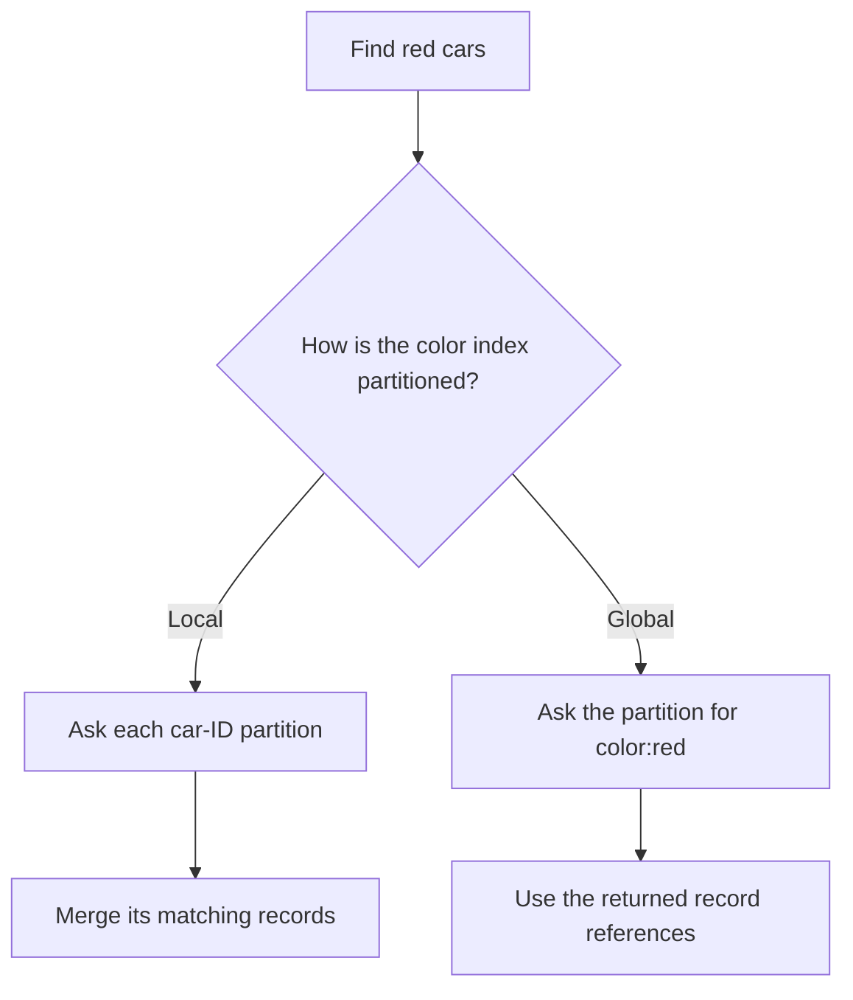

# Chapter 6: Partitioning

*Designing Data-Intensive Applications*, 2017 first edition. Printed pages 199–218.

Source: Martin Kleppmann, *Designing Data-Intensive Applications* (O'Reilly, 2017).

The central idea: **partitioning spreads data and work across machines, but success depends on distributing the actual workload and keeping common operations local.**

**1. Partitioning and replication solve different problems.** (pp. 199–201)

Partitioning divides a dataset into subsets, also called shards. Replication keeps several copies of a subset. A system commonly combines them: each partition has replicas, potentially with its own leader.

A physical node can hold several partitions. Moving a partition between nodes is different from changing which partition a key belongs to.

Evenly dividing bytes does not guarantee evenly dividing work. A partition with a few extremely popular records can be overloaded while a much larger partition is idle. This imbalance is **skew**; the overloaded partition is a **hot spot**.

**2. Range and hash partitioning favor different queries.** (pp. 201–205)

| Approach | How records are placed | Benefit | Cost |
|---|---|---|---|
| Key range | Consecutive key ranges belong to partitions | Nearby keys and range scans stay together | Sequential or popular ranges can become hot |
| Hash | A hash of the key determines its partition | Different keys tend to spread more evenly | Original key order is lost across partitions |

Partitioning sensor readings only by timestamp can direct all current writes into one partition. Adding a sensor identifier can distribute writes, but a query across every sensor then needs more partitions.

A hybrid key can use one component for placement and another for ordering. For example, partition by a hash of `user_id`, then keep each user's records ordered by `timestamp`. This makes one user's time-range query convenient while spreading different users across the cluster.

**Choose the partition key together with the query patterns.** A convenient write distribution can make common reads expensive, and vice versa.

**3. Hashing does not split one hot key.** (p. 205)

Every request for the same key has the same hash. A celebrity's record or a popular counter can still overload one partition.

One application-level remedy is to split that logical key into several physical keys, such as `(post_id, bucket)`, and distribute writes across buckets. Reads then fetch and combine the pieces.

This introduces extra bookkeeping and read work, so applying it indiscriminately can make ordinary records more expensive. The important distinction is between skew across many keys, which hashing can reduce, and load concentrated on one key, which hashing alone cannot fix.

**4. Secondary indexes need their own partitioning strategy.** (pp. 206–209)

Suppose car records are partitioned by car ID, but a query asks for all red cars. The color does not tell the query which car-ID partitions contain matches.

| Index strategy | Write behavior | Read behavior |
|---|---|---|
| **Local/document-partitioned** | Update the record and its index in the same partition | A query without the partition key searches all relevant partitions and merges results |
| **Global/term-partitioned** | A record change may update index partitions elsewhere | A lookup for a particular term goes to that term's index partition |

Local-index queries often use **scatter/gather**. Their response time can depend on the slowest participating partition, connecting this chapter to tail amplification in Chapter 1.

Global indexes make targeted lookups easier, but maintaining them may require work across several partitions. If updates are asynchronous, the index can lag behind the underlying records. Fetching referenced records can also require further requests.

**5. Rebalancing should move only the data needed.** (pp. 209–214)

Nodes are added, removed, or replaced, and data volume changes. Rebalancing changes ownership while the system continues serving requests.

The simple rule `hash(key) % number_of_nodes` is troublesome: changing the node count remaps a large fraction of keys.

The chapter describes three alternatives:

| Strategy | How it adapts | Main trade-off |
|---|---|---|
| Fixed number of partitions | Move whole partitions between nodes | Initial partition count affects future capacity and overhead |
| Dynamic partitions | Split large partitions and merge small ones | Boundaries and routing metadata change over time |
| Partitions proportional to nodes | Add or split partitions as nodes join | Requires a suitable distribution and balancing scheme |

With many more partitions than nodes, a new node can take selected partitions from existing nodes without remapping all keys. Very large partitions are expensive to move; too many tiny partitions increase management overhead.

Automatic rebalancing reduces manual work, but data movement consumes disk and network capacity. Mistaking a temporarily slow node for a failed node and immediately moving its data can increase load at exactly the wrong time. Automation needs operational limits and visibility.

**6. Request routing must track changing ownership.** (pp. 214–216)

Clients need to find the partition responsible for a key. Common approaches are:

1. Contact any node, which forwards the request if necessary.
2. Contact a routing tier that knows partition ownership.
3. Let clients maintain enough partition metadata to contact the owner directly.

Some systems use a coordination service to distribute assignments; others use communication among cluster nodes. All approaches must cope with ownership changes and stale routing information.

Complex analytical queries can involve several stages of partitioned execution, including joins and aggregation. Partitioning enables parallel work, but cross-partition communication remains part of its cost.

**7. Partition independence has limits.** (pp. 216–218)

The reason partitions scale is that much of their work can proceed independently. Operations spanning them—global indexes, joins, transfers, or uniqueness rules—need additional coordination or a deliberately weaker guarantee.

The useful design question is: **which operations stay within one partition, and what happens when they cannot?** Chapter 7 introduces transactions, and Chapter 9 examines coordination across nodes.

**A quick recall check:**

1. Why can a perfectly uniform hash function still leave one partition overloaded?
2. Why does a local secondary index often require scatter/gather?
3. What changes when a fixed partition moves to a new node?
4. What is the cost of splitting one hot counter across several keys?

Suggested answers

1. Requests may concentrate on a single key. Identical keys always hash to the same place.
2. It describes only records in its own primary partition. Without knowing the primary partition, a query must search multiple local indexes.
3. The partition-to-node assignment changes. The key-to-partition mapping can stay the same.
4. Writes can spread across nodes, but reads must combine the buckets and the application must manage that representation.

Next is **Chapter 7: Transactions**, covering which combinations of concurrent operations a database allows.
