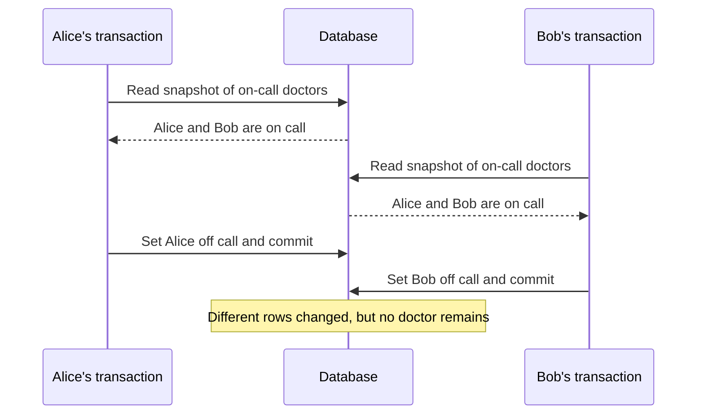

# Chapter 7: Transactions

*Designing Data-Intensive Applications*, 2017 first edition. Printed pages 221–267.

Source: Martin Kleppmann, *Designing Data-Intensive Applications* (O'Reilly, 2017).

The central idea: **transactions reduce the number of failure and concurrency cases an application must handle, but the isolation guarantee determines which race conditions remain possible.**

For anomaly tables and transaction timelines, see the [Isolation Level Cheat Sheet](../cheatsheets/isolation-level.md).

**1. ACID names four different concerns.** (pp. 223–227)

| Property | Meaning | Common misunderstanding |
|---|---|---|
| **Atomicity** | If a transaction aborts, its writes are discarded | It is not the concurrency meaning of an indivisible CPU operation |
| **Consistency** | Transactions preserve application invariants | The database cannot infer every business rule |
| **Isolation** | Concurrency is constrained according to the isolation level | Using a transaction does not automatically provide serializability |
| **Durability** | Successfully committed data survives the promised failure scenarios | The promise depends on persistence, replication, and the fault model |

For a money transfer, atomicity prevents a debit from surviving without its corresponding credit. Isolation controls what concurrent transfers and readers can observe. The application must still choose the right accounts and amounts.

ACID consistency concerns valid application state. It is different from replica consistency and the consistency discussed in the CAP theorem.

The database provides atomicity, isolation, and durability, but consistency belongs to the application. The application uses atomicity and isolation to keep its invariants, and the database can enforce only some of them, such as foreign keys and uniqueness. So the book argues that the C doesn't really belong in ACID. Products also implement the other letters so differently that a claim of ACID compliance tells you little about the actual guarantees.

**2. Single-record guarantees do not cover multi-record invariants.** (pp. 228–232)

A database can make an individual record update atomic while leaving a sequence of operations unprotected. Relationships, secondary indexes, and denormalized copies often require coordinated changes to several objects.

For example, an email app may store an unread counter, a denormalized copy of the number of unread messages. A new message then needs two writes: insert the email and increment the counter. Without isolation, the recipient can see the new email while the counter still says 0. Without atomicity, a failed counter update leaves the two out of sync. In a transaction, that failure aborts the whole change, including the inserted email.

Transactions also provide an error-handling structure: abort, then retry the entire operation when appropriate. Retrying only the last statement can reuse decisions based on stale reads.

There are limits:

- Retry transient conflicts with bounded retries and backoff; repeating a permanent validation error will not help.
- A lost commit response leaves the outcome uncertain. It is different from a confirmed abort: if the commit actually succeeded, a retry applies it twice unless the application deduplicates.
- External effects, such as sending an email, are not automatically rolled back with database writes.

**3. Read committed prevents some anomalies, but does not provide one stable view.** (pp. 233–238)

Two foundational problems are **dirty reads**, where a transaction sees another transaction's uncommitted data, and **dirty writes**, where it overwrites another transaction's uncommitted write. The chapter's read-committed implementations prevent both.

Dirty writes are especially harmful when a transaction changes several rows. In the book's example, Alice and Bob buy the same car at the same time, and each purchase updates both the listing and the invoice. If their writes interleave, the listing can name Bob as the buyer while the invoice goes to Alice. Row-level write locks, held until commit or abort, prevent this. Making readers wait for those locks would let one long write stall many reads, so most databases instead return the old committed value until the writer commits.

However, separate reads can observe different committed states. Suppose a transfer moves $100 between two accounts. Reading one balance before the transfer and the other afterward can produce a total that never existed in a committed database state. This is **read skew**.

Every individual value may be committed and still fail to form a coherent combined view.

**4. Snapshot isolation provides a consistent view, but permits some write anomalies.** (pp. 237–246)

A transaction reads a snapshot of committed data from its start, plus its own changes. **Multi-version concurrency control (MVCC)** retains versions and applies visibility rules to construct that view.

In the book's description, based on PostgreSQL, each transaction gets an increasing transaction ID, and each row version records which transaction created it and which deleted it. An update marks the old version deleted and adds a new one. A reader ignores changes made by transactions that were still in progress when it started, that aborted, or that have a later ID. For example, when transaction 13 takes $100 from account 2, it marks the $500 version deleted and creates a $400 version. A transaction that started before 13 keeps reading $500, even after 13 commits.

This supports long-running backups and reports without making their ordinary reads block concurrent writers. Writers can still conflict with other writers.

Databases that support snapshot isolation usually use MVCC for read committed too. The difference is how long a snapshot lives: read committed starts a fresh snapshot with every query, whereas snapshot isolation reuses one snapshot for the whole transaction. A garbage collector removes old versions once no transaction can still see them.

Do not infer exact behavior from an isolation-level name alone. The chapter shows that names such as “repeatable read” and “serializable” have historically been used for different guarantees by different products. For example, Oracle calls its snapshot isolation “serializable”, so that level still allows the write skew in point 5. PostgreSQL and MySQL call snapshot isolation “repeatable read”, while IBM DB2 uses “repeatable read” to mean serializability. The SQL standard cannot settle this: its levels follow System R's 1975 definitions, which predate snapshot isolation.

A **lost update** can occur in a read-modify-write cycle:

```text
Initial counter: 42
A reads 42       B reads 42
A writes 43      B writes 43
Final counter: 43, although two increments were intended
```

Possible protections include an atomic update such as `SET value = value + 1`, explicit locking, compare-and-set, or automatic conflict detection. These mechanisms have specific scopes; fixing one counter does not protect every multi-record rule.

Automatic detection needs no special application code, so it is less error-prone than locks or atomic operations, which are easy to forget. PostgreSQL (repeatable read), Oracle (serializable), and SQL Server (snapshot isolation) detect lost updates and abort the transaction, but MySQL/InnoDB's repeatable read does not. Compare-and-set is unsafe if the database checks its `WHERE` condition against an old snapshot.

With multi-leader or leaderless replication there is no single up-to-date copy, so locks and compare-and-set don't apply. These systems instead keep conflicting versions (siblings) and merge them, or use commutative operations such as counter increments, as Riak 2.0's datatypes do. Last write wins, a common default in replicated systems, is prone to lost updates.

**5. Write skew is the crucial counterexample to “snapshot means safe.”** (pp. 246–251)

The book's example requires at least one doctor to remain on call. Alice and Bob are both on call, and each independently checks whether it is safe to leave.



Neither transaction overwrites the other's row. Both can therefore pass checks that only detect competing writes to the same object. Yet no serial execution of the two decisions would allow both to leave.

This is **write skew**: transactions make writes based on premises that concurrent transactions invalidate.

Write skew generalizes the lost update. Had both transactions updated the same row, it would be a dirty write or lost update instead. That is why lost-update defenses fail here. Atomic operations cover a single object, and the snapshot databases that detect lost updates do not detect write skew. Few databases support constraints across several rows. Short of serializable isolation, the next best fix is to lock the rows the check reads, with `SELECT ... FOR UPDATE` on the shift's on-call doctors.

The book finds the same pattern in booking a meeting room, moving game pieces, claiming a username, and preventing double-spending:

1. A query checks a condition, such as "at least two doctors are on call" or "no booking overlaps".
2. The application decides whether to go ahead.
3. It writes, and that write changes the result the check would now return.

A unique constraint fixes the username case. The others need serializable isolation or a workaround.

A **phantom** involves changes to the set of rows matching a predicate. For example, two transactions both find no room booking in a time interval, then insert overlapping bookings. Locking only the rows returned by the original query may lock nothing. Protection may require a database constraint, predicate/range locking, a shared object representing the resource, or serializable isolation.

The shared-object option is what the book calls **materializing conflicts**. For room bookings, you could create a row for each room and 15-minute slot ahead of time, say for the next six months. A booking transaction first locks the slot rows it needs with `SELECT ... FOR UPDATE`, then checks for overlaps and inserts. This turns a phantom into an ordinary lock conflict on rows that already exist. It is easy to get wrong and mixes concurrency control into the data model, so the book treats it as a last resort.

Snapshot isolation can keep a repeated query's visible results stable while still allowing this invariant violation at commit. A stable view and serializable execution are different guarantees.

**6. Serializability means an outcome equivalent to some serial order.** (pp. 251–266)

The database may execute transactions concurrently, provided their committed effects could have arisen from running them one at a time. This protects against the concurrency anomalies covered in the chapter, when all relevant work is within the transaction boundary.

The chapter compares three implementations:

| Approach | How it works | Main trade-off |
|---|---|---|
| Actual serial execution | Run transactions one at a time, often per partition | Transactions must be short; cross-partition work needs extra coordination |
| **Two-phase locking (2PL)** | Hold read/write locks to prevent conflicting access | Blocking, deadlocks, and variable response time |
| **Serializable snapshot isolation (SSI)** | Read snapshots and track dependencies that could violate serializability | Some transactions abort and must be retried |

Actual serial execution becomes practical when data is in memory and transactions avoid waiting for user input or slow network round trips. Partitioning can add parallelism when transactions are local to partitions.

That rules out interactive transactions. If the application sent one statement, waited for the result, and then sent the next, the single thread would sit idle most of the time. So systems such as VoltDB/H-Store, Redis, and Datomic make the application send the whole transaction to the database in advance, packaged as a **stored procedure**. With the data in memory, it runs without network or disk waits. Every transaction must still be fast, because one slow transaction stalls all the others. Cross-partition transactions are the hard limit: VoltDB reports roughly 1,000 cross-partition writes a second. That is orders of magnitude slower than single-partition work, and adding machines doesn't raise it.

In the 2PL described here, sometimes called strong strict 2PL (SS2PL), shared locks permit concurrent readers, while exclusive locks protect writes. Locks are retained until commit or abort. Predicate or index-range locks extend protection to rows that might be inserted. Deadlocks require detecting a cycle and aborting a participant.

This is the key contrast with snapshot isolation, where reads and writes never block each other. Under 2PL, a writer waits for readers, and readers wait for a writer. The name comes from the two phases: a transaction acquires locks while it runs, then releases them all at the end. MySQL/InnoDB and SQL Server use 2PL for their serializable level, and DB2 for its repeatable read. The cost is lower throughput and slower, less predictable responses, mainly because transactions wait for each other. Waits have no time limit, queues form on busy objects, and one slow or lock-heavy transaction can stall the rest, so high percentiles get very slow under contention.

Exact predicate locks are slow to check when many are held. So most 2PL databases use **index-range locks**, also called next-key locks. They lock a broader but safe approximation of the search, such as all bookings for room 123, on an index entry or range. A conflicting write must touch that part of the index, so it waits. Without a suitable index, the database falls back to locking the whole table.

SSI takes an optimistic approach: let transactions proceed, track read/write dependencies, and abort transactions when needed to prevent a nonserializable outcome. It is not a rule that every stale read is invalid. The relevant question is whether the dependencies allow a valid serial execution. High contention can cause many retries, so optimistic execution is not free.

Concretely, the database looks for two signs that a transaction's premise has gone stale. Either one of its reads ignored another transaction's uncommitted write, which has since committed, or another transaction later wrote to data it read, such as the on-call rows for a shift. The abort decision waits until commit, because at read time the database does not know whether the reader will write anything, and the other transaction might still abort. In the on-call example, the first transaction to commit succeeds and the other aborts. The cheat sheet's [serialization failure timeline](../cheatsheets/isolation-level.md#conflict-and-recovery-serialization-failure) shows the steps.

The write-after-read check works like a 2PL index-range lock that never blocks. It acts as a tripwire that tells the readers their premise may be outdated. That gives SSI its advantages. Compared with 2PL, readers and writers don't block each other, so latency is more predictable, and read-only queries need no locks. Compared with serial execution, it is not limited to one CPU core: FoundationDB spreads conflict detection over several machines. PostgreSQL's serializable level has used SSI since version 9.1.

The weak spot is the abort rate. A long read-write transaction is likely to conflict and abort, so read-write transactions should be short, while long read-only ones can be fine. Precise tracking of reads and writes costs bookkeeping, and coarse tracking causes extra aborts.

**Two-phase locking (2PL) and two-phase commit (2PC) are different:** the former controls concurrent access; the latter coordinates commit decisions across participants and appears in Chapter 9.

**7. Choose guarantees around the invariant.** (pp. 266–267)

| Problem | Why a weaker guarantee may be insufficient |
|---|---|
| Coherent multi-record report | Read committed can mix different committed moments |
| Read-modify-write counter | Concurrent readers can compute and write the same replacement |
| At least one doctor on call | Different rows can change without a direct write/write conflict |
| No overlapping booking | The conflicting record might not exist when the check runs |

Write the invariant in plain language, identify all records and predicates it depends on, and determine how the chosen database guarantee protects them. A transaction wrapper alone does not answer those questions.

**A quick recall check:**

1. What does ACID atomicity promise after a confirmed abort?
2. Why can snapshot isolation allow both doctors to leave?
3. Why might locking existing booking rows fail to prevent a double booking?
4. How do 2PL and SSI handle potential concurrency conflicts differently?
5. Why do databases that run transactions serially require stored procedures?
6. Why do most 2PL databases use index-range locks instead of exact predicate locks?

<details>
<summary>Suggested answers</summary>

1. None of that transaction's database writes remain committed. External effects and an unknown commit outcome require separate handling.
2. Both read a snapshot with two doctors and update different records, so there need not be a direct write/write conflict.
3. Both searches may return no rows. Protecting the absence of a match requires something beyond locking returned rows.
4. 2PL blocks incompatible operations using locks. SSI permits more concurrent execution and aborts transactions when dependency analysis requires it.
5. In an interactive transaction, the single thread would wait for the application and the network between statements. A stored procedure hands over the whole transaction at once, so with the data in memory it runs without waiting.
6. Checking many predicate locks is slow. An index-range lock covers a broader but safe approximation of the search, so any conflicting write must touch it and wait. The price is sometimes locking more than needed.

</details>

Next is **Chapter 8: The Trouble with Distributed Systems**, covering the failures that make cross-machine guarantees difficult.
