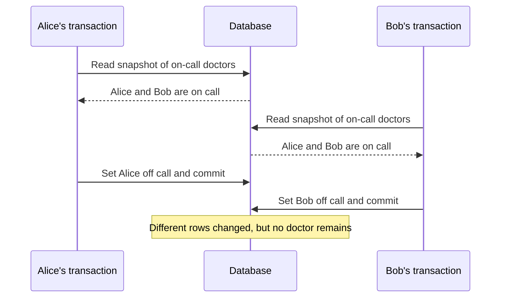

# Chapter 7: Transactions

*Designing Data-Intensive Applications*, 2017 first edition. Printed pages 221–267.

Source: Martin Kleppmann, *Designing Data-Intensive Applications* (O'Reilly, 2017).

The central idea: **transactions reduce the number of failure and concurrency cases an application must handle, but the isolation guarantee determines which race conditions remain possible.**

For anomaly tables and transaction timelines, see the [Isolation Level Cheat Sheet](../cheatsheets/isolation-level.md).

**1. ACID names four different concerns.** (pp. 222–228)

| Property | Meaning | Common misunderstanding |
|---|---|---|
| **Atomicity** | If a transaction aborts, its writes are discarded | It is not the concurrency meaning of an indivisible CPU operation |
| **Consistency** | Transactions preserve application invariants | The database cannot infer every business rule |
| **Isolation** | Concurrency is constrained according to the isolation level | Using a transaction does not automatically provide serializability |
| **Durability** | Successfully committed data survives the promised failure scenarios | The promise depends on persistence, replication, and the fault model |

For a money transfer, atomicity prevents a debit from surviving without its corresponding credit. Isolation controls what concurrent transfers and readers can observe. The application must still choose the right accounts and amounts.

ACID consistency concerns valid application state. It is different from replica consistency and the consistency discussed in the CAP theorem.

**2. Single-record guarantees do not cover multi-record invariants.** (pp. 228–233)

A database can make an individual record update atomic while leaving a sequence of operations unprotected. Relationships, secondary indexes, and denormalized copies often require coordinated changes to several objects.

Transactions also provide an error-handling structure: abort, then retry the entire operation when appropriate. Retrying only the last statement can reuse decisions based on stale reads.

There are limits:

- Retry transient conflicts with bounded retries and backoff; repeating a permanent validation error will not help.
- A lost commit response leaves the outcome uncertain. It is different from a confirmed abort.
- External effects, such as sending an email, are not automatically rolled back with database writes.

**3. Read committed prevents some anomalies, but does not provide one stable view.** (pp. 233–237)

Two foundational problems are **dirty reads**, where a transaction sees another transaction's uncommitted data, and **dirty writes**, where it overwrites another transaction's uncommitted write. The chapter's read-committed implementations prevent both.

However, separate reads can observe different committed states. Suppose a transfer moves $100 between two accounts. Reading one balance before the transfer and the other afterward can produce a total that never existed in a committed database state. This is **read skew**.

Every individual value may be committed and still fail to form a coherent combined view.

**4. Snapshot isolation provides a consistent view, but permits some write anomalies.** (pp. 237–246)

A transaction reads a snapshot of committed data from its start, plus its own changes. **Multi-version concurrency control (MVCC)** retains versions and applies visibility rules to construct that view.

This supports long-running backups and reports without making their ordinary reads block concurrent writers. Writers can still conflict with other writers.

Do not infer exact behavior from an isolation-level name alone. The chapter shows that names such as “repeatable read” and “serializable” have historically been used for different guarantees by different products.

A **lost update** can occur in a read-modify-write cycle:

```text
Initial counter: 42
A reads 42       B reads 42
A writes 43      B writes 43
Final counter: 43, although two increments were intended
```

Possible protections include an atomic update such as `SET value = value + 1`, explicit locking, compare-and-set, or automatic conflict detection. These mechanisms have specific scopes; fixing one counter does not protect every multi-record rule.

**5. Write skew is the crucial counterexample to “snapshot means safe.”** (pp. 246–251)

The book's example requires at least one doctor to remain on call. Alice and Bob are both on call, and each independently checks whether it is safe to leave.



Neither transaction overwrites the other's row. Both can therefore pass checks that only detect competing writes to the same object. Yet no serial execution of the two decisions would allow both to leave.

This is **write skew**: transactions make writes based on premises that concurrent transactions invalidate.

A **phantom** involves changes to the set of rows matching a predicate. For example, two transactions both find no room booking in a time interval, then insert overlapping bookings. Locking only the rows returned by the original query may lock nothing. Protection may require a database constraint, predicate/range locking, a shared object representing the resource, or serializable isolation.

Snapshot isolation can keep a repeated query's visible results stable while still allowing this invariant violation at commit. A stable view and serializable execution are different guarantees.

**6. Serializability means an outcome equivalent to some serial order.** (pp. 251–266)

The database may execute transactions concurrently, provided their committed effects could have arisen from running them one at a time. This protects against the concurrency anomalies covered in the chapter, when all relevant work is within the transaction boundary.

The chapter compares three implementations:

| Approach | How it works | Main trade-off |
|---|---|---|
| Actual serial execution | Run transactions one at a time, often per partition | Transactions must be short; cross-partition work needs extra coordination |
| **Two-phase locking (2PL)** | Hold read/write locks to prevent conflicting access | Blocking, deadlocks, and variable response time |
| **Serializable snapshot isolation (SSI)** | Read snapshots and track dependencies that could violate serializability | Some transactions abort and must be retried |

Actual serial execution becomes practical when data is in memory and transactions avoid waiting for user input or slow network round trips. Partitioning can add parallelism when transactions are local to partitions.

In the strict 2PL approach discussed here, shared locks permit concurrent readers, while exclusive locks protect writes. Locks are retained until commit or abort. Predicate or index-range locks extend protection to rows that might be inserted. Deadlocks require detecting a cycle and aborting a participant.

SSI takes an optimistic approach: let transactions proceed, track read/write dependencies, and abort transactions when needed to prevent a nonserializable outcome. It is not a rule that every stale read is invalid. The relevant question is whether the dependencies allow a valid serial execution. High contention can cause many retries, so optimistic execution is not free.

**Two-phase locking (2PL) and two-phase commit (2PC) are different:** the former controls concurrent access; the latter coordinates commit decisions across participants and appears in Chapter 9.

**7. Choose guarantees around the invariant.** (pp. 266–267)

| Problem | Why a weaker guarantee may be insufficient |
|---|---|
| Coherent multi-record report | Read committed can mix different committed moments |
| Read-modify-write counter | Concurrent readers can compute and write the same replacement |
| At least one doctor on call | Different rows can change without a direct write/write conflict |
| No overlapping booking | The conflicting record might not exist when the check runs |

Write the invariant in plain language, identify all records and predicates it depends on, and determine how the chosen database guarantee protects them. A transaction wrapper alone does not answer those questions.

**A quick recall check:**

1. What does ACID atomicity promise after a confirmed abort?
2. Why can snapshot isolation allow both doctors to leave?
3. Why might locking existing booking rows fail to prevent a double booking?
4. How do 2PL and SSI handle potential concurrency conflicts differently?

<details>
<summary>Suggested answers</summary>

1. None of that transaction's database writes remain committed. External effects and an unknown commit outcome require separate handling.
2. Both read a snapshot with two doctors and update different records, so there need not be a direct write/write conflict.
3. Both searches may return no rows. Protecting the absence of a match requires something beyond locking returned rows.
4. 2PL blocks incompatible operations using locks. SSI permits more concurrent execution and aborts transactions when dependency analysis requires it.

</details>

Next is **Chapter 8: The Trouble with Distributed Systems**, covering the failures that make cross-machine guarantees difficult.
