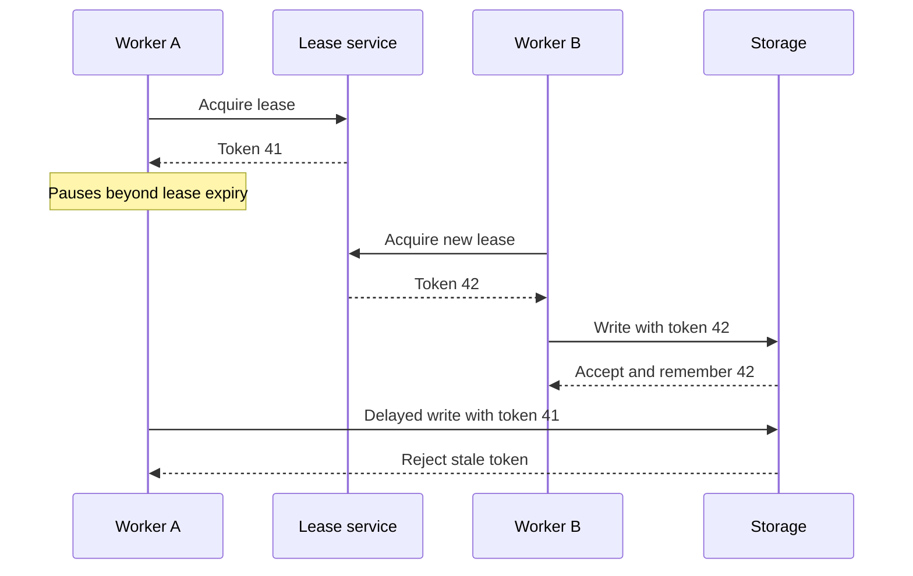

# Chapter 8: The Trouble with Distributed Systems

*Designing Data-Intensive Applications*, 2017 first edition. Printed pages 273–312.

Source: Martin Kleppmann, *Designing Data-Intensive Applications* (O'Reilly, 2017).

The central idea: **a distributed process cannot reliably infer another process's state from silence, elapsed time, or its own belief that it still has authority. Protocols must remain safe despite that uncertainty.**

**1. Partial failure is the defining difficulty.** (pp. 273–277)

Some machines can work while others fail or become unreachable. The working machines may not know which parts failed or whether a remote operation completed.

For example, after sending a write and receiving no response, several explanations remain possible:

- The request never reached the server.
- The server received it but has not processed it.
- The server committed it, but the reply was lost or delayed.
- The server failed at some intermediate point.

These cases require different recovery actions, yet the client may observe the same timeout. A retry may be necessary for progress and may also duplicate an effect.

**2. Networks introduce loss, queues, and unpredictable delay.** (pp. 277–287)

Packets can be delayed in switches, operating-system buffers, and queues on overloaded machines. Retransmission adds further delay. Even a transport acknowledgment does not prove that the application finished the requested work.

A timeout is therefore a **suspicion of failure**, not proof of a crash.

| Timeout choice | Benefit | Risk |
|---|---|---|
| Shorter | Faster reaction to real failures | More false suspicions, unnecessary failover, and duplicated work |
| Longer | More tolerance of temporary delays | Slower recovery and longer waits |

Declaring an overloaded node dead and moving its work elsewhere can overload the remaining nodes, causing a cascade. Adaptive failure detectors can use observed delays, but they cannot remove the fundamental uncertainty.

Bounded-delay networks and real-time systems are possible under stronger engineering assumptions. The chapter's point is that ordinary distributed applications generally cannot rely on such bounds holding at all times.

**3. Use the right clock, and understand its limits.** (pp. 287–295)

| Clock | Appropriate use | Limitation |
|---|---|---|
| **Time-of-day / wall clock** | Calendar timestamps and human-facing time | Can jump or disagree across machines |
| **Monotonic clock** | Measuring durations within a system | Its absolute values do not provide a shared cross-machine timeline |

Clock synchronization reduces error but does not make clocks exact. Resolution is also different from accuracy: reporting nanoseconds does not mean the clock is accurate to a nanosecond.

Timestamp-based last-write-wins can discard a causally later write because its writer's clock is behind. Physical timestamps alone therefore do not establish causality.

Some systems represent time as an uncertainty interval and wait until intervals cannot overlap before making ordering guarantees. Such a protocol depends on the validity of the error bounds; merely synchronizing clocks is not equivalent.

**4. A process can pause after checking that it is allowed to act.** (pp. 295–300)

Garbage collection, scheduling, page faults, virtual-machine pauses, or storage delays can stop a process for much longer than expected.

Suppose a worker holds a lease that expires after a deadline:

1. The worker checks that the lease is valid.
2. It pauses before issuing a write.
3. Its lease expires, and another worker acquires the lease.
4. The original worker resumes and sends its delayed write.

Checking immediately before the write is still insufficient: a pause can occur between that check and the action. A correct lock service does not automatically prevent a stale client from affecting the protected resource.

**5. Fencing moves the authority check to the resource being protected.** (pp. 300–304)

Each lease grant receives a monotonically increasing **fencing token**. Every protected write carries that token, and the storage service rejects tokens older than the highest one it has already accepted.

The storage service must enforce the token check. Giving a token to a client and trusting that client to stop is not fencing. A random unique lock identifier also does not provide the increasing order required by this technique.

Fencing rejects an older owner once the resource has observed newer authority. It is not a clock that independently proves a lease has expired, and it does not by itself deduplicate repeated writes from the same owner.

**6. Fault models make assumptions explicit.** (pp. 304–308)

Algorithms are designed for a particular model of faults:

| Node model | Assumption |
|---|---|
| Crash-stop | A failed node stops forever |
| Crash-recovery | A node can restart, losing memory but retaining stable storage |
| Byzantine | A node can behave arbitrarily, including sending contradictory information |

Timing models differ too. A synchronous model assumes known bounds. An asynchronous model gives an algorithm no timing guarantees. Partial synchrony allows periods when timing bounds fail, while providing sufficiently well-behaved periods for progress.

The chapter mainly motivates practical systems that tolerate crash recovery and unpredictable delays. Byzantine tolerance is a different requirement, not something ordinary replication automatically provides. Checksums and validation can still catch accidental corruption without implementing a full Byzantine protocol.

**7. Safety and liveness must be evaluated separately.** (pp. 308–312)

- **Safety:** a forbidden event never occurs. For example, an outdated owner cannot overwrite data after a newer owner has established its authority.
- **Liveness:** useful progress eventually occurs. For example, a valid requester eventually obtains a lease when the required conditions hold.

A safety violation has a finite counterexample: the bad event has happened. A lack of progress may merely mean the system needs more time or better network conditions.

Protocols can preserve safety during arbitrarily long delays while requiring eventual communication or a reachable quorum to make progress. This is why “it stopped accepting writes during the outage” and “it corrupted data during the outage” are very different outcomes.

A proof applies to its stated model. Real implementations must also handle corrupted storage, bugs, misconfiguration, and violated assumptions. Testing failure cases and reasoning about protocols complement each other.

**A quick recall check:**

1. What does a timeout tell you about whether a remote write committed?
2. Why is a wall clock a poor tool for measuring a local request duration?
3. Why does a lease check immediately before writing remain unsafe on its own?
4. Which component must enforce a fencing token?

Suggested answers

1. Only that a response was not received in time. The write may have committed, failed, or still be in progress.
2. Synchronization can move it forward or backward. A monotonic clock is intended for measuring elapsed time.
3. The process can pause after the check, and its lease can expire while another worker takes over.
4. The protected resource, or a trusted component controlling access to it. It must reject older authority rather than trust the stale client.

Next is **Chapter 9: Consistency and Consensus**, covering how systems agree on an order and on decisions despite these failures.
