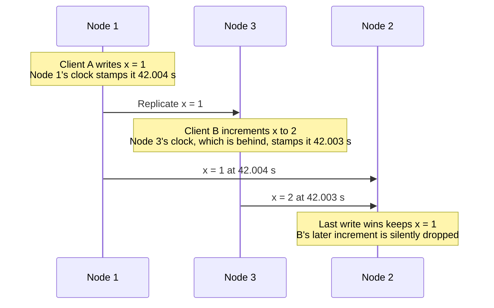
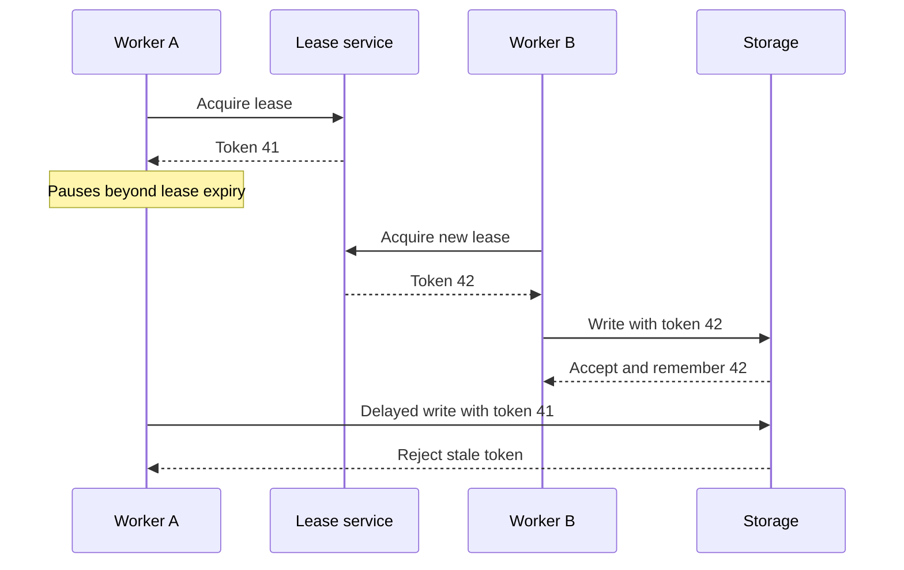

# Chapter 8: The Trouble with Distributed Systems

*Designing Data-Intensive Applications*, 2017 first edition. Printed pages 273–312.

Source: Martin Kleppmann, *Designing Data-Intensive Applications* (O'Reilly, 2017).

The central idea: **a distributed process cannot reliably infer another process's state from silence, elapsed time, or its own belief that it still has authority. Protocols must remain safe despite that uncertainty.**

**1. Partial failure is the defining difficulty.** (pp. 273–277)

Some machines can work while others fail or become unreachable. The working machines may not know which parts failed or whether a remote operation completed.

For example, after sending a write and receiving no response, several explanations remain possible:

- The request never reached the server.
- The server received it but has not processed it.
- The server committed it, but the reply was lost or delayed.
- The server failed at some intermediate point.

These cases require different recovery actions, yet the client may observe the same timeout. A retry may be necessary for progress and may also duplicate an effect.

Supercomputers handle a failed node by stopping the whole job and restarting from a checkpoint, which turns partial failure into total failure. Internet services can't do that. They must stay online, they run on commodity machines that fail more often, and with thousands of nodes something is always broken. So fault tolerance must be built into the software, making a reliable system from unreliable parts, as TCP does on top of IP. Such layers have limits: TCP hides lost, duplicated, and reordered packets, but it cannot remove network delay.

**2. Networks introduce loss, queues, and unpredictable delay.** (pp. 277–287)

Network faults are common, even in a data center run by one company. One study found about 12 a month in a medium-sized data center, half cutting off one machine and half a whole rack. Redundant gear helps less than hoped, because human error, such as a misconfigured switch, is a major cause. A link can even work in one direction only. Showing users an error during a fault can be a valid choice, but the reaction must be defined and tested. Untested handling can leave a cluster deadlocked even after the network recovers, or even delete data.

Packets can be delayed in switches, operating-system buffers, and queues on overloaded machines. Retransmission adds further delay. Even a transport acknowledgment does not prove that the application finished the requested work.

A timeout is therefore a **suspicion of failure**, not proof of a crash.

If the network guaranteed delivery within some time d, and a healthy node always answered within time r, 2d + r would be a reliable timeout: no response by then would mean the network or the node had failed. Real networks and servers guarantee neither, so a brief spike in round-trip times can trip a short timeout.

| Timeout choice | Benefit | Risk |
|---|---|---|
| Shorter | Faster reaction to real failures | More false suspicions, unnecessary failover, and duplicated work |
| Longer | More tolerance of temporary delays | Slower recovery and longer waits |

Declaring an overloaded node dead and moving its work elsewhere can overload the remaining nodes, causing a cascade. Adaptive failure detectors, such as the Phi Accrual detector in Akka and Cassandra, adjust timeouts to the observed delays and their jitter, but they cannot remove the fundamental uncertainty. Without one, choose timeouts experimentally by measuring round-trip times over a long period and many machines.

Bounded-delay networks and real-time systems are possible under stronger engineering assumptions. The chapter's point is that ordinary distributed applications generally cannot rely on such bounds holding at all times.

The book's comparison of telephone circuits with Ethernet and IP shows why:

| Network | How bandwidth is shared | Result |
|---|---|---|
| Telephone circuit, such as ISDN | Each call reserves a fixed slot: 16 bits every 250 microseconds | Bounded delay, but no one else can use a reserved slot, even when it is idle |
| Ethernet and IP | Packets compete for whatever bandwidth is free | Better use of capacity, but packets queue, so delay is unbounded |

Data center and internet traffic is bursty. A file transfer has no fixed bandwidth need and should simply finish as fast as possible, while a circuit would force you to guess a rate in advance. Variable delay is therefore the price of cheaper, better-utilized networks.

**3. Use the right clock, and understand its limits.** (pp. 287–295)

| Clock | Appropriate use | Limitation |
|---|---|---|
| **Time-of-day / wall clock** | Calendar timestamps and human-facing time | Can jump or disagree across machines |
| **Monotonic clock** | Measuring durations within a system | Its absolute values do not provide a shared cross-machine timeline |

Clock synchronization reduces error but does not make clocks exact. For scale, Google assumes its servers' quartz clocks drift by up to 200 parts per million: 6 ms if a clock resyncs every 30 seconds, 17 seconds if it resyncs once a day. Syncing with NTP over the internet gave at best about 35 ms of error in one experiment, with occasional spikes to around a second. Resolution is also different from accuracy: reporting nanoseconds does not mean the clock is accurate to a nanosecond.

Clock problems are easy to miss. NTP may forcibly reset a clock that is too far off, so time jumps backward or forward. A node firewalled off from NTP can drift unnoticed, leap seconds have crashed large systems, and a paused virtual machine sees its clock jump ahead. Most things keep working while a clock drifts, so software that relies on synchronized clocks is more likely to lose data silently than to crash. It should monitor clock offsets and remove any node that drifts too far.

Timestamp-based last-write-wins can discard a causally later write because its writer's clock is behind. Physical timestamps alone therefore do not establish causality.

For example, in the book's setup each replicated write carries a timestamp from the clock of the node where it started:

B's write clearly came after A's, since B incremented the value A wrote. Yet a clock skew of only a few milliseconds gave it the smaller timestamp. Last write wins is widely used, for example in Cassandra and Riak.

Under LWW, if one node's clock runs behind another's, its writes cannot replace values the faster node wrote until the skew has elapsed, so writes vanish without any error. LWW also cannot tell writes in quick succession from truly concurrent ones; that takes causality tracking such as version vectors. Better NTP is no fix: correct ordering needs a clock far more accurate than network delay, and NTP's own accuracy is limited by network round-trip time. **Logical clocks**, which count events instead of measuring time, are a safer way to order events. They record only which event came first, not the time of day or elapsed seconds.

Some systems represent time as an uncertainty interval and wait until intervals cannot overlap before making ordering guarantees. Such a protocol depends on the validity of the error bounds; merely synchronizing clocks is not equivalent.

The book's example is Google's Spanner. Its TrueTime API returns the earliest and latest possible current time, not a single value. Spanner waits out that uncertainty before committing a read-write transaction, so any transaction that could read the data gets a later, non-overlapping interval. To keep the wait short, each Google data center has its own GPS receiver or atomic clock, which keeps the uncertainty to about 7 ms.

The goal is snapshot isolation across data centers. Snapshots need transaction IDs that increase in causal order, and a single global counter would need coordination and become a bottleneck. So Spanner uses these timestamps as transaction IDs instead. When the book was written, no mainstream database outside Google did this.

**4. A process can pause after checking that it is allowed to act.** (pp. 295–302)

Garbage collection, scheduling, page faults, virtual-machine pauses, or storage delays can stop a process for much longer than expected. Stop-the-world garbage collection pauses have sometimes lasted several minutes.

Suppose a worker holds a lease that expires after a deadline:

1. The worker checks that the lease is valid.
2. It pauses before issuing a write.
3. Its lease expires, and another worker acquires the lease.
4. The original worker resumes and sends its delayed write.

Checking immediately before the write is still insufficient: a pause can occur between that check and the action. The book's example renews the lease whenever less than 10 seconds remain, which looks like a safe margin. A 15-second pause around the validity check will likely let the lease run out before the write happens, by which time another node may have taken over. The same code has a second flaw: the lease's expiry time is set by another machine but compared with the local clock, so it also relies on synchronized clocks.

A node cannot trust its own judgment. After a garbage collection pause it may not notice that time passed, and a node with a one-way network fault can be declared dead while working fine. So many algorithms decide by **quorum**, usually a majority of nodes, including the decision that a node is dead. The node must then step down, even if it feels alive. A majority keeps working when some nodes fail (three nodes tolerate one failure, five tolerate two), and it is safe because only one majority can exist at a time. This matters whenever a system needs exactly one of something, such as one leader per partition, one lock holder, or one owner of a username. A node's belief that it holds that role does not mean a quorum agrees.

A correct lock service does not automatically prevent a stale client from affecting the protected resource. HBase once had exactly this bug: a paused client resumed after its lease had expired and kept writing to a file that the new leaseholder was also writing, corrupting it.

**5. Fencing moves the authority check to the resource being protected.** (pp. 303–304)

Each lease grant receives a monotonically increasing **fencing token**. Every protected write carries that token, and the storage service rejects tokens older than the highest one it has already accepted.

The storage service must enforce the token check. Giving a token to a client and trusting that client to stop is not fencing. A random unique lock identifier also does not provide the increasing order required by this technique.

With ZooKeeper as the lock service, its transaction ID (`zxid`) or node version (`cversion`) can serve as the token, since both only increase. A resource without fencing support may still allow a workaround, such as putting the token in the file name. Fencing stops nodes that are wrong by accident, not malicious ones: a node that lies can simply send a fake token.

Fencing rejects an older owner once the resource has observed newer authority. It is not a clock that independently proves a lease has expired, and it does not by itself deduplicate repeated writes from the same owner.

**6. Fault models make assumptions explicit.** (pp. 304–308)

Algorithms are designed for a particular model of faults:

| Node model | Assumption |
|---|---|
| Crash-stop | A failed node stops forever |
| Crash-recovery | A node can restart, losing memory but retaining stable storage |
| Byzantine | A node can behave arbitrarily, including sending contradictory information |

Timing models differ too. A synchronous model assumes known bounds. An asynchronous model gives an algorithm no timing guarantees at all. It has no clock, so timeouts are impossible. Partial synchrony allows periods when timing bounds fail, while providing sufficiently well-behaved periods for progress.

For real systems, the book finds partial synchrony with crash-recovery faults the most useful model. Byzantine tolerance is a different requirement, not something ordinary replication automatically provides. Checksums and validation can still catch accidental corruption without implementing a full Byzantine protocol.

A full Byzantine protocol is worth its cost mainly where nodes cannot trust each other, as in peer-to-peer networks like Bitcoin, or where radiation can corrupt memory, as in aerospace. The cost is high: most such algorithms need more than two-thirds of the nodes to behave correctly, so four nodes tolerate only one faulty node. They also do little against bugs or attackers when every node runs the same software, because whatever breaks one node can probably break them all.

**7. Safety and liveness must be evaluated separately.** (pp. 308–312)

- **Safety:** a forbidden event never occurs. For example, an outdated owner cannot overwrite data after a newer owner has established its authority.
- **Liveness:** useful progress eventually occurs. For example, a valid requester eventually obtains a lease when the required conditions hold.

A safety violation has a finite counterexample: the bad event has happened. A lack of progress may merely mean the system needs more time or better network conditions.

Protocols can preserve safety during arbitrarily long delays while requiring eventual communication or a reachable quorum to make progress. This is why “it stopped accepting writes during the outage” and “it corrupted data during the outage” are very different outcomes.

A proof applies to its stated model. Real implementations must also handle corrupted storage, bugs, misconfiguration, and violated assumptions. Testing failure cases and reasoning about protocols complement each other.

**A quick recall check:**

1. What does a timeout tell you about whether a remote write committed?
2. Why is a wall clock a poor tool for measuring a local request duration?
3. Why does a lease check immediately before writing remain unsafe on its own?
4. Which component must enforce a fencing token?
5. Why can't a node rely on its own belief that it is still the leader?
6. Why are logical clocks safer than time-of-day timestamps for ordering events?

Suggested answers

1. Only that a response was not received in time. The write may have committed, failed, or still be in progress.
2. Synchronization can move it forward or backward. A monotonic clock is intended for measuring elapsed time.
3. The process can pause after the check, and its lease can expire while another worker takes over.
4. The protected resource, or a trusted component controlling access to it. It must reject older authority rather than trust the stale client.
5. It may have been paused or cut off while a quorum declared it dead and chose a new leader. The quorum's decision counts, so the node must step down.
6. Clock skew can give a causally later write a smaller timestamp, so last write wins drops it silently. Logical clocks count events and record only their order, so they don't depend on clock accuracy.

Next is **Chapter 9: Consistency and Consensus**, covering how systems agree on an order and on decisions despite these failures.
