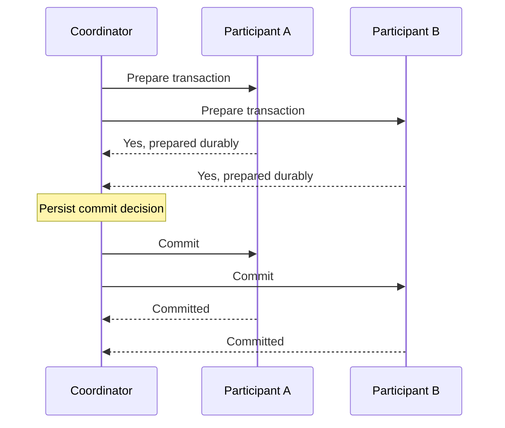

# Chapter 9: Consistency and Consensus

*Designing Data-Intensive Applications*, 2017 first edition. Printed pages 321–375.

Source: Martin Kleppmann, *Designing Data-Intensive Applications* (O'Reilly, 2017).

The central idea: **many distributed guarantees require nodes to agree on an irrevocable decision or order. Timestamps, leaders, and replica counts help only when a protocol connects them to that agreement.**

**1. Linearizability makes an object behave like one up-to-date copy.** (pp. 322–330)

Each operation appears to take effect at one instant between its invocation and response. The resulting order must respect real time: if operation A completes before B starts, A precedes B.

If a write completes and a later read begins, that read cannot return a value older than the completed write, assuming no intervening write changes it. Reads overlapping an in-progress write can be ordered on either side, provided all observations fit one valid history.

| Guarantee | What is ordered? | Real-time requirement |
|---|---|---|
| **Serializability** | Transactions that can access multiple objects | Equivalent to some serial execution |
| **Linearizability** | Operations on an object | The order respects completed-before-started relationships |
| **Strict serializability** | Transactions | A serial execution that also respects real-time order |

Linearizable operations on individual objects do not automatically make a multi-object transaction serializable. Conversely, serializability alone does not specify that the chosen serial order must follow wall-clock execution order. Evaluate the transaction-level guarantee directly.

**2. Coordination needs stronger guarantees than merely eventual convergence.** (pp. 330–335)

Leader election, locks, and enforcing a unique username at write time require participants to agree which operation won. If two isolated replicas both report exclusive success, reconciling later cannot undo the fact that both clients were promised exclusivity.

A leader can order writes, but unsafe failover can break the guarantee. Leaderless read/write quorum overlap also does not automatically provide linearizability. The full protocol must handle concurrent operations and recovery.

Linearizable reads require a suitable freshness protocol. Serving an arbitrary lagging follower is not enough, even if the replicated write log is correctly ordered.

**3. CAP describes a specific trade-off during network partitions.** (pp. 335–339)

If nodes are disconnected, the system cannot both guarantee linearizability and ensure that every request to a nonfailed node completes successfully under the CAP availability requirement.

For an exclusive claim, an isolated node may need to wait or reject the request rather than invent an answer inconsistent with the other side. A service that allows independent updates can keep accepting them, but must expose weaker semantics and resolve conflicts where necessary.

“Pick any two of consistency, availability, and partition tolerance” hides the important condition: network partitions are faults you must handle. CAP also uses a narrower definition of consistency and a different definition of availability from many operational dashboards.

Even without a partition, coordination has latency costs. A guarantee that requires remote agreement cannot generally be completed using only local information.

**4. Causality gives a partial order; a total order adds decisions about concurrency.** (pp. 339–348)

An answer depends on its question. An edit based on a prior read depends on the version read. Independent actions can remain unordered by causality.

**Lamport timestamps** use logical counters, advanced when sending or receiving information, with a node identifier to break ties. They can produce a total ordering consistent with causality:

- If A causally precedes B, A receives an earlier logical timestamp.
- An earlier timestamp does not prove that A caused B. The events may be concurrent.

Version vectors retain information useful for distinguishing concurrency. A compact Lamport timestamp does not provide that same test.

More importantly, sortable timestamps do not tell you when you have seen every competing operation. For a username claim, there might be an unseen claim with an earlier timestamp. Choosing a winner after collecting everything is different from safely telling a client “you won” now.

**5. Total order broadcast finalizes a common sequence.** (pp. 348–352)

The protocol provides reliable delivery and a shared delivery order. Once an operation is delivered in the agreed sequence, another operation cannot later be inserted ahead of it.

This supports **state machine replication**: replicas apply the same deterministic operations in the same order and reach the same state.

For a unique username, process claims in that agreed order. The first valid claim wins; subsequent claims see the existing owner and fail.

Delivery order alone does not say how soon each replica applies the log. Building linearizable storage on top also requires acknowledgments and reads to respect the necessary committed/applied position. A correctly ordered but lagging replica can still serve stale data.

**6. Two-phase commit coordinates one transaction's outcome.** (pp. 352–364)

When a transaction spans participants, each must reach the same commit-or-abort outcome. Independent local commits can leave only half the transaction applied.

In **two-phase commit (2PC)**:

1. **Prepare:** the coordinator asks each participant to promise that it can commit. A “yes” vote requires recording enough durable state and retaining the necessary resources.
2. **Decide:** if all vote yes, the coordinator durably records commit; otherwise it records abort. It sends the decision and retries delivery until participants learn it.

Once a participant votes yes, it cannot simply abort after a timeout: another participant may already have committed. If the coordinator becomes unavailable, prepared participants can remain **in doubt**, holding locks and waiting for a recoverable decision. This is the blocking limitation of classic 2PC.

Atomic commit does not require participants to become visible at exactly the same physical instant; it requires compatible final decisions. Isolation and visibility still need their own mechanisms.

**7. Consensus preserves decisions while allowing leadership to change.** (pp. 364–370)

The chapter describes these properties:

| Property | Meaning |
|---|---|
| Agreement | Nodes do not decide differently |
| Integrity | Each node decides at most once in a consensus instance |
| Validity | The chosen value was actually proposed |
| Termination | Nonfailed participants eventually decide when the protocol's progress assumptions hold |

Algorithms such as Paxos, Raft, Viewstamped Replication, and Zab provide forms of fault-tolerant agreement. Repeated decisions can establish the sequence needed for total order broadcast.

Typical protocols use increasing **epochs/terms**, quorum votes, and recovery rules that preserve already chosen decisions across elections. Two machines may temporarily believe they lead different terms; the protocol prevents the stale leader from committing conflicting decisions.

In common majority-based configurations, three voting replicas can make progress with two communicating, and five with three. Merely counting replicas is insufficient: the required quorum must communicate and follow the protocol. Safety can be retained when progress stops, assuming the fault model holds.

Classic 2PC requires every transaction participant to prepare and may wait for its coordinator. Consensus replicates a decision with a fault-tolerant recovery procedure. Combining the two is possible, but “use a majority” does not remove the need for every transaction participant to be able to commit its own work.

The FLP result rules out guaranteed termination of deterministic consensus in a fully asynchronous model with even one possible crash. It does not make practical consensus impossible: practical systems use additional assumptions, such as periods of timely communication, to obtain progress while preserving safety.

**8. Coordination services provide useful building blocks, not universal application correctness.** (pp. 370–375)

A coordination service can maintain small amounts of important metadata, membership, leader-election state, and ordered tokens. It can help agree that a node is no longer a member, even though it cannot prove that the physical process is dead.

The application must still use the result correctly. For example, an elected leader accessing an external storage system may need fencing, as Chapter 8 explained.

Use agreement where the requirement needs it. Independent updates and mergeable data can avoid some coordination, but their observable semantics differ from exclusive, immediately final decisions.

**A quick recall check:**

1. How does linearizability differ from serializability?
2. Why do Lamport timestamps not by themselves implement a unique username claim?
3. Why can a prepared 2PC participant not safely abort after a timeout?
4. Why can a consensus system stop making progress without violating safety?

Suggested answers

1. Linearizability makes object operations respect real-time order. Serializability makes transactions equivalent to some serial execution. Strict serializability combines transaction ordering with real-time order.
2. A node can sort known claims but cannot know whether an unseen earlier claim exists. It needs a way to finalize the order before promising success.
3. A commit decision may already exist and may have reached another participant. A unilateral abort could contradict it.
4. Without the required communicating quorum, refusing new decisions preserves agreement. Progress resumes only when the required conditions are restored.

Next is **Chapter 10: Batch Processing**, beginning the discussion of data derived from other data.
