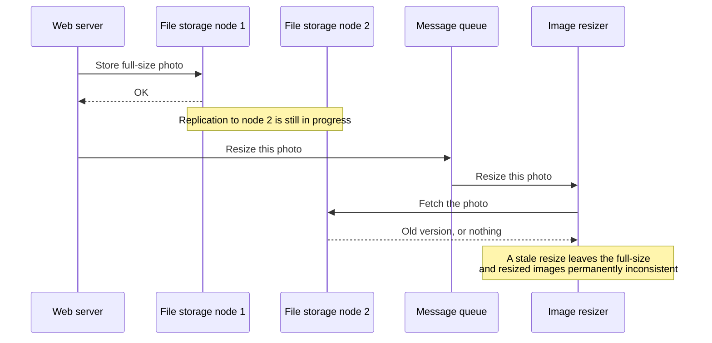
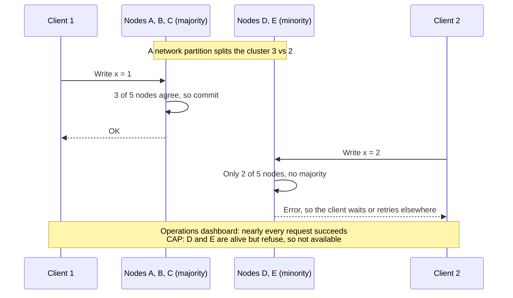
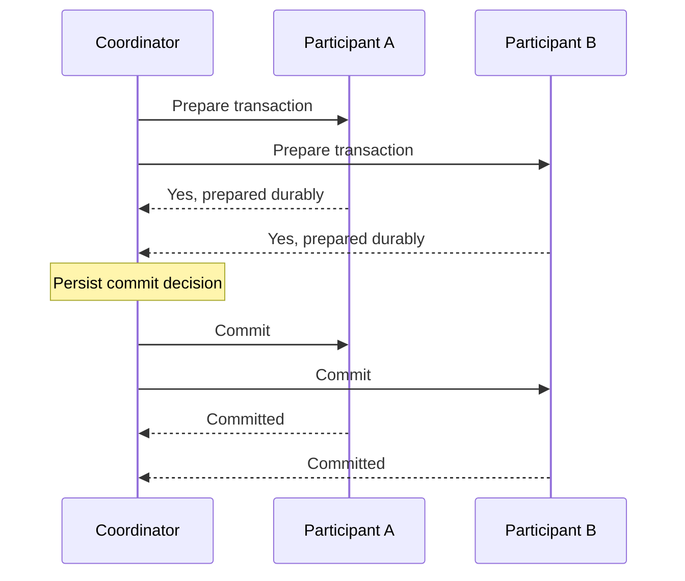
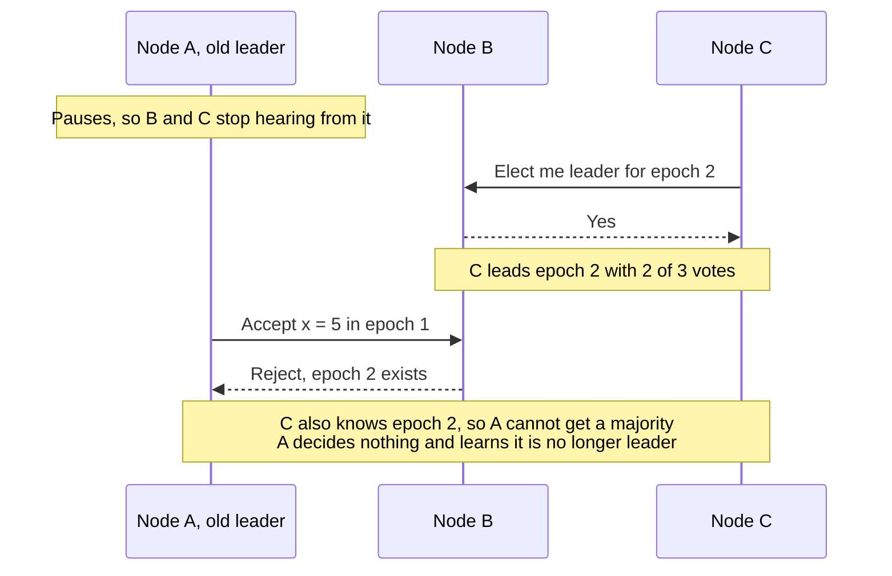

# Chapter 9: Consistency and Consensus

*Designing Data-Intensive Applications*, 2017 first edition. Printed pages 321–375.

Source: Martin Kleppmann, *Designing Data-Intensive Applications* (O'Reilly, 2017).

The central idea: **many distributed guarantees require nodes to agree on an irrevocable decision or order. Timestamps, leaders, and replica counts help only when a protocol connects them to that agreement.**

**1. Linearizability makes an object behave like one up-to-date copy.** (pp. 324–329)

Each operation appears to take effect at one instant between its invocation and response. The resulting order must respect real time: if operation A completes before B starts, A precedes B.

If a write completes and a later read begins, that read cannot return a value older than the completed write, assuming no intervening write changes it. Reads overlapping an in-progress write can be ordered on either side, provided all observations fit one valid history.

That condition also rules out flip-flopping: once any read has returned the new value, every later read must return it too, even while the write is still in progress. The book's running example breaks this rule. Alice sees the final score of the 2014 World Cup final and tells Bob. Bob reloads afterward, but a lagging replica still shows the game in progress. His request began after hers had finished, so that stale answer violates linearizability.

| Guarantee | What is ordered? | Real-time requirement |
|---|---|---|
| **Serializability** | Transactions that can access multiple objects | None: some serial order, which may differ from the order the transactions actually ran |
| **Linearizability** | Operations on an object | The order respects completed-before-started relationships |
| **Strict serializability** | Transactions | A serial execution that also respects real-time order |

Linearizable operations on individual objects do not automatically make a multi-object transaction serializable. For example, they do not prevent the on-call doctors write skew from Chapter 7, because that conflict spans several rows. Conversely, serializability alone does not specify that the chosen serial order must follow wall-clock execution order. Serializable snapshot isolation (SSI) is serializable but not linearizable: by design, a transaction reads from a snapshot that leaves out newer writes. Two-phase locking and actual serial execution are typically linearizable as well. Evaluate the transaction-level guarantee directly.

**2. Coordination needs stronger guarantees than merely eventual convergence.** (pp. 330–335)

Leader election, locks, and enforcing a unique username at write time require participants to agree which operation won. If two isolated replicas both report exclusive success, reconciling later cannot undo the fact that both clients were promised exclusivity.

The book's third use case is **cross-channel timing dependencies**. In the book's example, a web server writes an uploaded photo to file storage and then puts a resize instruction on a message queue. If the queue is faster than replication inside the storage service, the resizer may fetch an old version of the photo, or nothing:

The race exists because the two sides talk through two channels, the storage and the queue. Alice and Bob also had a second channel: her voice. Linearizable storage prevents such races. If you control the second channel, read-your-writes techniques from Chapter 5 can work instead, at the cost of more complexity.

A leader can order writes, but unsafe failover can break the guarantee. For example, a node that wrongly believes it is still the leader may serve stale reads, and asynchronous replication can lose acknowledged writes during failover. Leaderless read/write quorum overlap also does not automatically provide linearizability. The full protocol must handle concurrent operations and recovery.

The book shows this with `n=3, w=3, r=2`. A write of x = 1 has so far reached only one of the three replicas. Reader A's two replicas include that one, so A returns the newer value, 1. Reader B starts after A has finished, but both of its replicas still hold 0, so B returns 0. The quorum condition `w + r > n` holds, yet B sees an older value than A, which no single history allows. Avoiding this costs performance: readers must finish read repair before returning, and writers must read the latest state from a quorum before writing. Even then, a compare-and-set would still need consensus. In short, assume Dynamo-style leaderless systems are not linearizable.

Linearizable reads require a suitable freshness protocol. Serving an arbitrary lagging follower is not enough, even if the replicated write log is correctly ordered.

**3. CAP describes a specific trade-off during network partitions.** (pp. 335–338)

If nodes are disconnected, the system cannot both guarantee linearizability and ensure that every request to a nonfailed node completes successfully under the CAP availability requirement.

For an exclusive claim, an isolated node may need to wait or reject the request rather than invent an answer inconsistent with the other side. A service that allows independent updates can keep accepting them, but must expose weaker semantics and resolve conflicts where necessary.

The book's example is a database replicated across two datacenters whose link fails. With multi-leader replication, both datacenters keep accepting writes and exchange them once the link is back. With a single leader, clients that can reach only the follower datacenter can neither write nor read linearizably until then.

“Pick any two of consistency, availability, and partition tolerance” hides the important condition: network partitions are faults you must handle. A clearer reading is **either Consistent or Available when Partitioned**.

CAP is also much narrower than its slogan. Eric Brewer named it in 2000, though designers had known the trade-off since the 1970s. It began as a rule of thumb without precise definitions, meant to start a discussion, and it helped push engineers toward the shared-nothing designs of the NoSQL era. The later formal theorem keeps only a small part:

| Term | What the CAP theorem means | What the word often means elsewhere |
|---|---|---|
| Consistency | Linearizability, and no other model | Replicas eventually converging, or ACID's application-defined “good state” (Chapter 7) |
| Availability | Every request to a nonfailed node gets a successful response. Waiting or returning an error counts as unavailable | Loosely, fault-tolerant. Even CAP discussions use contradictory definitions |

It also considers only one kind of fault: a network partition, where nodes are alive but cannot reach each other. It says nothing about network delays, crashed nodes, or other trade-offs.

Many so-called highly available systems do not meet CAP's definition. To illustrate, take a five-node cluster that runs a consensus algorithm, so each write needs a majority, and split it 3 vs 2:

The cluster stays linearizable by giving up CAP availability on the minority side. Because CAP's terms cause so much confusion and its scope is so narrow, the book concludes that it was historically influential but has little practical value for design, and that more precise results have superseded it. It also advises against labeling systems CP or AP.

Even without a partition, coordination has latency costs. A guarantee that requires remote agreement cannot generally be completed using only local information.

In fact, the book argues that speed, not fault tolerance, is the main reason systems drop linearizability. Even RAM on a multi-core CPU is not linearizable: each core has its own cache and store buffer, so a core may read a stale value unless a memory barrier is used. CPUs make this trade for performance, and so do many distributed databases. Attiya and Welch proved that linearizable reads and writes take time at least proportional to the uncertainty of network delays. On networks with highly variable delays, linearizability is slow all the time, not only during a fault.

**4. Causality gives a partial order; a total order adds decisions about concurrency.** (pp. 339–348)

An answer depends on its question. An edit based on a prior read depends on the version read. Independent actions can remain unordered by causality.

Linearizability implies causality. Its single timeline follows real time, so causes always come before effects, even when they travel over a separate channel like the photo queue. Causal consistency is weaker: concurrent operations stay unordered, like branches in Git history. But it is the strongest model that neither slows down for network delays nor becomes unavailable during network failures, so the CAP trade-off does not apply to it. The book suggests that many systems that seem to need linearizability really need only causal consistency, although such databases were still mostly research at the time.

A single leader can number operations causally just by incrementing a counter for its replication log. Without one, the common alternatives scale better but break causality. Odd numbers on one node and even on another, physical clock timestamps, and preallocated blocks such as 1–1,000 and 1,001–2,000 all give unique numbers, yet a causally later operation can get a smaller number.

**Lamport timestamps** fix this. Each timestamp is a pair (counter, node ID): each node counts the operations it processes, and the node ID breaks ties. Every node and client also remembers the highest counter it has seen and sends it with every request. A node that receives a higher value jumps its counter up to it. In the book's example, client A gets counter 5 from node 2 and sends it on to node 1, whose counter is only 1. Node 1 jumps to 5, so its next operation gets 6. The result is a total ordering consistent with causality:

- If A causally precedes B, A receives an earlier logical timestamp.
- An earlier timestamp does not prove that A caused B. The events may be concurrent.

Version vectors retain information useful for distinguishing concurrency. A compact Lamport timestamp does not provide that same test.

More importantly, sortable timestamps do not tell you when you have seen every competing operation. For a username claim, there might be an unseen claim with an earlier timestamp. Choosing a winner after collecting everything is different from safely telling a client “you won” now.

**5. Total order broadcast finalizes a common sequence.** (pp. 348–352)

The protocol provides reliable delivery and a shared delivery order. Once an operation is delivered in the agreed sequence, another operation cannot later be inserted ahead of it.

This supports **state machine replication**: replicas apply the same deterministic operations in the same order and reach the same state.

For a unique username, process claims in that agreed order. The first valid claim wins; subsequent claims see the existing owner and fail. Concretely, a node appends a tentative claim to the log and waits until the log delivers that claim back. Only then does it check whether the first claim for the name is its own, and commit or abort.

Delivery order alone does not say how soon each replica applies the log. Building linearizable storage on top also requires acknowledgments and reads to respect the necessary committed/applied position. A correctly ordered but lagging replica can still serve stale data. The book calls this combination, linearizable writes with possibly stale reads, **sequential consistency** (also called timeline consistency), slightly weaker than linearizability.

The book lists three ways to make reads linearizable:

- Send the read through the log as well, and perform it when it comes back in order. Quorum reads in etcd work somewhat like this.
- Ask for the latest log position in a linearizable way, wait until the replica has applied everything up to it, then read. This is the idea behind ZooKeeper's `sync()`.
- Read from a replica that is updated synchronously on every write, as in chain replication.

The reverse also works: you can build total order broadcast from linearizable storage. With a linearizable register that supports atomic increment-and-get, stamp each message with the next number, and have nodes deliver messages in number order. Unlike Lamport timestamps, these numbers have no gaps. A node that has delivered message 4 and receives message 6 knows it must wait for 5. That gap-free sequence is the key difference from timestamp ordering.

Keeping such a counter correct through node failures and network interruptions leads back to consensus. The book notes that a linearizable compare-and-set (or increment-and-get) register, total order broadcast, and consensus are provably equivalent: a solution to any one can be turned into a solution to the others. Its closing summary adds atomic commit, locks and leases, membership services, and uniqueness constraints to the same family (pp. 373–374).

**6. Two-phase commit coordinates one transaction's outcome.** (pp. 352–364)

When a transaction spans participants, each must reach the same commit-or-abort outcome. Independent local commits can leave only half the transaction applied.

In **two-phase commit (2PC)**:

1. **Prepare:** the coordinator asks each participant to promise that it can commit. A “yes” vote requires recording enough durable state and retaining the necessary resources.
2. **Decide:** if all vote yes, the coordinator durably records commit; otherwise it records abort. That log write is the **commit point**. Then it sends the decision, retrying until every participant learns it.

Once a participant votes yes, it cannot simply abort after a timeout: another participant may already have committed. If the coordinator becomes unavailable, prepared participants can remain **in doubt**, holding locks and waiting for a recoverable decision. This is the blocking limitation of classic 2PC.

For example, suppose the coordinator in the diagram above crashes after sending Commit to A but before sending it to B. B cannot abort, since A may have committed, as it has here. It cannot commit on its own either, since for all B knows, A voted no. So B waits with its row locks held: if the coordinator takes 20 minutes to restart, those rows stay locked for 20 minutes, and if the coordinator's log is lost, until an administrator resolves the transaction by hand. Other transactions that need those rows are blocked too, which can make large parts of an application unavailable.

**Three-phase commit (3PC)** was proposed to avoid this blocking, but it assumes bounded network delays and response times. In general, nonblocking atomic commit needs a perfect failure detector, and a timeout is not one, since it cannot tell a crashed node from a slow network. That is why 2PC is still used.

Atomic commit does not require participants to become visible at exactly the same physical instant; it requires compatible final decisions. Isolation and visibility still need their own mechanisms.

In practice, the book separates two kinds of distributed transaction. **Database-internal** ones run among the nodes of one database, such as VoltDB or MySQL Cluster's NDB engine. The database can use its own optimized protocol, so these often work well. **Heterogeneous** ones span different technologies, such as two vendors' databases, or a database and a message broker. They usually use **XA**, a standard from 1991. XA is a C API for talking to a coordinator, not a network protocol. These are much harder.

Their main appeal is **exactly-once message processing**: acknowledge a queue message and commit its database writes in one atomic transaction. If either part fails, both abort, so the broker can safely redeliver the message. This works only if every side effect joins the protocol. An email server without 2PC might still send the same email twice.

The key lesson is that the coordinator is effectively a database of transaction outcomes, so it needs the same care as any important database:

| Problem | Effect |
|---|---|
| Extra disk syncs and network round trips | Slow. MySQL's distributed transactions reportedly run more than 10 times slower than single-node ones |
| The XA coordinator is often a library in the application process, with its log on local disk and little or no replication | If that server dies, participants stay in doubt until it restarts. The server is no longer stateless, and the coordinator is a single point of failure |
| Coordinator log lost or corrupted | Orphaned in-doubt transactions keep their locks, even across database restarts. XA's **heuristic decisions** let a participant decide alone, which probably breaks atomicity |
| XA is a lowest common denominator | It cannot detect deadlocks across systems and does not work with SSI |
| Every participant must respond | Any broken part fails the transaction, so 2PC amplifies failures |

**7. Consensus preserves decisions while allowing leadership to change.** (pp. 364–369)

The chapter describes these properties:

| Property | Meaning |
|---|---|
| Agreement | Nodes do not decide differently |
| Integrity | Each node decides at most once in a consensus instance |
| Validity | The chosen value was actually proposed |
| Termination | Nonfailed participants eventually decide when the protocol's progress assumptions hold |

Algorithms such as Paxos, Raft, Viewstamped Replication, and Zab provide forms of fault-tolerant agreement. Repeated decisions can establish the sequence needed for total order broadcast.

Single-leader replication from Chapter 5 orders writes too, but it does not escape consensus. A leader picked by hand is a dictator: if it fails, writes stop until humans pick a new one, so termination fails. Automatic failover must get all nodes to agree on the new leader, which is consensus again. A leader avoids consensus on every write but still needs it for every leadership change (p. 375). Since consensus algorithms themselves use a leader, this looks circular. Epochs break the circle.

Typical protocols use increasing **epochs/terms**, quorum votes, and recovery rules that preserve already chosen decisions across elections. Two machines may temporarily believe they lead different terms; the protocol prevents the stale leader from committing conflicting decisions.

Here is how. Each election uses a higher epoch number, called a ballot number in Paxos, a view number in Viewstamped Replication, and a term in Raft. A leader needs a quorum to elect it, and again a quorum to accept each proposal. A node rejects proposals from an epoch older than the newest one it knows. Any two majorities share at least one node, so any quorum the stale leader asks includes a node that took part in the newer election. The epoch acts much like a fencing token from Chapter 8:

In common majority-based configurations, three voting replicas can make progress with two communicating, and five with three. Merely counting replicas is insufficient: the required quorum must communicate and follow the protocol. Safety can be retained when progress stops, assuming the fault model holds.

This two-round voting looks like two-phase commit, but 2PC differs in three ways: its coordinator is not elected, it needs a yes from every participant rather than a majority, and it has no recovery procedure that brings nodes to a consistent state under a new leader. Because it may wait forever for its coordinator, 2PC does not meet consensus's termination property. Combining the two is possible, but “use a majority” does not remove the need for every transaction participant to be able to commit its own work.

Consensus also has costs:

- Voting on every proposal is a kind of synchronous replication, so it is slower. Many databases prefer asynchronous replication and accept that failover may lose some committed data.
- Most algorithms assume a fixed set of voting nodes. Extensions allow adding and removing nodes, but they are much less well understood.
- Failures are detected by timeouts. With highly variable delays, as in geographically distributed systems, false suspicions cause frequent elections, and the system can spend more time electing leaders than doing work.
- Some algorithms react badly to particular network faults. If one link is consistently unreliable, Raft leadership can keep bouncing between two nodes, so the system never makes progress.

The FLP result (p. 353) rules out guaranteed termination of deterministic consensus in a fully asynchronous model, one without clocks or timeouts, if even one node may crash. It does not make practical consensus impossible. Allowing timeouts that suspect crashed nodes, even if a suspicion is sometimes wrong, makes consensus solvable, and so does allowing random numbers.

**8. Coordination services provide useful building blocks, not universal application correctness.** (pp. 370–375)

A coordination service can maintain small amounts of important metadata, membership, leader-election state, and ordered tokens. It can help agree that a node is no longer a member, even though it cannot prove that the physical process is dead.

The book's main examples are ZooKeeper and etcd. They hold a small dataset that fits in memory and replicate it with fault-tolerant total order broadcast. ZooKeeper runs its votes on a fixed set of nodes, usually three or five, while serving many clients. An application with thousands of nodes thus outsources consensus, ordering, and failure detection instead of voting among all of them. ZooKeeper's main features show what applications build on:

| Feature | What it gives you |
|---|---|
| Linearizable compare-and-set | A lock or leader election where only one of several concurrent claimants wins. Locks are usually leases that expire if the client fails |
| Total order of operations | An increasing transaction ID, the `zxid`, usable as a fencing token |
| Sessions with heartbeats | A client's ephemeral nodes, such as its locks, are deleted when its session times out |
| Change notifications | A client learns that another client joined or failed without polling |

The book notes that only the linearizable atomic operations really require consensus. It is the combination of features that makes these services useful for coordination.

The data should change slowly, for example “the node at 10.1.1.23 leads partition 7”, which may change every few minutes or hours. Application state that changes thousands of times per second belongs elsewhere.

The application must still use the result correctly. For example, an elected leader accessing an external storage system may need fencing, as Chapter 8 explained.

Use agreement where the requirement needs it. Independent updates and mergeable data can avoid some coordination, but their observable semantics differ from exclusive, immediately final decisions.

**A quick recall check:**

1. How does linearizability differ from serializability?
2. Why do Lamport timestamps not by themselves implement a unique username claim?
3. Why can a prepared 2PC participant not safely abort after a timeout?
4. Why can a consensus system stop making progress without violating safety?
5. Why do many systems give up linearizability, and what is the strongest model that keeps causality without that cost?
6. Why can a crashed XA coordinator make large parts of an application unavailable?

Suggested answers

1. Linearizability makes object operations respect real-time order. Serializability makes transactions equivalent to some serial execution. Strict serializability combines transaction ordering with real-time order.
2. A node can sort known claims but cannot know whether an unseen earlier claim exists. It needs a way to finalize the order before promising success.
3. A commit decision may already exist and may have reached another participant. A unilateral abort could contradict it.
4. Without the required communicating quorum, refusing new decisions preserves agreement. Progress resumes only when the required conditions are restored.
5. Mainly for speed, not because of partitions. Linearizable reads and writes take time at least proportional to the uncertainty of network delays, all the time. Causal consistency keeps every cause before its effect, does not slow down for network delays, and stays available during network failures.
6. The coordinator often runs inside the application server and keeps its log on local disk. Until that server restarts and reads the log, prepared participants stay in doubt and keep their row locks, which blocks other transactions that need those rows. If the log is lost, only an administrator or a risky heuristic decision can release them.

Next is **Chapter 10: Batch Processing**, beginning the discussion of data derived from other data.
