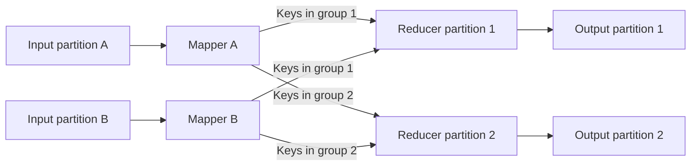

# Chapter 10: Batch Processing

*Designing Data-Intensive Applications*, 2017 first edition. Printed pages 389–431.

Source: Martin Kleppmann, *Designing Data-Intensive Applications* (O'Reilly, 2017).

The central idea: **processing immutable, bounded input into separate output makes large computations composable, repeatable, and recoverable. Distributed frameworks manage where the work runs and how failed tasks are retried.**

**1. Batch jobs derive new data from a defined input.** (pp. 389–397)

An online service responds to requests as they arrive. A batch job processes a bounded dataset, such as yesterday's logs or a database snapshot, and eventually finishes. Its priorities often include throughput and completion time rather than per-request latency.

The chapter starts with Unix pipelines: extract fields, sort records, count groups, and rank results. The key principles are small composable programs, compatible input/output interfaces, separation of logic from wiring, and preservation of input.

For example, the shared interface is the file: a plain, ordered stream of bytes. By convention, many tools treat it as lines of text, so any tool's output can feed another tool's input. Each program reads stdin and writes stdout without knowing what they are connected to. The person running the shell does that wiring.

An illustrative pipeline might:

1. Extract the requested URL from each log record.
2. Sort by URL.
3. Count adjacent equal URLs.
4. Sort the counts to find the most popular pages.

The book runs these steps as one line of standard tools over a web server's access log:

```bash
cat /var/log/nginx/access.log | awk '{print $7}' | sort | uniq -c | sort -r -n | head -n 5
```

Sorting can spill to disk, so larger-than-memory input need not imply distributed execution. The algorithm and I/O pattern matter before the number of machines does.

The book compares the pipeline with a short Ruby script that counts URLs in an in-memory hash table:

| Approach | Memory needed | If the data outgrows memory |
|---|---|---|
| Hash table of URL to count | One entry per distinct URL, however long the log is | Breaks down once the distinct URLs no longer fit |
| `sort`, then `uniq -c` | One chunk at a time | Sorts chunks in memory, writes each to disk, then merges the sorted files, like the SSTables in Chapter 3 |

GNU `sort` spills to disk this way automatically and spreads the work across CPU cores.

**2. MapReduce generalizes partitioning, grouping, and recovery.** (pp. 397–403)

A distributed filesystem stores large files across machines with replication. The processing framework divides input into map tasks, preferably near the input data.

- A **mapper** turns an input record into zero or more key-value pairs.
- The **shuffle** routes pairs by key to reducer partitions and organizes them for grouping.
- A **reducer** processes the values belonging to one key and produces output.

For a page-view count, the mapper emits each record's URL as the key. The book leaves the value empty. All pairs for `/about` must meet at the same reducer, which counts them.

This is the Unix pipeline from point 1 spread across machines. The mapper does the job of `awk '{print $7}'`, the shuffle does the job of `sort`, and the reducer does the job of `uniq -c`.



The shuffle is essential work, not merely plumbing. It moves related records together across the network. Sorting/grouping is within reducer partitions; the resulting output is not automatically one globally sorted file.

Despite its name, the shuffle involves no randomness, unlike shuffling a deck of cards. It works in three steps:

1. The framework splits each mapper's output by a hash of the key, one part per reducer, and writes each part as a sorted file on the mapper's local disk.
2. When a mapper finishes, each reducer downloads its part from that mapper.
3. Each reducer merges the sorted files from all mappers, keeping the order, so all values for a key arrive together. The reduce function is then called once per key.

One job can count views per URL, but ranking the URLs needs a second sort, so a second job. Jobs are chained into **workflows** by directory name: the first job writes to an HDFS directory and the second reads from it. A failed job's partial output is discarded, so each job may start only after the jobs producing its input succeed. Schedulers such as Oozie, Azkaban, Luigi, Airflow, and Pinball handle these dependencies. Recommendation systems often chain 50 to 100 jobs.

**3. Distributed joins are largely about arranging data.** (pp. 403–410)

Suppose activity events refer to user IDs, and a user dataset contains profile attributes. The join must bring each event together with the matching user.

| Join strategy | What it does | When it fits |
|---|---|---|
| Reduce-side sort-merge | Shuffle both inputs by join key, then join each group | General case without useful existing placement |
| Broadcast hash | Load the small input into each worker's hash table | One side is small enough to replicate in memory |
| Partitioned hash | Join corresponding partitions locally | Both inputs share a compatible partitioning scheme |
| Map-side merge | Merge matching sorted input partitions | Inputs are compatibly partitioned and sorted |

In the book's sort-merge example, one set of mappers emits `(user ID, activity event)` and another emits `(user ID, date of birth)`. A **secondary sort** puts the user record first within each key, followed by the activity events in timestamp order. With made-up values, the reducer for user 104 might see:

| Reducer input for user 104, in order | What the reducer does |
|---|---|
| `(104, born 1990-01-15)` | Remembers the date of birth |
| `(104, viewed /about on 2024-06-01)` | Outputs `(/about, viewer age 34)` |
| `(104, viewed /cart on 2024-06-01)` | Outputs `(/cart, viewer age 34)` |

The reducer holds only one user record at a time and makes no network requests. A later job can then count viewer ages per URL.

The book suggests a useful way to see this: a mapper "sends a message" to a reducer, and the key is the destination address. Every pair with the same key reaches the same reducer call. The framework does all the network communication, so application code never deals with moving data, or with retrying after another node crashes.

For a partitioned hash join, suppose both inputs are split into 10 partitions by the last digit of the user ID. The mapper for partition 3 loads only the users whose IDs end in 3 into a hash table, then scans only those users' events.

An indexed request to a remote database for every event can destroy batch throughput and overload that database. Bringing the required data into the batch computation often makes the work more predictable.

Each remote lookup waits for a network round trip, and the job stops being deterministic: the remote data can change between a run and its rerun. So the book first copies the user database into the distributed filesystem, for example from a database backup, next to the activity logs.

The grouping key can also be a user or session ID, making it possible to assemble events that originated on many different web servers.

**4. Skew makes a few tasks dominate completion time.** (pp. 407–408, 420)

If one key has far more records than others, the reducer responsible for that key receives disproportionate work. Adding reducers does not split that key automatically.

The book's example is a social network. Most users have a few hundred connections, but a celebrity can have millions of followers. A job that collects activity per user, such as replies to each user's posts, sends all of the celebrity's records to one reducer. The job finishes only when that reducer does. Such keys are called **hot keys**, or linchpin objects.

Special handling can distribute a hot key's work and combine partial results afterward. For joins, this may require replicating matching records from the other input. The remedy depends on the operation: a sum is easier to split than a computation requiring every value to be processed together.

For example, Pig's skewed join:

1. Runs a sampling job to find the hot keys.
2. Sends each hot-key record to a randomly picked reducer out of several, instead of choosing by the key's hash.
3. Copies the other input's records for that key to all of those reducers.

A grouping, such as counting replies per user, can be split into two stages. The first stage sends a hot key's records to random reducers that each output a partial count. The second stage adds up the partial counts for each key.

This is the same workload-distribution problem from Chapter 6. In a batch job it often appears as a small number of slow **stragglers** holding up the entire result.

**5. Outputs can be serving systems, not just reports.** (pp. 411–417)

Batch jobs can build search indexes, recommendation tables, machine-learning artifacts, and key-value files that online services query later.

Writing bulk output into files and loading or publishing those files can be more efficient than issuing a remote write for every record. It can also separate the generation of a new dataset from making that dataset visible to readers.

For example, when Voldemort loads files built by a batch job, each server keeps answering queries from its old files while the new ones are copied over. It then switches to the new files atomically. If anything goes wrong, it switches back, since the old files are still there.

Preserving the input allows a failed or incorrect job to be rerun. A new version of a transformation can generate a replacement output without destroying the old source or serving result.

In a read-write database, rolling back buggy code does not remove the bad data it already wrote. With batch output, you roll back the code and rerun the job, or switch back to the old output. Recovering from buggy code like this is called **human fault tolerance**, a term the book credits to Nathan Marz.

The chapter also contrasts flexible processing of raw input with more tightly managed warehouse schemas. Delaying interpretation moves the work of making sense of the data from its producer to its consumers (**schema-on-read**). That suits producers and consumers on different teams, and one raw dataset can feed several views shaped for different purposes.

Concretely, Hadoop let teams dump raw data into HDFS first and work out how to interpret it later. A massively parallel processing (MPP) database needs careful up-front modeling before data can be imported. A common pattern combines them: copy raw data from transactional systems into HDFS, run jobs that clean it and reshape it into relational form, then load it into an MPP data warehouse. Modeling still happens, just as a separate step after collection.

The book's biggest contrast, though, is generality. The parallel join algorithms were not new: MPP databases had them more than a decade before MapReduce. But an MPP database is a tightly integrated engine for analytic SQL, while MapReduce on a distributed filesystem behaves like a general-purpose operating system: it runs whatever program you give it. Machine-learning models, search indexes with relevance ranking, and image analysis need custom code, not just queries. Many processing models, such as MapReduce, Hive, HBase, and Impala, can share one cluster and read the same files, so nobody has to copy data into separate specialized systems.

**6. Retry safety depends on controlling side effects.** (pp. 413–414, 417–418, 429–430)

A framework can rerun a failed task, or launch another attempt for a slow task. If attempts produce isolated output files and only one successful attempt is published, retries need not duplicate the logical output. The book calls this MapReduce's all-or-nothing guarantee: a successful job's output looks as if every task ran exactly once, and a failed job leaves no output at all.

That guarantee does not automatically extend to arbitrary effects inside a mapper. A task that sends an email, charges an account, or increments an external database counter may perform that action again on retry.

The useful abstraction is: deterministic computation over a fixed input, with effects limited to output the framework controls. If input depends on a changing external service or current time, rerunning may produce different results.

Why does MapReduce retry single tasks and write to disk so eagerly? An MPP database handles faults differently:

| Aspect | MPP database | MapReduce |
|---|---|---|
| A node fails mid-run | Abort the whole query, then rerun it | Retry only the failed task |
| Memory and disk | Keep as much as possible in memory | Write to disk eagerly |
| Suits | Queries that run for seconds or minutes | Large, long jobs likely to see a task failure |

The reason is the environment MapReduce was built for, not unreliable hardware. At Google, low-priority batch tasks share machines with online services and can be preempted at any time to free resources. A task running for an hour had about a 5% chance of being killed this way, more than ten times the rate of hardware failures. With 100 tasks of 10 minutes each, the chance that at least one is killed is over 50%. YARN, Mesos, and Kubernetes did not support general priority preemption when the book was written, so where tasks are rarely killed, these design choices make less sense.

**7. Dataflow engines avoid unnecessary intermediate work.** (pp. 419–423)

Classic MapReduce chains jobs through fully materialized intermediate files. This simplifies recovery but adds disk I/O, replication, sorting, and waits for prior jobs to finish.

Dataflow engines represent the entire workflow as connected operators. They can pipeline data, retain useful intermediate state, choose different join strategies, and avoid sorting where only hash partitioning is needed.

The trade-off shifts rather than disappears:

| Strategy | Normal execution | Failure recovery |
|---|---|---|
| Materialize intermediate results | More writes and storage | Restart from saved intermediate data |
| Pipeline or retain data in memory | Less intermediate I/O | Recompute lost work or recover from checkpoints |

Knowing an operator's dependencies makes recomputation possible. Deterministic operators make that recovery easier to reason about.

Spark's resilient distributed datasets (RDDs) record how each dataset was computed, so a lost partition can be recomputed from its inputs. Flink instead checkpoints operator state. Determinism matters because downstream operators may already have consumed the lost data: if the recomputed version differs, they must be rerun too. Nondeterminism slips in easily through hash table iteration order, random numbers without a fixed seed, the system clock, or external data.

Recomputing is not always the better choice. When intermediate data is much smaller than its input, or costly to compute, it is cheaper to materialize it than to recompute it.

**8. Iterative algorithms and high-level queries need suitable execution models.** (pp. 424–429)

Graph algorithms such as PageRank repeatedly update state based on neighboring vertices. Repeated full MapReduce jobs can reread and rewrite much unchanged data.

The **Pregel / bulk synchronous parallel** model keeps vertex state across iterations. Vertices send messages, and messages from one round are processed in the next. Round boundaries coordinate progress and provide a structure for recovery.

Distribution has a real cost for graphs. Grouping vertices that talk a lot onto one machine is hard, so frameworks usually split the graph by an arbitrary vertex ID. Many messages then cross the network, and they can add up to more data than the graph itself. So if a graph fits in one machine's memory, a single-machine, even single-threaded, algorithm will likely beat a distributed job. If it fits on one machine's disks, a framework such as GraphChi is an option. Pregel-style distribution is unavoidable only when the graph is too big for one machine.

Higher-level languages let users declare joins, filters, and aggregations while the engine chooses operators and data movement. This connects back to Chapter 2: describing the desired result leaves room for optimization.

Batch frameworks still let callbacks run arbitrary code, so jobs can use ordinary libraries for parsing, language processing, or image analysis. That freedom long set them apart from MPP databases, whose user-defined functions are often clumsy to use. But when simple filters and field selections are declared instead of coded, the optimizer can read only the needed columns and run tight, cache-friendly loops instead of calling a function per record. Hive, Spark DataFrames, and Impala do this. So batch frameworks and MPP databases are converging into general systems for storing and processing data.

**A quick recall check:**

1. What is the shuffle trying to achieve?
2. When can a broadcast join avoid shuffling the large input by join key?
3. Why is retrying a task that sends email dangerous?
4. What does materializing intermediate output buy at the cost of extra I/O?
5. Why does MapReduce retry single tasks and write eagerly to disk, while an MPP database just reruns a failed query?
6. Besides schema flexibility, what does Hadoop offer that an MPP database lacks?

<details>
<summary>Suggested answers</summary>

1. Bring records with the same key to the same processing partition so they can be grouped or joined.
2. When the other input is small enough for each worker to hold and look up locally.
3. The framework can repeat execution, but cannot automatically undo or suppress an external email already sent.
4. A durable recovery point and a reusable dataset. Without it, lost intermediate work may need recomputation.
5. It was designed for shared clusters where low-priority batch tasks are often preempted. A long job with many tasks would almost always lose one, so rerunning the whole job would waste too much work.
6. It runs arbitrary code, not just SQL, and lets many processing models share one cluster over the same files.

</details>

Next is **Chapter 11: Stream Processing**, extending derived-data computation to input that never finishes.
