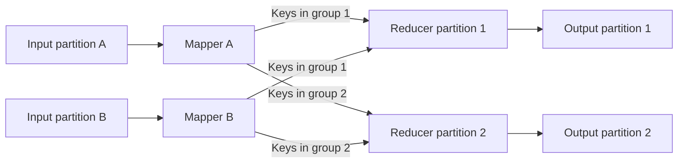

# Chapter 10: Batch Processing

*Designing Data-Intensive Applications*, 2017 first edition. Printed pages 389–431.

Source: Martin Kleppmann, *Designing Data-Intensive Applications* (O'Reilly, 2017).

The central idea: **processing immutable, bounded input into separate output makes large computations composable, repeatable, and recoverable. Distributed frameworks manage where the work runs and how failed tasks are retried.**

**1. Batch jobs derive new data from a defined input.** (pp. 389–397)

An online service responds to requests as they arrive. A batch job processes a bounded dataset, such as yesterday's logs or a database snapshot, and eventually finishes. Its priorities often include throughput and completion time rather than per-request latency.

The chapter starts with Unix pipelines: extract fields, sort records, count groups, and rank results. The key principles are small composable programs, compatible input/output interfaces, separation of logic from wiring, and preservation of input.

An illustrative pipeline might:

1. Extract the requested URL from each log record.
2. Sort by URL.
3. Count adjacent equal URLs.
4. Sort the counts to find the most popular pages.

Sorting can spill to disk, so larger-than-memory input need not imply distributed execution. The algorithm and I/O pattern matter before the number of machines does.

**2. MapReduce generalizes partitioning, grouping, and recovery.** (pp. 397–403)

A distributed filesystem stores large files across machines with replication. The processing framework divides input into map tasks, preferably near the input data.

- A **mapper** turns an input record into zero or more key-value pairs.
- The **shuffle** routes pairs by key to reducer partitions and organizes them for grouping.
- A **reducer** processes the values belonging to one key and produces output.

For a page-view count, every mapper emits `(URL, 1)`. All pairs for `/about` must meet at the same reducer, which adds their values.

The shuffle is essential work, not merely plumbing. It moves related records together across the network. Sorting/grouping is within reducer partitions; the resulting output is not automatically one globally sorted file.

**3. Distributed joins are largely about arranging data.** (pp. 403–411)

Suppose activity events refer to user IDs, and a user dataset contains profile attributes. The join must bring each event together with the matching user.

| Join strategy | What it does | When it fits |
|---|---|---|
| Reduce-side sort-merge | Shuffle both inputs by join key, then join each group | General case without useful existing placement |
| Broadcast hash | Load the small input into each worker's hash table | One side is small enough to replicate in memory |
| Partitioned hash | Join corresponding partitions locally | Both inputs share a compatible partitioning scheme |
| Map-side merge | Merge matching sorted input partitions | Inputs are compatibly partitioned and sorted |

An indexed request to a remote database for every event can destroy batch throughput and overload that database. Bringing the required data into the batch computation often makes the work more predictable.

The grouping key can also be a user or session ID, making it possible to assemble events that originated on many different web servers.

**4. Skew makes a few tasks dominate completion time.** (pp. 407–410)

If one key has far more records than others, the reducer responsible for that key receives disproportionate work. Adding reducers does not split that key automatically.

Special handling can distribute a hot key's work and combine partial results afterward. For joins, this may require replicating matching records from the other input. The remedy depends on the operation: a sum is easier to split than a computation requiring every value to be processed together.

This is the same workload-distribution problem from Chapter 6. In a batch job it often appears as a small number of slow **stragglers** holding up the entire result.

**5. Outputs can be serving systems, not just reports.** (pp. 411–419)

Batch jobs can build search indexes, recommendation tables, machine-learning artifacts, and key-value files that online services query later.

Writing bulk output into files and loading or publishing those files can be more efficient than issuing a remote write for every record. It can also separate the generation of a new dataset from making that dataset visible to readers.

Preserving the input allows a failed or incorrect job to be rerun. A new version of a transformation can generate a replacement output without destroying the old source or serving result.

The chapter also contrasts flexible processing of raw input with more tightly managed warehouse schemas. Delaying interpretation can enable new analyses, but consumers still need a consistent understanding of the data they read.

**6. Retry safety depends on controlling side effects.** (pp. 413–419, 429–430)

A framework can rerun a failed task, or launch another attempt for a slow task. If attempts produce isolated output files and only one successful attempt is published, retries need not duplicate the logical output.

That guarantee does not automatically extend to arbitrary effects inside a mapper. A task that sends an email, charges an account, or increments an external database counter may perform that action again on retry.

The useful abstraction is: deterministic computation over a fixed input, with effects limited to output the framework controls. If input depends on a changing external service or current time, rerunning may produce different results.

**7. Dataflow engines avoid unnecessary intermediate work.** (pp. 419–424)

Classic MapReduce chains jobs through fully materialized intermediate files. This simplifies recovery but adds disk I/O, replication, sorting, and waits for prior jobs to finish.

Dataflow engines represent the entire workflow as connected operators. They can pipeline data, retain useful intermediate state, choose different join strategies, and avoid sorting where only hash partitioning is needed.

The trade-off shifts rather than disappears:

| Strategy | Normal execution | Failure recovery |
|---|---|---|
| Materialize intermediate results | More writes and storage | Restart from saved intermediate data |
| Pipeline or retain data in memory | Less intermediate I/O | Recompute lost work or recover from checkpoints |

Knowing an operator's dependencies makes recomputation possible. Deterministic operators make that recovery easier to reason about.

**8. Iterative algorithms and high-level queries need suitable execution models.** (pp. 424–429)

Graph algorithms such as PageRank repeatedly update state based on neighboring vertices. Repeated full MapReduce jobs can reread and rewrite much unchanged data.

The **Pregel / bulk synchronous parallel** model keeps vertex state across iterations. Vertices send messages, and messages from one round are processed in the next. Round boundaries coordinate progress and provide a structure for recovery.

Higher-level languages let users declare joins, filters, and aggregations while the engine chooses operators and data movement. This connects back to Chapter 2: describing the desired result leaves room for optimization.

**A quick recall check:**

1. What is the shuffle trying to achieve?
2. When can a broadcast join avoid shuffling the large input by join key?
3. Why is retrying a task that sends email dangerous?
4. What does materializing intermediate output buy at the cost of extra I/O?

Suggested answers

1. Bring records with the same key to the same processing partition so they can be grouped or joined.
2. When the other input is small enough for each worker to hold and look up locally.
3. The framework can repeat execution, but cannot automatically undo or suppress an external email already sent.
4. A durable recovery point and a reusable dataset. Without it, lost intermediate work may need recomputation.

Next is **Chapter 11: Stream Processing**, extending derived-data computation to input that never finishes.
