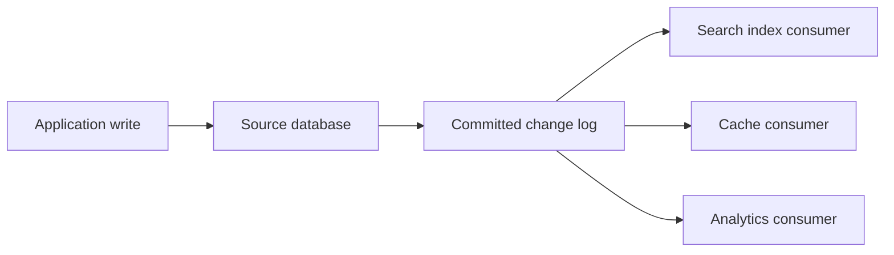

# Chapter 11: Stream Processing

*Designing Data-Intensive Applications*, 2017 first edition. Printed pages 439–481.

Source: Martin Kleppmann, *Designing Data-Intensive Applications* (O'Reilly, 2017).

The central idea: **streams let you maintain derived results continuously, but require explicit choices about ordering, time, retained state, and recovery. The input has no natural finish line.**

**1. An event stream is an unbounded sequence of records.** (pp. 439–446)

An event describes something that happened: a click, a sensor reading, or a database change. Producers publish events and consumers process them. A stream processor may update a database, send output events, or maintain an aggregate.

If consumers fall behind, the system must buffer, apply backpressure, or discard data according to its requirements. Persistence and acknowledgments determine which failures the messages survive.

Multiple consumers can either share work, so one handles each message, or receive independent copies of a stream. These are different subscription patterns, even when a broker supports both.

**2. Work queues and retained logs support different recovery models.** (pp. 441–451)

| Property | Queue-style broker described in the chapter | Log-based broker |
|---|---|---|
| Assignment | Individual messages assigned to workers | Partitions assigned within a consumer group |
| Progress tracking | Acknowledge individual messages | Track offsets in each partition |
| Retention | Messages commonly removed after acknowledgment | Retained independently of individual reads |
| Replay | Often unavailable after acknowledgment | Possible while the needed records remain retained |
| Ordering | Parallel processing and redelivery can change completion order | Ordered records within each partition |

A partitioned log scales by placing separate append-only sequences on different nodes. There is no automatic total order across all partitions. In the simple consumer-group model, partition ownership also limits parallelism within that group.

Separate consumer groups can maintain separate offsets and read the same events independently. Slow consumers do not delete events for others, but they can fall behind the retention boundary and lose the ability to replay what they missed.

**3. Database changes can drive derived systems.** (pp. 451–457)

Writing to a database and then separately updating a search index creates a **dual-write** problem. One write may fail, or concurrent requests may reach the two systems in different orders. Both writes can succeed while their final states disagree.

**Change data capture (CDC)** turns committed database changes into a stream that downstream consumers apply to indexes, caches, or analytical stores.

The database becomes the source of ordering for its changes. Consumers must preserve the ordering needed by each affected record; partitioning does not magically preserve every cross-record dependency.

Bootstrapping a new consumer usually needs a consistent snapshot plus a known log position. Recent changes alone omit records that have not changed recently.

With suitable keyed replacement records, **log compaction** can retain the latest value for each key instead of every historical update. Deletion markers and retention rules must preserve the ability of supported consumers to learn about removals.

CDC is generally asynchronous. It reduces dual-write inconsistency but does not make a search index instantly current.

**4. Event sourcing records domain events rather than only storage changes.** (pp. 457–464)

| CDC | Event sourcing |
|---|---|
| Captures changes made to database records | Makes an event history the primary record of domain actions |
| Example: a row's enrollment status changed | Example: a student canceled a course booking |
| A full replacement value may supersede older values | Earlier events may remain necessary to interpret later ones |

A **command** requests an action and may be rejected. An **event** records an action accepted as having happened. Validating a command, such as checking that a seat remains available, still needs appropriate concurrency control before recording an irrevocable event.

Current state is derived by applying events. Replaying the history can build new views or repair a buggy projection. Snapshots can speed recovery without changing the meaning of the source history.

Do not apply latest-value log compaction blindly to domain events. “Added item” and “removed item” are operations whose combined history matters; the last event alone may not describe the cart.

Separating the write model from read projections relates to **CQRS**, or command-query responsibility segregation. The query view can be shaped for its readers rather than mirroring how events are recorded.

Immutability helps debugging and replay, but it does not justify retaining personal or unnecessary data forever. Deletion and retention requirements need a deliberate design.

**5. Event time and processing time answer different questions.** (pp. 468–472)

- **Event time:** when an event occurred according to its timestamp.
- **Processing time:** when an operator actually processes it.

A device can upload yesterday's events today. A processor recovering from an outage can process hours of backlog in minutes. Grouping by processing time then describes the processing schedule rather than the original activity.

Event timestamps have their own clock errors. A timestamp supplied by a device is not automatically trustworthy simply because it is called event time.

For event-time windows, the processor cannot generally know that no older event will ever arrive. A watermark or progress signal expresses how far the system believes event time has advanced, according to its assumptions. It is not proof that an arbitrarily delayed event cannot exist.

After declaring a result, the system can drop late events with monitoring, or accept them and publish corrected results. The choice affects latency, retained state, and completeness.

| Window | Meaning |
|---|---|
| **Tumbling** | Fixed, nonoverlapping intervals |
| **Hopping** | Fixed-length windows starting at regular intervals, possibly overlapping |
| **Sliding** | Events grouped within a moving interval of each other |
| **Session** | Events grouped until an inactivity gap closes the session |

For example, “sales in each calendar minute” and “sales within any five-minute interval” are different computations, even if both are described casually as windowed counts.

**6. Stream joins need state and a rule for time.** (pp. 472–476)

| Join | Example | State needed |
|---|---|---|
| **Stream–stream** | Match a search impression with a later click | Recent events from both streams, often within a window |
| **Stream–table** | Enrich an activity event with user profile data | A queryable copy of the table, often maintained through CDC |
| **Table–table** | Maintain a join of tweets and follow relationships | Both changing tables and the derived join result |

Matching events may arrive in either order. Unmatched events may need to be retained until a window or timeout expires.

For stream–table joins, specify which table version applies: the version available when processing occurs, or the version corresponding to the event's time. Replaying against today's profile table may otherwise produce a different historical result.

**7. Exactly-once effects require coordinating input progress, state, and output.** (pp. 476–479)

A processor can crash after updating its output but before saving its input offset. Replaying then repeats the update. Saving the offset first risks losing the effect if the processor crashes before writing output.

The required relationship is between all of these:

1. Input positions acknowledged as processed.
2. Operator state produced from those inputs.
3. Output records and external side effects.

Microbatching and checkpoints can recover a consistent processing state. Atomic commit can coordinate progress and effects within a supported boundary. **Idempotent writes** or transactional deduplication can make replay produce the same observable effect.

Setting a key to a fixed value is naturally idempotent in a suitable ordering context; incrementing a counter is not. An event identifier or partition-and-offset can identify an effect already applied, but recording that identifier and applying the effect must itself be coordinated. Replaying an older “set” must also not overwrite a newer state.

**Exactly-once semantics do not mean an event's code physically executes only once.** They mean retries do not create additional observable effects within the promised boundary. Arbitrary emails or external API calls are not automatically included in a stream engine's checkpoint guarantee.

**8. Stateful operators need a recovery plan.** (pp. 478–481)

Joins, windows, and aggregates retain data between events. That state can be checkpointed, replicated through a changelog, or rebuilt by replay when enough input history remains.

After failover, a former worker may resume. Fencing may be necessary to prevent it from applying stale effects alongside its replacement. Recovery must cover ownership as well as data.

**A quick recall check:**

1. Why does acknowledging a retained log record not necessarily remove it?
2. How does CDC differ from event sourcing?
3. What happens if an event arrives after its event-time window was published?
4. Why is saving an offset separately from a counter increment unsafe?

Suggested answers

1. Offsets represent a consumer's progress. Retention is a separate policy, allowing other consumers and replay to read the same record.
2. CDC captures database changes; event sourcing models accepted domain actions as the source history from which state is derived.
3. The system needs an explicit policy, such as dropping it with metrics or updating/retracting the earlier result.
4. A crash between the two writes can lose the increment or apply it twice. Atomic coordination or correctly designed deduplication is required.

Next is **Chapter 12: The Future of Data Systems**, connecting derived data, correctness, and responsibility to users.
