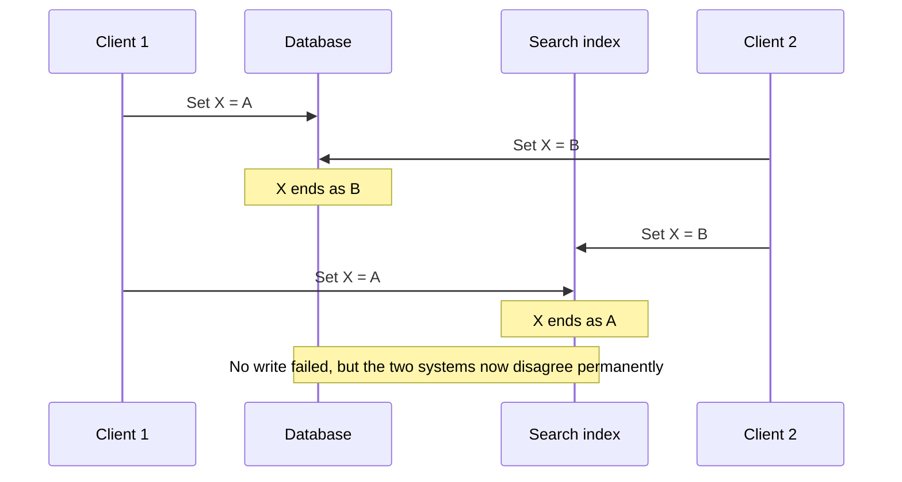
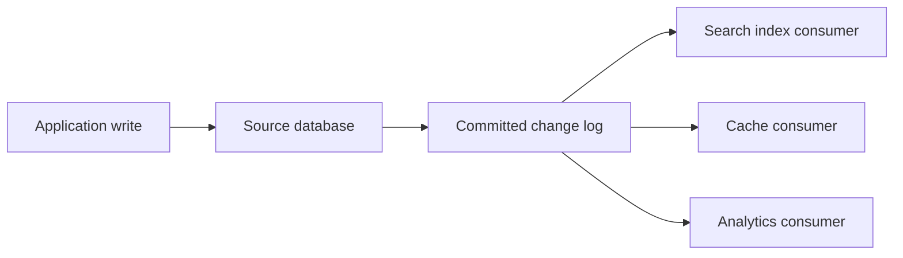

# Chapter 11: Stream Processing

*Designing Data-Intensive Applications*, 2017 first edition. Printed pages 439–481.

Source: Martin Kleppmann, *Designing Data-Intensive Applications* (O'Reilly, 2017).

The central idea: **streams let you maintain derived results continuously, but require explicit choices about ordering, time, retained state, and recovery. The input has no natural finish line.**

**1. An event stream is an unbounded sequence of records.** (pp. 439–446)

An event describes something that happened: a click, a sensor reading, or a database change. Producers publish events and consumers process them. A stream processor may update a database, send output events, or maintain an aggregate.

If consumers fall behind, the system must buffer, apply backpressure, or discard data according to its requirements. Persistence and acknowledgments determine which failures the messages survive.

Multiple consumers can either share work, so one handles each message (**load balancing**), or each receive an independent copy of the stream (**fan-out**). These are different subscription patterns, even when a broker supports both.

**2. Work queues and retained logs support different recovery models.** (pp. 441–451)

| Property | Queue-style broker described in the chapter | Log-based broker |
|---|---|---|
| Assignment | Individual messages assigned to workers | Partitions assigned within a consumer group |
| Progress tracking | Acknowledge individual messages | Track offsets in each partition |
| Retention | Messages commonly removed after acknowledgment | Retained independently of individual reads |
| Replay | Often unavailable after acknowledgment | Possible while the needed records remain retained |
| Ordering | Parallel processing and redelivery can change completion order | Ordered records within each partition |

For example, in a queue-style broker, consumer 2 crashes midway through message m3, while consumer 1 is busy with m4. The broker redelivers m3 to consumer 1, which ends up processing m4, then m3, then m5. Giving each consumer its own queue avoids this, but gives up load balancing.

A partitioned log scales by placing separate append-only sequences on different nodes. There is no automatic total order across all partitions. In the simple consumer-group model, partition ownership also limits parallelism within that group.

For example, with 4 partitions, at most 4 consumers in a group get work, and one slow message holds up every message behind it in its partition. So the book's rule of thumb is: use a queue-style broker when messages are expensive to process, you want to parallelize message by message, and order matters little. Use a log when throughput is high, each message is quick to process, and order matters.

Separate consumer groups can maintain separate offsets and read the same events independently. Slow consumers do not delete events for others, but they can fall behind the retention boundary and lose the ability to replay what they missed.

That boundary is usually far away. The book estimates that a 6 TB disk written at its full 150 MB/s fills in about 11 hours. Real deployments rarely write at full speed, so a log often holds days or weeks of messages. Alerting on how far a consumer lags gives an operator time to fix it before it misses anything.

Reading a log changes nothing except the consumer's offset, and the consumer controls that. So you can run a second copy of a consumer, starting from yesterday's offsets, write its output somewhere else, and reprocess a day of messages, as often as you like with different code. This is the batch idea from Chapter 10 again: derived output kept apart from its input by a repeatable transformation. The offset itself works like the log sequence number in single-leader replication, with the broker as the leader and the consumer as a follower.

**3. Database changes can drive derived systems.** (pp. 451–457)

Writing to a database and then separately updating a search index creates a **dual-write** problem. One write may fail, or concurrent requests may reach the two systems in different orders. Both writes can succeed while their final states disagree.

In the book's example, two clients update item X at the same time. Client 1 sets it to A and client 2 sets it to B, each writing to the database first and the search index second:

Neither system decides the order for both. Without extra concurrency detection, such as version vectors, nobody even notices: one value silently overwrites the other.

**Change data capture (CDC)** turns committed database changes into a stream that downstream consumers apply to indexes, caches, or analytical stores.

This removes the race above. A database's replication log is already a stream of its writes, and followers that apply the same writes in the same order end up in the same state. CDC makes the source database the single leader and turns the search index and other derived systems into its followers. A log-based broker suits the transport because it keeps the change events in order.

Many CDC tools read the database's own replication log. For example, Debezium and Maxwell parse MySQL's binlog, and Bottled Water decodes PostgreSQL's write-ahead log. Database triggers can also capture changes, but they tend to be fragile and slow.

The database becomes the source of ordering for its changes. Consumers must preserve the ordering needed by each affected record; partitioning does not magically preserve every cross-record dependency.

Bootstrapping a new consumer usually needs a consistent snapshot plus a known log position. Recent changes alone omit records that have not changed recently.

With suitable keyed replacement records, **log compaction** can retain the latest value for each key instead of every historical update. Deletion markers and retention rules must preserve the ability of supported consumers to learn about removals.

For example, after compaction a key updated 1,000 times keeps only its latest value. A deletion is written as a null value for the key, a **tombstone**, which tells compaction to remove that key. A new search index can then read the compacted log from offset 0 and still see the latest value of every key, without a fresh database snapshot. Kafka supports this.

CDC is generally asynchronous. It reduces dual-write inconsistency but does not make a search index instantly current.

**4. Event sourcing records domain events rather than only storage changes.** (pp. 457–464)

| CDC | Event sourcing |
|---|---|
| Captures changes made to database records | Makes an event history the primary record of domain actions |
| Example: a row's enrollment status changed | Example: a student canceled a course booking |
| A full replacement value may supersede older values | Earlier events may remain necessary to interpret later ones |

A **command** requests an action and may be rejected. An **event** records an action accepted as having happened. Validating a command, such as checking that a seat remains available, still needs appropriate concurrency control before recording an irrevocable event.

The book gives two ways to do that check. A serializable transaction can check the seat and append the event atomically. Or the booking becomes two events: a tentative reservation, then a confirmation once an asynchronous check passes. The check cannot be left to consumers, because by the time they read an event it is already in the log, and other consumers may have seen it.

Current state is derived by applying events. Replaying the history can build new views or repair a buggy projection. Snapshots can speed recovery without changing the meaning of the source history.

The book treats state and log as two sides of the same coin. Any changing state, such as the free seats on a flight or an account balance, comes from the events that changed it. Loosely, state is the event stream integrated over time, and the change stream is the state differentiated by time. Pat Helland's version: the log is the real record, and the database only caches the newest value of every row. Accountants have worked this way for centuries. A mistake in the ledger is never erased. A new entry compensates for it, and the balances are derived from the ledger.

Do not apply latest-value log compaction blindly to domain events. “Added item” and “removed item” are operations whose combined history matters; the last event alone may not describe the cart.

Separating the write model from read projections relates to **CQRS**, or command-query responsibility segregation. The query view can be shaped for its readers rather than mirroring how events are recorded.

The main weakness of event sourcing and CDC is that log consumers usually run asynchronously. A user may append an event, then read a view that does not show it yet. Updating the view in the same transaction as the append fixes this, but needs both in one storage system or a distributed transaction. In return, some concurrency control gets simpler. If each event fully describes one user action, that action needs just one append, and a single append is simple to make atomic. And if the log and the state are partitioned the same way, a single-threaded consumer per partition needs no concurrency control for its writes at all.

Immutability helps debugging and replay, but it does not justify retaining personal or unnecessary data forever. Deletion and retention requirements need a deliberate design.

For example, privacy rules may require erasing a user's personal data after they close their account. Appending a “deleted” event is not enough: history itself must be rewritten, as Datomic's excision feature does. Even then, copies can linger in backups, and on SSDs and filesystems that write to new locations instead of overwriting old data.

**5. Event time and processing time answer different questions.** (pp. 468–472)

- **Event time:** when an event occurred according to its timestamp.
- **Processing time:** when an operator actually processes it.

A device can upload yesterday's events today. A processor recovering from an outage can process hours of backlog in minutes. Grouping by processing time then describes the processing schedule rather than the original activity.

For example, say a processor that measures requests per second is redeployed and is down for a minute. By processing time, the backlog it then works through looks like a sudden spike in requests, although the real rate never changed.

Event timestamps have their own clock errors. A timestamp supplied by a device is not automatically trustworthy simply because it is called event time.

The book's fix for a mobile app is to log three timestamps: when the event happened and when it was sent, both by the device clock, and when it arrived, by the server clock. Arrival minus sending estimates the device clock's offset, assuming network delay is small. That offset then corrects the event time.

For event-time windows, the processor can never be sure it has seen every event for a window. The book's example: you count requests per minute, and most new events now fall in minutes 38 and 39 of the hour. When is the window for minute 37 done? You can time out after no new events arrive for a while, but some events may still be stuck on another machine behind a network interruption. Or a producer can send a special message saying that no more events older than time t will follow. With many producers, each consumer must track every producer's threshold separately, which makes adding and removing producers harder. Many stream frameworks call such progress markers **watermarks**, but the book does not use that term.

After declaring a result, the system can drop late **straggler events** with monitoring, or accept them and publish corrected results. The choice affects latency, retained state, and completeness.

| Window | Meaning | Example from the book |
|---|---|---|
| **Tumbling** | Fixed, nonoverlapping intervals | 1-minute windows: 10:03:00–10:03:59, then 10:04:00–10:04:59 |
| **Hopping** | Fixed-length windows starting at regular intervals, possibly overlapping | 5 minutes long, starting every minute: 10:03:00–10:07:59, then 10:04:00–10:08:59 |
| **Sliding** | Events grouped within a moving interval of each other | Events at 10:03:39 and 10:08:12 share a 5-minute window, since they are under 5 minutes apart |
| **Session** | Events grouped until an inactivity gap closes the session | One user's events, until 30 minutes pass with no activity |

For example, “sales in each calendar minute” and “sales within any five-minute interval” are different computations, even if both are described casually as windowed counts.

**6. Stream joins need state and a rule for time.** (pp. 472–476)

| Join | Example | State needed |
|---|---|---|
| **Stream–stream** | Match a search impression with a later click | Recent events from both streams, often within a window |
| **Stream–table** | Enrich an activity event with user profile data | A queryable copy of the table, often maintained through CDC |
| **Table–table** | Maintain a join of tweets and follow relationships | Both changing tables and the derived join result |

Matching events may arrive in either order. Unmatched events may need to be retained until a window or timeout expires.

For the search-and-click join, the processor keeps the last hour of searches and clicks, indexed by session ID, and checks each new event against the other index. A match emits which result was clicked. A search that expires unmatched emits which results were not clicked. That matters: copying search details into click events would miss every search without a click, and so get the click-through rate wrong.

For stream–table joins, specify which table version applies: the version available when processing occurs, or the version corresponding to the event's time. Replaying against today's profile table may otherwise produce a different historical result.

Order is the root of the problem. A partitioned log keeps order within a partition, but not across streams or partitions. So when a user changes their profile, which activity events should see the old version and which the new one? If the interleaving of the two inputs is not fixed, the join is nondeterministic: rerunning the job on the same input can give a different result.

The book's example is tax rates. A sale should be joined with the tax rate on the day of the sale, not today's rate, even when old sales are reprocessed. Data warehouses call this a **slowly changing dimension**. A common fix gives each version of a rate its own ID and records that ID on the invoice. The join becomes deterministic, but every version must be kept, so log compaction can no longer drop old ones.

**7. Exactly-once effects require coordinating input progress, state, and output.** (pp. 476–479)

Batch jobs get exactly-once output by making a task's output visible only when the task finishes. A stream never finishes, so it needs finer-grained recovery.

A processor can crash after updating its output but before saving its input offset. Replaying then repeats the update. Saving the offset first risks losing the effect if the processor crashes before writing output.

The required relationship is between all of these:

1. Input positions acknowledged as processed.
2. Operator state produced from those inputs.
3. Output records and external side effects.

Microbatching and checkpoints can recover a consistent processing state. Atomic commit can coordinate progress and effects within a supported boundary. **Idempotent writes** or transactional deduplication can make replay produce the same observable effect.

Spark Streaming cuts the stream into microbatches of about one second, a compromise: smaller batches cost more scheduling overhead, and larger ones delay results. Flink instead writes periodic checkpoints of operator state, triggered by barrier markers in the stream. After a crash it restarts from the last checkpoint and discards any output produced since then. Google Cloud Dataflow and VoltDB commit state changes and messages together, but only inside their own framework, not across different products as XA tries to.

Setting a key to a fixed value is naturally idempotent in a suitable ordering context; incrementing a counter is not. An event identifier or partition-and-offset can identify an effect already applied, but recording that identifier and applying the effect must itself be coordinated. Replaying an older “set” must also not overwrite a newer state.

Idempotence also rests on three assumptions. After a restart, the task is fed identical messages in identical order, as a log-based broker does. Processing is deterministic. And no other node updates the same value at the same time.

**Exactly-once semantics do not mean an event's code physically executes only once.** They mean retries do not create additional observable effects within the promised boundary. The book suggests “effectively-once” as the more accurate name. Arbitrary emails or external API calls are not automatically included in a stream engine's checkpoint guarantee.

**8. Stateful operators need a recovery plan.** (pp. 478–481)

Joins, windows, and aggregates retain data between events. That state can be checkpointed, replicated through a changelog, or rebuilt by replay when enough input history remains.

After failover, a former worker may resume. Fencing may be necessary to prevent it from applying stale effects alongside its replacement. Recovery must cover ownership as well as data.

**9. Stream processing serves several kinds of application.** (pp. 464–468)

Besides writing events into a database or index, or pushing them to people as alerts and dashboards, a consumer can turn streams into new streams. Such an **operator**, or job, works like a batch job: it reads its input without changing it, appends its output elsewhere, and is partitioned the same way. The crucial difference is that a stream never ends. Sorting it makes no sense, so sort-merge joins are out. And a job that has run for years cannot simply restart from the beginning after a crash.

| Use | What it does | Example |
|---|---|---|
| **Complex event processing (CEP)** | Stored rules describe patterns of events, and the engine emits a “complex event” when one matches | Monitoring, such as spotting a sudden change in how a credit card is used |
| **Stream analytics** | Aggregates and statistics over time windows | Average queries per second, and the 99th percentile response time, over the last 5 minutes |
| **Materialized views** | Keeps a derived view current, using all events since the beginning, except those log compaction drops | Caches and search indexes fed by CDC, or event-sourced application state |
| **Search on streams** | Matches each new document against stored search queries | Alerts for news that mentions a company, or for new homes that match a buyer's search |

CEP and stream search reverse the usual roles of data and queries. A database stores data and forgets each query once it has answered it. Here the queries stay in place for a long time, and the events stream past them. Stream analytics sometimes uses probabilistic algorithms, such as HyperLogLog to estimate how many distinct items there are, because they need far less memory. That is only an optimization: stream processing is not inherently approximate.

**A quick recall check:**

1. Why does acknowledging a retained log record not necessarily remove it?
2. How does CDC differ from event sourcing?
3. What happens if an event arrives after its event-time window was published?
4. Why is saving an offset separately from a counter increment unsafe?
5. How do complex event processing and search on streams reverse the usual roles of data and queries?
6. How can event sourcing reduce the need for multi-object transactions?

Suggested answers

1. Offsets represent a consumer's progress. Retention is a separate policy, allowing other consumers and replay to read the same record.
2. CDC captures database changes; event sourcing models accepted domain actions as the source history from which state is derived.
3. The system needs an explicit policy, such as dropping it with metrics or updating/retracting the earlier result.
4. A crash between the two writes can lose the increment or apply it twice. Atomic coordination or correctly designed deduplication is required.
5. A database stores data and forgets each query after answering it. These systems store the queries long-term and match each arriving event or document against them.
6. Design each event as a self-contained description of one user action, so the action needs only one append, which is simple to make atomic. If the log and the state are partitioned the same way, a single-threaded consumer per partition needs no concurrency control.

Next is **Chapter 12: The Future of Data Systems**, connecting derived data, correctness, and responsibility to users.
