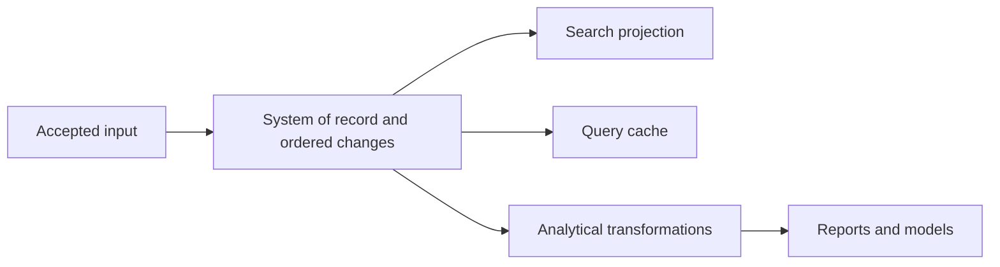
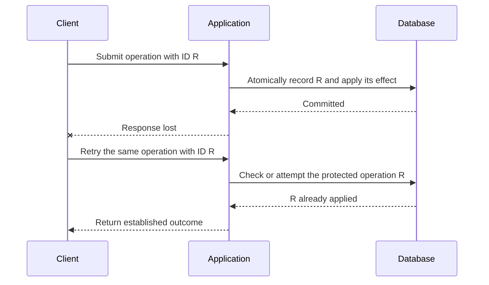

# Chapter 12: The Future of Data Systems

*Designing Data-Intensive Applications*, 2017 first edition. Printed pages 489–544.

Source: Martin Kleppmann, *Designing Data-Intensive Applications* (O'Reilly, 2017).

The central idea: **design the whole flow from authoritative input to derived results, preserve correctness across that flow, and consider the consequences for the people represented by the data.**

This chapter includes Kleppmann's architectural proposals and predictions from 2017. The useful lessons are the reasoning and trade-offs, rather than treating every prediction as a description of today's products.

**1. Make the system of record and its derived data explicit.** (pp. 490–494)

One application may need a transactional database, search index, cache, analytical tables, and machine-learning features. No single storage representation necessarily serves all those access patterns well.

Identify where a fact is first accepted and which representations are computed from it. If several systems independently accept authoritative writes to the same fact, they can process concurrent writes in different orders and permanently disagree.

CDC or an event log can establish a direction for propagation. Derived views may lag, but their updates should follow the source's required ordering and transformation rules.

A global total order is convenient but can become costly. Partitioned or independently operated systems may have no total order across all events. Where one event depends on another, the dependency must still be preserved or explicitly handled. Per-object ordering does not automatically settle cross-object constraints.

**2. Batch and stream processing are complementary tools for evolution.** (pp. 494–499)

Streaming updates derived views as new data arrives. Batch processing rebuilds a view from accumulated history. Together they allow a substantial model or algorithm change without rewriting the authoritative facts by hand.

A useful migration pattern is:

1. Keep the old view serving users.
2. Build a new view from retained history or a consistent snapshot.
3. Catch it up with subsequent changes.
4. Compare results and switch readers when ready.
5. Retire the old view after the transition is established.

The **lambda architecture** maintains a batch path for historical results and a low-latency stream path for recent data, then combines the outputs. Its difficulty is maintaining equivalent logic in two systems and merging their results correctly.

A unified processing approach aims to use the same transformation for replay and live input. It needs replayable sources, suitable failure recovery, and event-time semantics. Processing time cannot reproduce historical timing when months of input are replayed in hours.

Reprocessing also has limits: it requires the necessary source data and schema information to remain available, and external nondeterministic dependencies must be accounted for.

**3. An “unbundled database” exposes internal database ideas as separate components.** (pp. 499–504)

A database internally maintains logs, indexes, and materialized representations. A larger dataflow system can do similar work using independently chosen storage and processing tools.

For example, an application-managed search index is conceptually a derived index of the source database. The engineering challenge is to make initialization, updates, recovery, and evolution as dependable as the integrated version.

Composition increases the range of workloads a system can serve, but also increases operational work: deployment, compatibility, monitoring, and failure handling across components. The chapter explicitly favors a single integrated product when it already meets the requirements. Unbundling is useful when the requirements justify that complexity.

**4. Move work deliberately between write paths and read paths.** (pp. 504–515)

A read can compute a result on demand, or fetch a result maintained ahead of time. Materialized views, caches, and indexes all choose a point on this spectrum.

The chapter's exchange-rate example illustrates the trade-off:

| Approach | Benefit | Cost |
|---|---|---|
| Query an exchange-rate service during each purchase | Central lookup at the time of the request | Adds a synchronous dependency and its latency/failures |
| Subscribe to updates and maintain local rates | Local lookup during the purchase | Requires a freshness policy and recovery of the local copy |

Asynchronous dataflow can reduce failure propagation through synchronous call chains, but it introduces lag that the application must handle.

The same idea can extend to user interfaces: a client observes a derived view and receives updates when its source changes. A subscription is a continuing interest in future changes, whereas a one-off query ends after returning its result. Offline clients and reconnecting clients introduce familiar replication and compatibility questions.

**5. Correctness must cover the complete user operation.** (pp. 515–521)

A database transaction can prevent a partial transfer within the database. It cannot, by itself, recognize that two HTTP requests are retries of the same user's intended transfer.

Suppose a browser submits an operation, the server commits it, and the response is lost. If the browser retries with a new identity, the database sees another valid transaction.

An **end-to-end operation ID** lets every layer recognize the same logical action:

The deduplication record and effect must be coordinated. A separate “have I seen this ID?” read followed by an unprotected write still has a race. A uniqueness constraint within the same transaction is one mechanism described in the chapter.

The operation ID must identify the intended action across retries. Two genuinely different actions need different identities. Downstream consumers must preserve the same distinction if they apply additional effects.

This illustrates the **end-to-end argument**: a lower-level guarantee is useful, but complete correctness may require knowledge available only at the endpoints. Packet deduplication, message processing, and database transactions each cover a particular boundary.

**6. Route conflicting decisions together, and distinguish acceptance from a final result.** (pp. 521–524)

For a username claim, partition requests by username and process each partition in order. A processor records the first valid owner and emits a success or rejection for each request.

This can scale across independent usernames because potentially conflicting claims meet in the same place. The ordering and ownership protocol still needs to be correct; a stream does not remove the need for agreement.

A client can wait for the decision on an output stream. An acknowledgment that the request was appended is not yet a promise that the username was granted.

Operations involving several partitions require further design. Recording the intended operation as one durable event can let downstream stages derive its effects, but each stage must enforce its own ordering, constraints, duplicate handling, and recovery rules.

**7. Timeliness and integrity are different requirements.** (pp. 524–528)

| Requirement | Meaning | Example problem |
|---|---|---|
| **Timeliness** | Users see a sufficiently current state | An index has not yet received a recent update |
| **Integrity** | Data and derivations are correct, without loss or contradictory effects | A transfer is applied twice or an update is permanently missing |

Lag can disappear as processing catches up. Corruption does not necessarily repair itself through waiting.

Asynchronous processing can preserve integrity through durable input, deterministic derivation, deduplication, and recovery while allowing delayed visibility. It does not automatically satisfy a requirement for immediate, globally consistent reads.

Some businesses can accept a tentative action and later issue a **compensating action**, such as canceling an overbooking and offering an alternative. Others need an immediate hard constraint. Compensation changes the business contract; it is not equivalent to guaranteeing that the violation never happened, and it may not undo every external consequence.

The chapter argues for making this choice consciously rather than imposing the same synchronization policy on every operation.

**8. Verify integrity even when the underlying tools promise it.** (pp. 528–533)

Hardware corruption, application bugs, and database bugs can violate assumptions. Lower-level checksums do not detect every error introduced at higher layers, and a valid transaction can still implement incorrect application logic.

Useful mechanisms include independent audits, reconciliation between source and derived data, end-to-end checks, and enough provenance to explain how a result was produced.

For example, recomputing an aggregate from authoritative records can detect a drifting incremental counter. Retained events can help distinguish an incorrect input from a broken transformation. Repairability is part of a dependable architecture.

**9. Technical correctness does not settle whether a system treats people well.** (pp. 533–544)

The final section examines consequences of predictive analytics and data collection:

- Models can reproduce or amplify bias in historical data.
- Proxy features can recreate distinctions omitted from the explicit input fields.
- A false positive can be cheap for an institution but seriously harmful to the person denied an opportunity.
- Opaque decisions with no meaningful appeal make mistakes harder to challenge.
- Collecting and joining datasets changes who has power to infer, disclose, and act on personal information.

The book treats privacy as control over what is revealed, to whom, and for what purpose. Voluntarily sharing one fact does not imply agreement to every later use or inference.

Retention is an architectural decision. The convenience of immutable histories and unlimited reprocessing must be reconciled with deletion, purpose limits, and user agency. The chapter calls on engineers to consider these effects throughout system design, rather than treating them as external to engineering.

**A quick recall check:**

1. Why is an explicit system of record helpful when maintaining a search index and cache?
2. Why can a successful database transaction still lead to a duplicated user action?
3. How does an asynchronous username check distinguish request acceptance from success?
4. What is the difference between a stale result and a corrupt result?
5. Why does an accurate prediction not automatically make a decision fair?

Suggested answers

1. It establishes where facts and their order originate, so other representations can be rebuilt and updated from a defined source.
2. A lost response can cause the user to submit the same logical action again as a new transaction. An end-to-end operation identity is needed to recognize the retry.
3. Appending accepts the request for processing. The ordered constraint check later emits the decision, which the client must await before treating the claim as granted.
4. A stale result may become current through normal catch-up. A corrupt result violates the intended computation or integrity rules and may require repair.
5. Decisions also involve purpose, consequences, unequal error costs, bias, and the ability to challenge mistakes. Predictive performance alone does not resolve those questions.

This completes the book's progression from individual storage engines to distributed guarantees, derived data, and the responsibilities of system designers.
