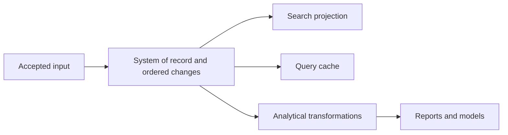
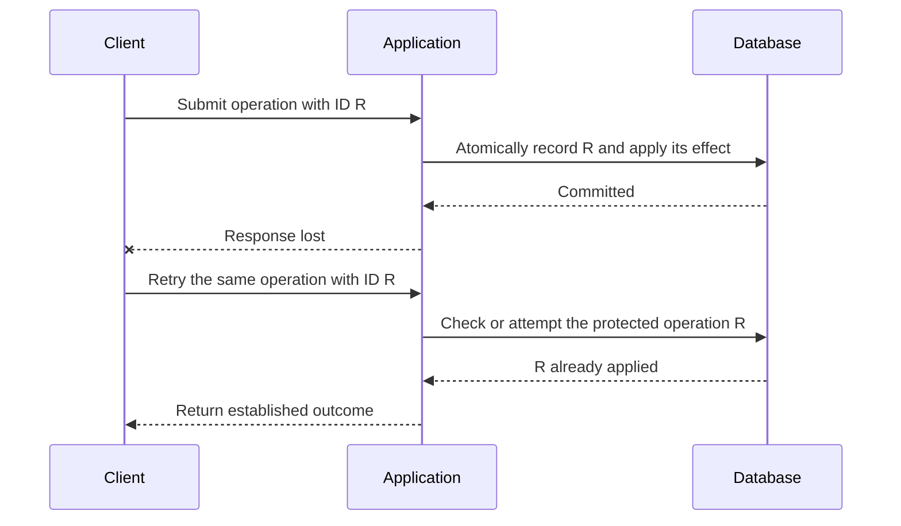
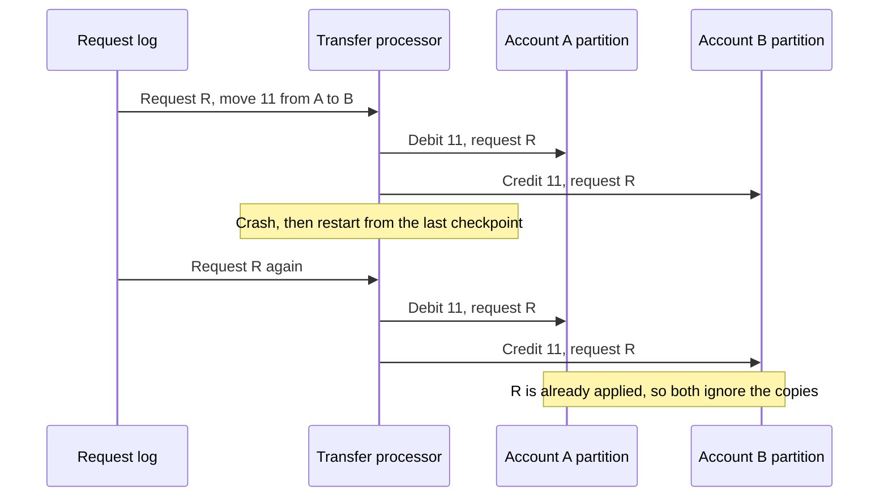

# Chapter 12: The Future of Data Systems

*Designing Data-Intensive Applications*, 2017 first edition. Printed pages 489–544.

Source: Martin Kleppmann, *Designing Data-Intensive Applications* (O'Reilly, 2017).

The central idea: **design the whole flow from authoritative input to derived results, preserve correctness across that flow, and consider the consequences for the people represented by the data.**

This chapter includes Kleppmann's architectural proposals and predictions from 2017. The useful lessons are the reasoning and trade-offs, rather than treating every prediction as a description of today's products.

**1. Make the system of record and its derived data explicit.** (pp. 490–494)

One application may need a transactional database, search index, cache, analytical tables, and machine-learning features. No single storage representation necessarily serves all those access patterns well.

Identify where a fact is first accepted and which representations are computed from it. If several systems independently accept authoritative writes to the same fact, they can process concurrent writes in different orders and permanently disagree.

This is the dual-write race from Chapter 11. If the application writes to both the database and the search index, one can end with X = B and the other with X = A, because neither decides the order for both. If CDC is the only way the index gets updated, the index is derived from the database and applies writes in the database's order.

CDC or an event log can establish a direction for propagation. Derived views may lag, but their updates should follow the source's required ordering and transformation rules.

The classic alternative is a distributed transaction across all the systems. The book compares the two:

| Concern | Distributed transactions | Log-based derived data |
|---|---|---|
| Order of writes | Decided with locks | Decided by the log |
| Exactly-once effect | Atomic commit | Deterministic retry and idempotence |
| Reading your own writes | Usually yes, since they are usually linearizable | Not by default, since derived views update asynchronously |

Kleppmann considers XA weak on both fault tolerance and performance, so he sees log-based derived data as the most promising way to integrate different systems. Still, he rejects telling everyone to simply live with eventual consistency. Points 5 to 7 work toward a middle ground.

A global total order is convenient but can become costly. Partitioned or independently operated systems may have no total order across all events. Where one event depends on another, the dependency must still be preserved or explicitly handled. Per-object ordering does not automatically settle cross-object constraints.

The book's example: a user removes their ex as a friend, then sends their remaining friends a message complaining about the ex. If friendships and messages live in different systems, a notification service may process the message before the unfriend event and notify the ex anyway. The book offers no simple fix. Starting points include logical timestamps and events that reference the ID of an earlier event the user saw. Conflict resolution can repair stored state, but not a notification already sent.

**2. Batch and stream processing are complementary tools for evolution.** (pp. 494–498)

Streaming updates derived views as new data arrives. Batch processing rebuilds a view from accumulated history. Together they allow a substantial model or algorithm change without rewriting the authoritative facts by hand.

A useful migration pattern is:

1. Keep the old view serving users.
2. Build a new view from retained history or a consistent snapshot.
3. Catch it up with subsequent changes.
4. Compare results and switch readers when ready.
5. Retire the old view after the transition is established.

Readers can move gradually, a small share of users first, and every stage is reversible because the old view keeps working. The book compares this to how railways in 19th-century England moved to one standard track gauge: add a third rail so trains of both gauges can run, convert the trains, then remove the rail that only old trains used.

The **lambda architecture** maintains a batch path for historical results and a low-latency stream path for recent data, then combines the outputs. Its difficulty is maintaining equivalent logic in two systems and merging their results correctly.

As proposed, a stream processor such as Storm gives a quick approximate update, and a batch system such as Hadoop MapReduce later computes the corrected view. Merging is easy for a simple count per tumbling window, but much harder for views built with joins or sessionization. Reprocessing all history every time is also expensive, so the batch path often processes hourly increments instead. That brings back stream problems, such as late events and windows that cross batch boundaries.

A unified processing approach aims to use the same transformation for replay and live input. It needs replayable sources, exactly-once semantics when faults occur, and event-time semantics. Processing time cannot reproduce historical timing when months of input are replayed in hours.

Reprocessing also has limits: it requires the necessary source data and schema information to remain available, and external nondeterministic dependencies must be accounted for.

**3. An “unbundled database” exposes internal database ideas as separate components.** (pp. 499–504)

A database internally maintains logs, indexes, and materialized representations. A larger dataflow system can do similar work using independently chosen storage and processing tools.

Consider what `CREATE INDEX` does inside one database:

1. Scan a consistent snapshot of the table, then sort and write out the indexed values.
2. Apply the writes that arrived since the snapshot was taken.
3. Keep updating the index on every later write.

This is much the same procedure as setting up a new follower replica, or starting a CDC consumer from a snapshot plus a log position.

For example, an application-managed search index is conceptually a derived index of the source database. The engineering challenge is to make initialization, updates, recovery, and evolution as dependable as the integrated version.

Seen this way, an organization's whole dataflow behaves like a single giant database. Batch, stream, and ETL jobs act like triggers and index maintenance, and each derived system plays the role of one more kind of index. The book sees two ways to make such pieces work as one system:

| Approach | What it unifies | Tradition it follows | Example |
|---|---|---|---|
| **Federated database** (polystore) | Reads: one query interface over many stores | Relational: one high-level query language | PostgreSQL's foreign data wrappers |
| **Unbundled database** | Writes: CDC and event logs carry each change to every store | Unix: small tools joined by pipes | A search index kept in sync by CDC |

Kleppmann thinks keeping writes in sync is the harder problem, so he focuses on unbundling. Between different technologies, he prefers an asynchronous event log with idempotent consumers over distributed transactions, since no standard transaction protocol spans systems built by different groups. The log also gives loose coupling at two levels. For the system, a slow or failed consumer just falls behind while the log buffers its input, so the fault stays contained. For people, different teams can build and run each component on their own.

The book says the missing piece is an equivalent of the Unix shell for composing such systems. Something like `mysql | elasticsearch` would then index every document in a MySQL database into Elasticsearch and keep applying new changes, with no custom application code.

Composition increases the range of workloads a system can serve, but also increases operational work: deployment, compatibility, monitoring, and failure handling across components. The chapter explicitly favors a single integrated product when it already meets the requirements. Unbundling is useful when the requirements justify that complexity.

**4. Move work deliberately between write paths and read paths.** (pp. 504–515)

A read can compute a result on demand, or fetch a result maintained ahead of time. Materialized views, caches, and indexes all choose a point on this spectrum.

The book's search example shows three points on it:

| Approach | Write path | Read path |
|---|---|---|
| No index | Just store the document | Scan every document, like `grep` |
| Full-text index | Tokenize the document and update the index | Look up the query's terms in the index |
| Cache of common queries | Also update any cached results the new document belongs in | Return the cached result, or use the index for rarer queries |

Precomputing results for every possible query is impossible, since the set of possible queries is infinite. Twitter's home timelines from Chapter 1 draw this line per user: most tweets are copied into followers' timelines on write, but celebrities' tweets are fetched at read time.

Composing storage and processing systems with application code like this is also called the “database inside-out” approach. The goal is spreadsheet-like: when a record changes, every index, cache, and view that depends on it updates automatically. Keeping derived data correct is stricter than running background jobs from a queue. Views derived from one log must apply its events in the same order, yet many message brokers reorder messages when they redeliver them. And a single lost message leaves a derived view wrong for good. Even so, meeting these demands is much cheaper and more robust than using distributed transactions.

The chapter's exchange-rate example illustrates the trade-off:

| Approach | Benefit | Cost |
|---|---|---|
| Query an exchange-rate service during each purchase | Central lookup at the time of the request | Adds a synchronous dependency and its latency/failures |
| Subscribe to updates and maintain local rates | Faster local lookup, and purchases still work if the rate service is down | Must keep consuming rate updates, and the local copy can lag |

The book calls the dataflow version a stream-table join between purchases and rate updates. The join is time-dependent: to reprocess old purchases later, you need the rate at each original purchase time, whichever approach you use.

Asynchronous dataflow can reduce failure propagation through synchronous call chains, but it introduces lag that the application must handle.

The same idea can extend to user interfaces: a client observes a derived view and receives updates when its source changes. A subscription is a continuing interest in future changes, whereas a one-off query ends after returning its result. Offline clients and reconnecting clients introduce familiar replication and compatibility questions.

For example, server-sent events and WebSockets let a server push changes to a browser over an open connection, extending the write path all the way to the user's screen. A device that was offline can catch up the way a log consumer does, by resuming from the last offset it processed.

The book goes one step further: **reads are events too**. If read requests also flow through the stream processor, serving a read becomes a stream-table join of the query stream with the stored data. Logging reads also records what a user saw before deciding, such as the predicted shipping date and stock status shown before a purchase. Later events can then reference that read, which helps with the causality problem from point 1, at extra storage and I/O cost.

**5. Correctness must cover the complete user operation.** (pp. 515–520)

A database transaction can prevent a partial transfer within the database. It cannot, by itself, recognize that two HTTP requests are retries of the same user's intended transfer.

The book's example is a transaction that moves $11 from one account to another. TCP drops duplicate packets, but only within one connection. If the connection breaks after COMMIT, the client can't tell whether the transaction committed, and a retry on a new connection could move $22. Two-phase commit lets a coordinator reconnect and settle an in-doubt transaction, but the hop between the user's device and the application server is still unprotected.

Suppose a browser submits an operation, the server commits it, and the response is lost. If the browser retries with a new identity, the database sees another valid transaction.

An **end-to-end operation ID** lets every layer recognize the same logical action:

The deduplication record and effect must be coordinated. A separate “have I seen this ID?” read followed by an unprotected write still has a race. A uniqueness constraint within the same transaction is one mechanism described in the chapter.

In the book's version, the table of request IDs also acts as an event log. The balance updates could be derived from it downstream, as long as each request is processed exactly once, which the same ID can enforce. Point 6 builds on this.

The operation ID must identify the intended action across retries. The book suggests a UUID in a hidden form field, or a hash of the relevant form fields. Two genuinely different actions need different identities. Downstream consumers must preserve the same distinction if they apply additional effects.

This illustrates the **end-to-end argument**, stated by Saltzer, Reed, and Clark in 1984: a lower-level guarantee is useful, but complete correctness may require knowledge available only at the endpoints. Packet deduplication, message processing, and database transactions each cover a particular boundary.

**6. Route conflicting decisions together, and distinguish acceptance from a final result.** (pp. 521–524)

For a username claim, partition requests by username and process each partition in order. A processor records the first valid owner and emits a success or rejection for each request.

This can scale across independent usernames because potentially conflicting claims meet in the same place. The ordering and ownership protocol still needs to be correct; a stream does not remove the need for agreement.

A client can wait for the decision on an output stream. An acknowledgment that the request was appended is not yet a promise that the username was granted.

Operations involving several partitions require further design. Recording the intended operation as one durable event can let downstream stages derive its effects, but each stage must enforce its own ordering, constraints, duplicate handling, and recovery rules.

The book's example reuses the $11 transfer from point 5: payer A sends money to payee B. The request ID, A, and B may each live in a different partition. A traditional database would run it as one atomic commit spanning the three partitions, and that cross-partition coordination tends to cut throughput. Partitioned logs avoid it:

1. The client gives the transfer a unique request ID and appends it as one message to a log partition chosen by that ID. Writing one message is atomic, so the request is either logged or not.
2. A processor reads the request and emits a debit instruction to A's partition and a credit instruction to B's partition, both tagged with the request ID.
3. Processors for each account apply the instructions and skip any request ID they have already applied.

If the processor in step 2 crashes, it restarts from its last checkpoint and may emit the same instructions again. It is deterministic, so the copies are identical, and step 3 drops them:

Each transfer is applied exactly once to both accounts, without an atomic commit across partitions. To prevent overdrafts, a processor partitioned by the payer's account can validate requests before they enter the log in step 1.

**7. Timeliness and integrity are different requirements.** (pp. 524–528)

| Requirement | Meaning | Example problem |
|---|---|---|
| **Timeliness** | Users see a sufficiently current state | An index has not yet received a recent update |
| **Integrity** | Data and derivations are correct, without loss or contradictory effects | A transfer is applied twice or an update is permanently missing |

Lag can disappear as processing catches up. Corruption does not necessarily repair itself through waiting.

The book argues that the word consistency mixes up these two requirements. In most applications, integrity matters much more: stale data is a nuisance, but corrupt data can be a disaster.

The book's example is a credit card statement. If a purchase from the last 24 hours does not show up yet, that is a normal timeliness lag. If the balance does not equal the previous balance plus the new transactions, or you are charged but the merchant is never paid, integrity is broken. Put briefly, a timeliness violation is eventual consistency, while an integrity violation is perpetual inconsistency.

ACID transactions normally give you timeliness and integrity together, so the difference rarely shows. Event-based dataflow decouples them. Asynchronous processing can preserve integrity through durable input, deterministic derivation, deduplication, and recovery while allowing delayed visibility. It does not automatically satisfy a requirement for immediate, globally consistent reads.

Some businesses can accept a tentative action and fix a violation later with a **compensating transaction**, such as apologizing to one of two people who booked the same seat and asking them to pick another. Others need an immediate hard constraint. Compensation changes the business contract; it is not equivalent to guaranteeing that the violation never happened, and it may not undo every external consequence.

Compensation is common in practice. Airlines and hotels overbook on purpose. If a warehouse sells more than it has, it orders more stock and apologizes, the same process it needs anyway if a forklift destroys some stock. A double card charge is fixed with a refund, at the cost of some fees and perhaps a complaint. If someone withdraws more than their balance, the bank charges an overdraft fee and asks for the money back, and a daily withdrawal limit caps its risk.

These applications still need integrity: no lost bookings, and no money lost because a debit has no matching credit. What they can relax is the timeliness of the constraint check. They can write optimistically and check the constraint afterward, as long as validation still happens before any step that is expensive to undo.

Put this together with the integrity mechanisms above and you get what the book calls **coordination-avoiding data systems**. They keep strong integrity with no atomic commit and no synchronous coordination between partitions, which helps both performance and fault tolerance. For example, they can run multi-leader across datacenters, with each one operating independently. The price is weak timeliness: such a system cannot be linearizable. Serializable transactions still have a place in small, local scopes, and synchronous coordination is still worth adding where a strict constraint must hold before an action that cannot be undone.

The chapter argues for making this choice consciously rather than imposing the same synchronization policy on every operation. In the book's terms, coordination means fewer apologies for inconsistent data, but possibly more for outages.

**8. Verify integrity even when the underlying tools promise it.** (pp. 528–533)

Hardware corruption, application bugs, and database bugs can violate assumptions. Lower-level checksums do not detect every error introduced at higher layers, and a valid transaction can still implement incorrect application logic. Even mature databases have such bugs: Kleppmann has seen MySQL fail to keep a uniqueness constraint, and PostgreSQL's serializable level allow write skew.

Useful mechanisms include independent audits, reconciliation between source and derived data, end-to-end checks, and enough provenance to explain how a result was produced.

For example, recomputing an aggregate from authoritative records can detect a drifting incremental counter. Retained events can help distinguish an incorrect input from a broken transformation. Repairability is part of a dependable architecture.

The book's own examples of “trust, but verify”: HDFS and Amazon S3 treat disks as fallible: background processes keep reading files back and comparing them with other replicas. Likewise, try restoring from backups now and then, or you may find a broken backup only after losing data. Event sourcing helps audits: you can hash the event log to detect corruption, and rerun the derivation to check that derived state comes out the same. Continuous end-to-end checks work like automated tests: they catch problems early, so you can change the system with more confidence. The book also finds cryptographic integrity checks promising, such as the Merkle trees behind certificate transparency, while staying skeptical of blockchains' Byzantine fault tolerance and calling proof of work wasteful.

**9. Technical correctness does not settle whether a system treats people well.** (pp. 533–544)

The final section examines consequences of predictive analytics and data collection:

- Models can reproduce or amplify bias in historical data.
- Proxy features can recreate distinctions omitted from the explicit input fields.
- A false positive can be cheap for an institution but seriously harmful to the person denied an opportunity. Someone labeled risky may be refused jobs, travel, insurance, and housing again and again, which the book calls “algorithmic prison.”
- Opaque decisions with no meaningful appeal make mistakes harder to challenge.
- Feedback loops can make harm self-reinforcing. If employers screen by credit score, a worker hit by bad luck misses bills, finds work harder to get, and slips further. Recommendation systems can likewise build echo chambers. The book urges systems thinking: consider the whole system, including the people in it.
- Collecting and joining datasets changes who has power to infer, disclose, and act on personal information.

On data collection, the book asks whom the system serves. If users store data because they want the service to process it, they are the customer. If ads fund the service, the advertisers are the real customers, and tracking grows into what the book bluntly calls surveillance. Accepting a privacy policy is weak consent: users don't know what is collected or how it is processed, data about one user also describes people who never agreed, the service alone sets the terms, and opting out of a service most people treat as essential has a real social cost.

The book treats privacy as a decision right: the ability to decide what to share, with whom, and what to keep private. Voluntarily sharing one fact does not imply agreement to every later use or inference. Surveillance moves that decision right to the company, which may expose sensitive facts in roundabout ways, such as ad targeting aimed at people with a certain illness.

Retention is an architectural decision. Critics call stored personal data a “toxic asset”: it can leak in a breach, be sold when a company fails, or be demanded by a future government. The convenience of immutable histories and unlimited reprocessing must be reconciled with deletion, purpose limits, and user agency. The book suggests purging data once it is no longer needed, and enforcing access with cryptography rather than policy alone. The chapter calls on engineers to consider these effects throughout system design, rather than treating them as external to engineering.

**A quick recall check:**

1. Why is an explicit system of record helpful when maintaining a search index and cache?
2. Why can a successful database transaction still lead to a duplicated user action?
3. How does an asynchronous username check distinguish request acceptance from success?
4. What is the difference between a stale result and a corrupt result?
5. Why does an accurate prediction not automatically make a decision fair?
6. How do log-based derived data and distributed transactions differ in ordering writes and applying them exactly once?
7. What does a coordination-avoiding data system keep, and what does it give up?

Suggested answers

1. It establishes where facts and their order originate, so other representations can be rebuilt and updated from a defined source.
2. A lost response can cause the user to submit the same logical action again as a new transaction. An end-to-end operation identity is needed to recognize the retry.
3. Appending accepts the request for processing. The ordered constraint check later emits the decision, which the client must await before treating the claim as granted.
4. A stale result may become current through normal catch-up. A corrupt result violates the intended computation or integrity rules and may require repair.
5. Decisions also involve purpose, consequences, unequal error costs, bias, and the ability to challenge mistakes. Predictive performance alone does not resolve those questions.
6. Distributed transactions order writes with locks and use atomic commit. Log-based systems take the order from the log and use deterministic retry and idempotence. Transactions also usually give linearizability, such as reading your own writes, while derived views update asynchronously.
7. It keeps strong integrity through single-message writes, deterministic derivation, and end-to-end request IDs, and it checks loose constraints after the fact, apologizing when needed. It gives up timeliness, since it cannot be linearizable, and gains performance and fault tolerance, for example letting each datacenter run independently.

This completes the book's progression from individual storage engines to distributed guarantees, derived data, and the responsibilities of system designers.
